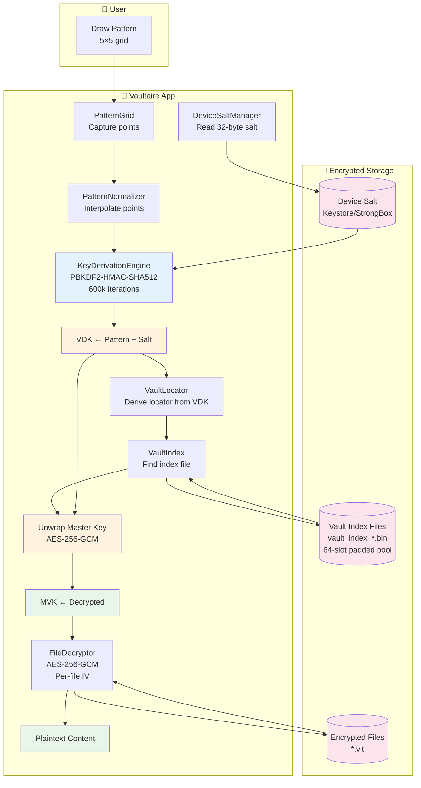
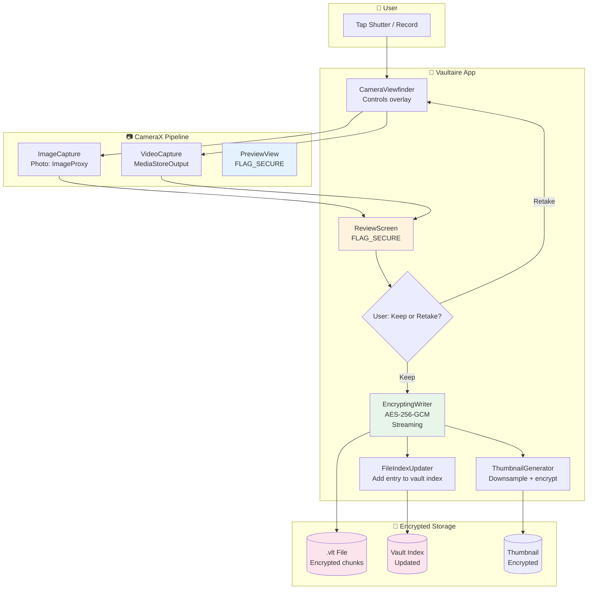
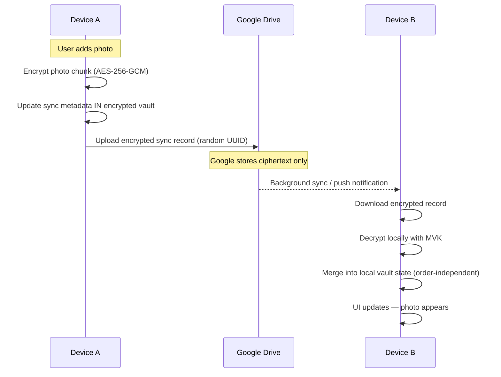
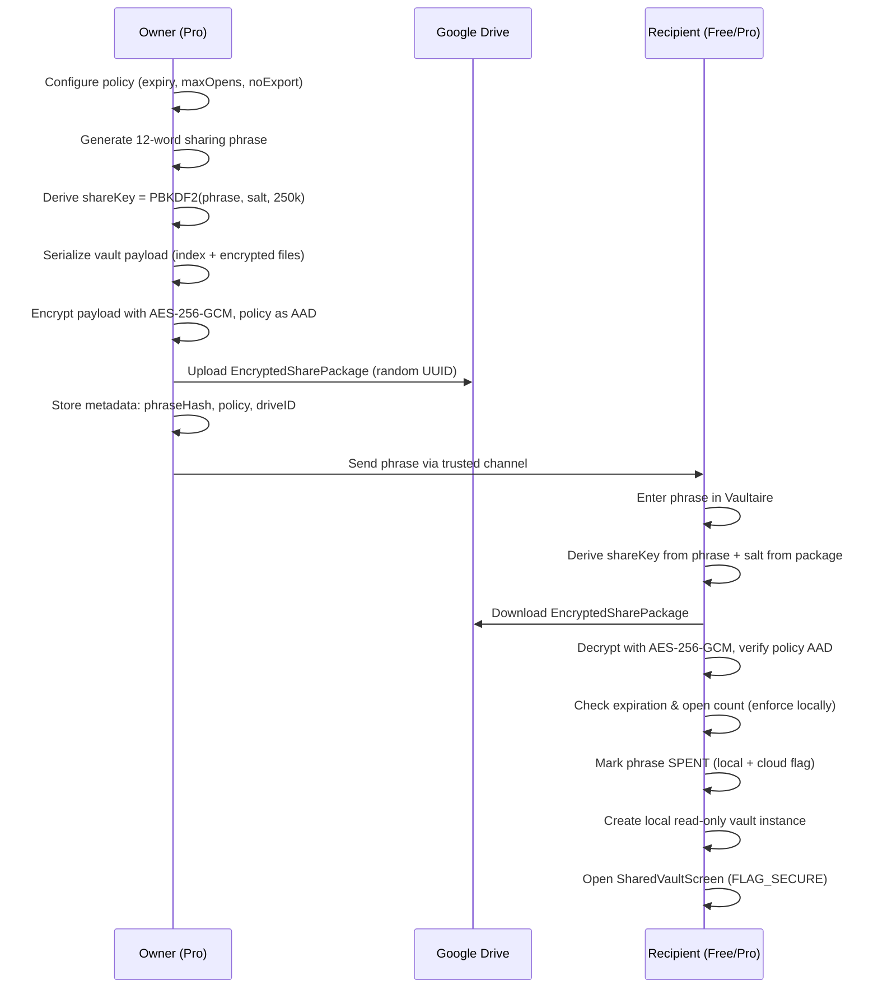
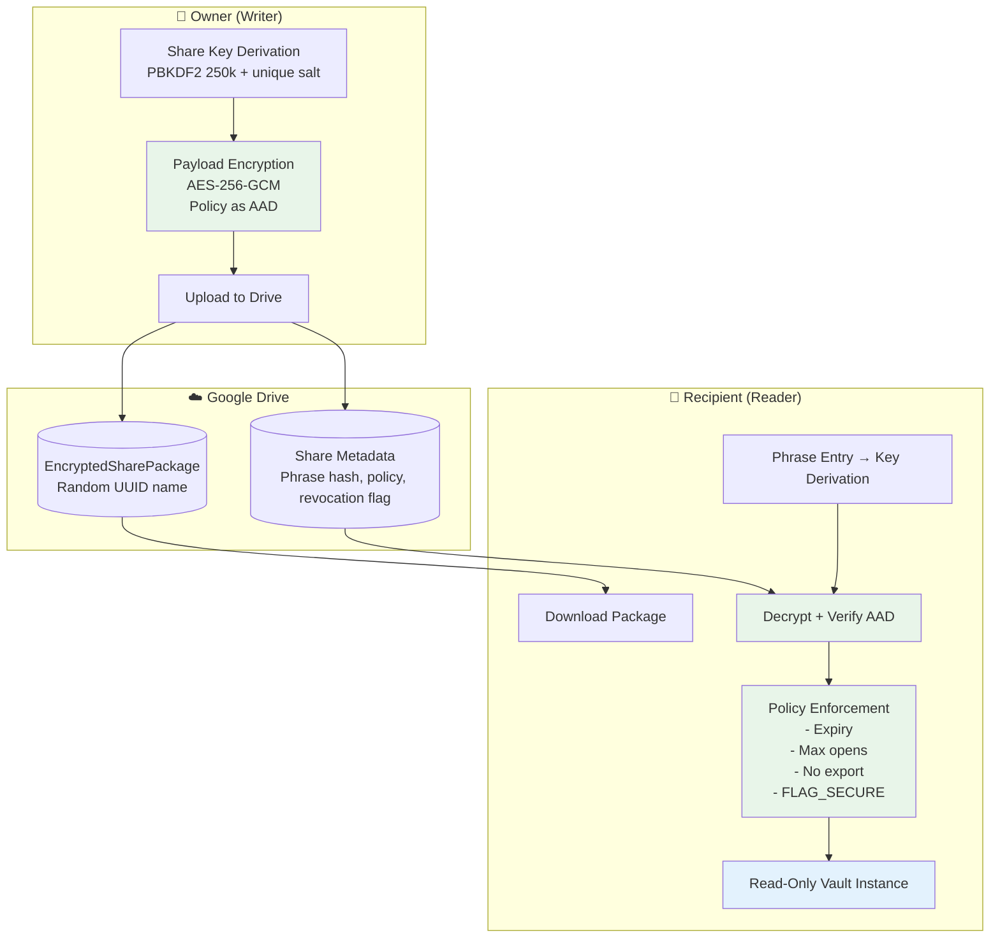

# Vaultaire Android — Data Flow Diagrams (DFDs)

> **Mermaid DFDs** showing data movement, trust boundaries, and encryption boundaries.

---

## 1. Pattern → VDK → Vault Discovery → MVK → File Decrypt



### Trust Boundaries
| Boundary | Data Crossing | Protection |
|----------|---------------|------------|
| User → App | Pattern points | Local only, never logged |
| App → Storage | Salt read | Keystore/StrongBox |
| App → Storage | Index file read | Encrypted at rest |
| App → Storage | File read | AES-256-GCM encrypted |
| App Internal | VDK, MVK | Memory only, zeroed on lock |

---

## 2. Camera Capture → Encrypted Stream → Storage



### Encryption Details
- **Photo**: Single AES-256-GCM operation, 12-byte IV, 128-bit tag
- **Video**: Segmented encryption (1MB chunks), each with unique IV
- **No temp files**: CameraX → ParcelFileDescriptor pipe → EncryptingWriter
- **Thumbnail**: Generated from decrypted stream, then encrypted separately

---

## 3. Backup: Local Encrypt → Drive Upload

```mermaid
flowchart TD
    subgraph App ["📱 Vaultaire App"]
        A1[BackupScheduler\nWorkManager 24h/Wi-Fi/idle]
        A2[BackupKeyDerivation\nPBKDF2 600k\nDIFFERENT context from VDK]
        A3[BackupEncryptionEngine\nAES-256-GCM\n10MB padded records]
        A4[DriveUploader\nGoogle Drive API v3\nAppData folder]
        A5[BackupMetadata\nVersion, timestamp, size]
    end
    
    subgraph Local ["💾 Local Storage"]
        L1[(Vault Files\n*.vlt)]
        L2[(Vault Index)]
        L3[(Device Salt)]
    end
    
    subgraph Cloud ☁️ ["☁️ Google Drive"]
        C1[(AppData Folder\nEncrypted backup records\nRandom UUID names)]
        C2[(Backup Manifest\nv1, v2, v3...)]
    end
    
    subgraph Google ["🔍 Google Visibility"]
        G1[File existence]
        G2[File sizes (padded)]
        G3[Timestamps]
        G4[Record counts]
        G5[Account ID]
    end
    
    A1 --> A2
    A2 --> L3
    A2 --> A3
    A3 --> L1
    A3 --> L2
    A3 --> A4
    A4 --> C1
    A4 --> C2
    A4 --> A5
    C1 --> G1
    C1 --> G2
    C1 --> G3
    C2 --> G4
    A5 --> C2
    
    style A2 fill:#fff3e0
    style A3 fill:#e8f5e9
    style C1 fill:#fce4ec
    style G1 fill:#fff3e0
    style G2 fill:#fff3e0
```

### What Google Sees vs. Doesn't See
| Visible to Google | Hidden from Google |
|-------------------|-------------------|
| File exists in AppData | Vault plaintext |
| Padded file sizes (~10MB) | Backup key |
| Modification timestamps | Pattern-derived keys |
| Account ID | Recovery phrase |
| Record counts | File names/types |
| | Content hashes |

---

## 4. Sync: Local Change → Vector Clock → Drive → Merge



### Merge Algorithm (Order-Independent)

```mermaid
flowchart TD
    subgraph Merge["🔀 Merge Logic (on each device)"]
        M1[Collect all sync records\nfrom Drive]
        M2[Sort by vector clock\npartial ordering]
        M3[For each file:\n- Add if not seen\n- Delete if seen AND delete marker\n- Ignore delete if add not seen]
        M4[Collapse identical files\n(same content = same chunks)]
        M5[Update local vector clock]
        M6[Write merged state\nto local vault]
    end
    
    M1 --> M2
    M2 --> M3
    M3 --> M4
    M4 --> M5
    M5 --> M6
    
    style M3 fill:#e8f5e9
    style M4 fill:#e8f5e9
```

### Vector Clock Structure
```kotlin
data class VectorClock(
    val deviceClocks: Map<String, Long> // deviceId → logical time
) {
    fun increment(deviceId: String): VectorClock
    fun merge(other: VectorClock): VectorClock
    fun happensBefore(other: VectorClock): Boolean
    fun concurrentWith(other: VectorClock): Boolean
}
```

### Merge Rules (from vaultaire.app)
1. **Adds win over deletes** that did not see the added file
2. **Identical files collapse** (same content = same encrypted chunks = deduplicated)
3. **Order-independent** — same result regardless of arrival order
4. **Delete only removes** a file once that device's history shows it had seen that file

---

## 5. Share: Owner Encrypt → Drive → Recipient Decrypt



### Trust Model Enforcement



### Policy as AAD (Additional Authenticated Data)
```kotlin
data class SharePolicy(
    val expiration: Instant? = null,
    val maxOpens: Int = Int.MAX_VALUE,
    val disableExport: Boolean = false,
    val version: Int = 1
) {
    fun toAAD(): ByteArray = JSON.encodeToByteArray(this)
}

// Encryption
val cipher = Cipher.getInstance("AES/GCM/NoPadding")
cipher.init(Cipher.ENCRYPT_MODE, shareKey, gcmSpec)
cipher.updateAAD(policy.toAAD()) // Policy bound to ciphertext
val ciphertext = cipher.doFinal(payload)

// Decryption - ANY policy modification breaks auth tag
cipher.init(Cipher.DECRYPT_MODE, shareKey, gcmSpec)
cipher.updateAAD(policy.toAAD()) // Must match EXACT policy
val plaintext = cipher.doFinal(ciphertext) // Throws AEADBadTagException if tampered
```

---

## 6. Duress: Pattern Hash Match → Multi-pass Wipe → Decoy Launch

```mermaid
flowchart TD
    subgraph Entry["🔐 Pattern Entry"]
        E1[User draws pattern]
        E2[AttemptThrottler\nCheck state]
        E3[DuressConfigManager\nConstant-time SHA-256 compare]
    end
    
    subgraph Trigger["⚡ Duress Trigger"]
        T1{Duress pattern\nmatched?}
        T2[DuressWipeProtocol\nSTART ASYNC]
    end
    
    subgraph Wipe["🧹 Multi-pass Wipe"]
        W1[List all non-decoy\nvault .dat files]
        W2[Pass 1: Overwrite 3x\nrandom bytes]
        W3[Pass 2: Overwrite 1x\nzeros]
        W4[Delete files\nFileChannel.force(true)]
        W5[Clear vault indexes\nfrom padded pool]
        W6[Clear recovery\nenvelopes from Keystore]
        W7[Clear sync metadata\nMark duress-isolated]
    end
    
    subgraph Decoy["🎭 Decoy Launch"]
        D1[SyncEngine paused\nisolated]
        D2[Open decoy vault\nNormal UI]
    end
    
    subgraph Peers["📱 Peer Devices"]
        P1[Next sync:\nDetect duress flag]
        P2[Pause sync for\nthis device ID]
        P3[Vaults intact\nCloud backups intact]
    end
    
    E1 --> E2
    E2 --> E3
    E3 --> T1
    T1 -->|No| Normal[Normal unlock]
    T1 -->|Yes| T2
    T2 --> W1
    W1 --> W2
    W2 --> W3
    W3 --> W4
    W4 --> W5
    W5 --> W6
    W6 --> W7
    W7 --> D1
    D1 --> D2
    D2 --> P1
    P1 --> P2
    P2 --> P3
    
    style T2 fill:#ffebee
    style W2 fill:#ffebee
    style W3 fill:#ffebee
    style W4 fill:#ffebee
    style D2 fill:#fff3e0
```

### Wipe Implementation Details
```kotlin
class DuressWipeProtocol {
    suspend fun execute(decoyVaultId: String) {
        // 1. Identify non-decoy files
        val targetFiles = vaultStorage.listFiles()
            .filter { it.vaultId != decoyVaultId }
        
        // 2. Multi-pass overwrite (async, no UI)
        for (file in targetFiles) {
            overwritePass(file, passes = 3, random = true)
            overwritePass(file, passes = 1, random = false) // zeros
            file.delete()
        }
        
        // 3. Clear indexes
        vaultIndexManager.clearNonDecoyIndexes(decoyVaultId)
        
        // 4. Clear Keystore
        keyStore.clearRecoveryEnvelopes()
        keyStore.clearPatternEnvelopes(exceptDecoy = decoyVaultId)
        
        // 5. Sync isolation
        syncEngine.markDeviceDuressIsolated()
        
        // 6. Launch decoy
        startActivity(DecoyVaultIntent(decoyVaultId))
    }
    
    private suspend fun overwritePass(file: File, passes: Int, random: Boolean) {
        for (i in 1..passes) {
            val buffer = ByteArray(8192)
            if (random) SecureRandom().nextBytes(buffer) else buffer.fill(0)
            val channel = FileChannel.open(file.toPath(), StandardOpenOption.WRITE)
            var remaining = file.length()
            while (remaining > 0) {
                val write = min(remaining, buffer.size.toLong())
                channel.write(ByteBuffer.wrap(buffer, 0, write.toInt()))
                remaining -= write
            }
            channel.force(true)
        }
    }
}
```

---

## Trust Boundaries Summary

| Boundary | Data Flow | Encryption | Key Management |
|----------|-----------|------------|----------------|
| User ↔ App | Pattern, phrase, files | Local only | Device-bound |
| App ↔ Local Storage | Vault files, indexes | AES-256-GCM | MVK wrapped by VDK/RK |
| App ↔ Google Drive | Backup records, sync records, share packages | AES-256-GCM (padded) | Backup key, sync keys, share keys |
| App ↔ Camera | Preview, captures | FLAG_SECURE (preview), encrypted at rest | Per-file keys |
| Device ↔ Device (Sync) | Encrypted sync records | AES-256-GCM | MVK (same vault) |
| Owner ↔ Recipient (Share) | Share phrase, encrypted package | AES-256-GCM + policy AAD | Share key from phrase |
| Duress Trigger | Pattern hash match | Constant-time compare | SHA-256 hash in Keystore |

---

## Key Hierarchy

```
Device Salt (32 bytes, StrongBox)
    │
    ├── Pattern → PBKDF2(600k) → VDK → Wraps MVK (Pattern Envelope)
    ├── Recovery Phrase → PBKDF2(800k) → RK → Wraps MVK (Recovery Envelope)
    ├── Backup Context → PBKDF2(600k) → Backup Key → Wraps Backup Data
    ├── Share Phrase → PBKDF2(250k) → Share Key → Encrypts Share Package
    └── Duress Pattern → SHA-256 → Stored Hash → Triggers Wipe

MVK (256-bit random)
    │
    ├── Encrypts Vault Index (file map, metadata)
    ├── Encrypts File Chunks (per-file IV)
    └── Derives Sync Keys (per-device)
```

---

## Data Classification

| Data | Classification | Storage | Transmission |
|------|----------------|---------|--------------|
| Pattern drawing | Secret | Memory only (zeroed) | Never |
| Recovery phrase | Secret | Keystore (encrypted) | Never |
| Device salt | Secret | StrongBox | Never |
| VDK / RK / Backup Key / Share Key | Secret | Memory only | Never |
| MVK | Secret | Wrapped in envelopes | Never |
| Vault files | Confidential | AES-256-GCM (.vlt) | Encrypted to Drive |
| Vault index | Confidential | AES-256-GCM | Encrypted to Drive |
| Sync metadata | Confidential | Inside vault | Encrypted to Drive |
| Share package | Confidential | AES-256-GCM + AAD | Encrypted to Drive |
| Backup records | Confidential | AES-256-GCM (padded) | Encrypted to Drive |
| Thumbnails | Confidential | AES-256-GCM | Local only |
| App usage analytics | Anonymous | Local aggregated | Opt-in, no PII |