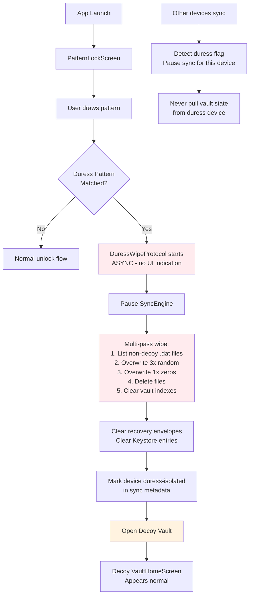
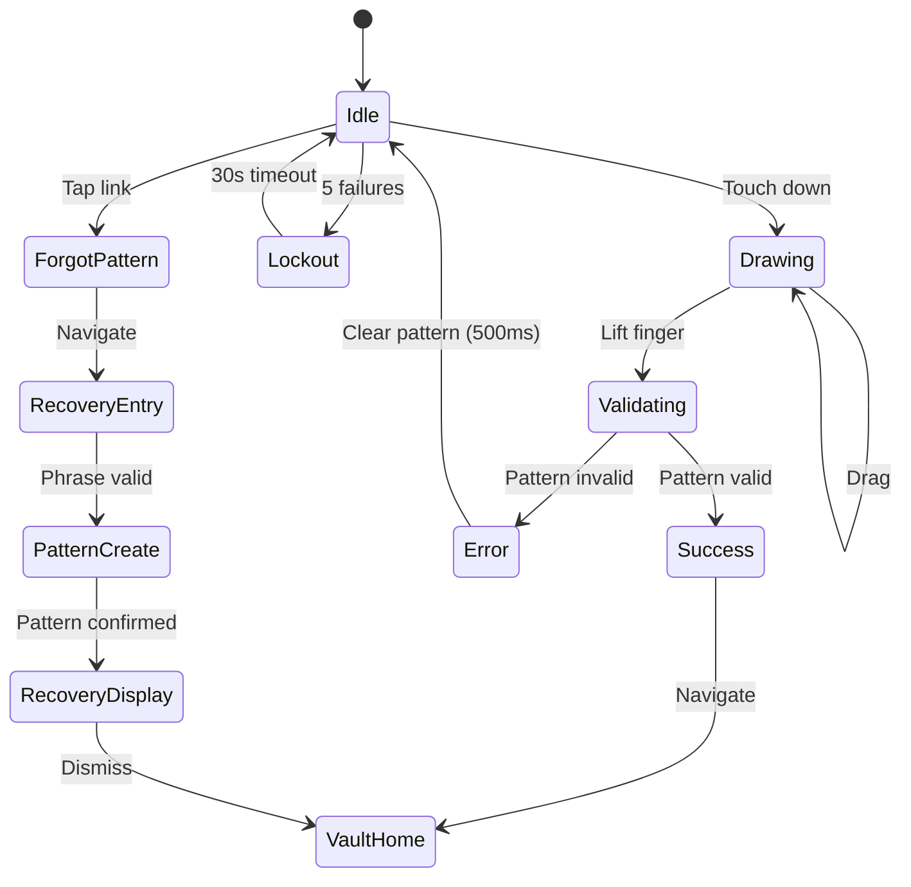
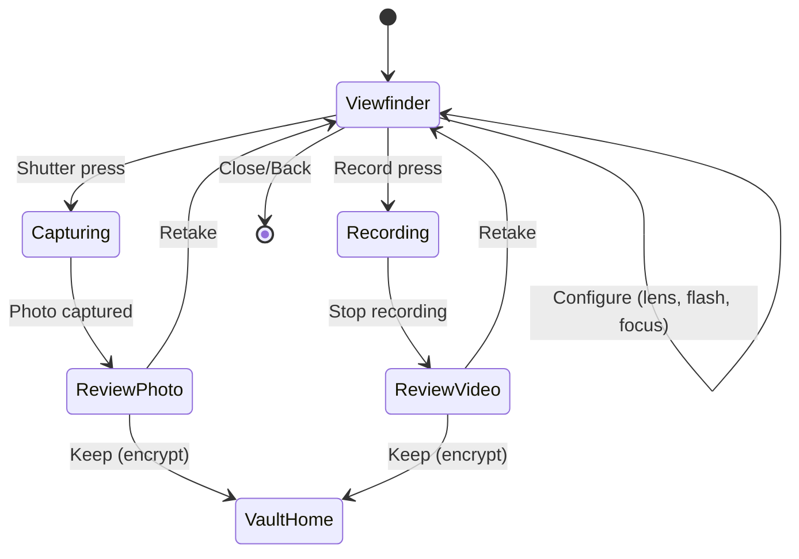
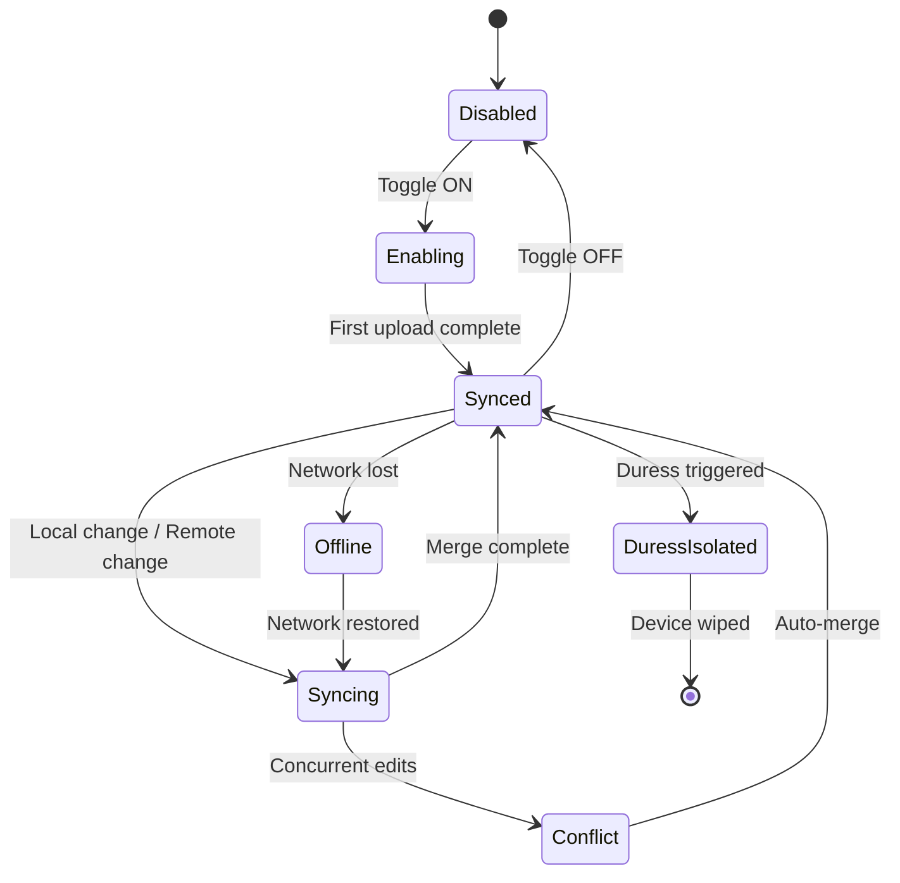

# Vaultaire Android — User Flow Diagrams

> **Mermaid flow diagrams** for all major user journeys. Render in any Mermaid viewer.

---

## 1. First Launch → Pattern → Phrase → Vault (Zero-Config)

```mermaid
flowchart TD
    A[App Launch] --> B{Vault Exists?}
    B -->|No| C[Onboarding: PatternLockScreen<br/>Empty state - "Draw your pattern"]
    B -->|Yes| D[PatternLockScreen<br/>Unlock existing vault]
    
    C --> E[User draws pattern<br/>&ge;6 dots, 1 turn]
    E --> F{Valid Pattern?}
    F -->|No| G[Error: "Pattern must connect<br/>at least 6 dots with one turn"]
    G --> C
    F -->|Yes| H[Auto-create vault:<br/>- Generate MVK<br/>- Wrap with VDK<br/>- Save .vlt<br/>- Generate 9-word phrase]
    
    H --> I[RecoveryPhraseDisplay<br/>Creation mode - 10s delay]
    I --> J[User taps "I've Saved It"]
    J --> K[VaultHomeScreen<br/>Empty FileGrid]
    
    K --> L[User taps FAB +<br/>Add first file]
    L --> M[File encrypted → visible in grid]
    
    style C fill:#e3f2fd
    style I fill:#fff3e0
    style K fill:#e8f5e9
```

---

## 2. Returning User → Pattern → Vault

```mermaid
flowchart TD
    A[App Launch / Foreground] --> B{Vault Exists?}
    B -->|Yes| C[PatternLockScreen]
    B -->|No| D[Onboarding Flow]
    
    C --> E[User draws pattern]
    E --> F[Derive VDK via PBKDF2<br/>600k iterations]
    F --> G[Retrieve wrapped MVK]
    G --> H{Unwrap Success?}
    H -->|Yes| I[Decrypt vault index<br/>Load FileGrid]
    H -->|No| J[PatternGrid: Error shake<br/>"Incorrect pattern"]
    J --> C
    
    I --> K[VaultHomeScreen<br/>Files visible]
    K --> L[User interacts:<br/>Tap file → View<br/>FAB → Camera/Import<br/>Long press → Select]
    
    M[App Backgrounded] --> N[Clear keys from memory<br/>Lock vault]
    N --> A
    
    style C fill:#e3f2fd
    style K fill:#e8f5e9
    style N fill:#ffebee
```

---

## 3. Pattern Forgotten → Recovery Phrase → Vault

```mermaid
flowchart TD
    A[PatternLockScreen] --> B[User taps "Forgot Pattern?"]
    B --> C[SecretPhraseEntryScreen<br/>9-word fields]
    
    C --> D[User enters phrase<br/>Paste or type]
    D --> E[Normalize: lowercase,<br/>trim, single spaces]
    E --> F[Derive RK via PBKDF2<br/>800k iterations]
    F --> G[Decrypt Recovery Envelope]
    G --> H{GCM Tag Valid?}
    H -->|No| I[Error: "Phrase not recognized"<br/>No timing leak]
    I --> C
    H -->|Yes| J[Extract MVK]
    
    J --> K[PatternLockScreen<br/>Create New mode]
    K --> L[User draws new pattern 2x]
    L --> M{Patterns Match?}
    M -->|No| N[Error: "Patterns don't match"]
    N --> K
    M -->|Yes| O[Validate strength]
    O --> P{Valid?}
    P -->|No| Q[Guidance: "Needs 6+ dots, 1 turn"]
    Q --> K
    P -->|Yes| R[Generate new MVK<br/>Wrap with new VDK<br/>Generate NEW phrase]
    
    R --> S[RecoveryPhraseDisplay<br/>New phrase - must confirm]
    S --> T[VaultHomeScreen<br/>Unlocked with new pattern]
    
    style C fill:#fff3e0
    style S fill:#fff3e0
    style I fill:#ffebee
```

---

## 4. Duress Trigger → Silent Wipe → Decoy Vault



---

## 5. Camera Capture → Review → Save/Retake

```mermaid
flowchart TD
    A[VaultHomeScreen] --> B[Tap Camera FAB]
    B --> C[CameraViewfinder<br/>FLAG_SECURE]
    
    C --> D{Configure Shot}
    D -->|Switch Lens| D
    D -->|Tap Focus| D
    D -->|Cycle Flash| D
    D -->|Rotate Device| D
    D -->|Shutter Press| E[Capture Photo]
    
    E --> F[CameraReviewScreen<br/>Photo - FLAG_SECURE]
    F --> G{User Action}
    G -->|Retake| H[Discard buffer<br/>Slide down 200ms]
    H --> C
    G -->|Keep| I[Encrypt via AES-256-GCM<br/>Save .vlt to vault]
    I --> J[Generate thumbnail]
    J --> K[Return to VaultHomeScreen<br/>New file in grid]
    
    %% Video flow
    C --> L[Switch to Video Mode]
    L --> M{Configure Recording}
    M -->|Switch Lens| M
    M -->|Tap Focus| M
    M -->|Toggle Torch| M
    M -->|Record Press| N[Start Recording<br/>Timer shows]
    N --> O[Stop Recording]
    O --> P[CameraReviewScreen<br/>Video - FLAG_SECURE]
    P --> Q{User Action}
    Q -->|Retake| R[Discard buffer<br/>Slide down]
    R --> C
    Q -->|Keep| S[Finalize encryption<br/>Save .vlt]
    S --> T[Generate video poster]
    T --> K
    
    style C fill:#e3f2fd
    style F fill:#fff3e0
    style P fill:#fff3e0
    style I fill:#e8f5e9
    style S fill:#e8f5e9
```



---

## 6. Backup Enable → Drive Auth → First Backup

```mermaid
flowchart TD
    A[BackupSettingsScreen] --> B[Toggle "Encrypted Cloud Backup" ON]
    B --> C{Google Account<br/>Connected?}
    C -->|No| D[Google Sign-In Flow]
    D --> E[Account selected]
    C -->|Yes| E
    
    E --> F[Derive Backup Key<br/>Separate from VDK<br/>PBKDF2 600k, diff context]
    F --> G[Encrypt vault chunks<br/>AES-256-GCM, 10MB padded]
    G --> H[Upload to Drive AppData<br/>Random UUID filenames]
    H --> I[Record backup version<br/>+ timestamp]
    I --> J[BackupStatus: ✅ Synced]
    
    K[Periodic WorkManager<br/>24h, Wi-Fi, idle] --> L[Incremental backup<br/>Changed chunks only]
    L --> J
    
    M[User toggles OFF] --> N[Delete remote backup<br/>from Drive AppData]
    N --> O[BackupStatus: Disabled]
    
    style B fill:#e3f2fd
    style J fill:#e8f5e9
    style O fill:#fff3e0
```

---

## 7. Sync Setup → Drive Auth → Device Link

```mermaid
flowchart TD
    A[SyncSettingsScreen<br/>Pro entitlement check] --> B[Prerequisite: Backup ON]
    B --> C{Backup Enabled?}
    C -->|No| D[Deep link to Backup Settings]
    D --> A
    C -->|Yes| E[Enable "Sync This Vault"]
    
    E --> F[Initialize sync metadata<br/>Vector clock = 0]
    F --> G[Upload current vault state<br/>to Drive AppData]
    G --> H[SyncStatus: 🟢 This device + 0 others]
    
    I[Second Device:<br/>Install + Recovery Phrase] --> J[Restore vault from backup]
    J --> K[Enable Sync This Vault]
    K --> L[Download peer metadata<br/>Merge vector clocks]
    L --> M[SyncStatus: 🟢 This device + 1 other]
    
    N[Add photo on Device A] --> O[Encrypt → Upload → Drive]
    O --> P[Device B: Background sync<br/>Download → Decrypt → Merge]
    P --> Q[Photo appears on Device B]
    
    R[Duress on Device B] --> S[Device B: Wipe + isolate]
    S --> T[Device A: Sync continues<br/>Unaffected]
    
    style A fill:#e3f2fd
    style H fill:#e8f5e9
    style M fill:#e8f5e9
    style Q fill:#e8f5e9
```

---

## 8. Share Create → Policy → Phrase → Send

```mermaid
flowchart TD
    A[VaultHomeScreen] --> B[Tap Share (Pro)]
    B --> C[ShareCreateScreen]
    
    C --> D[Auto-generate 12-word phrase]
    D --> E[User configures policy:<br/>- Expiration date<br/>- Max opens<br/>- Disable export]
    E --> F[Tap "Create Share"]
    
    F --> G[Derive share key<br/>PBKDF2 250k + random salt]
    G --> H[Serialize vault payload<br/>File index + encrypted content]
    H --> I[Encrypt payload AES-256-GCM<br/>Policy as AAD]
    I --> J[Upload EncryptedSharePackage<br/>to Drive App Folder]
    J --> K[Store metadata locally:<br/>Phrase hash, policy, driveID]
    
    K --> L[Display phrase + Copy/Share/QR]
    L --> M[User sends via trusted channel]
    
    style C fill:#e3f2fd
    style L fill:#e8f5e9
```

---

## 9. Share Open → Phrase → Read-Only Vault

```mermaid
flowchart TD
    A[Recipient opens Vaultaire] --> B[Tap "Open Shared Vault"]
    B --> C[ShareOpenEntryScreen<br/>FLAG_SECURE on input]
    
    C --> D[Enter 12-word phrase<br/>Paste / QR scan]
    D --> E[Normalize phrase]
    E --> F[Derive share key<br/>from phrase + salt]
    F --> G[Download EncryptedSharePackage<br/>from Drive]
    G --> H[Decrypt with AES-256-GCM<br/>Verify policy AAD]
    H --> I{Valid?}
    I -->|No| J[Error: "Invalid sharing phrase"]
    J --> C
    I -->|Yes| K[Check expiration & open count]
    K --> L{Allowed?}
    L -->|No| M[Error: "Expired" / "Limit exceeded"]
    M --> C
    L -->|Yes| N[Mark phrase SPENT<br/>Locally + cloud flag]
    N --> O[Create local read-only<br/>vault instance]
    O --> P[SharedVaultScreen<br/>FLAG_SECURE]
    
    P --> Q[Read-only FileGrid<br/>No export/share/screenshot]
    Q --> R[Pull-to-refresh checks<br/>updates/revocation]
    
    style C fill:#fff3e0
    style P fill:#e3f2fd
    style Q fill:#e8f5e9
```

---

## 10. App Icon Change → Confirm → Launcher Refresh

```mermaid
flowchart TD
    A[Settings → App Icon] --> B[DisguiseIconPickerScreen]
    B --> C{Pro User?}
    C -->|No| D[Tap icon → "Pro feature" dialog]
    D --> B
    C -->|Yes| E[Tap desired icon]
    E --> F[Confirmation Dialog:<br/>"Change App Icon?"<br/>Shows new icon preview]
    F --> G[User confirms]
    G --> H[PackageManager.switchComponent<br/>Enable alias, disable others]
    H --> I[Toast: "Icon updated ✓"]
    I --> J[Launcher refreshes<br/>2-5 seconds]
    
    K[App Update via Play Store] --> L[Application.onCreate<br/>Reconcile saved icon]
    L --> M[Re-apply component state<br/>if different from default]
    
    style B fill:#e3f2fd
    style F fill:#fff3e0
    style I fill:#e8f5e9
```

---

## 11. Settings Navigation

```mermaid
flowchart TD
    A[SettingsScreen] --> B{Section}
    
    B -->|Security| C[SettingsSecurityScreen]
    C --> C1[Change Pattern]
    C --> C2[Recovery Phrase<br/>(re-auth required)]
    C --> C3[Duress Mode (Pro)]
    C --> C4[Biometric Unlock]
    C --> C5[Auto-lock Timeout]
    
    B -->|Cloud| D[SettingsCloudScreen]
    D --> D1[Encrypted Cloud Backup]
    D --> D2[Device Sync (Pro)]
    D --> D3[Secure Sharing (Pro)]
    
    B -->|Appearance| E[SettingsAppearanceScreen]
    E --> E1[Theme: System/Light/Dark]
    E --> E2[App Icon (Pro)]
    E --> E3[Grid Density]
    
    B -->|Advanced| F[SettingsAdvancedScreen]
    F --> F1[Analytics Toggle]
    F --> F2[Cache Management]
    F --> F3[Diagnostic Data]
    
    B -->|About| G[SettingsAboutScreen]
    G --> G1[Version]
    G --> G2[Licenses]
    G --> G3[Privacy Policy]
    G --> G4[Security Whitepaper]
    
    style A fill:#e3f2fd
```

---

## Flow Navigation Summary

| Flow | Entry Point | Key Screens | Exit Point |
|------|-------------|-------------|------------|
| First Launch | App launch | PatternLock → RecoveryDisplay → VaultHome | VaultHome |
| Daily Unlock | App launch/foreground | PatternLock → VaultHome | VaultHome |
| Recovery | PatternLock "Forgot" | SecretPhraseEntry → PatternLock(Create) → RecoveryDisplay → VaultHome | VaultHome |
| Duress | PatternLock (duress pattern) | Silent → Decoy VaultHome | Decoy VaultHome |
| Camera | VaultHome FAB | CameraViewfinder → CameraReview → VaultHome | VaultHome |
| Backup Enable | Settings → Cloud | BackupSettings → (Sign-in) → BackupSettings | BackupSettings |
| Sync Setup | Settings → Cloud | SyncSettings → (restore) → SyncSettings | SyncSettings |
| Share Create | VaultHome menu | ShareCreate → ShareCreate (phrase shown) | VaultHome |
| Share Open | App entry "Open Shared" | ShareOpenEntry → SharedVault | SharedVault |
| App Icon | Settings → Appearance | DisguiseIconPicker → Confirm → Settings | Settings |
| Settings | Any screen menu | Settings → Section → Item | Previous screen |

---

## State Transitions (PatternLock)



---

## State Transitions (Camera)



---

## State Transitions (Sync)

