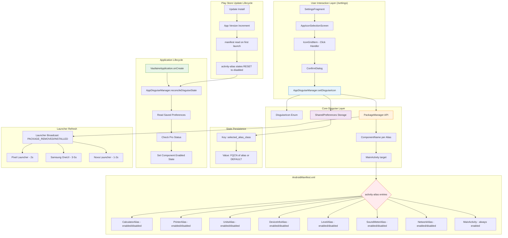

# App Icons - Implementation Architecture

## Architecture Diagram



---

## AndroidManifest.xml Activity-Alias Structure

```xml
<!-- Primary Main Activity - always enabled -->
<activity
    android:name=".MainActivity"
    android:exported="true"
    android:label="@string/app_name"
    android:theme="@style/Theme.Vaultaire">
    <intent-filter>
        <action android:name="android.intent.action.MAIN" />
        <category android:name="android.intent.category.LAUNCHER" />
    </intent-filter>
</activity>

<!-- Activity Aliases for App Disguise -->
<!-- Only ONE should be enabled at runtime via PackageManager -->

<activity-alias
    android:name=".alias.UnitsAlias"
    android:enabled="@bool/is_alias_enabled"  <!-- Runtime toggle -->
    android:exported="true"
    android:icon="@drawable/ic_disguise_units"
    android:label="@string/app_icon_units"
    android:targetActivity=".MainActivity">
    <intent-filter>
        <action android:name="android.intent.action.MAIN" />
        <category android:name="android.intent.category.LAUNCHER" />
    </intent-filter>
</activity-alias>

<activity-alias
    android:name=".alias.DeviceInfoAlias"
    android:enabled="false"  <!-- Disabled by default, enabled via PackageManager -->
    android:exported="true"
    android:icon="@drawable/ic_disguise_device_info"
    android:label="@string/app_icon_device_info"
    android:targetActivity=".MainActivity">
    <intent-filter>
        <action android:name="android.intent.action.MAIN" />
        <category android:name="android.intent.category.LAUNCHER" />
    </intent-filter>
</activity-alias>

<!-- Additional aliases: Calculator, Printer, Level, SoundMeter, Network -->
```

### Icon Resources Required

Store in `res/drawable/` (or `res/mipmap-` for adaptive):

| Alias Class | Drawable Resource | Adaptive Icon (Android 8.0+) | Monochrome (Android 13+) |
|---|---|---|---|
| CalculatorAlias | `ic_disguise_calculator.xml` | `ic_disguise_calculator_adaptive.xml` | `ic_disguise_calculator_monochrome.xml` |
| PrinterAlias | `ic_disguise_printer.xml` | `ic_disguise_printer_adaptive.xml` | `ic_disguise_printer_monochrome.xml` |
| UnitsAlias | `ic_disguise_units.xml` | `ic_disguise_units_adaptive.xml` | `ic_disguise_units_monochrome.xml` |
| DeviceInfoAlias | `ic_disguise_device_info.xml` | `ic_disguise_device_info_adaptive.xml` | `ic_disguise_device_info_monochrome.xml` |
| LevelAlias | `ic_disguise_level.xml` | `ic_disguise_level_adaptive.xml` | `ic_disguise_level_monochrome.xml` |
| SoundMeterAlias | `ic_disguise_sound_meter.xml` | `ic_disguise_sound_meter_adaptive.xml` | `ic_disguise_sound_meter_monochrome.xml` |
| NetworkAlias | `ic_disguise_network.xml` | `ic_disguise_network_adaptive.xml` | `ic_disguise_network_monochrome.xml` |

---

## Icon Switching Mechanism

### Core API: PackageManager.setComponentEnabledSetting()

```kotlin
val packageManager = context.packageManager
val packageName = context.packageName

// Enable target icon
val target = ComponentName(packageName, "com.vaultaire.android.alias.CalculatorAlias")
packageManager.setComponentEnabledSetting(
    target,
    PackageManager.COMPONENT_ENABLED_STATE_ENABLED,
    PackageManager.DONT_KILL_APP
)

// Disable all other aliases
val otherAliases = listOf(
    "com.vaultaire.android.alias.PrinterAlias",
    "com.vaultaire.android.alias.UnitsAlias",
    // ... etc
)
otherAliases.forEach { className ->
    val component = ComponentName(packageName, className)
    packageManager.setComponentEnabledSetting(
        component,
        PackageManager.COMPONENT_ENABLED_STATE_DISABLED,
        PackageManager.DONT_KILL_APP
    )
}
```

### Implementation in AppDisguiseManagerImpl

**Modified file: `app/src/main/java/com/vaultaire/android/disguise/AppDisguiseManager.kt`**

Key changes from current implementation:
1. Update `DisguiseIcon` enum to use correct alias class names
2. Add adaptive icon support detection
3. Improve error handling and logging
4. Add launcher refresh broadcast

```kotlin
// NEW: Updated enum with correct icon names
enum class DisguiseIcon(
    val aliasClassName: String,
    val displayName: String,
    @DrawableRes val iconRes: Int,
    @StringRes val labelRes: Int
) {
    DEFAULT("com.vaultaire.android.MainActivity", "Vaultaire",
        R.drawable.ic_launcher, R.string.app_name),
    
    CALCULATOR("com.vaultaire.android.alias.CalculatorAlias", "Calculator",
        R.drawable.ic_disguise_calculator, R.string.app_icon_calculator),
    
    PRINTER("com.vaultaire.android.alias.PrinterAlias", "Printer",
        R.drawable.ic_disguise_printer, R.string.app_icon_printer),
    
    UNITS("com.vaultaire.android.alias.UnitsAlias", "Units",
        R.drawable.ic_disguise_units, R.string.app_icon_units),
    
    DEVICE_INFO("com.vaultaire.android.alias.DeviceInfoAlias", "Device Info",
        R.drawable.ic_disguise_device_info, R.string.app_icon_device_info),
    
    LEVEL("com.vaultaire.android.alias.LevelAlias", "Level",
        R.drawable.ic_disguise_level, R.string.app_icon_level),
    
    SOUND_METER("com.vaultaire.android.alias.SoundMeterAlias", "Sound Meter",
        R.drawable.ic_disguise_sound_meter, R.string.app_icon_sound_meter),
    
    NETWORK("com.vaultaire.android.alias.NetworkAlias", "Network",
        R.drawable.ic_disguise_network, R.string.app_icon_network);

    companion object {
        fun fromClassName(className: String): DisguiseIcon {
            return entries.find { it.aliasClassName == className } ?: DEFAULT
        }
    }
}
```

---

## State Persistence

### SharedPreferences Schema

```kotlin
companion object {
    private const val PREFS_NAME = "vaultaire_disguise_prefs"
    private const val KEY_SELECTED_ALIAS = "selected_alias_class"
    
    // Optional: track when it was last changed (for analytics)
    private const val KEY_LAST_CHANGED_AT = "last_icon_changed_at"
    
    // Optional: track Pro status at time of selection
    private const val KEY_PRO_STATUS_AT_SELECTION = "pro_at_selection"
}

private val prefs = context.getSharedPreferences(PREFS_NAME, Context.MODE_PRIVATE)

override fun setDisguiseIcon(targetIcon: DisguiseIcon): Boolean {
    // ... validation ...
    
    prefs.edit()
        .putString(KEY_SELECTED_ALIAS, targetIcon.aliasClassName)
        .putLong(KEY_LAST_CHANGED_AT, System.currentTimeMillis())
        .putBoolean(KEY_PRO_STATUS_AT_SELECTION, isProUserProvider())
        .apply()
}
```

---

## Reconciliation on App Update

### Problem
When Vaultaire is updated via Play Store, `activity-alias` elements are re-read by the system. By default, all aliases are marked as `android:enabled="false"` in the manifest, causing previously selected icons to revert.

### Solution: Reconciliation in Application.onCreate()

```kotlin
// VaultaireApplication.kt
class VaultaireApplication : Application() {
    
    @Inject
    lateinit var appDisguiseManager: AppDisguiseManager
    
    override fun onCreate() {
        super.onCreate()
        
        // Restore icon state after update
        appDisguiseManager.reconcileDisguiseState()
    }
}

// In AppDisguiseManagerImpl
override fun reconcileDisguiseState() {
    val desiredIcon = getCurrentDisguiseIcon()
    
    // If not DEFAULT and user is Pro, restore the state
    if (desiredIcon != DisguiseIcon.DEFAULT && isProUserProvider()) {
        Log.i(TAG, "Reconciling icon state to: ${desiredIcon.displayName}")
        setDisguiseIcon(desiredIcon, skipProCheck = true)
    } else {
        // Ensure only default is active
        setDisguiseIcon(DisguiseIcon.DEFAULT)
    }
}
```

### Update Detection (Optional Improvement)

```kotlin
private fun reconcileDisguiseState() {
    val prefs = context.getSharedPreferences(PREFS_NAME, Context.MODE_PRIVATE)
    val lastVersion = prefs.getInt(KEY_LAST_VERSION, Build.VERSION_CODE_INT)
    
    if (lastVersion < Build.VERSION.SDK_INT) {
        // App updated - force reconciliation
        val currentIcon = getCurrentDisguiseIcon()
        if (currentIcon != DisguiseIcon.DEFAULT && isProUserProvider()) {
            setDisguiseIcon(currentIcon, skipProCheck = true)
        }
        prefs.edit().putInt(KEY_LAST_VERSION, Build.VERSION.SDK_INT).apply()
    }
}
```

---

## Launcher Caching Behaviors

| Launcher | Icon Refresh Latency | Notes |
|---|---|---|
| **Pixel Launcher** | 1-3 seconds | Fastest, reliable |
| **Samsung OneUI** | 3-5 seconds | May require cache clear if slow |
| **Nova Launcher** | 1-2 seconds | Respects `DONT_KILL_APP` flag |
| **Lawnchair** | 2-4 seconds | Similar to Pixel |
| **Microsoft Launcher** | 5-10 seconds | Slower, may need app restart |

### User Feedback Strategy
- Show Toast: "Icon updated ✓" immediately after PackageManager call
- Optionally: "It may take a few seconds for the launcher to refresh"
- No need for progress indicator; the operation is async but quick

---

## Adaptive Icons (Android 8.0+) Support

### Adaptive Icon XML Structure

```xml
<!-- res/drawable/ic_disguise_calculator_adaptive.xml -->
<adaptive-icon xmlns:android="http://schemas.android.com/apk/res/android">
    <background android:drawable="@color/ic_disguise_calculator_bg"/>
    <foreground android:drawable="@drawable/ic_disguise_calculator_fg"/>
    <alpha android:lerpFrom="0.0" android:lerpTo="1.0"/>
</adaptive-icon>
```

### Monochrome Icons (Android 13+)

For Material You dynamic color support:

```xml
<!-- res/drawable-anydpi-v26/ic_disguise_calculator_monochrome.xml -->
<vector xmlns:android="http://schemas.android.com/apk/res/android"
    android:width="24dp"
    android:height="24dp"
    android:tint="?android:attr/colorPrimary"
    android:viewportWidth="24"
    android:viewportHeight="24">
    <path android:fillColor="@android:color/white"
        android:pathData="..."/>
</vector>
```

### Resource Qualifiers

```
res/
├── drawable/           # Legacy icons
├── drawable-v26/       # Adaptive icons
├── drawable-anydpi/    # Vector drawables
└── drawable-anydpi-v26/  # Monochrome variants
```

---

## Icon List Alignment with Website

### Recommended Alignment (Match iOS Exactly)

| Icon Name | Status | Action Required |
|---|---|---|
| **Vaultaire (Default)** | ✅ Present | Label should be "Vaultaire" |
| **Calculator** | ✅ Present | Rename class from Notes -> Calculator |
| **Printer** | ✅ Present | Already correct |
| **Units** | ❌ Missing | Add `UnitsAlias` |
| **Device Info** | ❌ Missing | Add `DeviceInfoAlias` |
| **Level** | ❌ Missing | Add `LevelAlias` |
| **Sound Meter** | ❌ Missing | Add `SoundMeterAlias` |
| **Network** | ❌ Missing | Add `NetworkAlias` |

### Icons to Remove / Repurpose
- **Notes** → Replace with **Units**
- **Scanner** → Replace with **Sound Meter** or remove
- **Weather** → Replace with **Level**
- **Files** → Replace with **Network**

---

## Pro License Enforcement

### Current Implementation
The existing `AppDisguiseManagerImpl` checks `!isProUserProvider()` but the function is injected, suggesting a DI pattern.

### Required Integration Points

1. **Check Pro Status Before Switch**

```kotlin
override fun setDisguiseIcon(targetIcon: DisguiseIcon, skipProCheck: Boolean = false): Boolean {
    if (!skipProCheck && targetIcon != DisguiseIcon.DEFAULT && !isProUserProvider()) {
        Log.w(TAG, "Attempted to set ${targetIcon.displayName} without Pro license")
        return false
    }
    // ... rest of implementation
}
```

2. **UI Layer - Disable Clicks for Free Users**

```kotlin
@Composable
fun AppIconGridItem(icon: DisguiseIcon, isSelected: Boolean, onClick: () -> Unit, isPro: Boolean) {
    val modifier = Modifier
        .clickable(enabled = isPro || icon == DisguiseIcon.DEFAULT) {
            if (!isPro && icon != DisguiseIcon.DEFAULT) {
                // Show unlock dialog
                viewModel.showProUnlockDialog()
            } else {
                onClick()
            }
        }
    // ...
}
```

3. **Entitlement Mapping**

```kotlin
// Entitlement.kt
enum class Entitlement {
    UNLIMITED_VAULTS,
    UNLIMITED_FILES,
    DURESS_MODE,
    CUSTOM_APP_ICONS,  // <-- Use this
    E2EE_SHARED_VAULTS,
    CROSS_DEVICE_SYNC
}

// Usage:
fun isProUser(): Boolean {
    return Entitlement.isEntitlementActive(Entitlement.CUSTOM_APP_ICONS)
}
```

---

## Edge Cases & Mitigations

### 1. Launcher Not Responding

**Symptom**: Icon doesn't change visually, but PackageManager reports success.

**Mitigation**:
- Always show Toast: "Icon updated ✓"
- Add optional retry button in Settings
- Log analytics for "icon_change_success_rate"

### 2. App Update via Play Store

**Symptom**: After update, all aliases are disabled, user's icon is gone.

**Mitigation**:
- Reconciliation in `Application.onCreate()`
- Store last version code in SharedPreferences
- Force reconciliation if version changed

### 3. Component State Reset by System

**Symptom**: Device reboot or force-stop may reset component states.

**Mitigation**:
- Reconciliation on app resume (Activity.onResume)
- Store preferred icon in SharedPreferences, restore on foreground

### 4. Rapid Switching

**Symptom**: Clicking multiple icons rapidly causes race conditions.

**Mitigation**:
- Disable icon buttons during switch operation
- Use a Mutex or channel to serialize requests
- Show loading state

### 5. Permission Issues

**Symptom**: `PackageManager.setComponentEnabledSetting` throws SecurityException.

**Mitigation**:
- Catch exception, log, show error Toast
- Graceful fallback to DEFAULT
- Document known launcher-specific issues

### 6. Missing Drawable Resource

**Symptom**: Icon click appears to succeed but shows default icon.

**Mitigation**:
- Validate drawable exists before switch
- Use `try { resources.getDrawable(...) } catch` to verify
- Fallback to safe icon

### 7. Android 12+ Package Visibility

**Symptom**: `PackageManager` calls may be restricted.

**Mitigation**:
- Declare `<queries>` in manifest if checking external packages
- No special query needed for own package's components

---

## Testing Checklist for Implementation

- [ ] Add missing activity-alias entries (Units, DeviceInfo, Level, SoundMeter, Network)
- [ ] Update `DisguiseIcon` enum to use correct alias class names
- [ ] Add adaptive icon resources (drawable-v26)
- [ ] Add monochrome icon resources for Android 13+
- [ ] Update `setDisguiseIcon` to handle new enum
- [ ] Implement reconciliation in `VaultaireApplication.onCreate()`
- [ ] Hook up Pro license check from `Entitlement`
- [ ] Add UX confirmation dialog
- [ ] Add launcher refresh notification
- [ ] Add error handling and logging