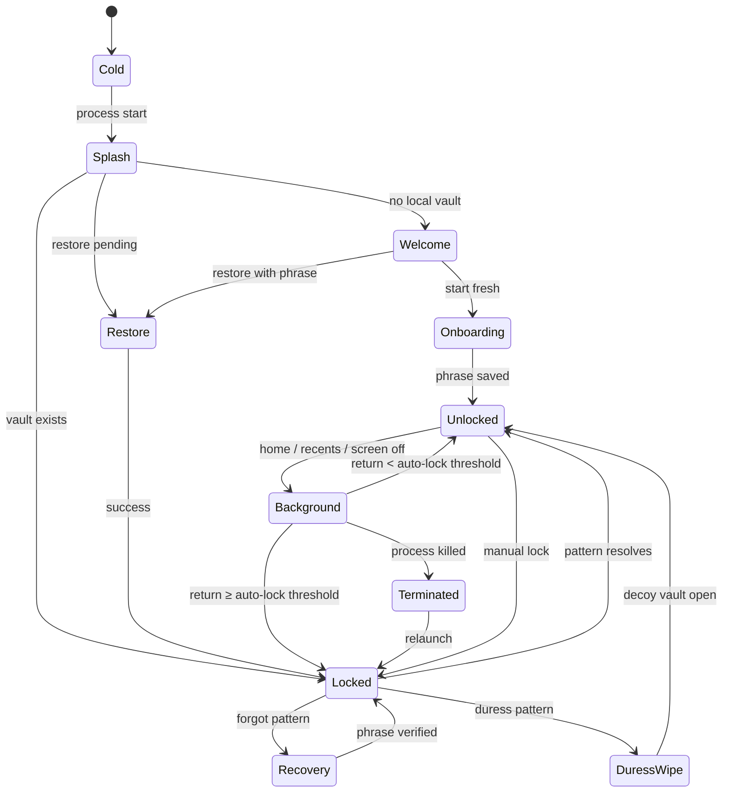

# Aurora State Model

> The app is a small set of session states wrapped around a large set of screen states.
> This file defines the session states, their precedence, what survives death, and which
> states a screen of each class is required to implement.

State **codes** (`S0–S17`, `G`, `N`, `D`, `E`, `P`, `V`, `A`, `X`) are defined in
[`_TEMPLATE.md §2`](./_TEMPLATE.md). This file defines how they combine.

---

## 1. Three tiers

| Tier | Codes | Scope | Can it blank the screen? |
|---|---|---|---|
| **A — App** | `G1–G6`, crash, upgrade | Whole process | Yes |
| **B — Environment** | `N`, `D`, `E`, `P`, `V`, `A`, `X` | A capability, a region, or one action | Sometimes — see §2 |
| **C — Screen** | `S0–S17` | One destination | Yes, but only inside its own region |

Resolution is always **A → B → C**. A screen never overrides an app state; an app state never
renders a component-level detail.

---

## 2. Precedence

Most "which state wins" bugs come from treating every state as global. Aurora splits them:

- A **blocking** state replaces the screen.
- A **gating** state replaces one **action** or one **region**, never the whole screen — unless
  the destination itself exists only for that feature.
- An **informing** state adds a banner and changes nothing else.

### 2.1 Resolution order

```
render(screen):
  1. G6 duress wipe            → normal decoy UI, no overlay, no error, no spinner variant
  2. G3/G4 session locked       → secure cover (brand, no content)
  3. G5 restore in progress     → restore takeover
  4. fatal exception            → S7 with safe exit
  5. destination is Pro-only and E1/E3 → S10 full-screen gate
  6. destination requires a permission and P2/P3 → S11 full-screen rationale
  7. writes blocked by D3       → region-level "storage full" (not full screen unless the
                                  screen's only purpose is writing)
  8. N2/N4 and screen needs network → S8 with cached content where any exists
  9. otherwise                  → C-tier screen state
```

Two rules follow from this and must never be broken:

1. **A gate never hides existing data.** Pro lapse degrades a feature; it does not blank a
   vault, a share, or a backup that already exists.
2. **A gate never renders over the lock screen.** Paywall, permission rationale, and storage
   dialogs are all dismissed when the session locks.

### 2.2 Combining multiple B-tier states

Apply in this order, all of them, at their own scope:

`E` (feature availability) → `P` (action permission) → `D` (write capacity) → `N` (transport)
→ `X` (device pressure) → `V` (layout) → `A` (accessibility).

A screen can legitimately show an offline banner **and** a Pro badge **and** be in selection
mode. Those are different regions.

### 2.3 Forbidden combinations

| Never | Why |
|---|---|
| Paywall over `/lock` | Extortion surface; also a coercion tell |
| Snackbar over a dialog | Two competing dismiss targets |
| Two sheets stacked | Back-stack ambiguity; use one sheet with a pushed step |
| Error styling on unlock | Leaks pattern validity (`screens.md §3.1`) |
| Duress-specific visual, haptic, or timing | The whole feature |
| A spinner that can exceed 8 s without a cancel or explanation | User cannot tell hung from slow |
| "Try again" that retries something irreversible | Duplicate side effects |

---

## 3. Session lifecycle



### 3.1 Timings

| Transition | Budget | Notes |
|---|---|---|
| Launcher tap → first frame | ≤ 300 ms | Splash is a canvas, not a logo animation |
| Cold start → lock screen interactive | ≤ 800 ms | Measured on a mid-tier device |
| Pattern release → vault visible | ≤ 500 ms | KDF dominates; no artificial delay |
| Background → lock (screen off) | immediate | Screen-off always locks, regardless of setting |
| Background → lock (home/recents) | setting: immediately / 30 s / 1 m / 5 m | Default 30 s |
| Duress → decoy visible | within the same budget as normal unlock | Timing is a tell |

### 3.2 Session states

| State | Entered by | What runs | What the user sees |
|---|---|---|---|
| `G1` Cold | Process start | Alias resolve, vault index probe, theme | Canvas, then lock or welcome |
| `G2` Warm | Existing process, activity recreated | State restore | Last route, re-locked if threshold passed |
| `G3` Background | Home, recents, screen off | Snapshot cover, key held or dropped per threshold | Recents shows cover, not content |
| `G4` Process death | LMK, crash, force stop | Full cold path | Lock, with a pending destination if one was recorded |
| `G5` Restore | User restores on a new device | Download, verify, decrypt, index | Restore takeover with real counts |
| `G6` Duress | Duress pattern | Open decoy, wipe others | Indistinguishable from a normal unlocked vault |

### 3.3 Lock triggers

1. Screen off — always.
2. Background beyond the auto-lock threshold.
3. Manual lock from the nav overflow or a long-press shortcut.
4. Process death.
5. Biometric invalidation (enrollment change) — falls back to pattern, does not destroy the vault.
6. A failed integrity check (`S12`) — locks and explains in neutral language.

---

## 4. Ownership and lifetime

| Thing | Owner | Lifetime | Survives background? | Survives process death? |
|---|---|---|---|---|
| Derived vault key | Session manager | Until lock | Only inside threshold | No |
| Decrypted index | Vault repository | Session | Yes, briefly | No |
| Thumbnails | Image cache | LRU | Yes | No |
| Pattern buffer | Lock screen | Gesture | No | No |
| Attempt counter | Security store (encrypted) | Forever | Yes | Yes |
| Current route | Navigation | Session | Yes | Yes (opaque only) |
| Selected item IDs | Screen state | Screen | Yes (saved state) | No — selection is dropped |
| Scroll position | Screen state | Screen | Yes | Yes if the list can restore by stable ID |
| Import/backup queue | WorkManager | Durable | Yes | Yes |
| Pending share phrase | Share flow | Until dismissed | **No** — cleared on background | No |
| Recovery phrase plaintext | Creation flow | Until confirmed | **No** — cleared on background | No |
| Settings | Encrypted prefs | Forever | Yes | Yes |

**Zeroization rule:** any object holding a key, phrase, or decrypted secret is cleared on
`G3` (beyond threshold), on `G6`, and on `S9`. **Phrase displays are stricter:** they cover
immediately on `onPause` and zeroize the plaintext after **5 s**; process death always loses the
plaintext. Clearing means overwrite-then-drop; do not rely on GC.

---

## 5. Persistence matrix

| Data | Memory | Encrypted disk | KeyStore | Cloud (opaque) |
|---|---|---|---|---|
| Vault key | session | — | wrapped | — |
| Recovery phrase | never after confirm | never plaintext | — | — |
| Pattern coordinates | never | never | — | — |
| Attempt counter | — | ✅ | — | — |
| Vault index | session | ✅ | — | ✅ encrypted |
| Media | session cache | ✅ | — | ✅ encrypted |
| Settings | — | ✅ | — | — |
| Backup bookkeeping | — | ✅ | — | ✅ inside encrypted vault |
| Sync bookkeeping | — | ✅ | — | ✅ inside encrypted vault |
| Share phrase | flow only | — | — | — |
| Diagnostics | — | opt-in | — | — |

**Nothing readable by the OS or a cloud provider may encode:** vault count, vault labels,
collection names, file names, thumbnails, or which pattern maps to which vault.

---

## 6. Process death contract

Android will kill the process at any moment. Every screen must answer: *what reopens?*

| Interrupted during | On relaunch | Must not happen |
|---|---|---|
| Onboarding, before phrase confirm | Pattern screen if pattern was committed; otherwise `/welcome`. Phrase is **lost** | A phrase shown again that was never confirmed |
| Pattern draw | `/lock`, buffer empty | A partially drawn pattern restored |
| Unlock KDF | `/lock` | A half-unlocked vault |
| Phrase display (post-auth) | Lock → after unlock, home | Phrase reappearing without re-auth |
| Import | Import queue resumes via WorkManager; already-imported items are present | A partial file being listed |
| Camera capture (pre-review) | Capture discarded | A capture silently kept |
| Review | Capture discarded | An unreviewed item in the vault |
| Backup/restore | WorkManager resumes; UI shows a resumable state | A duplicate backup |
| Share phrase display | Phrase is gone; share exists but the phrase cannot be shown again | Phrase recoverable from disk |
| Payment | Play Billing re-queries purchases; entitlement reconciling state | A double charge or a phantom Pro |
| Duress wipe | Wipe resumes before the decoy becomes interactive | The decoy opening over a half-wiped device |

**Pending destination:** persist only `{kind, opaqueId}`. After unlock, if the id cannot be
resolved, land on `/vault` silently. Never persist a file name, collection name, or vault label
as a pending destination.

---

## 7. Overlay stack

Maximum stack: **1 sheet + 1 dialog**. A snackbar may coexist with either, positioned above
them.

| Layer | Component | Dismiss | Notes |
|---|---|---|---|
| 4 | Biometric prompt | Cancel | System UI; never fake it in-app |
| 3 | Dialog (`S14`) | Back, scrim tap, Esc, explicit cancel | Destructive dialog has no scrim dismiss |
| 2 | Sheet | Back, scrim, drag, Esc | Can push a second step inside itself |
| 1 | Snackbar (`S17`) | Timeout, swipe, action | Never the only place an error is reported |
| 0 | Screen | — | — |

**Back contract:** back pops one layer at a time. Predictive back must preview the pop, never
reveal content underneath a secure surface. At the root, back backgrounds the app — it never
logs out, deletes, or closes a vault silently.

---

## 8. Mandatory state budget by screen class

A screen that skips a row fails review.

| Class | Mandatory | Conditional |
|---|---|---|
| **List** (`/vault`, timeline, collection, search, shares, sync log) | S0, S1, S3, S4, S5, S6, S9, A4, V1, V4 | S8 if it can be stale, S13 if selectable, S15 if it mutates |
| **Detail / media** (viewer, shared vault) | S0, S1, S3, S6, S7, S9 | S12 if codec/format can fail |
| **Form** (share create, share open, phrase entry) | S0, S3, S13, S15, S16, S6, S9 | S11, S14, S17 |
| **Secret** (phrase display, duress confirm) | S3, S9 + FLAG_SECURE + background cover | S14, S15 |
| **One-shot flow** (onboarding, recovery, reset) | S0–S3, S6, S9, S15, S16 | S14 on abandonment |
| **Settings** | S0, S3, S9 | S12 for unavailable toggles, S10 for Pro rows |
| **Pro-only screen** | S3, S10, S15, S16, S6, S9, N2 | E3 |
| **Camera** | S0, S1, S3, S6, S7, S9, S11, S12, X4, X5 | S15, S17 |

Empty vs. no-permission vs. no-network must be **three different states** with three different
actions. Collapsing them is the most common defect in vault apps.

---

## 9. State → component map

| State | Component | Notes |
|---|---|---|
| S0 | Static layout | No skeleton flash for < 300 ms loads |
| S1 | `AuroraSkeleton` | Same geometry as content |
| S2 | Inline 18 dp spinner or 2 dp line | Never a blocking overlay |
| S4 | `AuroraEmptyState` | Neutral copy; one action |
| S6 | `AuroraBanner` (danger/info) + retry | Content around it survives |
| S7 | Full-bleed state + `AuroraButton` | One safe exit |
| S8 | `AuroraBanner` (sky) | Cached content stays interactive |
| S9 | `AuroraSecureSurface` + brand cover | No content beneath |
| S10 | `AuroraProGate` (inline) or `AuroraProCard` (destination) | Value first, exit always |
| S11 | Rationale sheet → `Open settings` | One request per session |
| S12 | Disabled row + explanation | Never a dead end |
| S13 | Contextual action bar | Count is always visible |
| S14 | `AuroraDialog` | Destructive: no scrim dismiss |
| S15 | Preserved-footprint spinner | Controls disabled, not removed |
| S16 | Inline confirmation + next action | No confetti on secrets |
| S17 | `AuroraSnackbar` with `Undo` | 7 s for delete, 4 s otherwise |

---

## 10. Forcing a state (testability)

Every state in this model must be reachable in a debug build without editing code:

- A **state inspector** (long-press the version row) lists the current screen's state codes.
- A **state injector** can force any B-tier code and any S-code for the current destination.
- Golden screenshots are captured per `(screen, state)` pair, not per screen.
- The three pixel-diff guardians in `../accessibility.md §10.3` run across all forced states
  where they apply.

No analytics, no remote config, no A/B flags. State injection is local and debug-only.

---

## 11. Anti-patterns

| Anti-pattern | Correct behavior |
|---|---|
| "Something went wrong" | Name the cause in plain language + one action |
| Spinner with no cancel on a > 8 s operation | Progress + cancel or a reason it cannot be cancelled |
| Retry that duplicates a commit | Idempotency key, or "Check again" instead of "Retry" |
| Empty state that also means "no permission" | Three distinct states |
| Error dialog on unlock | Never (`screens.md §3.1`) |
| Toast for a decision | Dialog or banner |
| Disabled control with no explanation | Row opens an explanation sheet |
| Auto-dismissing security warning | Persistent until resolved |
| Restoring a selection after process death | Drop selection, keep scroll |
| Keeping a decrypted bitmap "just in case" | Clear on lock, re-decrypt on demand |
