# 01 — Access & Recovery

> Splash, new device, onboarding, pattern lock, recovery phrase entry/display, pattern reset, restore.
> The security-critical family. Every flow here defends the deniability model: no wrong-pattern
> state, no vault catalog, no coercion tell, no plaintext secret outside `AuroraSecureSurface`.

**Read first:** [`_TEMPLATE.md`](./_TEMPLATE.md) · [`00-state-model.md`](./00-state-model.md) · [`../screens.md §1–3, 20–22, 24, 27`](../screens.md) · [`../accessibility.md §4–5`](../accessibility.md) · [`../feature-matrix.md §5`](../feature-matrix.md)

---

## Flow atlas

| ID | Journey | Steps | Success | Abandonment |
|---|---|---|---|---|
| F1 | First install → vault in 4 steps | `/` → `/welcome` → `/onboarding/pattern` → `/onboarding/confirm` → `/onboarding/phrase` → `/onboarding/done` → `/vault` | Phrase confirmed, empty vault ready | Leave at phrase → confirm dialog: pattern kept, phrase never re-shown. Kill at phrase → phrase lost, `/lock` on relaunch |
| F2 | Returning unlock | `/` → `/lock` → `/vault` or pending destination | Session key in memory ≤ 500 ms | Idle at `/lock`; back grounds the app |
| F3 | Coerced unlock (duress) | `/lock` → duress pattern → decoy `/vault` | Decoy opens pixel-identically; other vaults wiped silently | None — silent by design |
| F4 | Forgotten pattern → recovery | `/lock` → `Forgot pattern?` → `/recovery/enter` | Phrase verifies → `Reset pattern` or `Open vault` | 3 wrong submissions → 30 s throttle; back → `/lock`, fields cleared |
| F5 | Pattern reset | `/recovery/enter` → `/recovery/reset-pattern` (interstitial → proof → 4 steps) | New pattern + new phrase committed | Cancel at any point → nothing changed, old credentials intact |
| F6 | Device lost → new phone | `/` → `/welcome` → `/recovery/enter` (restore) → `/restore/progress` → new pattern → `/vault` | "Vault restored." → vault opens | Cancel → resumable; kill → WorkManager resumes |
| F7 | Biometric shortcut | `/lock` → system prompt → `/vault` | Same session and timing class as pattern | 1 fail → pattern; system lockout → pattern only |
| F8 | Auto-lock cycle | Background ≥ threshold → `/lock` → unlock → pending destination | Last route restored | Destination unresolvable → `/vault` silently |
| F9 | Notification / deep link entry | Tap → `/` → `/lock` → pending destination | Settings/share destination opens post-unlock | Lock abandoned → destination dropped |
| F10 | Restore again on an existing device | `/settings/cloud/backup` → re-auth → `/recovery/enter` (restore) → `/restore/progress` | Restore re-runs | Cancel at re-auth → settings unchanged |

---

## Family rules (canonical for every screen below)

### R1 · Attempt throttling

With no wrong-pattern state (feature-matrix §5.3) there is no observable "failure", so the
throttler counts **attempts**, not failures. An `attempt` is any pattern release of ≥ 6 dots that
runs the KDF — known, unknown, or duress; outcomes are never recorded.

| Tier | Trigger | Wait | Notes |
|---|---|---|---|
| 0 | — | none | — |
| 1 | 5th attempt inside a rolling 2 min window | 30 s | Window measured between attempt timestamps |
| 2 | Attempt within 2 min after a tier-1 wait ends | 2 m | Grid stays disabled through the wait |
| 3 | Attempt within 2 min after a tier-2 wait ends | 10 m | — |
| 4 | Attempt within 2 min after a tier-3 wait ends | 30 m | Cap; further violations re-arm 30 m |
| decay | 10 min with no attempt | −1 tier | Keeps the ladder survivable for real users |

- A normal unlock also counts: 6 unlocks inside 2 minutes triggers tier 1 exactly like 6 wrong
  patterns. This is the cost of having no wrong-pattern signal. `Forgot pattern?` stays reachable
  during a wait; biometrics do not.
- **Persistence:** tier, wait deadline, and attempt minute-buckets live in encrypted prefs.
  Survives restart, force stop, reboot, and config change. Attempt timestamps are truncated to the
  minute to reduce forensic value.
- **Clock:** countdown renders from `elapsedRealtime`. Deadline is persisted as wall-clock plus a
  monotonic floor. Wall rollback (now < last-seen wall clock) re-arms the full current-tier wait.
  A forward jump across the deadline ends the wait — accepted cost, stated here.
- **Copy is exactly `Please wait a moment.`** + `mono.m` countdown, neutral ink. Never "Too many
  attempts", never a count, never a word implying a specific pattern was wrong. Recovery entry
  runs the same ladder on its own counter, armed at 3 wrong submissions (§1.8).

### R2 · Biometric unlock (shortcut only)

| Event | Behavior |
|---|---|
| Offer | Ghost row `Unlock with biometrics` on `/lock` below `Forgot pattern?` — only when enrolled + enabled; never auto-fired, never over a sheet, never during a throttle wait |
| Success | Identical resolve path, glow, and timing class as a pattern unlock; identical announcement |
| Fail | System prompt retries (1); after the prompt's own budget (5 fails) the system locks biometrics — the row is then absent, no in-app copy, pattern unaffected |
| Enrollment change | Wrapped key invalidated → pattern required (00 §3.3.5); after unlock a one-time dismissible sheet offers re-enrollment |
| Target vault | Re-opens the vault last unlocked in the previous session; the duress pattern remains the only coercion escape (see Gaps) |
| Never | During onboarding, before a first successful pattern unlock, or as the root credential |

### R3 · Duress contract (applies to `/lock`)

| Property | Normal unlock | Duress unlock |
|---|---|---|
| Grid feedback | iris line, `EFFECT_CLICK` per dot | identical |
| Resolve | 380 ms iris glow (± 1 frame), nav +120 ms | identical |
| Haptic | `EFFECT_HEAVY_CLICK` ×1 | identical — none extra |
| Announcement | "Vault unlocked" | identical — no badge, no confirmation |
| Destination | the matching vault | the decoy vault |
| Side effect | none | silent multi-pass wipe of every other vault index, its files, and local sync state; sync isolated |

- **Other vaults mid-wipe:** their indexes are removed first, so their patterns resolve to neutral
  empty vaults during the wipe; nothing is visible from inside the decoy; other devices later show
  this device as disconnected. No progress, sound, or notification at any point.
- **Partial wipe failure** (power loss, crash, storage error): the user sees nothing. On next cold
  start the wipe resumes before the decoy becomes interactive. If storage errors persist, the
  remaining artifacts stay (flash residue) and are acknowledged only in `/settings/security-info`.
  Surfacing a failed wipe would be a coercion tell.

### R4 · Process death at every step (G4)

| Interrupted during | On relaunch | Must never happen |
|---|---|---|
| `/` splash | identical cold start | a second branding flash |
| `/welcome` | identical screen | any state persisted |
| `/onboarding/pattern` | `/welcome` (nothing committed) | a partial pattern restored |
| `/onboarding/confirm` | `/welcome` if uncommitted; `/lock` if committed | a phrase shown that was never confirmed |
| `/onboarding/phrase` | `/lock` (pattern committed) | the phrase reappearing — it was never persisted |
| `/onboarding/done` | `/lock` → unlock → `/vault` | the done screen restored as a destination |
| `/lock` draw | `/lock`, buffer empty | a partially drawn pattern |
| `/lock` KDF | `/lock` | a half-unlocked vault |
| `/recovery/enter` | `/lock` (or `/welcome` on a no-vault device) | entered words surviving — buffers are memory-only |
| `/recovery/display` | `/lock` → unlock → home | the phrase re-rendering without re-auth |
| `/recovery/reset-pattern` | `/lock`; old pattern still valid | a half-committed reset; the new phrase surviving |
| `/restore/progress` | WorkManager resumes; UI reattaches | duplicate chunks; unencrypted residue |

Pending destination persists only `{kind, opaqueId}`. Unresolvable id → land on `/vault` silently.
Never persist a file name, collection name, or vault label as a pending destination.

---

### 1.1 Entry / splash — `/`

**Badges:** Secure: no · Pro: no · Owner: app-shell
**Purpose:** Resolve the active launcher alias, probe for a local vault, and route — in ≤ 300 ms, showing no branding when a disguise alias is active.

**Entry points**
| From | Trigger | Arguments | Preconditions |
|---|---|---|---|
| Launcher | Icon tap (default or disguise alias) | — | None |
| Widget | Optional 1×1 launch tile | — | None |
| Notification | Any channel tap (`Backup`, `Sync`, `Share expiry`, `Security`) | `pendingDestination {kind, opaqueId}` | None |
| App link | Deep link to a gated destination | `pendingDestination` | Never routes into unlocked content directly |
| Warm start | Process alive, activity recreated | — | Splash skipped entirely (`G2`) |
| G4 relaunch | Process death anywhere in the family | Persisted `pendingDestination` | Identical to cold |

**Exit points**
| To | Trigger | Side effects |
|---|---|---|
| `/welcome` | Vault-existence probe = none | None |
| `/lock` | Vault exists | `reason=first` recorded for lock copy |
| `/recovery/enter` | Interrupted restore intent recorded (`G5`/`G4`) | `mode=restore` |
| Background | Back on a disguise alias | Nothing rendered twice; no branding ever |

**Actions**
| Control | Preconditions | Effect | Resulting state | Failure |
|---|---|---|---|---|
| (none) | — | The splash is inert; nothing is tappable | S1 | Probe exceeds 300 ms → hold S1 canvas, never a spinner |

**States**
| State | Trigger | Visual | Available actions | Announcement |
|---|---|---|---|---|
| S0 | First composition | Canvas + orbit lines only | none | — |
| S1 | Alias + index probe | Canvas + `Vaultaire` wordmark | none | — |
| S1 disguise | Alias ≠ default | Canvas only — no wordmark, no glyph | none | — |
| G1 / G2 / G4 | cold / warm / death | Warm skips splash; death reruns cold | — | — |

**Transitions**
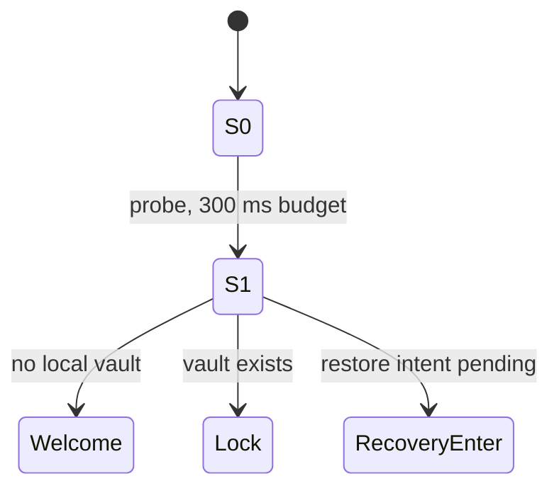

**Flows**
| Flow | Path | Success | Abandonment |
|---|---|---|---|
| F1 start | `/` → `/welcome` | Onboarding begins | — |
| F2 start | `/` → `/lock` | Unlock path | Idle at lock |
| F6 start | `/` → `/welcome` (no vault) → restore | Restore path | — |
| F9 start | Notification tap → `/` → `/lock` | Destination after unlock | Lock abandoned |

**Edge cases & races**
- Never shows "Unlocking…", a progress bar, or a logo animation; a progress bar implies variable security.
- The probe reads one opaque existence bit — the splash cannot learn or show a vault count.
- Process death mid-splash is invisible: S1 has no side effects, relaunch is identical.
- Disguise alias + notification tap: solid cover only; notification text never names vault content (§25).
- Race: notification tap while a duress wipe is resuming → destination dropped, wipe completes first.
- A4 200%: wordmark scales with `display.l`, layout holds. V4 tablet: identical centered layout.

**Data contract**
Reads: alias setting, vault-existence bit, `pendingDestination`. Writes: none. Must never appear: vault count, vault label, "No vault found" copy, a spinner.

---

### 1.2 New device / restore entry — `/welcome`

**Badges:** Secure: no · Pro: no · Owner: encrypted-cloud-backup / app-shell
**Purpose:** The only welcome surface — offered solely because a device with no local vault genuinely has nothing to open. Two honest choices, nothing else.

**Entry points**
| From | Trigger | Arguments | Preconditions |
|---|---|---|---|
| `/` | Cold start, probe = no local vault | — | No vault on device |
| G4 | Death during onboarding before the pattern committed | — | Pattern never committed |
| Debug injector | State forcing | — | Debug builds only |

**Exit points**
| To | Trigger | Side effects |
|---|---|---|
| `/onboarding/pattern` | `Start fresh` | None yet — nothing is written until confirm |
| `/recovery/enter` | `Restore with phrase` | `mode=restore` |
| Background | Back (root destination) | None |

**Actions**
| Control | Preconditions | Effect | Resulting state | Failure |
|---|---|---|---|---|
| `Restore with phrase` | — | Push recovery entry in restore mode | → `/recovery/enter` | Network is not needed here; transport failures surface later at `/restore/progress` |
| `Start fresh` | — | Push pattern creation | → `/onboarding/pattern` | None |
| Back | Root | Grounds the app | — | — |

**States**
| State | Trigger | Visual | Available actions | Announcement |
|---|---|---|---|---|
| S3 | Content | Orbit art, "Your vault, here." / "Restore it with the phrase you saved.", ink pill + ghost | Both buttons | "Your vault, here. Restore with phrase, or start fresh" |
| S4 | n/a | This screen never shows an empty/no-vault state — both paths are always offered | — | — |
| N2 | Offline | No banner — neither action needs a connection yet | — | — |
| A4 / V1 / V4 | Scale / width | Buttons grow to 60 dp; art scales, never crops the headline | — | — |

**Transitions**
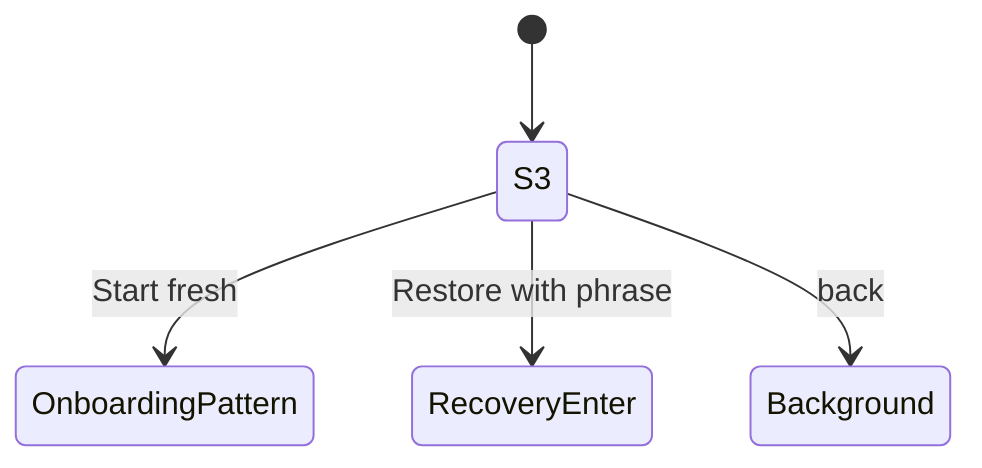

**Flows**
| Flow | Path | Success | Abandonment |
|---|---|---|---|
| F1 | `/welcome` → `/onboarding/pattern` | 4-step onboarding | Back before drawing — nothing persisted |
| F6 | `/welcome` → `/recovery/enter` (restore) | `/restore/progress` | Phrase entry abandoned → back here |

**Edge cases & races**
- A device that already has a vault can never land here; a deep link forcing it resolves silently → `/lock`.
- The screen never says "No vault found" — it confirms or denies nothing about local state.
- No account, no email, no sign-in, no marketing carousel, no permissions requested.
- Process death here leaves no trace; relaunch is identical.
- Google Drive is discovered only after the phrase derives the backup key — never before submit.
- V6 multi-window: single centered column; the art never competes with the buttons.

**Data contract**
Reads: vault-existence bit. Writes: none. Must never appear: "sign in", account rows, vault labels, Drive state before phrase submission.

---

### 1.3 Pattern create — `/onboarding/pattern`

**Badges:** Secure (FLAG_SECURE, whole screen) · Pro: no · Owner: pattern-encryption
**Purpose:** Draw the pattern that becomes the root credential. The only surface where error styling on a pattern is allowed.

**Entry points**
| From | Trigger | Arguments | Preconditions |
|---|---|---|---|
| `/welcome` | `Start fresh` | `mode=onboarding` | No local vault |
| `/restore/progress` | Restore success → `Open vault` → first-open pattern | `mode=post-restore` | Vault restored; phrase already proven |
| G4 | Relaunch with nothing committed | — | Lands here only via `/welcome` |

**Exit points**
| To | Trigger | Side effects |
|---|---|---|
| `/onboarding/confirm` | `Continue` with a valid pattern | Pattern held in memory only — not committed |
| `/welcome` | Back | Nothing persisted |
| `/vault` | `mode=post-restore` confirm path completes | Session starts; no phrase step (phrase unchanged) |

**Actions**
| Control | Preconditions | Effect | Resulting state | Failure |
|---|---|---|---|---|
| Draw pattern | — | Dots accumulate, `EFFECT_CLICK` per dot, iris line | S13 | — |
| Redraw | S13, before Continue | Lift finger or tap a cleared start → buffer resets | S3 | — |
| `Continue` | ≥ 6 dots AND ≥ 1 turn | Hold pattern in memory, push confirm | → `/onboarding/confirm` | < 6 dots → "Connect at least 6 dots."; no turn → "Add at least one turn." |
| Progress dots | — | 3 dots (`ink.200`, active ink pill 20 dp); hidden in `mode=post-restore` | — | — |

**States**
| State | Trigger | Visual | Available actions | Announcement |
|---|---|---|---|---|
| S3 | Idle | Grid on `gradient.dawn`, copy "Draw a pattern you'll remember." | Draw, back | "Draw a pattern you'll remember. Pattern grid, 5 rows, 5 columns" |
| S13 | Drawing | Dots enlarge 1.18, iris line draws continuously | Redraw, Continue | "{n} dots connected" |
| S6 | Continue invalid | Inline hint under grid, 420 ms shake — creation-only error styling | Redraw, Continue after fix | "Connect at least 6 dots" / "Add at least one turn" (assertive) |
| S16 | Valid → confirm | — | — | — |

**Transitions**
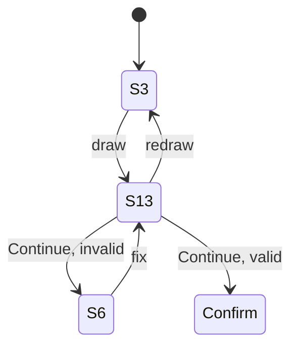

**Flows**
| Flow | Path | Success | Abandonment |
|---|---|---|---|
| F1 step 1 | → confirm | Confirm step | Back → `/welcome`, nothing lost |
| F6 last step | `mode=post-restore` → confirm → `/vault` | Vault opens | Back → `/restore/progress` success state |

**Edge cases & races**
- No throttle here — the throttler exists only on unlock surfaces (R1).
- No skip button; no strength meter (pattern strength guidance lives in the confirm step's help).
- Rotation: buffer survives config change; G4 → `/welcome` (nothing committed).
- Stylus input uses the same smoothing; palm rejection via `MotionEvent`.
- V3 foldable: the grid is never placed across a hinge; tabletop puts the grid in the bottom half.
- A4 200%: hint text wraps to 2 lines; the grid shrinks, never scrolls; buttons grow to 60 dp.
- No vault is created by drawing — commit happens only at confirm (§1.4).

**Data contract**
Reads: mode. Writes: none until confirm. Must never appear: the pattern in any persisted form, log, or screenshot (FLAG_SECURE from first frame).

---

### 1.4 Pattern confirm — `/onboarding/confirm`

**Badges:** Secure (FLAG_SECURE) · Pro: no · Owner: pattern-encryption
**Purpose:** Prove the pattern twice. The commit point: a successful match writes the pattern verifier and initializes the vault.

**Entry points**
| From | Trigger | Arguments | Preconditions |
|---|---|---|---|
| `/onboarding/pattern` | `Continue` with a valid pattern | pattern (memory only) | — |

**Exit points**
| To | Trigger | Side effects |
|---|---|---|
| `/onboarding/phrase` | Match | **Pattern committed**: verifier + wrapped key written; vault arena initialized |
| `/onboarding/pattern` | Back, or `Start over` | Nothing committed |
| G4 relaunch | Death | Committed → `/lock`; uncommitted → `/welcome` |

**Actions**
| Control | Preconditions | Effect | Resulting state | Failure |
|---|---|---|---|---|
| Draw pattern | — | Same grid language as create | S13 | — |
| Release | ≥ 6 dots | Compare against held pattern (constant-time) | S16 on match | Mismatch → S6, shake + retry, **no penalty, no counter** |
| `Start over` | — | Clear held pattern, back to create | → `/onboarding/pattern` | — |
| Back | — | Return to create | → `/onboarding/pattern` | — |

**States**
| State | Trigger | Visual | Available actions | Announcement |
|---|---|---|---|---|
| S3 | Idle | Copy "Draw it again." | Draw, back | "Draw it again" |
| S13 | Drawing | As create | Release | "{n} dots connected" |
| S6 | Mismatch | 420 ms shake, 3 oscillations ±10 dp — allowed here (creation) | Redraw | — |
| S16 | Match | 380 ms iris glow, then phrase step | none | — |

**Transitions**
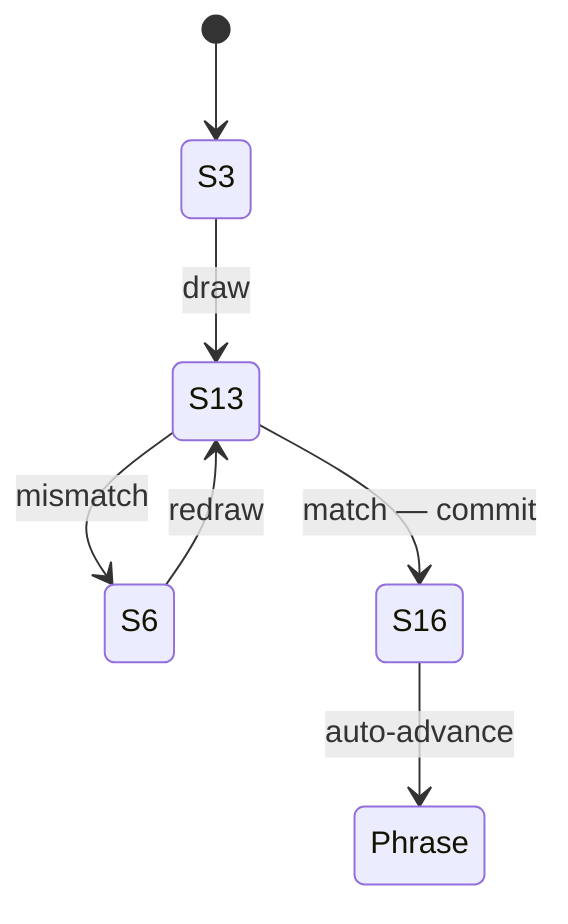

**Flows**
| Flow | Path | Success | Abandonment |
|---|---|---|---|
| F1 step 2 | → `/onboarding/phrase` | Pattern committed | Back → create, nothing committed |

**Edge cases & races**
- Mismatch never increments any counter and never arms the throttler.
- The commit is a single atomic write; a crash mid-write leaves no vault (relaunch → `/welcome`).
- After commit, death before the phrase is saved → relaunch is `/lock`; the phrase never existed
  (00 §6). The user can later generate one via reset with the current pattern (§1.10).
- Constant-time comparison; comparison timing must not leak match length.
- A4: shake is replaced by the reduced-motion 200 ms rose border pulse; announcement unchanged.

**Data contract**
Reads: held pattern (memory). Writes: pattern verifier, wrapped vault key, vault arena (encrypted). Must never appear: pattern coordinates at rest, "incorrect" copy, attempt counters.

---

### 1.5 Recovery phrase display (first run) — `/onboarding/phrase`

**Badges:** Secure (FLAG_SECURE, whole screen) · Pro: no · Owner: secret-phrase
**Purpose:** Show the 9-word recovery phrase exactly once. The only way back in if the pattern is lost.

**Entry points**
| From | Trigger | Arguments | Preconditions |
|---|---|---|---|
| `/onboarding/confirm` | Match → auto-advance | freshly generated phrase (memory only) | Pattern committed |

**Exit points**
| To | Trigger | Side effects |
|---|---|---|
| `/onboarding/done` | `I've saved it` (checkbox + 10 s gate) | Phrase confirmed; plaintext zeroized; encrypted verifier stored |
| `/vault` | Leave confirmed via dialog | Pattern kept, phrase **never shown again** |
| `/lock` | Background > 5 s, or G4 | Cover immediately; plaintext zeroized at 5 s; relaunch is `/lock` (vault exists) |

**Actions**
| Control | Preconditions | Effect | Resulting state | Failure |
|---|---|---|---|---|
| Read words | — | 3×3 tiles, `mono.m` 22sp, index `mono.s`; long-press selection disabled | S3 | — |
| `I wrote it down` checkbox | — | Real checkable node, state announced | S3 | — |
| `I've saved it` | Checkbox checked AND ≥ 10 s on screen | Confirm phrase, advance | → `/onboarding/done` | Button disabled until both; no timer text (no pressure) |
| Back / close | — | Opens leave-confirmation dialog | S14 | — |
| Leave confirmed | Checkbox "I understand I can lose access" checked | Exit to vault without a phrase | → `/vault` | Checkbox unchecked → primary disabled |

**States**
| State | Trigger | Visual | Available actions | Announcement |
|---|---|---|---|---|
| S3 | Content | Solid panel, `Plain` background, butter notice "This is your only way back in. Keep this screen open while you write it down." | Read, checkbox, save, leave | "Recovery phrase, 9 words. Screen readers will read it aloud." |
| S14 | Leave requested | Dialog: "Leave this screen? Without the phrase you can lose access to your vault." + checkbox | Confirm / cancel | Title first |
| S16 | Saved | — | — | "Phrase saved" |
| A2 TalkBack | Entry | Butter banner "Screen reader active. Your phrase will be spoken aloud. Use headphones." | Read all words (custom action) | Warning first — focus lands on the title, never word 1 |
| S9 | Background > 5 s, or G4 | Phrase gone; relaunch is `/lock` | Unlock | — |

**Transitions**
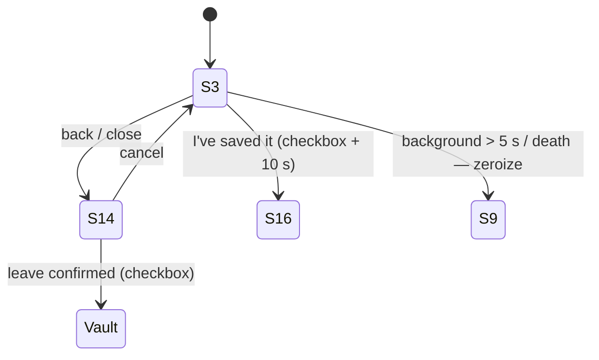

**Flows**
| Flow | Path | Success | Abandonment |
|---|---|---|---|
| F1 step 3 | → `/onboarding/done` | Phrase confirmed once | Leave confirmed → phrase lost; recoverable only by resetting the pattern later |

**Edge cases & races**
- **No skip.** Leaving always routes through the confirm dialog; the destructive dialog has no scrim
  dismiss (back and Esc cancel it).
- **The phrase is never persisted before confirmation.** Backgrounding covers it immediately and
  zeroizes the plaintext after 5 s; returning inside 5 s lifts the cover, after 5 s the app locks.
  Process death during display → the phrase is unrecoverable by design; relaunch is `/lock`. It
  must never be re-rendered from any store.
- Rotation: composition state (checkbox, elapsed timer) survives; the phrase stays in memory.
- No copy button, no share, no screenshot, clipboard disabled, autofill off, IME learning off.
- A4 200%: tiles wrap to one column, the page scrolls, no truncation of the notice.
- `A5` reduced motion: the 10 s gate is unchanged — it is not an animation.

**Data contract**
Reads: generated phrase (memory only). Writes: phrase verifier (encrypted) on confirm. Must never appear: the phrase in plaintext storage, logs, clipboard, crash reports, or a second display.

---

### 1.6 Ready — `/onboarding/done`

**Badges:** Secure: no · Pro: no · Owner: ease-of-use
**Purpose:** One calm landing: the vault exists and is open. Two next actions, no celebration.

**Entry points**
| From | Trigger | Arguments | Preconditions |
|---|---|---|---|
| `/onboarding/phrase` | `I've saved it` | — | Phrase confirmed |

**Exit points**
| To | Trigger | Side effects |
|---|---|---|
| `/vault/import` | `Add photos` | System picker flow; no permissions requested before the tap |
| `/vault/camera` | `Take a photo` | Camera permission flow owns the rationale |
| Background | Back | Session continues under auto-lock rules |

**Actions**
| Control | Preconditions | Effect | Resulting state | Failure |
|---|---|---|---|---|
| `Add photos` | Session open | Push import | → `/vault/import` | Picker cancelled → returns here |
| `Take a photo` | Session open | Push camera | → `/vault/camera` | Permission denied → rationale (owned by 03) |
| Back | Root of flow | Grounds the app; done is one-shot | — | Relaunch after death → `/lock` → `/vault` (done is never restored as a destination) |

**States**
| State | Trigger | Visual | Available actions | Announcement |
|---|---|---|---|---|
| S16 | Content | "Your vault is ready." ink primary + ghost; no confetti, no "vault created" fanfare | Both actions, back | "Your vault is ready" |
| D2/D3 | Storage low/full | Butter banner "Storage is almost full." / "This device is out of space. Free up space or connect a drive." | Actions still offered; import/camera block at the action per 07 §2 | — |
| N2 | Offline | No banner — both actions are local; import/camera never need a network | — | — |
| A2 | TalkBack | Order: title → `Add photos` → `Take a photo` | — | — |
| A4 / V4 | Scale / width | Buttons stack, 60 dp height; identical centering on tablet | — | — |

**Transitions**
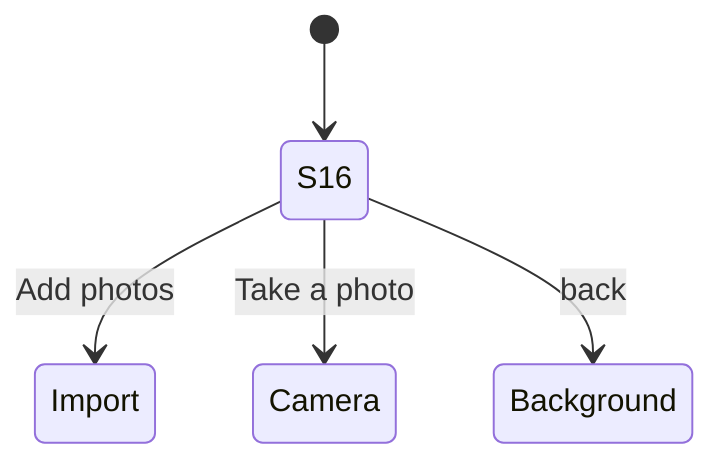

**Flows**
| Flow | Path | Success | Abandonment |
|---|---|---|---|
| F1 end | → `/vault` (via either action) | Vault in use | Back — vault remains, session under auto-lock |

**Edge cases & races**
- Duress / hidden vaults are never introduced here (screens §2).
- Notification permission is **not** asked here — only after the first backup is enabled or the
  first share is created (07 §8.4).
- Backup stays at its default-on state silently; there is no "backup enabled" moment to celebrate.
- Process death → `/lock`; after unlock the user lands on `/vault`, never back on done.
- G6 duress wipe is impossible on this path — the decoy cannot exist yet.
- V6 multi-window: single column; the two actions stay in the bottom third, thumb-reachable.
- A5 reduced motion: nothing to reduce — the landing is static by design.

**Data contract**
Reads: session state, storage estimate (on demand). Writes: none. Must never appear: "Setup complete" progress bars, celebration motion, permission prompts.

---

### 1.7 Pattern lock — `/lock`

**Badges:** Secure (grid) · Pro: no · Owner: pattern-encryption / duress-mode
**Purpose:** Resolve a drawn pattern (or biometric shortcut) into a vault session — known, unknown, or duress, identically — or into a neutral wait.

**Entry points**
| From | Trigger | Arguments | Preconditions |
|---|---|---|---|
| Cold start | Launcher / alias / widget | — | Vault exists |
| Warm start | Activity recreation, threshold passed | — | Session existed |
| Auto-lock | Background ≥ setting: immediately / 30 s / 1 m / 5 m (default 30 s) | `reason=timeout`, `pendingDestination` = last route | Session existed |
| Screen off | Always locks, regardless of setting | `reason=screen-off` | — |
| Manual lock | Nav overflow or long-press shortcut | `reason=manual` | Session existed |
| G4 | Process death with a pending destination | `pendingDestination {kind, opaqueId}` | — |
| Notification tap | `Backup` / `Sync` / `Share expiry` / `Security` channel | `pendingDestination` | Opens settings rows after unlock, never files |
| Deep link | App link to a gated destination | `pendingDestination` | Never into unlocked content |
| Re-auth | Secure action elsewhere (reveal phrase, restore from settings) | `reason=reauth` + return kind | Returns to origin on success |
| Biometric invalidation | Enrollment changed while enrolled | `reason=biometric-invalidated` | Vault intact; pattern required |
| Integrity check failed | Tamper / integrity `S12` | `reason=integrity` | Neutral explanation after unlock |
| Restore completion | Post-restore pattern just created | — | Session starts; no lock interposed |

**Exit points**
| To | Trigger | Side effects |
|---|---|---|
| Pending destination or `/vault` | Pattern or biometric resolves — known, unknown, or duress, identically | Session key in memory; attempt window decays |
| `/recovery/enter` | `Forgot pattern?` | Pattern buffer cleared |
| Background | Back from lock roots the app | Buffer zeroized; solid recents cover |

**Actions**
| Control | Preconditions | Effect | Resulting state | Failure |
|---|---|---|---|---|
| Draw pattern | `!throttled` | Dots accumulate, `EFFECT_CLICK` per dot | S13 | Release < 6 dots → ignored silently, no attempt counted |
| Release | ≥ 6 dots | KDF + index probe | S1 | 5th attempt in rolling window → S9 wait armed |
| `Unlock with biometrics` | Enrolled + enabled + `!throttled` | System prompt (overlay, never over a sheet) | S1 on success | Prompt fail → 1 retry; system lockout after 5 → row absent, pattern unaffected |
| `Forgot pattern?` | — | Push recovery entry | → `/recovery/enter` | — |
| Help icon | — | Sheet: pattern safety (shoulder surfing, screen protectors) — never account recovery | — | — |
| Wait expiry | S9 | Countdown ends, grid re-enables | S3 | — |

**States**
| State | Trigger | Visual | Available actions | Announcement |
|---|---|---|---|---|
| S0 | Composition | Static grid, no copy, 280 dp (`glassSubtle` circle) | Draw | "Pattern unlock grid, 5 rows, 5 columns" |
| S3 | Idle | 25 idle dots; "Welcome back" / "Draw your pattern" — no vault name, no count | Draw, biometric, Forgot, Help | — |
| S13 | Drawing | Dots enlarge, iris line, per-dot haptic | Release | "{n} dots connected" |
| S1 | Validating | Grid holds, subtle iris pulse; no spinner before 400 ms | none | "Checking" |
| S16 | Resolved | 380 ms iris glow → content; nav enters +120 ms | none | "Vault unlocked" (assertive) — identical for known, unknown, duress |
| S9 | Throttled | Neutral ink cover over the grid, "Please wait a moment." + `mono.m` countdown | Forgot pattern? | "Please wait a moment" (assertive) |
| S12 | Integrity failed | Lock as usual; neutral explanation sheet once unlocked | Unlock | — |
| X5 | Capture attempt | Blocked; one neutral line only if capture was attempted | — | "Screen capture is blocked on this screen" |

**Transitions**
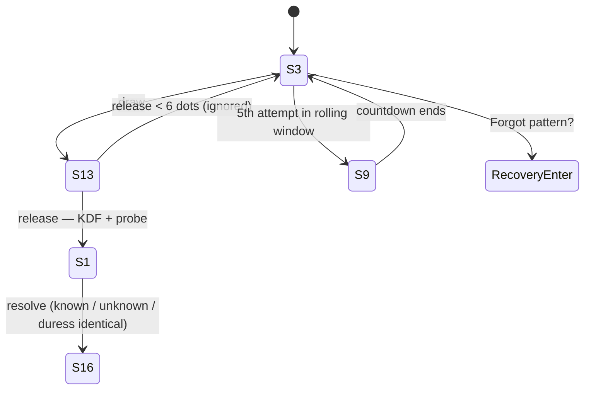

**Flows**
| Flow | Path | Success | Abandonment |
|---|---|---|---|
| F2 | → `/vault` | Session ≤ 500 ms after release | Idle; back grounds |
| F3 | Duress pattern → decoy `/vault` | Wipe silent | None |
| F7 | Biometric → `/vault` | Same timing class | Fail → pattern |
| F8 | Timeout → unlock → pending destination | Route restored | Unresolvable → `/vault` |
| F4 start | `Forgot pattern?` → `/recovery/enter` | Recovery path | Back → lock, buffer cleared |

**Edge cases & races**
- **No wrong-pattern state** (screens §3.1): an unknown pattern glows and navigates into the same
  neutral empty vault; no shake, no red, no error, no counter. A typo opens an empty vault; the
  user locks and redraws. Error styling exists only in creation (§1.3).
- **Duress is pixel-identical** (R3): ± 1 frame timing class, single heavy click, no extra haptic,
  no confirmation, no badge; wipe starts after the decoy renders.
- Race: duress pattern drawn while a normal KDF is in flight → in-flight derivation discarded;
  duress resolves within its normal budget.
- Background during KDF: derivation cancelled, buffers zeroized, return to S3. Process death during
  KDF: relaunch is `/lock`; a half-unlocked vault is impossible (derivation is atomic in memory).
- Rotation during draw: buffer survives config change; cleared on background.
- Throttle survives restart, force stop, and reboot (R1); clock rollback re-arms the wait.
- Screen dims to 10% after 30 s inactivity; never shows content. Recents: solid brand cover.
- A4 200%: grid shrinks, never scrolls; V3 foldable: never across the hinge; V4: 320 dp grid; X2
  battery saver forces Solid mode with no behavior change.
- Biometric invalidation mid-session locks immediately; the next unlock is pattern; re-enrollment
  offered once, dismissible.

**Data contract**
Reads: pattern buffer (memory only), throttle store (encrypted), `pendingDestination`, biometric availability. Writes: throttle tier/deadline/attempt buckets, last-unlock wall clock. Must never appear: pattern coordinates, vault count, vault label, "incorrect" copy, a biometric result that differs visually from a pattern resolve.

---

### 1.8 Recovery phrase entry — `/recovery/enter`

**Badges:** Secure (FLAG_SECURE, whole screen) · Pro: no · Owner: secret-phrase
**Purpose:** Turn a typed phrase into the vault key — to open, to reset the pattern, or to restore a backup on a new device.

**Entry points**
| From | Trigger | Arguments | Preconditions |
|---|---|---|---|
| `/lock` | `Forgot pattern?` | `mode=open` | — |
| `/welcome` | `Restore with phrase` | `mode=restore` | No local vault |
| `/settings/cloud/backup` | `Restore on a new device` | `mode=restore` | Pattern re-auth just passed |
| `/settings/security` | Reveal/change flows that prove by phrase | `mode=reauth` + return kind | — |
| `/` | Interrupted restore intent | `mode=restore` | — |

**Exit points**
| To | Trigger | Side effects |
|---|---|---|
| Choice sheet | Phrase verifies (`mode=open`) | `Reset pattern` → `/recovery/reset-pattern`, or `Open vault` → `/vault` |
| `/restore/progress` | Phrase verifies (`mode=restore`) | Backup key derived; Drive discovery begins |
| Origin screen | Phrase verifies (`mode=reauth`) | Return to the settings action that requested it |
| `/lock` or `/welcome` | Back, or G4 | Typed words zeroized; nothing persisted |

**Actions**
| Control | Preconditions | Effect | Resulting state | Failure |
|---|---|---|---|---|
| Segmented `9 words` / `12 words` / `Custom` | — | Slot count switches; `Custom` accepts 6–24 and shows the strength meter | S3 | Switching mode clears entered words (confirm if any filled) |
| Type in slot | — | Auto-advance; no suggestions, no autocorrect, no clipboard menu; backspace retreats | S13 | — |
| `Paste words` (ghost) | — | 1.5 s hold → confirm dialog → fills slots → clipboard cleared immediately | S13 | Clipboard empty or non-word content → dialog says so, no fill |
| Submit (`Unlock` / `Restore` / `Continue`) | All slots filled | Full-width iris progress line, no percentage; 800k KDF takes what it takes; **cancel disabled** | S15 | Tag mismatch → S6 "That phrase didn't work." |
| Wrong-submission recovery | S6 | Only the last field clears; the rest, the mode, and scroll position are preserved | S13 | 3rd wrong submission → 30 s wait (R1 ladder on the recovery counter) |
| `Strength` (custom) | Custom mode | 4 segments labeled `Weak / Fair / Good / Strong` — never color-only | — | — |

**States**
| State | Trigger | Visual | Available actions | Announcement |
|---|---|---|---|---|
| S3 | Idle | Segmented control + slots, `solidRaised` fields | Type, paste, mode switch, back | "Word 1 of 9, empty. Type a word" |
| S13 | Editing | Filled slots announce state | Submit when full | "Word {i} of {n}, filled" |
| S15 | Submitting | Iris progress line + "Checking your phrase. This can take a few seconds."; controls disabled, not removed; cancel disabled | none | "Checking your phrase" |
| S16 | Verified | Choice sheet (`mode=open`) or auto-advance | — | — |
| S6 | Wrong phrase | "That phrase didn't work." — generic; no hint about typo vs. wrong phrase; last field cleared | Fix last field, resubmit | "That phrase didn't work" (assertive) |
| S9 | 3 wrong submissions | "Please wait a moment." + `mono.m`; fields preserved behind the wait | Wait | "Please wait a moment" |
| N2 | Offline, `mode=restore` | Entry works; submit shows "Restoring needs a connection." → S6 at submit | Retry when online | "Restoring needs a connection" |

**Transitions**
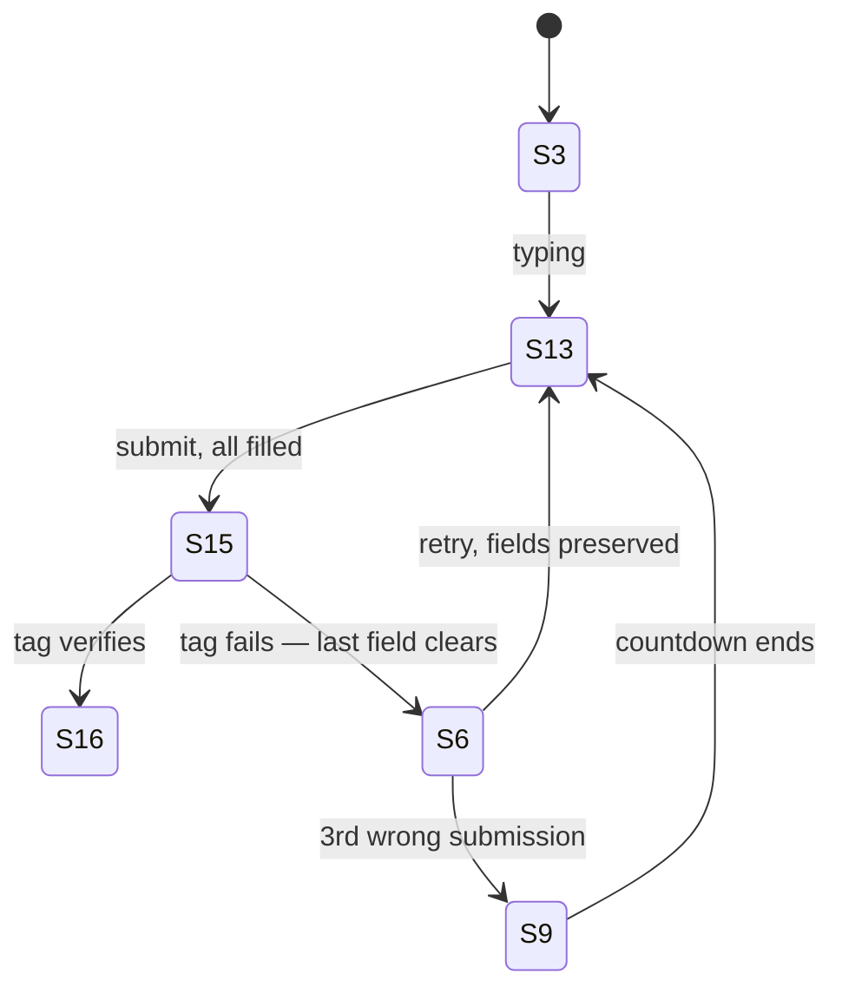

**Flows**
| Flow | Path | Success | Abandonment |
|---|---|---|---|
| F4 | `/lock` → here → choice | Reset or open | Back → `/lock`; words cleared |
| F5 start | Here → `/recovery/reset-pattern` | Reset flow | — |
| F6 | Here (`restore`) → `/restore/progress` | Restore | Kill → relaunch `/welcome` (or `/lock` if a vault now exists) |
| F10 | Settings re-auth → here → origin | Settings action proceeds | Back → settings |

**Edge cases & races**
- Word validation is local and silent until all slots are filled; per-field wordlist checks would
  leak progress to a shoulder surfer.
- "What is retried" after a wrong phrase: exactly the last field plus submit; every other field,
  the mode, and scroll position are preserved. Nothing is re-downloaded or re-derived.
- The recovery throttle counter is separate from the lock counter (R1) but uses the identical
  ladder, persistence, and neutral copy.
- G4: typed words are memory-only and never survive death; relaunch is `/lock`, or `/welcome` when
  the restore intent predates any vault.
- Autofill off, `IME_FLAG_NO_PERSONALIZED_LEARNING`, `KeyboardType.Password` semantics, clipboard
  menu disabled except the deliberate hold-to-paste.
- A4 200%: slots wrap to one column; the hold-to-paste control stays reachable (60 dp button).
- A6 RTL: slot order stays logical (word 1 first); numbers remain LTR in `mono`.

**Data contract**
Reads: mode, clipboard (only via hold-to-paste). Writes: derived key attempt in memory; recovery throttle store (encrypted); on success, the recovered session key. Must never appear: typed words in logs, crash reports, autofill, IME history, or persisted form state.

---

### 1.9 Recovery phrase re-display — `/recovery/display`

**Badges:** Secure (FLAG_SECURE, whole screen) · Pro: no · Owner: secret-phrase
**Purpose:** Post-authentication re-display of the phrase from Settings. Never the first run — that is `/onboarding/phrase` — and never reachable without fresh proof.

**Entry points**
| From | Trigger | Arguments | Preconditions |
|---|---|---|---|
| `/settings/security` | `Recovery phrase` → `Reveal` | — | Biometric or pattern re-entry just passed; phrase re-derived in memory |

**Exit points**
| To | Trigger | Side effects |
|---|---|---|
| `/settings/security` | Two-step save confirm completed | Plaintext zeroized |
| `/settings/security` | `Close` before confirming | Dialog (same as leave) → confirm; plaintext zeroized |
| `/lock` | Background > 5 s, 30 s inactivity, or G4 | Phrase zeroized; re-open requires full re-auth |

**Actions**
| Control | Preconditions | Effect | Resulting state | Failure |
|---|---|---|---|---|
| Read words | — | Same tile language as §1.5; no copy, no share, no screenshot, long-press disabled | S3 | — |
| `I wrote it down` checkbox | — | Real checkable node | S3 | — |
| `I've saved it` | Checkbox + 10 s gate | Two-step confirm: "Did you write down all 9 words?" → "Yes, I have them" | S14 → exit | — |
| `Close` | — | Leave-confirm dialog with the loss checkbox | S14 | Checkbox unchecked → primary disabled |
| Return from background ≤ 5 s | — | Solid cover lifts, phrase still visible | S3 | > 5 s → pattern required again (screens §20) |

**States**
| State | Trigger | Visual | Available actions | Announcement |
|---|---|---|---|---|
| S3 | Content | Solid panel, butter notice "This is the only way back in. We can't reset it." | Read, checkbox, save, close | "Recovery phrase shown. Screen capture is blocked." (assertive) |
| S14 | Save or close confirm | Two-step dialog / leave dialog | Confirm / cancel | Title first |
| S9 | Background > 5 s / idle 30 s / G4 | Phrase gone | Re-auth from settings | — |
| A2 | TalkBack | Same warn-then-read banner as §1.5 | Read all words | Warning before any word |

**Transitions**
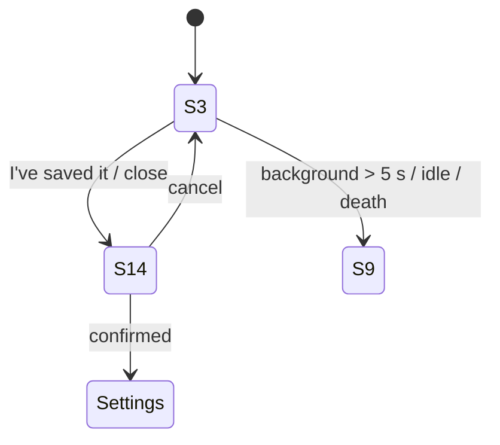

**Flows**
| Flow | Path | Success | Abandonment |
|---|---|---|---|
| Settings reveal | Re-auth → here → settings | Phrase seen once more | Close → dialog → zeroize |

**Edge cases & races**
- Each reveal requires fresh biometric or pattern proof; there is no "keep unlocked" toggle.
- The phrase is re-derived in memory from the pattern/biometric-wrapped key; it is never read from
  plaintext storage (persistence matrix: never plaintext, anywhere).
- Race: background at 4.9 s then instant return — the cover lifts with no re-auth; a kill during
  the same window is G4 and requires full re-auth.
- Recents shows a solid cover from the first frame (FLAG_SECURE set before first frame).
- A4 200%: tiles wrap per tile, the notice never truncates; V4: single centered column.

**Data contract**
Reads: re-derived phrase (memory only). Writes: none. Must never appear: copy button, share sheet, clipboard, screenshot, a second concurrent display, or the phrase after exit.

---

### 1.10 Pattern reset — `/recovery/reset-pattern`

**Badges:** Secure (phrase + confirm steps) · Pro: no · Owner: secret-phrase
**Purpose:** Replace the pattern and issue a new phrase. Four steps, no shortcuts; nothing changes until the final save.

**Entry points**
| From | Trigger | Arguments | Preconditions |
|---|---|---|---|
| `/recovery/enter` | Choice sheet → `Reset pattern` | `proof=phrase` | Phrase just verified |
| `/settings/security` | `Change pattern` | `proof=current-pattern` | Full-screen interstitial shown first (screens §11) |

**Exit points**
| To | Trigger | Side effects |
|---|---|---|
| `/settings/security` | Final save confirmed | New pattern committed; **new phrase issued; old phrase invalidated** |
| `/settings/security` | Cancel at any point | **Nothing changed** — old pattern and phrase remain valid |
| `/lock` | G4 mid-reset | Old credentials still valid; reset state discarded |

**Actions**
| Control | Preconditions | Effect | Resulting state | Failure |
|---|---|---|---|---|
| Interstitial | Entry | "Resetting your pattern creates a new recovery phrase. Your files stay encrypted and stay yours." | S3 | — |
| Prove identity | Interstitial → step 1 | Current pattern **or** phrase — never both | S3 | Wrong proof → same neutral handling as its source screen (no counter here; phrase proof reuses §1.8 throttle) |
| Draw new pattern | Proof passed | Same creation rules (≥ 6 dots, ≥ 1 turn) | S13 | Invalid → creation hints |
| Confirm pattern | — | Same compare rules as §1.4 | S13 | Mismatch → shake, no penalty |
| New phrase display | Confirm | 9 words, same rules as §1.5 (checkbox, 10 s gate, warn-then-read) | S3 | Leave → confirm dialog |
| `Save` | Phrase confirmed | Single atomic commit: new verifier + new phrase verifier; old phrase invalidated | S16 | Write failure → S6 "Your files are safe. The reset didn't finish." — old credentials still valid |

**States**
| State | Trigger | Visual | Available actions | Announcement |
|---|---|---|---|---|
| S3 | Any step | Step content; progress shown as 4 steps, no percentage | Step action, cancel | Per-step titles |
| S13 | Drawing / confirming | Creation grid language | Redraw | "{n} dots connected" |
| S14 | Cancel requested | Dialog: "Cancel reset? Nothing has changed yet." | Cancel / continue | Title first |
| S15 | Final save | Controls disabled; atomic commit in flight | none | "Saving" |
| S16 | Saved | "Pattern updated." inline confirmation → back to settings | Done | "Pattern updated" |
| S6 | Commit write failure | Inline error; old credentials valid | Retry / cancel | — |

**Transitions**
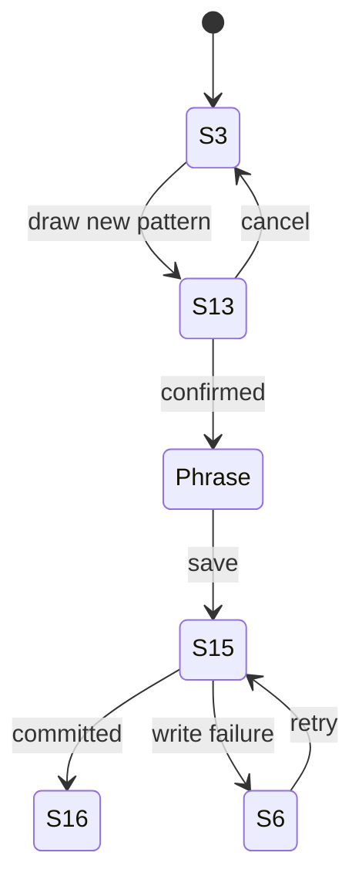

**Flows**
| Flow | Path | Success | Abandonment |
|---|---|---|---|
| F5 | Proof → pattern → confirm → phrase → save | New credentials live | Cancel anywhere → zero changes |
| F4 branch | Phrase proof → reset | — | — |

**Edge cases & races**
- Cancel at any point — including between confirm and save — changes nothing; the old pattern and
  phrase stay valid until the atomic commit lands.
- G4 before the commit: relaunch is `/lock`; the new phrase was never persisted and is lost; the
  reset restarts from the interstitial.
- G4 during the commit: the write is atomic — either old or new credentials, never a mix.
- The new phrase display follows every §1.5 rule, including background-zeroization.
- `proof=current-pattern` requires the current pattern first (screens §11); `proof=phrase` skips it
  because the phrase was just verified.
- A4 200%: the four-step indicator never truncates step labels; buttons stack.

**Data contract**
Reads: proof result, held new pattern (memory), new phrase (memory). Writes (atomic, at save only): new pattern verifier, new phrase verifier, invalidation of the old phrase. Must never appear: both credentials valid simultaneously after save, a partially committed reset, the new phrase on disk.

---

### 1.11 Restore progress — `/restore/progress`

**Badges:** Secure: no · Pro: no · Owner: encrypted-cloud-backup
**Purpose:** Download, verify, and decrypt a backup into a local vault, with real counts and honest failure reasons.

**Entry points**
| From | Trigger | Arguments | Preconditions |
|---|---|---|---|
| `/recovery/enter` | Phrase verified in `mode=restore` | backup key derived | `N1` for discovery |
| G4 / WorkManager | Restore job resumes after death | opaque job id | Chunk ledger intact |
| G5 takeover | App foregrounded while restore runs | — | Restore takeover per 00 §2.1 |

**Exit points**
| To | Trigger | Side effects |
|---|---|---|
| `/onboarding/pattern` (`mode=post-restore`) | `Open vault` after "Vault restored." | First-open pattern creation (2 steps, no phrase step — the phrase is already proven) |
| `/welcome` | Cancel confirmed | Downloaded data stays encrypted and resumable |
| Background | Home / recents | Restore continues; UI reattaches on return |

**Actions**
| Control | Preconditions | Effect | Resulting state | Failure |
|---|---|---|---|---|
| Progress display | Chunks flowing | Iris ring sweep + `mono.m` "42 of 128"; no file names, no vault labels, no thumbnails | S1/S3 | — |
| `Cancel` | — | Confirm dialog: "Stop restoring? Downloaded data stays encrypted and can resume later." | S14 | Destructive dialog: back/Esc cancel, no scrim dismiss |
| Cancel confirmed | S14 | Stop; keep encrypted partial state; exit | → `/welcome` | — |
| `Retry` | S6 | Resume from the chunk ledger — never from zero | S1 | Same failure → same reason, no escalation |
| `Try another phrase` | `Backup key doesn't match` | Back to `/recovery/enter` (`mode=restore`) | → `/recovery/enter` | — |

**States**
| State | Trigger | Visual | Available actions | Announcement |
|---|---|---|---|---|
| S1 | Discovering / first chunks | Ring + "Restoring…" | Cancel | "Restoring" |
| S3 | Steady progress | Ring sweep 600 ms, `mono.m` count | Cancel | "42 of 128" |
| S6 | `Not enough space` / `Connection lost` | Reason in plain language + `Retry`; space copy: "This device is out of space. Free up space or connect a drive." | Retry / Cancel | Reason announced |
| S6 | `Backup key doesn't match` | Reason + `Try another phrase` | Re-enter phrase | — |
| S14 | Cancel requested | Confirm dialog | Stop / continue | — |
| S16 | Complete | "Vault restored." + `Open vault` — no confetti, no "welcome back" personalization | Open vault | "Vault restored" |
| N2 | Connection drops mid-run | Pauses into S6 `Connection lost.` — queued chunk state preserved | Retry when online | — |
| D3 | Space exhausts mid-run | S6 `Not enough space`; no partial items listed anywhere | Free space → Retry | — |

**Transitions**
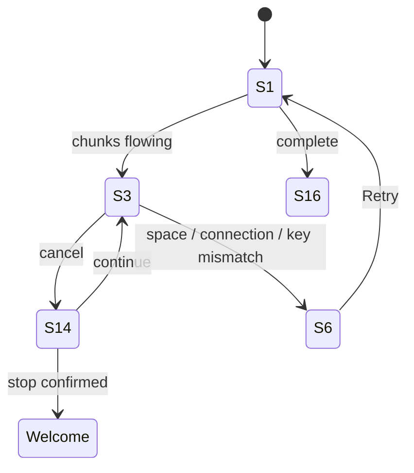

**Flows**
| Flow | Path | Success | Abandonment |
|---|---|---|---|
| F6 | → "Vault restored." → pattern → `/vault` | Vault usable | Cancel → resumable from `/welcome` |
| F10 | Settings-initiated restore → here | Restore re-runs | Cancel at re-auth, never here |

**Edge cases & races**
- Resume after kill: WorkManager owns the job; the chunk ledger is durable and opaque; the UI
  reattaches with real counts — never a restarted counter, never duplicate chunks.
- The restored vault has no pattern yet (the salt is device-bound): `Open vault` routes through
  `/onboarding/pattern` + confirm (`mode=post-restore`) before the session starts; the recovery
  phrase is unchanged and is not re-shown (see Gaps).
- Reasons are exact and distinct: `Not enough space` · `Connection lost` · `Backup key doesn't
  match`. Never record IDs, never sizes beyond the total, never crypto terms.
- Race: cancel confirmed while the final chunk commits → the commit wins; the success state shows
  on next open and the cancel is a no-op.
- A4 200%: the count line and reasons wrap; the ring keeps a 48 dp touch-cancel target.
- X3 doze: the job defers; the UI shows the last real count, not a fake percentage.

**Data contract**
Reads: chunk ledger (encrypted, opaque), backup manifest counts. Writes: encrypted chunks, ledger progress. Must never appear: file names, vault labels, thumbnails, record IDs, plaintext staging, a fake percentage.

---

## Gaps

- **Throttle counting basis needs product sign-off.** With no wrong-pattern state, "5 failures" is
  unobservable; R1 redefines the trigger as attempt *rate* (5 releases / 2 min), which also catches
  6 legitimate quick unlocks. Alternatives (time-damping only) change the brute-force economics.
- **Post-restore pattern creation is documented nowhere.** A device-bound salt means a restored
  vault cannot verify the old pattern; this file designs a 2-step pattern create (no phrase step).
  Confirm the crypto spec actually binds the salt to the device.
- **Biometric target vault is undesigned.** R2 picks "last unlocked vault"; with multiple vaults the
  user gets no choice, and "last used" is itself a small coercion/forensic leak. Needs a decision.
- **Restore-over-existing-vault has no policy.** F10 re-running a restore on a device that already
  has a vault needs merge / replace / refuse semantics before `/restore/progress` can ship it.
- **Duress partial-wipe ledger.** R3 asserts a resume-before-first-frame re-arm, but no durable wipe
  ledger design exists; without it a crash loop could leave residue the decoy never cleans.

## New components needed

- **`AuroraPatternGrid` extension — `throttled` state:** neutral ink cover + `mono.m` countdown
  over the grid; no new component, but a new grid state with its own golden screenshot.
- **`AuroraHoldButton`:** press-and-hold action (1.5 s paste, 2 s confirm) with an iris sweep
  progress and haptic on completion; currently only described inline in duress setup.
- **`AuroraSecretPhrase` extension — entry modes:** segmented `9 / 12 / Custom`, hold-to-paste
  integration, cleared-last-field semantics, and the `mode=post-restore` variant.
- **`AuroraStrengthMeter`:** 4-segment custom-phrase estimator, labeled `Weak / Fair / Good /
  Strong`, never color-only.
- **`AuroraStepDots`:** the 3-dot onboarding progress (ink.200 dots, active ink pill 20 dp) and the
  4-step reset indicator, one component with a count parameter.
