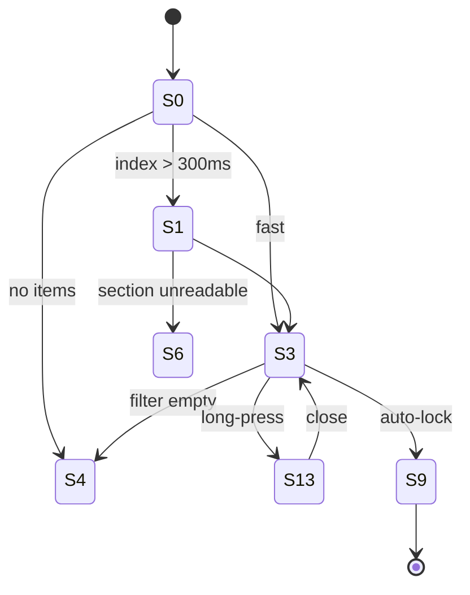
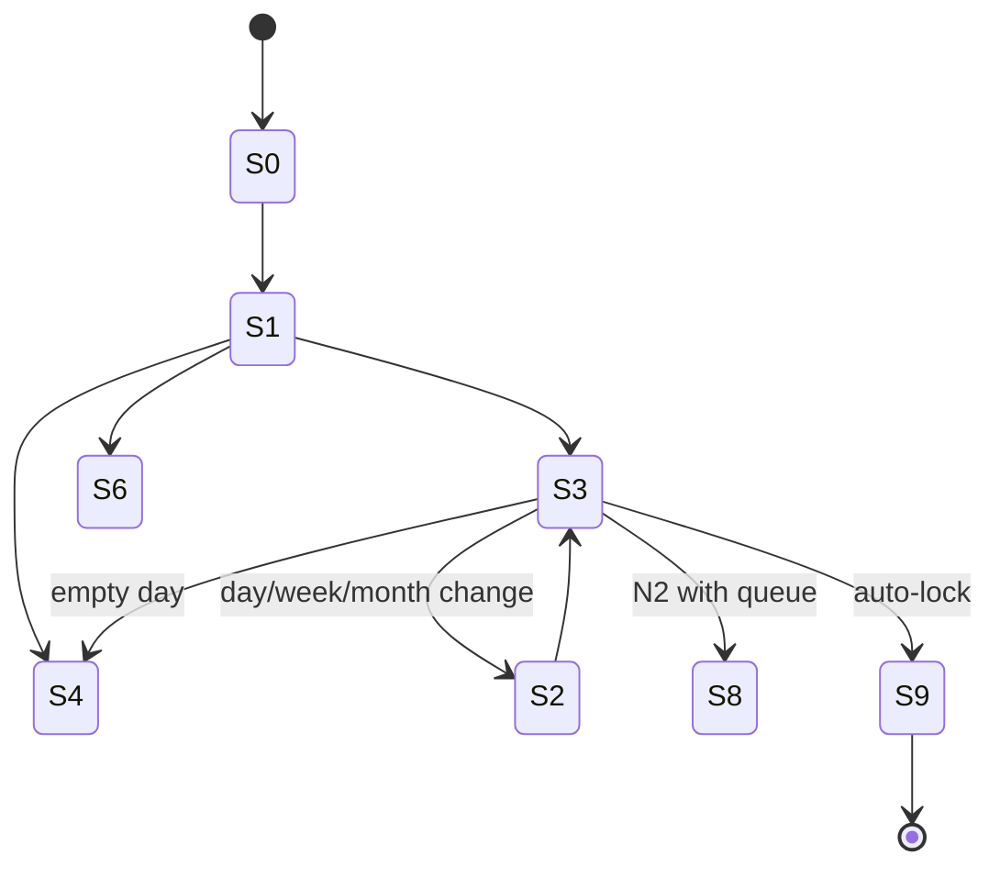
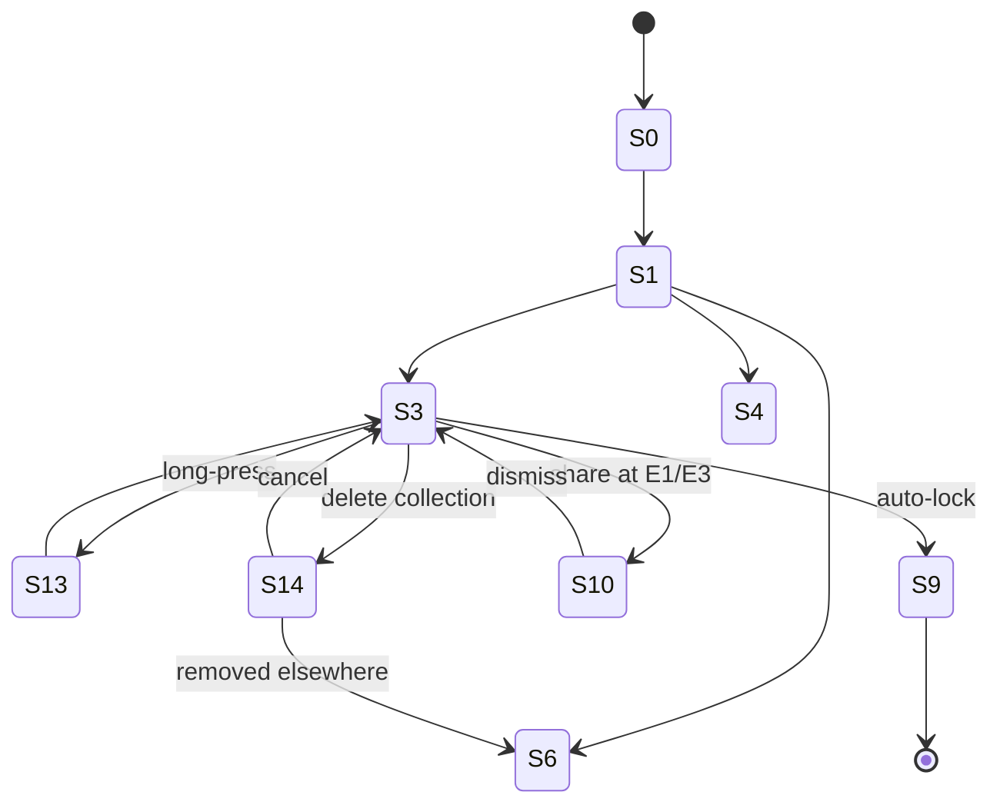
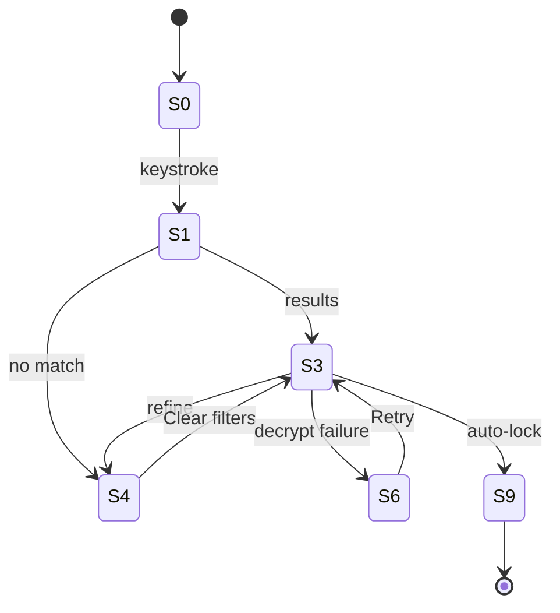
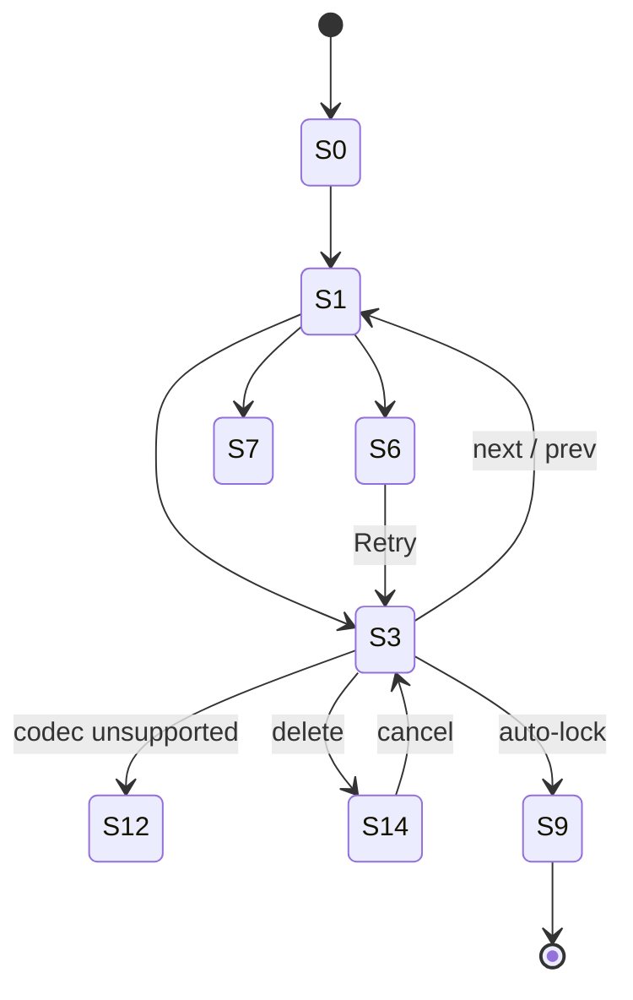
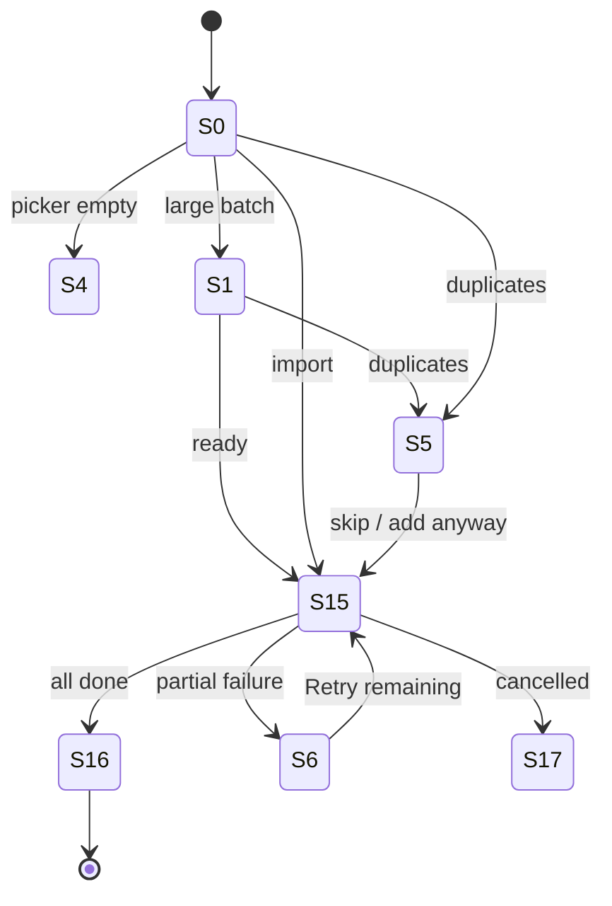
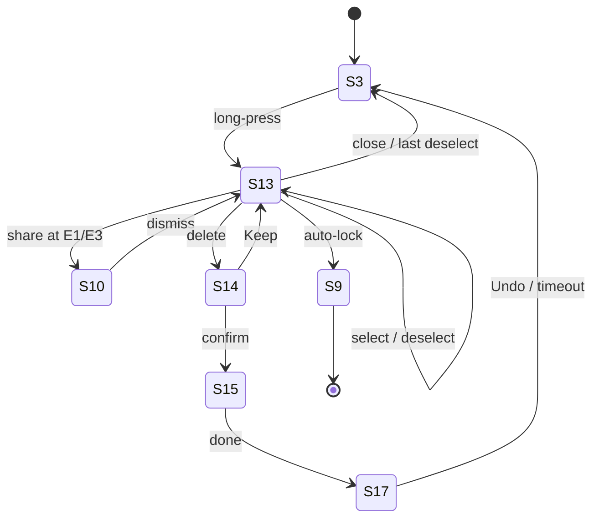

# 02 · Vault Core — Home, Timeline, Collection, Search, Viewer, Import, Selection

> What the vault *does* once it is open. Visuals are in [`../screens.md`](../screens.md) §4–§9,
> components in [`../components.md`](../components.md) §2, §4. State codes are in
> [`_TEMPLATE.md §2`](./_TEMPLATE.md); precedence, persistence and process-death rules in
> [`00-state-model.md`](./00-state-model.md); network/storage/entitlement in
> [`07-system-states.md`](./07-system-states.md).

**Scope:** `/vault`, `/vault/timeline`, `/vault/collection/{id}`, `/vault/search`,
`/vault/file/{id}`, `/vault/import`, and the selection state on `/vault`. Camera and review are in
`03`; sharing, My Shares and read-only `/shared/{id}` viewing are in `05`.

**Non-negotiables carried into every screen in this file**

- Vault title is always the generic `Vault`. No vault id, count, label, pattern or hash ever renders
  (`feature-matrix §5`, invariant 4). Collection and file names are encrypted *content* and are allowed.
- There is **no content server**. "Refresh" reads local storage and the local index as the source of
  truth; the only network surfaces are Backup, Sync, Sharing, Billing and the opt-in crash report.
- Destructive actions confirm; read-only content never offers delete; selection is always dropped on
  process death.
- No plaintext file name, vault label, collection name, or count is written to logs, notifications,
  recents snapshots, WorkManager input, or backup metadata.
- `S4 Empty` and "no permission" and "no index" are three different states with three different exits.

---

### 2.1 Vault home — `/vault`

**Badges:** Secure: no (capturable; recents follows "Hide previews") · Pro: no · Owner: ease-of-use / hidden-vaults
**Purpose:** the reference screen — generic `Vault` title, one hero, filter chips, recent media, one status banner, nav and the camera FAB.

**Entry points**
| From | Trigger | Arguments | Preconditions |
|---|---|---|---|
| `/lock` | Pattern resolves (known, unknown, or duress) | `reason=unlock` | Session key derived; `G6` opens the decoy identically |
| `/onboarding/done`, `/restore/progress` | `Your vault is ready.` / `Open vault` (S16) | — | First open (empty) or restore complete, index rebuilt |
| `/vault/camera`, `/vault/import` | Review `Keep` / import completes or is cancelled | `newItemId` / `importedCount` | Item(s) encrypted + indexed |
| `/settings/*`, `/shares`, `/vault/search`, `/vault/collection/{id}` | Back / nav | — | — |
| Notification, widget, QSS tile | Tap after unlock, or launch tile | `pendingDestination={kind:vault}` | Follows `07 §8`; never names content, never bypasses lock |
| Lifecycle | `G2` warm resume, `G5` restore in progress | — | Re-locks if threshold passed |

**Exit points**
| To | Trigger | Side effects |
|---|---|---|
| `/lock` | Manual lock, screen-off, background ≥ auto-lock threshold, `S9` | Key zeroized; recents cover drawn before content |
| `/vault/timeline`, `/vault/search`, `/settings` | Nav destination / search icon / overflow `more` | Home scroll saved; search field focused |
| `/vault/file/{id}`, `/vault/collection/{id}` | Media tile / hero / `See all` / row tap | Viewer FLAG_SECURE set before first frame |
| `/vault/camera`, `/vault/import`, `/pro` | FAB / empty-state `Add photos` / Pro affordance | Permission check or paywall sheet; state preserved |
| Background / `G4` | Back at root / process death | App minimises (never logs out or deletes); relaunch → `/lock` with pending `{kind:vault}` |

**Actions**
| Control | Preconditions | Effect | Resulting state | Failure |
|---|---|---|---|---|
| Filter chip `All / Photos / Videos / Docs` | — | Re-filter the media query locally | S2 → S3 or S4-empty-filter | None (local) |
| Search icon / overflow `more` | — | Push `/vault/search` / open `/settings` (no vault switcher, ever) | — | — |
| Hero arrow `(→)` / `See all` | Hero is a collection / ≥ 1 item | Open that collection, or the paged `All` grid | — | Collection deleted under you → S6 |
| Media tile tap / long-press | Item decryptable | Open `/vault/file/{id}`, or enter selection (`EFFECT_CLICK`) | S9 on viewer / `S13` (2.7) | Decrypt fail → viewer S6 |
| FAB tap | camera granted or not yet asked | Open `/vault/camera` | — | `P2/P3` → S11 rationale |
| Pull-to-refresh | — | Re-read the **local** index, re-derive missing thumbnails, recompute storage, re-query backup/sync status | S2 → S3 | `S6` if the index is unreadable |
| Banner action (`Retry` / `Why?` / `Manage`) | Banner actionable | Open the owning flow (backup/sync/storage) | — | — |
| Nav destination | — | Switch tabs, preserving each tab's state | — | — |

**Banner states (at most one shows; priority top → bottom)**
| Priority | State | Trigger | Visual | Action | Dismissible |
|---|---|---|---|---|---|
| 1 | Backup failed | Last attempt errored | butter banner, danger icon | `Retry`, `Why?` | no |
| 2 | Storage low / full | `D2` / `D3` | butter banner | `Free up space` | `D2` yes, `D3` no |
| 3 | Sync paused | `E3` lapse or wrong account | butter banner | `Open sync` | yes until resolved |
| 4 | Backup stale / healthy | > 48 h / ≤ 48 h since a successful backup | sand (stale) or mint (healthy) banner | `Back up now` / none | yes |

> **Offline is not a home banner.** The vault is local; `N2`/`N4`/`N5` change nothing here. A sky "you're offline" banner would imply the vault needs a server — it does not. Only cloud status banners above may appear, and their timestamps simply age while offline.

**States**
| State | Trigger | Visual | Available actions | Exit | Announcement |
|---|---|---|---|---|---|
| `S0 Initial` / `S1 Loading` | Composition / index read > 300 ms | Static geometry (no spinner < 300 ms), then `AuroraSkeleton` and "Decrypting…" after 800 ms | none | → S3/S4/S6 | "Vault" |
| `S3 Content` | 1…N items | Hero + chips + grid + banner + nav + FAB | all above | → S4/S13/S9 | — |
| `S4 Empty` | Vault empty, or filter matches zero | "Nothing here yet." + `Add photos` / `Take a photo`; the filter case adds `Clear filters` | add, camera, clear | → S3 | "Nothing here yet" |
| `S5 Partial` | Some thumbnails fail or still decrypting | Placeholder glyphs; grid usable | open, select | → S3 as they resolve | "Some items are still loading" |
| `S6 Recoverable` | Index section unreadable | Inline danger banner + `Retry` (re-reads that index slice only) | Retry, Settings | → S3 | "Some items couldn't be read" |
| `S8 Offline / stale` | `N2` — **no visual change** (local vault) | No banner; cloud banners age in place | everything | n/a | — |
| `S9 Locked` | Auto-lock while open | Brand cover, no content beneath | unlock | → `/lock` | "Vault locked" |
| `S13 Selection` / `S17 Undo` | Long-press / delete committed | Iris-selected grid, or a snackbar with `Undo` (7 s) | select, share, add, delete / Undo | close, back / → S3 | "3 selected" / "Items moved to trash" |

> Home never shows `S7 Fatal`; a fatal index failure is `G5`/`S6`. Two builders that differ (unknown pattern vs empty vault) must render **identically** (`accessibility.md §10.3`).

**Transitions**

**Flows**
| Flow | Path | Success | Abandonment |
|---|---|---|---|
| Open (first / returning) | `/lock` → S0→S4 / S3 | Empty actions or recent grid within 800 ms | Background → resumes at the same state |
| Filter to zero | `All` → `Docs` | Empty state + `Clear filters` | Clear / back → S3 |
| Refresh | Pull down | Local re-scan; banner + thumbnails update | Release under threshold → no-op |
| Deep link to a deleted item | Notification → home | Lands on `/vault` silently | — |

**Edge cases & races**
- **Scale.** 0 → `S4`. 1 → hero becomes the item (empty-state card below 4 items). 12 → one page, no paging. 1,000 → `LazyVerticalGrid`, ~60-item pages (token in `## Gaps`), tiles decoded at tile size and LRU-evicted under `X2`/`X4`. 100,000 → paged index cursors, nothing fully in memory; scroll restored by **stable item id**, never index; eviction drops thumbnails only, never the cursor or scroll anchor.
- **Races.** A tile deleted remotely fades out with the gap closed (no dead tile; a mid-open item goes to the viewer's deleted-under-you path, 2.5); a filter applied mid-page discards the in-flight page via a generation counter.
- **Process death (`G4`).** Reopens locked, then home at the restored scroll anchor; pending destination is `{kind:vault}` only; selection dropped; banner re-derived, never restored stale.
- **`V4`/`V5`:** 2–3 column grid, nav rail replaces the nav bar, hero spans columns, FAB docks into the rail. **`V1`:** 2-up grid, floating nav. **`A4`:** hero stats 2-up, chip labels hide, `Add photos` stays visible.

**Data contract**
Reads: local encrypted index (ids, types, sizes, dates, membership), thumbnail cache, storage totals, backup/sync status · Writes: filter + scroll anchor (session) · Must never appear: vault id/count/label, pattern mapping, plaintext paths, notification/recents content, secret or share phrases.

---

### 2.2 Timeline — `/vault/timeline`

**Badges:** Secure: no · Pro: no · Owner: ease-of-use / secure-camera (activity) + encrypted-cloud-backup / device-sync (events)
**Purpose:** activity and media grouped by day and hour, on a calendar strip with an activity rail.

**Entry points**
| From | Trigger | Arguments | Preconditions |
|---|---|---|---|
| `/vault` | Nav destination | — | — |
| Notification | Backup/sync/share notice after unlock | `pendingDestination={kind:timeline}` | Never names content |
| Home banner action | e.g. `Why?` on a failed backup | `focusEventId` | — |
| Lifecycle | `G2` warm resume, `G4` cold | restore `selectedDate` + scroll | — |

**Exit points**
| To | Trigger | Side effects |
|---|---|---|
| `/vault` | Nav / back | Selected date retained in session |
| `/vault/file/{id}` | Tap a media event | Viewer opens on that item |
| `/vault/collection/{id}` | Tap a collection event | — |
| `/shares` | Tap a share event | — |
| `/settings/cloud/sync` | Tap a sync event | — |
| Month sheet | Tap month header | Sheet over the timeline (`AuroraSheet`) |
| `S9` | Auto-lock | Cover, no content |

**Actions**
| Control | Preconditions | Effect | Resulting state | Failure |
|---|---|---|---|---|
| Day cell | — | Select day, load that day's rail | S2 → S3 / S4 | — |
| Swipe week | — | Change week within the strip | S3 | — |
| Month header | — | Open month sheet | Sheet | — |
| Month sheet scroll-back | — | 3 months live, then lazy-load older | S1 → S3 | Older month unreadable → S6 |
| Event `(⋯)` | Event is a media import | Row menu (Open, Add to collection, Delete) | S13/S14 | — |
| Event tap | Target still exists | Navigate to file/collection/share | — | Deleted → row removed (below) |
| `+` (44 dp glass) | — | Open camera | — | `P2/P3` → S11 |
| Pull-to-refresh | — | Re-derive day buckets locally | S2 → S3 | S6 |

**States**
| State | Trigger | Visual | Available actions | Exit | Announcement |
|---|---|---|---|---|---|
| `S0 Initial` | Composition | Static strip + rail skeleton | none | → S3 in 300 ms | "Timeline" |
| `S1 Loading` | Month/day read > 300 ms | Skeleton rail rows | none | → S3/S6 | "Loading activity" |
| `S3 Content` | Events exist | Strip + hour-grouped tinted cards | all above | → S2/S4/S9 | — |
| `S4 Empty (day)` | No activity that day | Single "No activity" row, no illustration | pick another day | → S3 | "No activity" |
| `S4 Empty (month)` | New vault, no history | Same single row for the month | camera | → S3 on first capture/import | "No activity" |
| `S5 Partial` | Some events unresolved | Rows with a neutral placeholder; rest usable | tap others | → S3 | "Some activity is still loading" |
| `S6 Recoverable` | Bucket read error | Inline danger row + `Retry` (re-reads that day) | Retry | → S3 | "This day couldn't load" |
| `S8 Offline / queued` | `N2` with queued backup/sync/share | Queued cards show a 16 dp clock badge | tap (opens owning flow) | → S3 on reconnect | "Waiting to sync" |
| `S9 Locked` | Auto-lock | Brand cover | unlock | → `/lock` | "Vault locked" |
| `A4` / `V1` / `V4` | Font scale / width class | 200%: five day chips visible, rail grows, no truncation; V1: single rail + nav bar; V4: 2-pane timeline + day detail | all | — | — |

**Transitions**

**Flows**
| Flow | Path | Success | Abandonment |
|---|---|---|---|
| Inspect today | Nav → default selected = today | Today's rail in < 300 ms | Leave → date retained |
| Jump back 3 months | Month sheet → older month | 3 months cached; older lazy-loads | Release scroll before load → prior month stays |
| Open a capture | Tap an 11 AM import event | Viewer opens on that item | Viewer deleted-under-you → pop |
| Retry a failed event day | S6 → `Retry` | That day re-read | — |

**Edge cases & races**
- **Timezone change** (`ACTION_TIMEZONE_CHANGED`): re-bucket all events into the new local day; a day may gain or lose events; the selected day is preserved if it still exists, else the nearest day with activity is selected. No event content changes.
- **Clock change** (manual `ACTION_TIME_CHANGED`): identical re-bucket; future-dated events clamp to "later today" rather than disappearing.
- **DST spring-forward:** the skipped hour is merged into its neighbour (no empty phantom hour). **DST fall-back:** the repeated hour is merged with a small `+1h` marker; ordering stays chronological.
- **Queued offline events:** shown immediately with a clock badge and `N2` semantics; on reconnect the badge clears in place, the card is not duplicated.
- **Activity referencing a since-deleted item:** the row is removed, never rendered dead (`screens.md §5`); a share/backup event that outlives its target stays but its tap target is gone (non-interactive, muted). If the deleted item was the open viewer behind a pushed event, the viewer's own flow handles it.
- **"Hide previews" on:** media events show counts only ("Imported 12 photos"); off: file names may appear. The setting is read live; flipping it re-renders without re-loading.
- **Race:** a sync merge arrives while an older month lazy-loads → merge repaints loaded buckets; the loading generation counter drops the stale page.
- **Process death (`G4`).** Reopens locked, then timeline at the restored `selectedDate` with scroll anchored to a stable event id; if that id is gone, lands on today.

**Data contract**
Reads: encrypted activity records (type, timestamp, opaque target id, count), media index for preview toggle · Writes: `selectedDate`, scroll anchor (session) · Must never appear: file names when "Hide previews" is on, share phrases, recipient identity, vault label, device ids, record ids.

---

### 2.3 Collection — `/vault/collection/{id}`

**Badges:** Secure: no · Pro: no (share button inside is Pro-gated) · Owner: ease-of-use / secure-sharing
**Purpose:** a named set inside the vault — hero cover, filters, and a file list; read-only when it came from a share.

**Entry points**
| From | Trigger | Arguments | Preconditions |
|---|---|---|---|
| `/vault` | Hero card, `See all`, tile | `id` (opaque) | Collection exists locally |
| `/vault/timeline` | Tap a collection event | `id` | — |
| `/vault/search` | Tap a collection result | `id` | — |
| `S16` after create/move | `Add to` completes | `id` | — |
| Deep link | Notification | `pendingDestination={kind:collection, opaqueId}` | Unresolvable → `/vault` silently |

**Exit points**
| To | Trigger | Side effects |
|---|---|---|
| `/vault` | Back | — |
| `/vault/file/{id}` | Tap a row | Viewer |
| `/vault/share/create` | Share button (Pro) | Pre-selects this collection |
| `/pro` | Share tapped at `E1/E3` | Sheet; returns to collection on dismiss |
| `/vault` | Collection deleted on another device | Snackbar, pop |
| `S9` | Auto-lock | Cover |

**Actions**
| Control | Preconditions | Effect | Resulting state | Failure |
|---|---|---|---|---|
| Filter chips | — | Re-filter rows locally | S2 → S3 / S4 | — |
| Share | `E2` and not read-only | Open `/vault/share/create` | — | `E1/E3` → `AuroraProGate` |
| Rename | not read-only | Sheet with `AuroraTextField`, exact-name validation | S15 → S16 | Empty name → inline invalid; name > limit → truncated |
| Add to | not read-only | Picker: add selected items to this or another collection | S15 → S16 | Item deleted mid-move → skipped, counted |
| Export | policy allows | System share sheet / save-to-files for the set | — | Policy off → **item absent**, not disabled |
| Delete | not read-only, owner | Confirm "Delete this collection? The photos stay in your vault." | S14 → S15 → S17 | — |
| Row tap | Item decryptable | Open viewer | — | Corrupt → viewer S6 |
| Row long-press | — | Enter selection (2.7) | S13 | — |
| Row `(⋯)` | — | Row menu | — | — |

**States**
| State | Trigger | Visual | Available actions | Exit | Announcement |
|---|---|---|---|---|---|
| `S0 Initial` | Composition | Static header + row skeleton | none | → S3 in 300 ms | "Collection" |
| `S1 Loading` | Index read > 300 ms | `AuroraSkeleton` rows | none | → S3/S4/S6 | "Loading collection" |
| `S3 Content` | ≥ 1 item | Hero 220 dp, filters, 64 dp rows, `mono.m` count | all above | → S4/S13/S9 | — |
| `S4 Empty` | Collection has no items | "This collection is empty." + `Add items` | add, share | → S3 | "This collection is empty" |
| `S5 Partial` | Some rows unresolved | Placeholder glyphs; list usable | open, select | → S3 | "Some items are still loading" |
| `S6 Recoverable` | Count/index slice mismatch | Inline row "Updating…" then reconciled count | wait | → S3 | — |
| `S6 Deleted under you` | Collection removed on another device | butter banner "This collection was removed on another device." + `Back to vault` | Back | → `/vault` | "Collection removed" |
| `S8 Offline` | `N2` | No banner (local); export/share gate only | browse, rename | → S3 | — |
| `S9 Locked` | Auto-lock | Cover | unlock | → `/lock` | "Vault locked" |
| `S10 Pro-gated` | Share at `E1/E3` | `AuroraProGate` sheet, feature visible | Try Pro, Not now | dismiss | — |
| `S13 Selection` | Long-press | See 2.7 | see 2.7 | close | "N selected" |
| `S14 Confirming` | Delete collection | Dialog, danger text, no scrim dismiss | Delete, Keep | confirm/cancel | "Delete this collection?" |
| `S16 Success` | Rename / add-to done | Inline confirmation with next action | — | → S3 | "Saved" |
| `A4` / `V1` / `V4` | Font scale / width class | 200%: header wraps, count stays one line, row actions stay 48 dp; V1: 2-up grid; V4: 3-up + rail, 720 dp cap | all | — | — |

**Transitions**

**Flows**
| Flow | Path | Success | Abandonment |
|---|---|---|---|
| Rename a trip | `(⋯)` → Rename → save | Header updates; names are encrypted content | Empty name → stays in sheet with hint |
| Add 3 items | `(⋯)` → Add to → pick items | Count bumps; `S16` confirms | Cancel → no change |
| Delete a collection | `(⋯)` → Delete → confirm | Group removed, files kept, `Undo` 7 s | Keep → S3 |
| Open a shared collection | `/shared/{id}` variant | Read-only pill, no edit/delete/share | — |

**Edge cases & races**
- **Read-only shared collection:** header shows a 28 dp `Read-only` status pill; `Rename`, `Add to`, `Delete`, and Share are **absent**, not disabled. Rows still open the viewer under the no-export policy (absent export, not disabled).
- **Collection edited on another device mid-view:** merged rows appear; if the collection itself was deleted, `S6 Deleted under you` fires and content already on screen stays until pop (no blank flash).
- **Item count mismatch:** the header count comes from the index and can differ from rendered rows for a frame during a sync merge; show a subtle `mono.m` "Updating…" instead of a wrong number; never show a negative or a "0 of 24".
- **Rename race:** two devices rename simultaneously → last-writer wins (add-wins merge per `device-sync`); the losing name is not shown as an error.
- **Add-to race:** an item deleted during the move is skipped and reported in the `S16` count.
- **Scale:** 1 item → hero + one row. 12 → single page. 1,000/100,000 → paged lazy rows, scroll anchored by stable item id.
- **Process death (`G4`).** Reopens locked, then the collection by `opaqueId`; if unresolvable, `/vault` silently. Selection dropped.

**Data contract**
Reads: encrypted collection record (encrypted name, membership, policy flags), item metadata, share policy · Writes: renamed name (encrypted), membership, collection-delete tombstone (syncable) · Must never appear: share phrase, recipient identity, owner account, vault label, plaintext paths.

---

### 2.4 Search — `/vault/search`

**Badges:** Secure: no · Pro: no · Owner: ease-of-use / security-architecture
**Purpose:** local, index-only search over vault content; never a network call, never over secrets.

**Entry points**
| From | Trigger | Arguments | Preconditions |
|---|---|---|---|
| `/vault` | Top-bar search icon | — | Field auto-focused |
| Any screen | Back into a retained query (session) | `query` | Query is session-only, cleared on lock |
| Lifecycle | `G2` resume with the field focused | — | Re-lock threshold respected |

**Exit points**
| To | Trigger | Side effects |
|---|---|---|
| `/vault` | Back / Cancel | Query discarded (not persisted unless recents opted in) |
| `/vault/file/{id}` | Tap a media result | Viewer |
| `/vault/collection/{id}` | Tap a collection result | — |
| `S9` | Auto-lock | Query cleared from memory |

**Actions**
| Control | Preconditions | Effect | Resulting state | Failure |
|---|---|---|---|---|
| Type | — | Update query; results refresh after **120 ms** debounce | S3 / S4 | — |
| Clear field | query non-empty | Reset to recents/filters | S3 idle | — |
| Filter chip `Photos/Videos/Docs/Dates` | — | Narrow results locally | S2 → S3 / S4 | — |
| `Clear filters` | zero results | Drop filters, keep query | S3 | — |
| Tap result | Target exists | Navigate | — | Target vanished → row removed (below) |
| Recent search tap | recents opted in | Re-run the stored (encrypted) query | S3 | — |
| Remove recent | recents opted in | Delete one stored query | S3 | — |

**States**
| State | Trigger | Visual | Available actions | Exit | Announcement |
|---|---|---|---|---|---|
| `S0 Initial` | Field focused, empty query | Filters + (opt-in) recents + hint | type | → S3 | "Search this vault" |
| `S1 Loading` | First keystroke, results > 300 ms | `AuroraSkeleton` results (no spinner before 300 ms) | type | → S3/S4 | "Searching" |
| `S3 Content` | ≥ 1 match | `Results · N` + paged tile grid | open, filter | → S4/S9 | "N results" |
| `S4 Empty (no match)` | Query has no matches | "No matches in this vault." + `Clear filters` | Clear | → S3/S0 | "No matches in this vault" |
| `S4 Empty (spaces only)` | Query is only whitespace | Treated as empty; recents/filters shown | type | → S3 | — |
| `S5 Partial` | Index still building | Filters/results as available + "Still indexing…" line | wait | → S3 | "Still indexing" |
| `S6 Recoverable` | A result fails to decrypt | Danger row + `Retry` (re-runs the query only) | Retry | → S3 | "Some results couldn't be read" |
| `S6 No index yet` | Vault opened, index not built | "Preparing search…" with a real progress, cancellable | Back | → S3 when ready | "Preparing search" |
| `S6 Index rebuilding` | Post-restore/sync rebuild in flight | Results appear incrementally; banner "Updating search index" | keep typing | → S3 | "Updating search index" |
| `S9 Locked` | Auto-lock | Cover; query cleared | unlock | → `/lock` | "Vault locked" |
| `A4` / `V1` / `V4` | Font scale / width class | 200%: field grows, chips scroll, results stay 2-up; V1: single column; V4: results pane beside rail, query retained | all | — | — |

**Transitions**

**Flows**
| Flow | Path | Success | Abandonment |
|---|---|---|---|
| Find a doc by name | Search → type → filter `Docs` | Result in < 300 ms after debounce | Back → query discarded |
| No match | Search → nonsense query | `S4 Empty` + `Clear filters` | Clear → S3 |
| First search before index | Open search immediately after restore | `S6 No index yet`, cancellable | Back → returns when ready |
| Opt into recents | First search → "Remember searches" | Query stored **encrypted**, opt-in only | Decline → nothing stored |

**Edge cases & races**
- **Debounce:** 120 ms; skeletons only if the first query exceeds 300 ms. Subsequent keystrokes cancel the in-flight query by generation counter, so results never flash an older query.
- **Zero results:** exact copy "No matches in this vault." with `Clear filters`; never "0 results found" counting language.
- **Spaces-only query:** trimmed to empty; shows recents/filters, issues no query.
- **Very long query:** the field scrolls; queries are clamped to a fixed max length (token proposed in `## Gaps`) and are never truncated silently in results — an over-long query that matches nothing yields `S4 Empty`.
- **No index yet:** incremental build with real progress; cancellable; typing during build shows `S5 Partial`, never a dead field.
- **Index rebuild:** after restore or a large sync merge; results update in place; the field stays usable.
- **Results that vanish while open:** a result deleted remotely is removed from the list on the next merge; if it was being opened, the viewer handles deleted-under-you. No dead row.
- **Recent searches:** **off by default**; when enabled, stored **encrypted** in the vault, shown as chips, individually removable, and cleared on lock.
- **Never touches secrets:** the index excludes recovery phrases, share phrases, pattern data, and key material; searching "garden" returns a file named garden, never phrase words.
- **Process death (`G4`).** Reopens locked; search does not auto-reopen with a query. Recents (if enabled) survive encrypted; the in-memory query is gone.

**Data contract**
Reads: local encrypted content index (file/collection names, types, dates) · Writes: recent queries **only if opted in** (encrypted), filter state (session) · Must never appear: recovery/share phrases, pattern data, keys, vault label, plaintext query in logs or diagnostics.

---

### 2.5 File viewer — `/vault/file/{id}`

**Badges:** Secure: yes (media, FLAG_SECURE + brand recents cover) · Pro: no · Owner: ease-of-use / secure-camera
**Purpose:** full-size photo/video viewing with zoom, pan, transport, and a separated danger delete.

**Entry points**
| From | Trigger | Arguments | Preconditions |
|---|---|---|---|
| `/vault` | Media tile tap | `id` (opaque) | Item decryptable |
| `/vault/timeline` | Media event tap | `id` | — |
| `/vault/collection/{id}` | Row tap | `id` | — |
| `/vault/search` | Result tap | `id` | — |
| Deep link | Notification | `pendingDestination={kind:file, opaqueId}` | Unresolvable → `/vault` silently |

**Exit points**
| To | Trigger | Side effects |
|---|---|---|
| Caller (grid/collection/search/timeline) | Back, swipe-down dismiss | FLAG_SECURE cleared on exit; scroll position preserved |
| `/vault/file/{id±1}` | Next / prev, arrow keys | FLAG_SECURE stays set |
| `/vault` | Item deleted under you | Snackbar with `Undo` |
| `/lock` | Auto-lock while viewing | Cover, key zeroized, decrypted bitmap wiped |
| background | Home / recents | Recents shows brand cover, never the media |

**Actions**
| Control | Preconditions | Effect | Resulting state | Failure |
|---|---|---|---|---|
| Double-tap | Image | Zoom 1× → 2.5× → 1× (range 1–5×) | S3 | — |
| Pinch / wheel | Image | Continuous zoom clamped to **1–5×** | S3 | — |
| Pan / drag | zoom > 1× | Move within bounds; cannot pull image fully off-screen | S3 | — |
| Swipe-down dismiss | not zoomed | Scale 0.85 backdrop, return to caller | exit | — |
| Play / pause | video | 44 dp overlay toggles playback | S3 | Codec unsupported → S12 |
| Seek | video | 4 dp scrubber, `mono.s` time | S3 | Seek past end → clamps to end |
| `(more)` | — | Menu: info, share, export, delete | — | Export present only if policy allows |
| `info` | — | Sheet: size, dimensions, date (`mono.s`) | — | — |
| `share` / `export` | policy allows | Export/share the decrypted copy via explicit action | — | Policy off → absent |
| `delete` | item owned | Confirm, then delete | S14 → S15 → S17 | Read-only → absent |
| Next / prev, arrow keys | list context known | Move to adjacent item | S1 → S3 | At edge → soft stop (no wrap) |
| `Esc` | — | Close viewer | exit | — |

**States**
| State | Trigger | Visual | Available actions | Exit | Announcement |
|---|---|---|---|---|---|
| `S0 Initial` | Composition | Black surface, top/bottom chrome | none | → S1/S3 in 300 ms | "Viewer" |
| `S1 Loading` | Decrypt/decode > 300 ms | Blurred ambient placeholder + inline spinner | none | → S3/S6/S7 | "Opening item" |
| `S3 Content` | Item decoded | Media + `mono.s` metadata + action row | all above | → S1 (next) / exit / S9 | "Item 3 of 24" |
| `S6 Corrupt` | Decryption/integrity failure | Danger banner "We couldn't open this item. It may be damaged." + `Retry` | Retry, Back | → S3 or exit | "Couldn't open this item" |
| `S7 Fatal` | Decoder crash | Full-bleed "This item couldn't open. Your vault is safe." + `Back to vault` | Back | → `/vault` | "This item couldn't open" |
| `S9 Locked` | Auto-lock | Brand cover | unlock | → `/lock` | "Vault locked" |
| `S12 Unsupported` | Codec/format not playable | "This file can't be previewed here." + `Open with…` if policy allows, else absent | Back | → caller | "This file can't be previewed here" |
| `S14 Confirming` | Delete | Dialog, count `1`, danger text | Delete, Keep | confirm/cancel | "Delete this item?" |
| `S17 Undo` | Delete committed | Snackbar `Undo`, 7 s | Undo | → exit | "Item moved to trash" |

**Transitions**

**Flows**
| Flow | Path | Success | Abandonment |
|---|---|---|---|
| Inspect a photo | Grid → tile | Full image, zoom to 5×, metadata | Swipe-down / back → caller |
| Watch a video | Grid → video tile → play | Plays to end (video end → pause, controls linger) | Back mid-play → stops, position not persisted |
| Swipe through a shoot | Open item 3 → next ×5 | Each adjacent decodes in < 300 ms | Stop at any point → caller |
| Delete one item | `(⋯)` → Delete → confirm | Gone, `Undo` 7 s | Keep → S3 |

**Edge cases & races**
- **Zoom/pan bounds:** zoom clamped 1–5×; pan clamped so the image edge never leaves the shorter screen dimension; releasing under 1× springs back to 1×. Swipe-down dismiss is suppressed while zoomed in (pan owns the gesture).
- **Video:** play/pause toggles the 44 dp overlay; the scrubber is 4 dp with a 44 dp hit target; seeking clamps to `[0, duration]`; at video end playback pauses and controls remain; scrubbing while paused does not auto-play.
- **Unsupported codec:** `S12` with `Open with…` only if export policy allows; otherwise the action is absent and the only exit is Back.
- **Corrupt file:** `S6` danger banner with `Retry` re-attempting **decrypt + decode only**; the neighbouring items are untouched. A hard decoder crash is `S7` with one exit.
- **Deleted under you:** item removed by sync/another device while open → media clears to the ambient backdrop, snackbar "This item was removed." with `Undo` if locally reversible, then pop to the caller. No blank screen left behind.
- **Next/prev at edges:** a soft stop (elastic resistance); the list does **not** wrap; moving from item 1 to 0 is a no-op with no error.
- **Rotation / multi-window (`V2`, `V6`):** current item preserved; zoom resets to 1× (a rotated zoom is ambiguous) but the item index and play position are kept; media letterboxes rather than crops in a short window.
- **`X5` screen capture:** FLAG_SECURE blocks capture and casting; the user sees a neutral one-line notice only if they attempted a capture. Recents shows the brand cover, not the frame.
- **Process death (`G4`).** Reopens locked; the viewer does not auto-reopen a decrypted item. The pending destination `{kind:file, opaqueId}` is honored **after** unlock only if the id resolves; otherwise `/vault`. The decrypted bitmap is never persisted.

**Data contract**
Reads: encrypted media blob + metadata (size, dimensions, capture date, duration) · Writes: deletion tombstone (syncable) on user delete · Must never appear: filename in the system share sheet (except explicit Export), plaintext temp files, decrypted bitmap in cache/recents/logs, vault label.

---

### 2.6 Gallery import — `/vault/import`

**Badges:** Secure: no (local; recents blurred/solid per "Hide previews") · Pro: no · Owner: secure-camera / ease-of-use
**Purpose:** encrypt-in-place from the system picker stream into the vault; optional delete-originals.

**Entry points**
| From | Trigger | Arguments | Preconditions |
|---|---|---|---|
| `/vault` empty state | `Add photos` | — | — |
| `/vault` / collection | `Add items` | `collectionId?` | — |
| `/vault/timeline` | `+`-adjacent add (if surfaced) | — | — |
| System picker | Multi-select → chosen | `uris[]` + `count` | Picker returned ≥ 0 items |
| WorkManager | Resume after `G4`/background | durable job id | Queue entry exists |

**Exit points**
| To | Trigger | Side effects |
|---|---|---|
| Caller (`/vault` or collection) | `Done`, back, picker cancel | Imported items visible; queue settled |
| Caller | Cancel mid-import | Imported items remain; count reported; no partial files |
| System gallery | Delete-originals (opt-in) completes | Deletion happens in Photos/Gallery, not in Vaultaire |
| `/lock` | Auto-lock | WorkManager continues in the background; UI resumes locked |

**Actions**
| Control | Preconditions | Effect | Resulting state | Failure |
|---|---|---|---|---|
| `Import N` | ≥ 1 selected, `D1`/`D2` | Queue encryption of N items | S15 → S16 | `D3` → blocked "Free up space to import" |
| `Delete originals from Photos` toggle | off by default | Enabling shows the explanation card | — | Cannot enable while `D3` |
| `Why?` | — | Explains deletion happens in the system gallery after success and cannot be undone by Vaultaire | — | — |
| Duplicate choice `Skip` / `Add anyway` | duplicates detected | Resolve per-detection | S15 | — |
| Cancel | mid-import | Stop queueing; keep already-imported | S17 | — |
| Close | import finished | Return to caller | — | — |

**States**
| State | Trigger | Visual | Available actions | Exit | Announcement |
|---|---|---|---|---|---|
| `S0 Initial` | Picker returned, screen composing | Static layout, `Import N items` | Import, close | → S15 | "Import N items" |
| `S1 Checking` | Batch > 200 items or duplicate hashing > 300 ms | "Checking 500 items…" with real progress, cancellable | Cancel | → S5 / S15 / S0 | "Checking 500 items" |
| `S4 Zero items` | Picker returned nothing | "Nothing selected." + `Choose photos` | choose, close | → S0 or exit | "Nothing selected" |
| `S3 Ready (1 item)` | Single item | Thumbnail + "Encrypting into Vault" copy pre-armed | Import | → S15 | "Import 1 item" |
| `S5 Duplicates` | N items already in vault | "3 items are already in this vault." + `Skip` / `Add anyway` | choose | → S15 | "3 items are already in this vault" |
| `S15 Committing` | Import running | Real progress "7 of 12", cancellable | Cancel | → S16/S6/S17 | "Importing 7 of 12" |
| `S6 Partial failure` | Some items fail | "Ran out of space at 42 of 500. The first 42 were saved." + `Retry` (remaining only) | Retry, Close | → S15/S17 | "Stopped at 42 of 500" |
| `S6 D3 blocked` | ≤ 50 MB free | Banner "This device is out of space. Free up space or connect a drive." | Free up space | → S0 when cleared | "Out of space" |
| `S16 Success` | All items imported | "Imported 12 items." + `Done` | Done | → caller | "Imported 12 items" |
| `S17 Undo / cancelled` | Cancel mid-import | Snackbar "Imported 7 items. Undo?" 7 s | Undo | → caller | "Imported 7 items" |
| `S8 Offline` | `N2` | No banner; import is local | Import | — | — |
| `S9 Locked` | Auto-lock mid-import | Cover; WorkManager continues | unlock | → `/lock` | "Vault locked" |

**Transitions**

**Flows**
| Flow | Path | Success | Abandonment |
|---|---|---|---|
| Add 12 photos | `Add photos` → pick 12 → Import | All 12 encrypted into the vault, `S16` | Pick 0 → `S4 Zero items` |
| Duplicates | Import 5, 3 already present | `S5` → Skip or Add anyway resolves | Back → nothing imported |
| Storage runs out at 42 | Import 500 with 40 items' space | Stops at 42, first 42 saved, remaining retryable | Retry after freeing space |
| Delete originals | Toggle on → import | Originals removed from Photos after success | Toggle off → originals untouched |

**Edge cases & races**
- **Picker cancel:** no screen change, nothing queued, caller unaffected.
- **0 items:** `S4 Zero items` with `Choose photos`; never an error.
- **1 item:** same layout, singular copy ("Import 1 item"), no progress bar jitter — the bar animates from a real 0→1, never a fake percentage.
- **500 items:** the queue is durable (WorkManager); progress shows real counts; the UI can be backgrounded and resumed; memory holds thumbnails only for the visible 3-up, evicted under pressure.
- **Duplicate detection:** matched by content hash on the encrypted side; the resolution is per-file (`Skip`/`Add anyway`), defaulting to **Skip**; the choice is not silently applied to all.
- **Partial failure:** storable copy "Ran out of space at 42 of 500. The first 42 were saved." `Retry` processes the **remaining** items only; already-imported items are never re-encrypted or duplicated (idempotency key).
- **App backgrounded mid-import:** WorkManager keeps going; on return the UI is re-locked if the threshold passed, then import progress is re-shown from the durable record. No duplicate import.
- **Delete-originals off:** originals remain in the system gallery as plaintext (the honest security note). **On:** deletion runs in the system gallery after a **successful** import only; a failed item's original is never deleted; the action cannot be undone by Vaultaire.
- **Cancel mid-import:** already-imported items remain and the count is shown; no partial `.vlt` file, no half-written item is ever listed; the cancelled bytes are discarded.
- **What remains encrypted:** every imported item is encrypted before it exists as vault data; no plaintext temp copy is ever written. The only plaintext is the user's own original in Photos, which is outside the vault's control and only removed with explicit delete-originals.
- **Process death (`G4`).** WorkManager resumes; already-imported items are present; no partial file is listed. The in-app progress UI is reconstructed from the durable record.

**Data contract**
Reads: picker URIs (streamed, never persisted), content hashes for dedupe, free space · Writes: encrypted media + thumbnail + index entry per success; durable import queue (opaque, no file names) · Must never appear: plaintext temp files, original file names in WorkManager input or logs, notification progress, vault label.

---

### 2.7 Selection mode — state on `/vault`

**Badges:** Secure: no · Pro: partial (Share gate) · Owner: ease-of-use / secure-sharing
**Purpose:** multi-select over the grid with a floating ink action bar; a state on `/vault`, not a route.

**Entry points**
| From | Trigger | Arguments | Preconditions |
|---|---|---|---|
| `/vault` grid | Long-press a tile (`EFFECT_CLICK`) | `firstItemId` | — |
| `/vault/collection/{id}` | Long-press a row | `firstItemId` | Not read-only |
| `AuroraMediaTile` selection circle | Tap the 28 dp circle | `itemId` | — |
| Keyboard | `Shift+Space` / space on focused tile | — | `V5` desktop |

**Exit points**
| To | Trigger | Side effects |
|---|---|---|
| `/vault` (normal) | Close `(close)`, back, or deselect last item | Count resets to 0; nav bar returns |
| `/vault/share/create` | Share (Pro) | Passes selected ids |
| `/pro` | Share at `E1/E3` | Sheet; selection preserved on dismiss |
| Caller | Delete committed | Snackbar `Undo` 7 s; exits selection |
| `/lock` | Auto-lock | Selection dropped when unlocked |
| `G4` | Process death | Selection **not** restored on relaunch |

**Actions**
| Control | Preconditions | Effect | Resulting state | Failure |
|---|---|---|---|---|
| Tap tile | in selection | Toggle selection | S13 | — |
| `select all` | in selection | Select every item in the current filter | S13 | 100k items → selects the filtered set, not the entire vault; count shown |
| Long-press another tile | in selection | Add/remove that item | S13 | — |
| Deselect last | in selection | Exit selection automatically | S3 | — |
| Share | `E2`, non-empty, not read-only | Open `/vault/share/create` | — | `E1/E3` → `AuroraProGate`, not a disabled button |
| Add to | non-empty | Add selected to a collection | S15 → S16 | — |
| Delete | non-empty, all owned | Confirm "Delete 3 items? This can't be undone." | S14 → S15 → S17 | Any read-only item → Delete is absent and copy explains why |
| Back | in selection | Exit selection; if a confirm is open, cancel it first | S3 / S14 | — |

**States**
| State | Trigger | Visual | Available actions | Exit | Announcement |
|---|---|---|---|---|---|
| `S13 Selection` | Long-press / selection circle | Iris check + 2 dp border, `N selected` header, `surface.ink` action bar 12 dp above nav | select, share, add, delete | close/back | "3 selected" |
| `S13 Empty selection` | Deselect last | Exits automatically | — | → S3 | "Selection cleared" |
| `S14 Confirming` | Delete | Count-aware dialog, no scrim dismiss | Delete, Keep | confirm/cancel | "Delete 3 items?" |
| `S15 Committing` | Delete in flight | Controls disabled, preserved footprint | none | → S17 / S6 | "Deleting" |
| `S17 Undo` | Delete committed | Snackbar with `Undo`, 7 s (or encrypted-trash 7-day window when that setting is on) | Undo | → S3 | "3 items moved to trash" |
| `S10 Pro-gated` | Share at `E1/E3` | `AuroraProGate` sheet, feature visible | Try Pro, Not now | dismiss → S13 | — |
| `S9 Locked` | Auto-lock | Cover | unlock | → `/lock` | "Vault locked" |

**Transitions**

**Flows**
| Flow | Path | Success | Abandonment |
|---|---|---|---|
| Delete a batch | Long-press → select 3 → Delete → confirm | 3 items trashed, `Undo` 7 s | Keep → back in selection |
| Share a selection | Long-press → select → Share (Pro) | `/vault/share/create` pre-filled | Dismiss paywall → selection retained |
| Select all in a filter | Filter `Videos` → select all | Only filtered videos selected, count shown | Close → selection cleared |
| Deselect down to zero | Tap tiles off | Auto-exits to S3 | — |

**Edge cases & races**
- **Enter/exit:** long-press at any tile enters with that tile selected; back exits; selecting the last item then deselecting it exits automatically with no empty selection bar.
- **Select all:** applies to the **current filter's** result set, never silently across the whole vault; the header count is the truth. At 100k items the count is computed from the filtered cursor, not by materializing ids.
- **Count changes:** the header count updates immediately; Delete's confirm copy re-reads the live count so "Delete 3 items?" never mismatches what gets deleted.
- **Delete confirm copy:** exact `Delete 3 items? This can't be undone.` Scrim-dismiss is disabled for this destructive dialog; `Esc`, back and an explicit `Keep` still cancel.
- **Undo window:** default is immediate delete with a 7 s `Undo` snackbar (`S17`), copy "Delete 3 items? This can't be undone." The opt-in **Encrypted trash (7 days)** setting instead keeps deleted items recoverable for 7 days; its Settings row is not yet specified (see `## Gaps`).
- **Share gate:** at `E1/E3` the Share control opens `AuroraProGate` (value sentence + `Try Pro` / `Not now`); it is never rendered as a disabled button; existing selection is preserved on dismiss.
- **Back behaviour:** back pops one layer — confirm first, then selection, then nav. At the root of `/vault`, back backgrounds the app.
- **Read-only items in a selection:** mixing owned and read-only items hides Delete and explains why; Share and Add to may still apply per policy.
- **Process death (`G4`).** Selection is **never** restored (`00-state-model §6`); relaunch lands locked, then `/vault` at the restored scroll anchor with no selection.

**Data contract**
Reads: selected item ids (session), ownership/read-only flags, filter membership · Writes: deletion or move operations on confirm; selection is memory-only · Must never appear: selected file names or count in logs, notifications, or recents; selection state in saved instance beyond process death.

---

## Flow atlas

Named end-to-end journeys across the domain. "Success" is the terminal state; "Abandonment" is a legitimate non-completion path.

| # | Journey | Steps | Success | Abandonment |
|---|---|---|---|---|
| F1 | Add 12 photos from gallery | `/vault` S4 → `Add photos` → pick 12 → `/vault/import` S0 → Import → S15 "7 of 12" → S16 | "Imported 12 items." → `/vault` S3 | Picker cancel → no-op; or Cancel mid-import → partial kept, `Undo` |
| F2 | Find a photo from 2023 | `/vault` → search → type name → filter `Photos` → tap result | Viewer on the item; swipe through neighbours | Back → query discarded; `Clear filters` from S4 |
| F3 | Delete a batch | `/vault` long-press → select 3 → Delete → confirm | 3 trashed; `Undo` 7 s (or 7-day encrypted trash if enabled) | Keep → back in S13; deselect last → S3 |
| F4 | Watch a video | Grid → video tile → viewer S3 → play → seek → end | Pauses at end, controls linger | Back mid-play → stops, exits to caller |
| F5 | Open at 100k items | Unlock → `/vault` S0→S3 paged grid → scroll far → open a tile → next ×3 | Adjacent items decode on demand; scroll anchor preserved | Back to `/vault` → exact scroll position restored |
| F6 | Rename a collection | `/vault/collection/{id}` → `(⋯)` → Rename → save | Header updates, encrypted name stored | Sheet cancel → unchanged |
| F7 | Import with duplicates + out of space | Import 500 → `S5` duplicates → `Skip` → `S15` → `S6 "stopped at 42"` | First 42 saved; `Retry` imports remaining | Close → 42 remain; originals untouched |
| F8 | Item deleted under you | Viewer open → remote delete | Media clears, snackbar "removed", pop to caller | `Undo` restores locally if reversible |
| F9 | Share a selection (Pro gate) | Select 3 → Share at E1 → `AuroraProGate` → `Try Pro` | After purchase → `/vault/share/create` pre-filled | `Not now` → selection retained on `/vault` |
| F10 | Offline import + queued backup | `N2` → import 12 → backup queues → `/vault/timeline` shows clock badge | On reconnect badges clear in place; backup completes | Stay offline → import succeeds, backup stays queued |

---

## Gaps

1. **Encrypted trash setting is unspecified.** The opt-in "7-day encrypted trash" changes delete semantics everywhere but has no row in `screens.md`/`settings`. Needs a Settings → Privacy row and a defined storage cap; until then default delete is immediate + 7 s `Undo`.
2. **Paging/decoding numbers are not in tokens.** Page size (~60 items), thumbnail cache budget, and query max length are behaviorally required at 100k items but have no `foundations.md §8.1` value; propose tokens rather than inventing them per screen.
3. **Collection delete semantics.** This spec keeps files on collection delete ("The photos stay in your vault"). `screens.md §6` lists `Delete` without stating whether contents are kept; confirm or it becomes a data-loss bug.
4. **Import duplicate policy.** Per-file `Skip`/`Add anyway` is specified here; `screens.md §27.3` says "Skip or add anyway" without scope. Confirm per-file vs. bulk and the default.
5. **"Add to" can target a non-existent collection.** Creating a collection inline from `Add to` is implied by the flow but has no defined screen; today it must reuse the picker only, not a new create form.
6. **Timeline scroll-back limit.** "3 months max before lazy loading" (`screens.md §5`) needs the paging unit (month? week?) and a defined behavior for a vault older than 10 years.

## New components needed

1. **`AuroraThumbnailGrid`** — paged `LazyVerticalGrid` with LRU thumbnail eviction and offscreen-cursor eviction, stable-id scroll restore, and a dense-selection overlay for 2.7.
2. **`AuroraClockBadge`** — 16 dp queued/waiting pill for offline timeline and import rows; icon + `label.m`, never color-only.
3. **`AuroraSectionStatusLine`** — inline `S5 Partial` / "Still indexing…" / "Updating search index" line with optional real progress and cancel.
4. **`AuroraVideoTransport`** — 44 dp play overlay + 4 dp scrubber with a 44 dp hit target, end-of-media state, and a `mono.s` time readout; extends `AuroraCameraReview`'s controls for the viewer.
5. **`AuroraDuplicateResolution`** — per-file `Skip` / `Add anyway` list used by import, with a running kept/skipped tally beyond the single banner copy.
6. **`AuroraReadOnlyPill`** — 28 dp status pill for shared/read-only collections and rows; pairs with "actions absent, not disabled".
