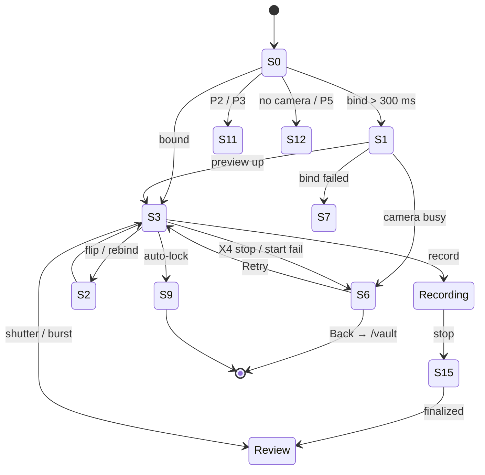
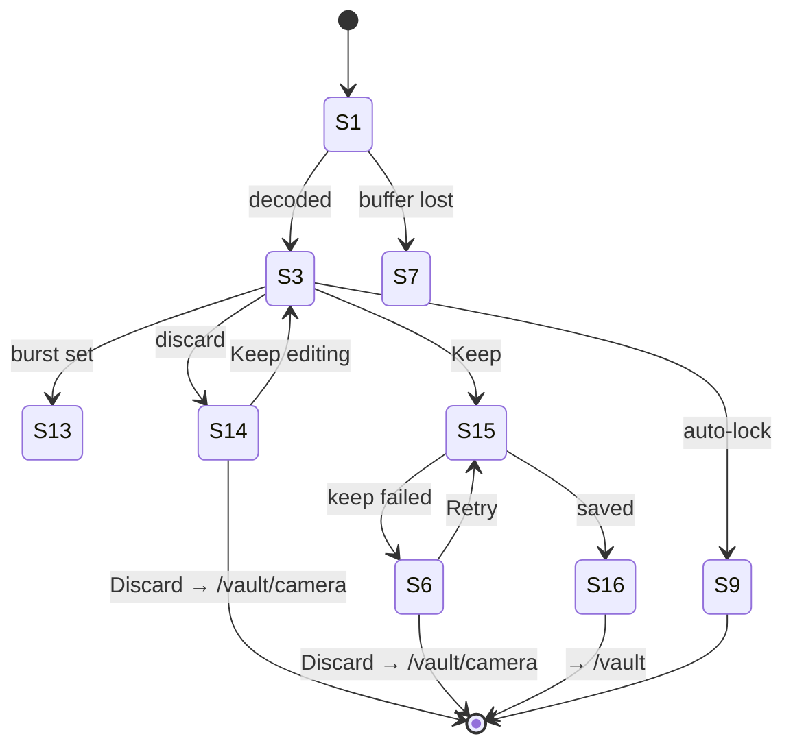
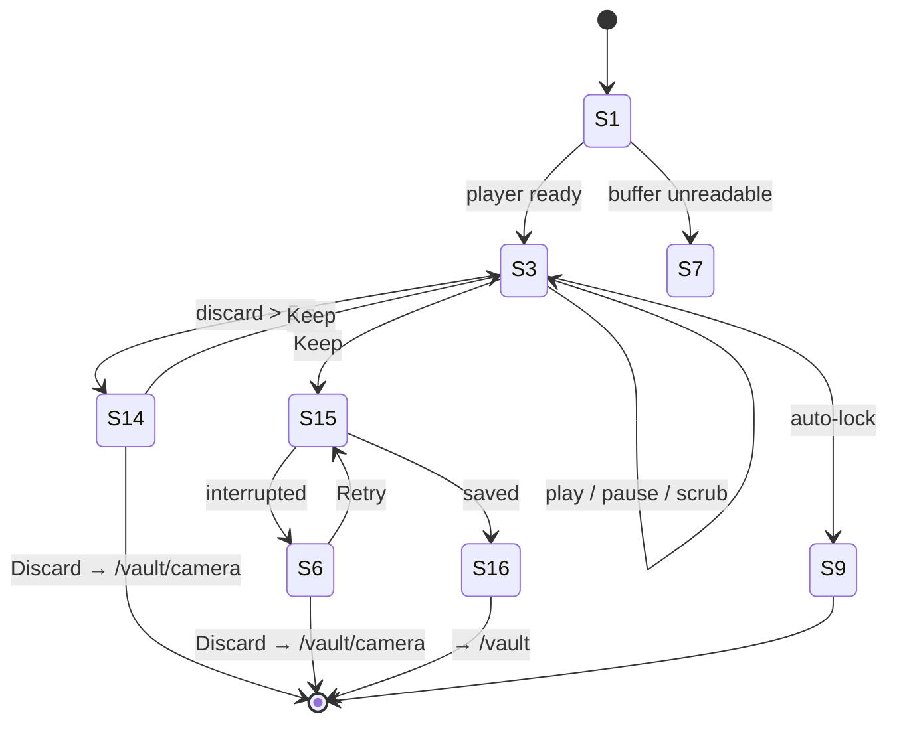
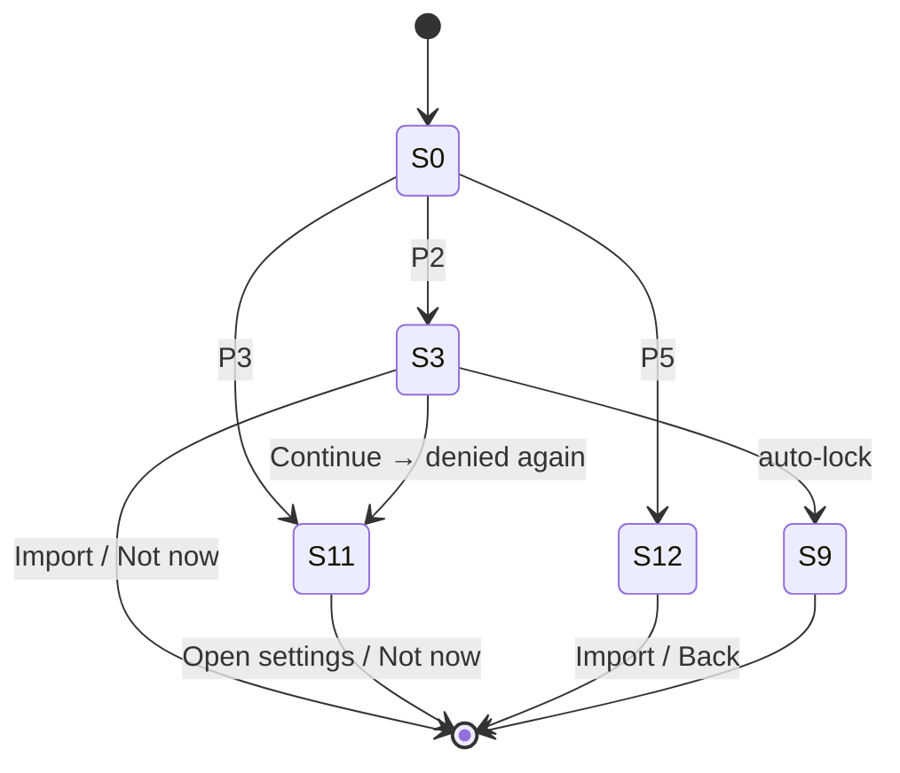

# 03 — Camera & Notifications

> The one place Vaultaire **creates** its own data, and the system surfaces that must never imply
> that a vault exists. Camera preview, the two review routes, the camera permission screen, the four
> notification channels, and the optional widget / Quick Settings tile.

**Read first:** [`_TEMPLATE.md`](./_TEMPLATE.md) · [`00-state-model.md`](./00-state-model.md) · [`07-system-states.md`](./07-system-states.md) · [`../components.md §6.2–6.3, §7.1`](../components.md) · [`../accessibility.md §3, §5, §7`](../accessibility.md) · [`../screens.md §24–26, §32–33`](../screens.md) · [`plan/secure-camera/README.md`](../../secure-camera/README.md) · [`plan/secure-camera/planning.md`](../../secure-camera/planning.md).

**Scope:** `/vault/camera`, `/vault/camera/review` (photo), `/vault/camera/review/video`, `/vault/camera/permission`, the four notification channels, and the optional widget / Quick Settings tile. Import from the system picker is `02-vault-core §2.6`; the camera is the only *producer* of vault data.

> **Note on `screens.md`:** its screen map is stale. Camera and review have **no numbered section**
> there; §7 is Search and §8 is the File Viewer. Camera UI is specified from `components.md §6.2–6.3`,
> `plan/secure-camera`, and `screens.md §32–33` only.

**Non-negotiables carried into every screen in this file**

- **Invariant 7 — review is mandatory.** A capture lives only in memory (photo) or the encrypted pipe buffer (video) until `Keep`. **No path encrypts a capture without a review** (`secure-camera/README.md` KTD 3).
- **No MediaStore, no gallery, no temp plaintext.** Nothing reaches `Pictures/`, `DCIM/`, `Movies/`, cache, or the system gallery; cleartext exists only in RAM.
- **FLAG_SECURE on preview and both review routes**, set before the first frame; recents shows a solid brand cover (`accessibility.md §5.1`).
- **Vault title is always the generic `Vault`.** Review reads "Encrypting into Vault"; no file name, count, label, or id renders or is notified.
- **Camera is fully local.** Capture, review, and encryption work offline; `N2`/`N4`/`N5` show nothing here (`07 §1.1`).
- **Empty, no-permission, and no-hardware are three different states with three different exits.**

---

## Family rules

### R1 · Permission matrix

Codes per `07 §4`. Camera and microphone are **separate**; the camera never needs a storage
permission (modern Android imports through the system picker), and audio is optional by design.

| Capability | State | Viewfinder behavior | Copy | Exit |
|---|---|---|---|---|
| `CAMERA` | `P1` Granted | Live preview | — | — |
| `CAMERA` | `P2` Denied once | Preview withheld; one in-app rationale, then the system dialog | "Vaultaire needs the camera to take photos into your vault. Nothing is saved to your gallery." | `Continue` → system dialog |
| `CAMERA` | `P2→P3` (second denial) | Treated as `P3` in UI even if the OS would still allow a dialog (`07 §4.2.3`) | "Camera access is off. You can still import photos." | `Open settings` / `Not now` |
| `CAMERA` | `P3` Permanently denied | No system dialog; preview never shown; `S11` | "Camera access is off. You can still import photos." | `Open settings`; `Not now` → `/vault` |
| `CAMERA` | `P4` Partial / limited | **Camera unaffected.** Partial access is a *photo-picker* grant for `/vault/import` (`02 §2.6`); the camera permission is independent | — | — |
| `CAMERA` | `P5` Restricted by policy | `S12`; preview withheld | "The camera is turned off by a device policy." | `Back to vault` only — no `Open settings` |
| `RECORD_AUDIO` | `P1` Granted | Audio track captured | — | — |
| `RECORD_AUDIO` | `P2` Denied once | Records **silently**; badge shown | "Sound is optional. You can record video without it." | request on first record |
| `RECORD_AUDIO` | `P3` / `P5` | Records silently; badge persists | "Video will record without sound." (persistent butter pill) | `Record without sound` stays available |
| `POST_NOTIFICATIONS` | any | Not a camera concern | see §3.5 | **never requested at launch** |

**Camera granted, mic denied:** video records silently; the 28 dp butter audio-off badge is visible
**during recording and on video review**; recording is never blocked (`planning.md AC-CAM-17`).

**Camera revoked while the preview is open (return from Settings):** on `onResume`, re-check
`checkSelfPermission`. If the camera is no longer granted, release the camera, freeze the preview to
a neutral cover, and show `S11` inline. Any **in-flight recording is stopped and finalized into the
encrypted buffer**, then opens `/vault/camera/review/video` — the mandatory review still runs because
encryption needs no camera. A preview-only open simply lands on `S11`.

### R2 · The mandatory review invariant

| Question | Answer |
|---|---|
| Can a capture reach the vault without review? | **No.** `Keep` on `/vault/camera/review[/video]` is the only writer. |
| Where does a photo live before `Keep`? | Memory only (`ImageProxy` → `Bitmap`); wiped on discard, lock, and process death. |
| Where does a video live before `Keep`? | The encrypted pipe buffer / rolling `.vlt`; a partial write is never listed, never plaintext. |
| Process death during capture? | Capture **discarded**; never silently kept (`00 §6`). |
| Process death during review? | Capture **discarded**; no unreviewed item in the vault (`00 §6`). |
| Storage fills between capture and `Keep`? | `Keep` fails with a named cause + `Retry`; the in-memory capture is preserved until the user retries or discards. |
| Is discard reversible? | Discard is final, but nothing is lost — no encrypted data ever existed. |

### R3 · FLAG_SECURE, projection, and API-level honesty

| Surface | FLAG_SECURE | Recents | Screen record / cast | Note |
|---|---|---|---|---|
| `/vault/camera` | ✅ before first frame | solid brand cover | blocked | also blocks `MediaProjection` |
| `/vault/camera/review` | ✅ | solid brand cover | blocked | no thumbnails cached |
| `/vault/camera/review/video` | ✅ | solid brand cover | blocked | decrypted frames drawn in memory only |

- **`X5` capture active:** if a `MediaProjection` is detected when the camera or a review route opens, the screen renders normally for the user but is excluded from capture. One neutral line appears — **"Screen capture is blocked on this screen."** — **only** when projection is detected, never as an accusation (`07 §7.1`).
- **API/OEM honesty:** Vaultaire sets `FLAG_SECURE` before the first frame on every API, and before first draw on 13+. On some OEM builds and older APIs a third-party recorder *may* still capture, and no API blocks a second physical camera. The viewfinder never over-claims; the honest limits live on `/settings/security-info` (`screens.md §30.2`).

### R4 · Zero-temp-file, no MediaStore, no export

- **Photo:** `ImageProxy` → RAM → `EncryptedOutputStream` → `.vlt`; no file hits disk unencrypted.
- **Video:** `VideoCapture` → `ParcelFileDescriptor` pipe → `EncryptedOutputStream` → `.vlt`; no temp MP4.
- **Cancel / lock / death:** the pipe closes and the partial `.vlt` is unlinked; a relaunch sweep deletes orphaned partials.
- **No capture enters MediaStore**, `DCIM`, `Pictures`, `Movies`, the gallery, or Google Photos.
- **Review offers no `Share`, `Export`, or `Save to gallery`.** The only exits are Retake and Keep (`components.md §6.3`).

---

### 3.1 Camera — `/vault/camera`

**Badges:** Secure: **yes** (FLAG_SECURE, clipboard off) · Pro: no · Owner: secure-camera
**Purpose:** a live CameraX preview with lens, flash/torch, tap-focus, zoom, photo/video mode, and a grid; every capture is handed straight to review and nothing is written here.

**Entry points**
| From | Trigger | Arguments | Preconditions |
|---|---|---|---|
| `/vault` FAB, empty-state `Take a photo` | Tap | — | Session unlocked |
| `/vault/timeline` `+` (44 dp glass) | Tap | — | — |
| `/vault/camera/review[/video]` | `Retake` (discard) | — | Capture discarded from memory |
| `/vault/camera/permission` | `Open settings` returns granted | `resumeTo=camera` | `P1` |
| Notification / widget / QSS tile | Launch after unlock | `pendingDestination={kind:camera}` | Never bypasses `/lock` |
| Lifecycle | `G2` warm resume, `G4` cold, camera-permission change on `onResume` | — | Re-locks if threshold passed |

**Exit points**
| To | Trigger | Side effects |
|---|---|---|
| `/vault` | Back / gesture | Camera released; no capture exists on this route |
| `/vault/camera/review[/video]` | Shutter / burst / record-stop | In-memory (photo) or encrypted-buffer (video) capture handed to review |
| `/vault/camera/permission` | Preview requested at `P2`/`P3`, or permission revoked on resume | Camera released |
| `/vault/import` | `You can still import photos.` | System picker (`02 §2.6`); no `READ_MEDIA_*` for camera |
| `/lock` | Auto-lock, screen-off, background ≥ threshold | Buffers wiped; recents cover drawn before content |
| `G4` | Process death | Capture discarded; relaunch → `/lock`, then `/vault` or `{kind:camera}` |

**Actions**
| Control | Preconditions | Effect | Resulting state | Failure |
|---|---|---|---|---|
| `(back)` | — | Leave the camera | → `/vault` | — |
| `(flash)` (photo) | Rear lens, flash unit present | Cycle Auto → On → Off → Auto | S3 | No flash unit → control **absent** (S5/S12) |
| Torch (video) | Rear lens, flash unit present | Torch On/Off | S3 | Front lens or no unit → control absent |
| `(settings)` | — | Camera settings sheet: Grid, Video quality, Max duration, Audio | Sheet over S3 | — |
| Grid toggle | In settings sheet | 1 dp white 25% rule-of-thirds lines; **off by default**, local pref | S3 | — |
| `(flip)` lens | ≥ 2 lenses present | Switch front ↔ rear; rebind | S2 → S3 | Single-lens device → control absent; target busy → S6 |
| Tap preview | Preview live | Set focus + exposure at the tap point; success = pulse ring | S3 | No AF → AE only, no lock pulse, no error; AF timeout → reticle fades, tap again |
| Pinch preview | Preview live | Zoom 1×…device max; `mono.s` indicator during gesture | S3 | Fixed-focus / no zoom → gesture no-op, no indicator |
| Mode `[Photo][Video]` | — | Swap shutter ⇄ record; flash ⇄ torch semantics | S3 | — |
| Shutter tap | Photo mode | Capture one frame at max sensor size | → review | `D3` → shutter blocked: "Free up space to take photos."; capture error → S6 |
| Shutter double-tap | Photo mode | **Burst lock:** captures up to the burst cap until tapped again | → review (set) | Cap reached → auto-stops into review |
| Shutter hold ≥ 500 ms | Photo mode | Burst while held, up to the cap | → review (set) | Release → stop; capture error → S6 |
| Record tap | Video mode, `D3` clear | Start; tap again to stop | S3 → S15 → review | `D3` → "Free up space to record video."; start error → S6 |
| Audio pill | `RECORD_AUDIO` `P1` | Mute/unmute the audio track (still silent on disk otherwise) | S3 | — |
| Review-last-capture slot | A session capture still in memory | Reopen it in review | → review | Normally **absent**; never a vault thumbnail |

**States**
| State | Trigger | Visual | Available actions | Exit | Announcement |
|---|---|---|---|---|---|
| `S0 Initial` | First composition | Static control chrome; no spinner < 300 ms | — | → S3/S1/S11/S12 | "Camera" |
| `S1 Loading` | Camera bind > 300 ms | Neutral preview placeholder, "Starting camera…" after 800 ms | none | → S3 | "Starting camera" |
| `S2 Refreshing` | Lens switch / rebind | Preview dims briefly, controls hold | none | → S3 | — |
| `S3 Content` | Preview live | `AuroraCameraViewfinder` (§6.2): flash, settings, focus ring, flip, 76 dp shutter, mode switch | all above | → review/S9/S6 | "Take photo" / "Start recording" |
| `S5 Partial` | Some capabilities missing | Preview live; unavailable controls **absent**, not disabled | capture, focus | → S3 | — |
| `S6 Recoverable` | Camera busy, bind retry failed | Inline banner + `Retry` | Retry, Back | → S3 / `/vault` | "Camera is in use. Close the other app and try again." |
| `S7 Fatal` | Camera hardware cannot start | Full-bleed neutral state + one exit | Back | → `/vault` | "This camera couldn't start." |
| `S9 Locked` | Auto-lock while open | Brand cover; buffers wiped | Unlock | → `/lock` | "Vault locked" |
| `S11 Permission-gated` | Camera `P2`/`P3`, or revoked on resume | Preview withheld; rationale or `Open settings` | Open settings, Not now | → `/vault/camera/permission` | "Camera access is off" |
| `S12 Unsupported` | No camera, or `P5` policy | Neutral explanation, no controls | Back | → `/vault` | "The camera is turned off by a device policy." |
| `S15 Committing` | Video stop | Preserved footprint, "Finalizing clip…" | cancel (discards) | → review | "Finalizing" |
| Recording | Record tapped | Inner circle → red rounded square; `mono.m` timer + 6 dp danger dot; audio-off badge if muted/denied | Stop, focus, torch | → S15 | "Recording" |
| `X4 Thermal` | `getThermalStatus` raised | Res/fps drop; a stop shows "The device is warm. Recording stopped to protect it. Saved up to 0:42." | capture | → review(saved) | as copy |
| `X5 Capture` | Projection detected | One neutral line; preview otherwise normal | all | → S3 | "Screen capture is blocked on this screen." |
| `D2 Low` | ≤ 500 MB free | Butter banner "Storage is almost full." | capture | → S3 | as copy |
| `D3 Full` | ≤ 50 MB free | Shutter/record blocked with named cause | Free up space | → `/vault` | "Free up space to take photos." |
| `A4` / `V1`–`V6` | font / viewport | Controls enlarge; landscape → right-edge strip, shutter bottom-right ≥ 76 dp; fold tabletop → controls bottom half; `V6` < 360 dp → single-column strip; below-min → letterbox | all | — | — |

**Transitions**

**Flows**
| Flow | Path | Success | Abandonment |
|---|---|---|---|
| First open | `/vault` FAB → S0 → rationale (`P2`) → preview | Live S3 within 800 ms | Deny → S11 / `/vault` |
| Snap one photo | S3 → shutter → review → `Keep` | Encrypted into Vault; → `/vault` with new item | `Retake` → S3 |
| Burst | S3 → double-tap shutter → cap → review set | All kept frames encrypted | Tap once to stop early → review |
| Record video | S3 → Video → record → stop → S15 → review | Encrypted clip | Cancel in S15 → capture discarded |

**Edge cases & races**
- **First open** shows rear lens, flash Auto, Photo mode, grid off; a disguise icon does **not** change anything in the viewfinder.
- **Lens availability.** Front-only device → `flip` absent, selfie default; rear-only → front unreachable, `flip` absent. Unavailable controls are **absent, not disabled** (`screens.md §16.4` pattern).
- **Lens in use by another app** (e.g. a call) → `S6 "Camera is in use."` + `Retry`; never a dead screen.
- **Flash/torch unavailable** → the control is absent; tapping the preview still shoots. Torch is rear-only.
- **Tap-to-focus failure** is silent: no red ring, no error copy — the reticle fades and the user can tap again.
- **Max video duration** is capped (token → `## Gaps`); the timer turns butter at 90% of cap and recording auto-stops into review — never truncates silently.
- **Incoming call mid-recording:** audio focus is lost → the clip continues **silently** with the audio-off badge; if the OS preempts the camera, recording stops and the encrypted portion opens review.
- **Headset unplug:** the audio route switches to the phone mic and recording continues; if no mic remains, it continues silently with the badge. Recording is never dropped for a route change.
- **Screen rotation:** `setTargetRotation` keeps captures upright; controls follow rotation with no letterbox. Review locks to the capture's orientation.
- **Fold / unfold (`V3`):** hinge-aware — tabletop puts controls on the bottom half. Unfolding **mid-record** that recreates the surface stops the clip and opens review with what was written; nothing was ever plaintext.
- **Multi-window (`V6`):** single-column control strip, shutter ≥ 76 dp bottom-right; losing window focus does **not** lock; below 320×480 dp letterboxes with a neutral message.
- **Thermal (`X4`):** resolution/fps drop automatically; a stop surfaces the thermal copy and lands in review of the saved portion.
- **Storage (`D2`/`D3`):** `D2` warns but shoots and may stop a clip early; `D3` blocks **before** the shutter/record with a named cause. Never downscales to fit (`07 §2.2`).
- **Battery < 5%, not charging:** one butter pill — "Battery is low. Recording may stop." Photos are never blocked; a critical threshold mid-record stops and saves the portion, like thermal.
- **Camera revoked on resume (R1):** recording stops and finalizes into review; a preview-only open becomes `S11`.
- **`A2`:** every control is a real button with a content description; focus order Back → Flash → Settings → Preview → Flip → Shutter → Mode (`accessibility.md §3.1`); visual 44 dp controls keep a 48 dp hit area.
- **Process death (`G4`).** Capture (pre-review) is **discarded**; relaunch → `/lock`, then `/vault` (or `{kind:camera}` if one was persisted). No capture is silently kept (`00 §6`).

**Data contract**
Reads: camera capability + permission state, mic state, free space on demand, thermal/battery, local prefs · Writes: local camera prefs (mode, flash, grid) only — never vault data · Must never appear: preview frames on disk, MediaStore rows, thumbnails, vault label, plaintext EXIF outside the encrypted payload, location tags.

---

### 3.2 Photo review — `/vault/camera/review`

**Badges:** Secure: **yes** · Pro: no · Owner: secure-camera
**Purpose:** the mandatory gate — show the just-captured frame(s) from memory and require an explicit `Retake` or `Keep`; `Keep` is the only writer.

**Entry points**
| From | Trigger | Arguments | Preconditions |
|---|---|---|---|
| `/vault/camera` | Shutter tap / burst / double-tap / hold | `capture=memory`, `frames=[…]` | Capture held in RAM, unreviewed |
| `/vault` timeline `+` (deep-linked capture) | Same as camera | — | — |
| Lifecycle | `G2` resume with a capture still held | — | Within auto-lock threshold |

**Exit points**
| To | Trigger | Side effects |
|---|---|---|
| `/vault/camera` | `Retake`, swipe-down discard, back | Frame(s) wiped from RAM; nothing written |
| `/vault` | `Keep` committed (`S16`) | `.vlt` + thumbnail + index entry; "Saved to vault" → home shows the new item |
| `/lock` | Auto-lock / screen-off | Capture wiped; recents cover |
| `G4` | Process death | Capture discarded; nothing listed |
| `/vault/camera/permission` | Camera revoked between capture and Keep (rare) | Keep still allowed offline |

**Actions**
| Control | Preconditions | Effect | Resulting state | Failure |
|---|---|---|---|---|
| `Retake` (64 dp glass, left) | — | Discard the current frame; return to camera | → `/vault/camera` | Burst set ≥ 2 → confirm (`S14`) |
| `Keep` (64 dp ink, right) | Capture present | Encrypt into Vault; write `.vlt` + thumbnail + index | S15 → S16 → `/vault` | Space/keyring/IO failure → S6 with `Retry` |
| Swipe down | — | Discard; confirm rule below | → `/vault/camera` | Confirm when required |
| Swipe ← / → | Burst set ≥ 2 frames | Move between just-captured frames | S13 | Single frame → no-op |
| Tap media | — | Toggle chrome (scrim + sheet) | S3 | — |
| Pinch | — | Zoom the frame 1–5× | S3 | — |
| Filmstrip frame tap | Burst set | Select a frame; its `Retake` removes just that frame | S13 | Removing the last frame exits to camera |

> **Discard confirm rule (stated):** a discard requires confirmation **only** when it would lose
> non-trivial content — i.e. a **burst set of ≥ 2 frames**, or a **video longer than 5 s** (§3.3).
> A single photo discards instantly with `Retake` or swipe-down, because nothing encrypted exists and
> re-shooting is trivial. The confirm is `S14`: "Discard 3 photos? They weren't saved." `Discard` (danger) / `Keep editing`.

**States**
| State | Trigger | Visual | Available actions | Exit | Announcement |
|---|---|---|---|---|---|
| `S1 Loading` | Decoding the in-memory frame | Neutral hold from the last preview frame, iris spinner after 300 ms | none | → S3 | "Preparing capture" |
| `S3 Content` | Frame ready | Full-bleed image on `#000`, top gradient scrim, `glassRaised` sheet at 38%: type + resolution + "Encrypting into Vault" | Retake, Keep, swipe, zoom | → S13/S14/S15/S9 | "Captured image, double tap to keep, swipe down to retake" |
| `S13 Editing` | Burst set ≥ 2 | Horizontal filmstrip; selected frame has an iris border + check | select, remove, Retake, Keep | → S3 | "{n} captures, frame {i}" |
| `S14 Confirming` | Discard a burst set ≥ 2 | Count-aware dialog, **no scrim dismiss** | Discard, Keep editing | confirm / cancel | "Discard 3 photos?" |
| `S15 Committing` | `Keep` pressed | `AuroraProgressRing` + "Encrypting into Vault"; controls disabled, cancellable (discard) | cancel | → S16 / S6 | "Encrypting" |
| `S16 Success` | Encryption + index committed | Inline "Saved to vault", then auto-return | none | → `/vault` | "Saved to vault" (polite) |
| `S6 Recoverable` | Keep failure | Inline danger banner + named cause + `Retry` | Retry, Discard | → S15 / → `/vault/camera` | "We couldn't save this. Retry." / "This device is out of space. Free up space to keep this." |
| `S7 Fatal` | Frame buffer lost (OOM) | Neutral state, one exit | Retake, Back | → `/vault/camera` | "This capture couldn't be shown." |
| `S9 Locked` | Auto-lock | Cover; capture wiped | Unlock | → `/lock` | "Vault locked" |
| `X5 Capture` | Projection detected | One neutral line | all | → S3 | "Screen capture is blocked on this screen." |
| `A4` / `V2`–`V6` | font / viewport | Sheet reflows; tablet → side panel; controls stay ≥ 64 dp; `Keep` thumb-right in RTL unless mirrored | all | — | — |

**Transitions**

**Flows**
| Flow | Path | Success | Abandonment |
|---|---|---|---|
| Keep one photo | camera → review S3 → `Keep` → S15 → S16 | Item in Vault; → `/vault` | Cancel encryption → discarded |
| Retake | camera → review S3 → `Retake`/swipe-down | Back to live preview, buffer wiped | — |
| Burst review | camera → set → S13 → review frames → `Keep` | All frames encrypted | Remove all frames → camera |
| Recovery | review S3 → `Keep` → S6 (D3) → free space → `Retry` | Saved on retry | Discard → camera |

**Edge cases & races**
- **Review is the only writer.** There is no `Save`, `Share`, `Export`, or "save to gallery" affordance anywhere on this route (`components.md §6.3`).
- **Swipe-down vs horizontal swipe** are distinct gestures: vertical discards, horizontal moves within a burst set; a diagonal resolves to the larger axis.
- **Encrypting progress is real**, tied to bytes written and the index commit — never a fake percentage.
- **Keep failure with retry:** `Retry` re-runs encryption of the **same in-memory capture** against a pre-allocated target id, so nothing is duplicated (idempotent). `D3` names space; a keyring/IO error is generic and non-technical.
- **Cancel during `S15`** discards the capture — it never entered the vault. The only non-cancellable window is the final index commit (milliseconds).
- **Lock during `Keep`:** backgrounding beyond the auto-lock threshold zeroizes the session key, so encryption cannot continue — it aborts and discards with **no partial item**; within the threshold it continues in place.
- **Storage fills between capture and Keep (D3):** the capture stays in memory; `Keep` fails with "This device is out of space. Free up space to keep this." + `Retry`; leaving the screen loses the capture (nothing was in the vault).
- **Process death (`G4`).** During review the capture is **discarded** and nothing is listed; relaunch → `/lock`. An unreviewed item must **never** appear in the vault (`00 §6`).
- **No thumbnail is cached** for the app switcher; the recents snapshot is the solid brand cover.

**Data contract**
Reads: in-memory capture, free space, vault key (session) · Writes: `.vlt` + thumbnail + index entry **only on `Keep`** · Must never appear: plaintext image/temp files, MediaStore rows, the capture after discard, file names in logs or notifications, vault label.

---

### 3.3 Video review — `/vault/camera/review/video`

**Badges:** Secure: **yes** · Pro: no · Owner: secure-camera
**Purpose:** the mandatory gate for recordings — play, scrub, and confirm; `Keep` finalizes encryption of the encrypted pipe buffer.

**Entry points**
| From | Trigger | Arguments | Preconditions |
|---|---|---|---|
| `/vault/camera` | Record stop → `S15 finalizing` | `capture=encrypted-buffer`, `duration` | Partial `.vlt` valid |
| `/vault/camera` | Thermal / storage / battery stop | `stoppedReason=thermal\|storage\|battery`, `savedTo` | Portion finalized |
| `/vault/camera` | Camera revoked on resume | `stoppedReason=permission` | Portion finalized |
| Lifecycle | `G2` resume with a clip under review | — | Within threshold |

**Exit points**
| To | Trigger | Side effects |
|---|---|---|
| `/vault/camera` | `Retake`, swipe-down (confirm), back | Encrypted buffer discarded; partial unlinked |
| `/vault` | `Keep` committed (`S16`) | `.vlt` finalized + thumbnail + index; → home |
| `/lock` | Auto-lock / screen-off | Buffer discarded; recents cover |
| `G4` | Process death | Partial swept on relaunch; nothing listed |

**Actions**
| Control | Preconditions | Effect | Resulting state | Failure |
|---|---|---|---|---|
| Center play / pause | Clip ready | Toggle playback; silent autoplay **off** | S3 | Decode failure → S6 |
| Scrubber (4 dp, 44 dp hit) | Clip ready | Seek; `mono.s` current / total | S3 | — |
| `Retake` (64 dp glass, left) | — | Discard clip; return to camera | → `/vault/camera` | `> 5 s` → confirm (`S14`) |
| `Keep` (64 dp ink, right) | Clip ready | Finalize encryption into Vault | S15 → S16 → `/vault` | Interrupted → S6 / G4 sweep |
| Swipe down | — | Discard | → `/vault/camera` | `> 5 s` → confirm |
| Audio-off badge (28 dp butter) | Mic denied or stopped silent mid-clip | Persistent, non-interactive | S3/S15 | — |

> **Discard confirm rule (shared with §3.2):** a clip longer than **5 s** confirms before discard
> ("Discard this video? It wasn't saved."); a clip ≤ 5 s discards instantly. This matches
> `components.md §6.3`.

**States**
| State | Trigger | Visual | Available actions | Exit | Announcement |
|---|---|---|---|---|---|
| `S1 Loading` | Player initializing (decrypt-stream) | Neutral hold, iris spinner after 300 ms | none | → S3 | "Preparing video" |
| `S3 Content` | Clip ready | Full-bleed playback on `#000`; 44 dp play/pause centre; 4 dp scrubber; `glassRaised` sheet: type + duration + "Encrypting into Vault"; audio-off badge if applicable | play, scrub, Retake, Keep | → S14/S15/S9 | "{m:ss} video, audio off" (if badge) |
| `S14 Confirming` | Discard clip > 5 s | Countless dialog "Discard this video? It wasn't saved.", no scrim dismiss | Discard, Keep | confirm / cancel | as copy |
| `S15 Committing` | `Keep` | `AuroraProgressRing` on real bytes; "Finalizing…"; cancellable | cancel | → S16 / S6 | "Finalizing" |
| `S16 Success` | Commit done | Inline "Saved to vault" → auto-return | none | → `/vault` | "Saved to vault" (polite) |
| `S6 Recoverable` | Interrupted / failed finalize | Named cause + `Retry` | Retry, Discard | → S15 / `/vault/camera` | "We couldn't save this video. Retry." / space copy |
| `S7 Fatal` | Buffer unreadable | Neutral state, one exit | Retake, Back | → `/vault/camera` | "This video couldn't be opened." |
| `S9 Locked` | Auto-lock | Cover; buffer discarded | Unlock | → `/lock` | "Vault locked" |
| `X5 Capture` | Projection detected | One neutral line | all | → S3 | "Screen capture is blocked on this screen." |
| Stopped-partial | Thermal/storage/battery/permission stop | Banner with the reason + "Saved up to 0:42"; clip plays from the valid portion | play, Keep, Retake | → S15 / `/vault/camera` | as copy |
| `A4` / `V2`–`V6` | font / viewport | Scrubber and controls grow; tablet → side panel | all | — | — |

**Transitions**

**Flows**
| Flow | Path | Success | Abandonment |
|---|---|---|---|
| Keep a clip | camera → record → stop → S15 → review → `Keep` | Encrypted `.vlt`; → `/vault` | Cancel finalize → discarded |
| Review a stopped clip | camera → thermal/storage stop → review (partial) | Saved portion kept | Retake → camera |
| Discard a long clip | review → swipe down → S14 | Buffer unlinked | Keep editing → S3 |
| Interrupted finalize | review → `Keep` → G4/lock → relaunch | Nothing listed; user re-records | — |

**Edge cases & races**
- **Interrupted encryption:** if `Keep` is running when the process dies, the partial `.vlt` is swept on relaunch and **nothing is listed** — no unreviewed or half-written item (`planning.md AC-CAM-18`). Locking beyond the threshold aborts finalize (key zeroized) and discards.
- **Silent-by-default playback:** the clip never autoplays with sound; sound only plays after an explicit tap and honours the system media volume. The audio-off badge reflects the *clip*, independent of playback.
- **Scrubbing a decrypt-stream:** seeking is bounded to buffered chunks; a seek beyond the buffer waits with an inline spinner, never a frozen frame.
- **Stopped-partial clarity:** the reason ("The device is warm…", "Ran out of space…", "Battery is low…", "Camera access was turned off…") is named on the sheet with "Saved up to 0:42"; the user can Keep the portion or Retake.
- **Discard confirmation** matches §3.2's stated rule (> 5 s), so the rule is identical across both review routes.
- **No share/export/save-to-gallery** affordance exists here, ever (`components.md §6.3`).
- **Process death (`G4`).** Clip under review is **discarded**; the partial buffer is swept; no unreviewed item reaches the vault.

**Data contract**
Reads: encrypted pipe buffer (decrypt-streamed), free space, vault key (session) · Writes: finalized `.vlt` + thumbnail + index **only on `Keep`** · Must never appear: temp MP4 or any plaintext frames on disk, MediaStore rows, file names in logs/notifications, vault label.

---

### 3.4 Camera permission — `/vault/camera/permission`

**Badges:** Secure: no (chrome only, no vault content) · Pro: no · Owner: secure-camera
**Purpose:** one-screen education and the correct path out when the camera is denied, permanently denied, or policy-restricted — the alternative (`import`) is always offered.

**Entry points**
| From | Trigger | Arguments | Preconditions |
|---|---|---|---|
| `/vault/camera` | Preview requested at `P2`/`P3`, or revoked on resume | `state=P2\|P3\|P5` | Session unlocked |
| `/vault` empty state | `Take a photo` with camera not granted | `state=…` | — |
| Settings | Notification/deep link to camera rationale | `state=P3` | — |

**Exit points**
| To | Trigger | Side effects |
|---|---|---|
| `/vault/camera` | `Open settings` returns granted | `resumeTo=camera`; preview proceeds |
| `/vault/import` | `Import instead` | System picker; no storage permission |
| `/vault` | `Not now`, back, or after `P5` | Camera remains ungranted |
| `/lock` | Auto-lock | Cover |

**Actions**
| Control | Preconditions | Effect | Resulting state | Failure |
|---|---|---|---|---|
| `Open settings` | `P2`/`P3` | Deep-link to the app's own permission page (with OEM fallback) | S3 | OEM blocks the link → show manual path copy |
| `Continue` | `P2` | Show the system permission dialog once more | S11 → request | Denied again → treat as `P3` |
| `Import instead` | — | Open the system photo picker (`02 §2.6`) | → `/vault/import` | — |
| `Not now` / back | — | Decline without nagging | → `/vault` | — |
| `Back to vault` | `P5` policy | Only exit (no settings link) | → `/vault` | — |

**States**
| State | Trigger | Visual | Available actions | Exit | Announcement |
|---|---|---|---|---|---|
| `S0 Initial` | Composition | Static card, iris eyebrow "CAMERA", one sentence | — | → S3 | "Camera access" |
| `S3 Rationale` (`P2`) | First denial | One-sentence rationale + `Continue` / `Import instead` / `Not now` | Continue, Import, Not now | → S11 / import | "Vaultaire needs the camera to take photos into your vault. Nothing is saved to your gallery." |
| `S11 Denied` (`P3`) | Permanently denied | "Camera access is off. You can still import photos." + `Open settings` / `Import instead` | Open settings, Import, Not now | → `/vault` | as copy |
| `S12 Policy` (`P5`) | Device policy blocks camera | "The camera is turned off by a device policy." + `Import instead` | Import, Back | → `/vault` | "The camera is turned off by a device policy." |
| `S9 Locked` | Auto-lock | Cover | Unlock | → `/lock` | — |
| `A4` / `V1` / `V4` | font / viewport | Card grows, actions stay visible; tablet centres at ≤ 480 dp | all | — | — |

**Transitions**

**Flows**
| Flow | Path | Success | Abandonment |
|---|---|---|---|
| Grant after denial | camera S11 → `Open settings` → grant → resume | Preview live | Return without granting → S11 again |
| Import instead | camera S11 → `Import instead` | Picker opens | Picker cancel → `/vault` |
| Policy-restricted | camera `P5` → S12 | Clear explanation | `Back to vault` |

**Edge cases & races**
- **Never requested at launch** (`07 §4.2`). This screen is only reached by the action that needs the camera.
- **One request per session per permission**; a second denial is treated as `P3` even if the OS would still show a dialog.
- **`Open settings` OEM fallback:** if the app-detail deep link is blocked, show the manual path ("Settings → Apps → Vaultaire → Permissions") rather than a dead button.
- **`P4` never routes here** — partial photo access does not gate the camera; it only narrows `/vault/import`.
- **Returning granted** resumes `/vault/camera` directly; the rationale is not re-shown.

**Data contract**
Reads: permission state, policy restriction · Writes: nothing · Must never appear: vault content, file names, counts, or any hint that a vault exists.

---

### Overlay: Notifications — four local channels

**Badges:** Secure: n/a (system surface) · Pro: no · Owner: encrypted-cloud-backup / device-sync / secure-sharing / security
**Purpose:** the only vault-aware system surface — **local only**, content-free by construction, and never a way around the lock.

**Channels (created once at first app start, idempotent)**

| Channel id | Name | Importance | Sound | Vibration | Allowed content | Tap destination (post-unlock) |
|---|---|---|---|---|---|---|
| `backup` | Backup | `LOW` | none | none | "Vaultaire backup needs attention." / "Backup finished." | `/settings/cloud/backup` |
| `sync` | Sync | `LOW` | none | none | "Vaultaire sync needs your review." | `/settings/cloud/sync` |
| `share_expiry` | Share expiry | `DEFAULT` | default | default | "A share expires soon." | `/shares` |
| `security` | Security | `HIGH` | **silent** | none | "Vaultaire security notice." | `/settings/security-info` |

**Entry points / triggers**
| From | Trigger | Channel | Preconditions |
|---|---|---|---|
| WorkManager | Backup finishes / fails / is skipped | `backup` | First backup enabled |
| WorkManager | Sync conflict, device disconnected, key mismatch | `sync` | Pro sync active |
| WorkManager | A share nears expiry, is revoked, or is exhausted | `share_expiry` | Sharing used |
| Security layer | Integrity check fails, backup-key changes, enrollment invalidated | `security` | — |
| User | Taps a notice | — | App locked → `/lock` first |

**Exit points / outcomes**
| To | Trigger | Side effects |
|---|---|---|
| `/lock` → destination | Tap a notice while locked | `pendingDestination={kind, opaqueId}`; lands on the settings/share screen after unlock, **never the file** |
| Destination | Tap a notice while unlocked | Opens the relevant settings/share screen directly |
| Dismissed | Swipe / `Clear` | No action change; the underlying job/queue is unaffected |
| Channel off / permission denied | System settings | Notices not delivered; in-app surfaces still show state (`07 §8.4`) |

**Actions**
| Control | Preconditions | Effect | Resulting state | Failure |
|---|---|---|---|---|
| Tap | Notice present | Lock-first, then open the destination | pending → destination | Unresolvable `opaqueId` → `/vault` silently |
| Dismiss while action pending | Revoke/backup in flight | Notice clears; the **durable queue continues** | pending → Applied | — |
| Channel settings | — | Open the Android channel page | — | OEM omits → in-app row explains |
| `Hide previews` (Settings → Privacy) | on/off | Redacts all notice content on the lock screen | — | — |

**States**
| State | Trigger | Visual | Available actions | Announcement |
|---|---|---|---|---|
| `S0` no permission | `POST_NOTIFICATIONS` not granted | No notices; in-app state only | Enable in settings | — |
| `S3` normal | Permission granted, quiet channels | Content-free text, no preview | tap, dismiss | as read |
| `S5` `Hide previews` on | Privacy setting | Title only: "Vaultaire"; body redacted on lockscreen | tap | "Vaultaire" |
| `S6` job failed | Backup/sync error | "Vaultaire backup needs attention." | tap → settings | as copy |
| `X3` Doze | Device idle | Delivery deferred until Doze exits | — | — |
| `S9` locked at tap | App locked | Opens after unlock on the destination | unlock | — |
| Channel disabled | User turned a channel off | Notices absent; in-app banner persists | Enable | — |

**Edge cases & races**
- **First-run timing:** `POST_NOTIFICATIONS` is asked **only after the first backup is enabled or the first share is created** — **never at launch, splash, onboarding, or first unlock** (`07 §4.2`, `§8.4`). Copy: "Get a quiet notice when a backup finishes or a share expires."
- **Content restrictions:** a notice **never** contains a file name, vault label, collection name, or a count that reveals vault existence or size. Share expiry carries **no count** ("A share expires soon."), not "3 shares expire". The shade is safe to read over a shoulder.
- **Tap destinations after unlock:** a tap always opens a **settings or share** screen, never a file; the pending destination is stored opaque `{kind, opaqueId}` (`00 §6`). If the id no longer resolves, land on `/vault` silently.
- **`Hide previews` on:** notification previews are redacted on the lock screen and recents becomes solid (`accessibility.md §5.3`).
- **Dismissed while an action is pending:** clearing a `sync`/`share_expiry` notice does not cancel the queued revoke/backup — the durable queue continues (`07 §1.2`); no re-notify storm.
- **Doze deferral (`X3`):** WorkManager jobs are deferred, so notices generate late rather than waking the device; a share that expires during Doze is reported after Doze exits. No exact-alarm spam.
- **No progress notifications.** Import and encryption report **in-app only** — a progress notification would reveal activity (`screens.md §27.3`).
- **`security` is silent by design** (high importance, no sound): a loud security tone would draw attention to the device.

**Data contract**
Reads: job outcomes, queue state, channel/permission settings · Writes: `pendingDestination` (opaque) · Must never appear: file names, vault labels, counts, thumbnails, share phrases, or any hint of vault existence.

---

### Overlay: Widgets & Quick Settings tile (optional, later)

**Badges:** Secure: n/a (system surface) · Pro: no · Owner: appearance / security
**Purpose:** a deliberately inert launcher surface. A widget that showed vault content would defeat the product (`screens.md §26`).

**Surfaces**

| Surface | Present? | What it shows | Tap outcome | Never |
|---|---|---|---|---|
| Photo / media widget | **No** | — | — | Any vault content, thumbnail, or count |
| 1×1 home widget | Optional | Neutral glyph only, label follows the active app alias | Launches → `/` → `/lock` | Last photo, item count, vault label |
| Quick Settings tile | Optional | A neutral "Vaultaire" glyph | Launches → `/lock` only | Any tile that opens the vault/camera **without** the pattern |

**Actions**
| Control | Preconditions | Effect | Resulting state | Failure |
|---|---|---|---|---|
| Tap the 1×1 tile | — | Cold/warm launch into the locked app | `/lock` | Alias missing → neutral glyph only |
| Tap the QSS tile | — | Launch into the locked app | `/lock` | — |
| Long-press a tile | Optional | System app info | — | Never reveals vault state |

**States**
| State | Trigger | Visual | Exit |
|---|---|---|---|
| `S3` idle | Widget on home | Neutral glyph + label | tap → `/lock` |
| `S9` app locked | — | Identical; a widget cannot show lock state | tap → `/lock` |
| Disguised | Active disguise alias | Widget label/glyph follow the alias | tap → `/lock` |
| `S12` unavailable | Launcher doesn't support widgets | Surface simply absent | — |

**Edge cases & races**
- **No photo widget, ever.** A widget that renders vault content (or a "last capture" thumbnail) is forbidden.
- **No QSS tile bypasses the pattern.** A tile may only launch the app; it can never open `/vault`, the camera, or a file directly (`screens.md §26`).
- **Disguise consistency:** while a disguise alias is active, the widget label and glyph must follow it — a widget reading "Vaultaire" would leak the disguise (`screens.md §17`). Behaviour under disguise is flagged in `## Gaps`.
- **No live data:** widgets and tiles never bind to vault counts, storage, or lock state, so they cannot become a side channel.
- **Process death is irrelevant:** a tile tap is just a launch; the cold path applies (`G1`/`G4`).

**Data contract**
Reads: active app alias only · Writes: nothing · Must never appear: any vault content, count, thumbnail, or lock state.

---

## Flow atlas

Named end-to-end journeys across the domain. Camera and review are always local; nothing here needs a network.

| # | Journey | Entry | Path | Success | Degraded / failure |
|---|---|---|---|---|---|
| F1 | First capture | `/vault` FAB | rationale (`P2`) → grant → S3 → shutter → review → `Keep` → S15 → S16 | Item in Vault; → `/vault` | Deny → S11 + `Import instead`; `P3` → `Open settings` |
| F2 | Deny mic and record | camera → Video | record → mic `P2` → deny → silent clip + audio-off badge → stop → review → `Keep` | Silent clip encrypted; badge visible throughout | Mic `P5` → same silent path; badge persists |
| F3 | Screen-record attempt | camera S3 | `MediaProjection` detected → `X5` neutral line; capture excluded | One-line notice; preview continues | Older/OEM API may still capture → honest limits on `/settings/security-info` |
| F4 | Storage full mid-video | camera → record | `D2` warn → fills to `D3` mid-record → stop → "Ran out of space… Saved up to 0:42" → review | Saved portion kept, or discarded if unfinalizable | Unfinalizable → banner + back to camera |
| F5 | Notification tap while locked | system shade | tap `share_expiry`/`security` → `/lock` → unlock → destination | Opens `/shares` or `/settings/security-info` | Unresolvable id → `/vault` silently |
| F6 | Burst + swipe review | camera S3 | double-tap shutter → burst set → review S13 → swipe frames → `Keep` | All kept frames encrypted | Remove all frames → back to camera |
| F7 | Keep fails, retry | review S3 | `Keep` → `D3` failure → `S6` named cause → free space → `Retry` → S15 → S16 | Saved on retry, no duplicate | Leave the screen → capture lost (never was in vault) |
| F8 | Process death during encryption | review S15 | `Keep` running → `G4` → relaunch | Nothing listed; partial `.vlt` swept; `/lock` → `/vault` | User re-records; no half-written item |

**Journeys that must share copy:** F1 and F7 (space failure) use the same storage copy family as `07 §10`; F3 and the review `X5` row use the identical single line "Screen capture is blocked on this screen." Any shared line between F4 and the camera `X4` thermal copy must stay factual and untouched.

---

## Gaps

1. **`<Vault label>` in `components.md §6.3` conflicts with invariant 4.** Review must render the generic **"Encrypting into Vault"**; `screens.md`/`components.md` should drop the `<Vault label>` placeholder so no implementer keys a real label into the sheet.
2. **No motion/limit tokens for camera.** Max video duration, burst cap, and the battery-low stop threshold have no `foundations.md §8.1` values; propose `duration.videoMax` (~10:00), a burst cap (~5 frames), and a battery-critical rule rather than per-screen magic numbers.
3. **Video partial-clip finalization is unspecified.** `secure-camera` does not state whether the chunked `.vlt` can be finalized at the last good chunk after a mid-record stop; F4/`X4` assume "Saved up to 0:42". Decide keep-at-last-chunk vs. discard-and-retake and encode it in the format.
4. **No home for a "capture wasn't saved" notice after `G4` during `Keep`.** `00 §6` says nothing is listed, but the user pressed Save; decide whether a neutral one-line notice appears on `/vault` or is omitted entirely.
5. **`security` channel has no permission trigger.** `POST_NOTIFICATIONS` is only requested after the first backup or share, so a user who does neither never enables the `security` channel. Decide whether security notices can be delivered at all on that path, or accept silent absence.
6. **Widget behaviour under an active disguise alias is undefined.** `screens.md §17` covers the launcher icon but not the widget/tile label; a "Vaultaire" widget would defeat the disguise. Specify alias-following for both surfaces.

## New components needed

1. **`AuroraFocusRing`** — tap-to-focus reticle with focusing/success-pulse states and a **neutral** AF-failure fade (never red); pairs with `AuroraCameraViewfinder` (§6.2).
2. **`AuroraBurstFilmstrip`** — horizontal just-captured frame selector for burst sets, with per-frame remove and a selected iris border (§3.2 `S13`).
3. **`AuroraAudioOffBadge`** — 28 dp butter pill, persistent in the viewfinder and on video review, independent of playback mute.
4. **`AuroraEncryptingProgress`** — real-bytes keep progress (ring + counts) shared by both review routes, cancellable except at the final index commit.
5. **`AuroraProjectionNotice`** — single-line, non-accusatory `FLAG_SECURE`/`MediaProjection` notice; a constrained variant of `AuroraThreatBanner` (§6.4).
6. **`AuroraLaunchTile`** — 1×1 home widget / QSS tile with a neutral glyph that launches only to `/lock`, with no bindable vault data.

> `AuroraCameraViewfinder` and `AuroraCameraReview` already exist (`components.md §6.2–6.3`) and are reused rather than re-specified; the six items above are the missing parts.
