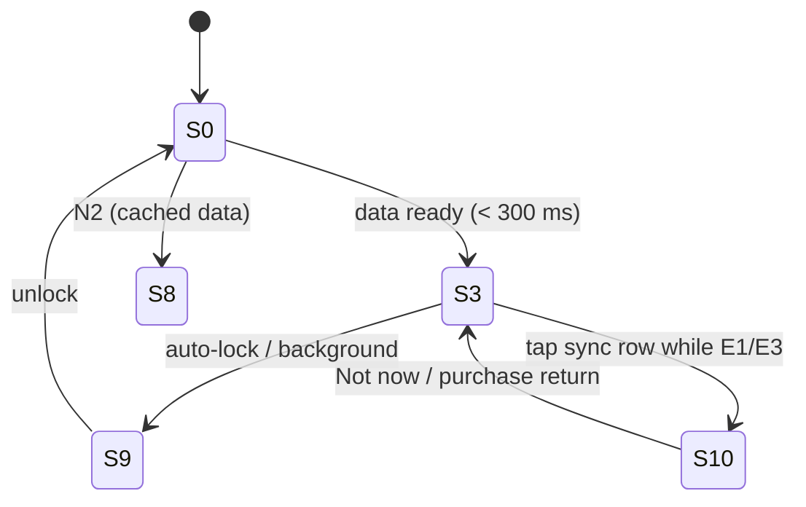
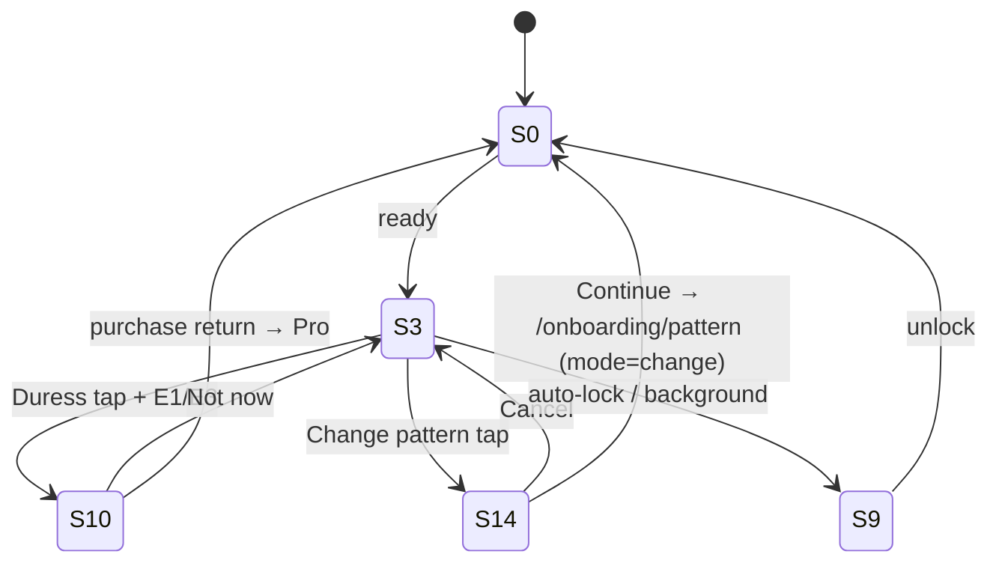
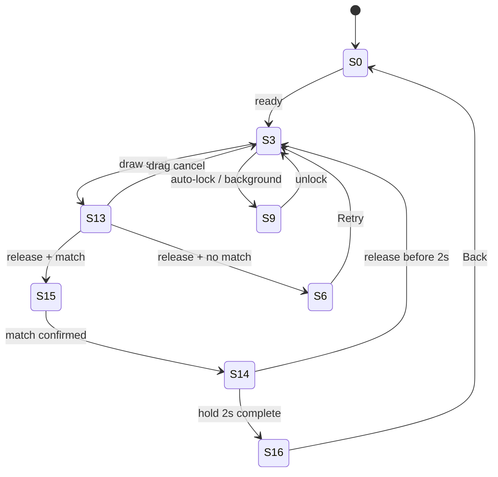
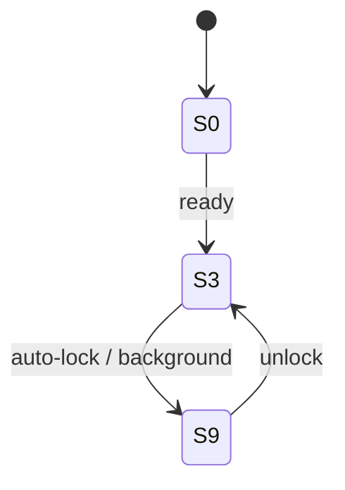
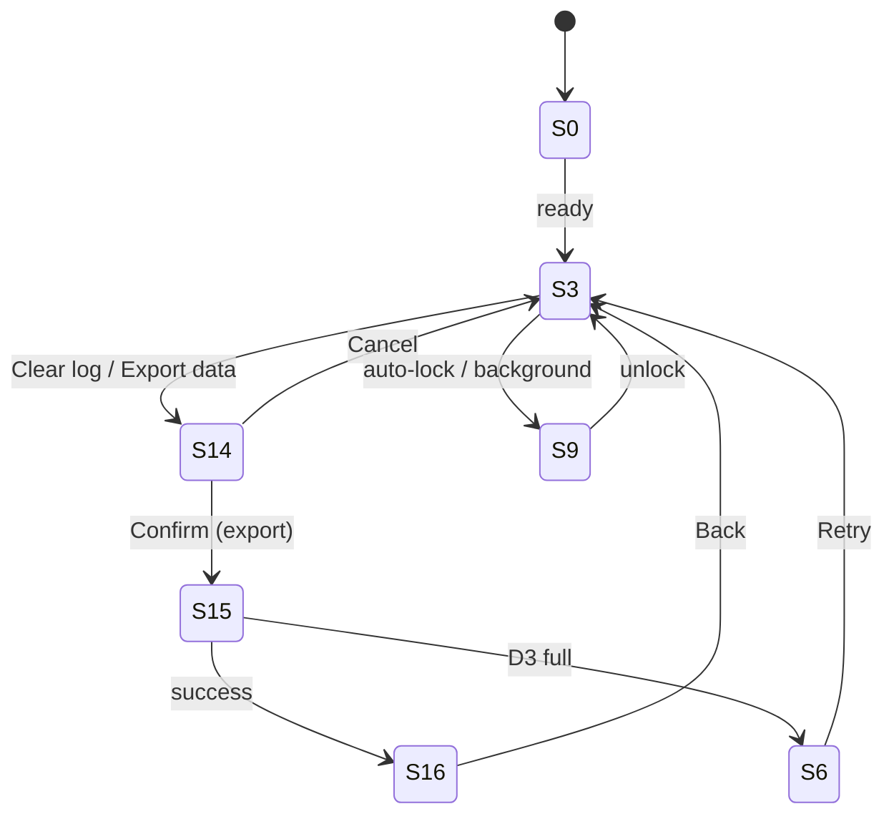

# 04 · Security Settings — Settings Hub, Security, Duress, Hidden Vaults, Security Info, Privacy, About

> Settings hub and all security/privacy surfaces. Visuals in [`../screens.md`](../screens.md) §10–§13, §19, §29–§30; components in [`../components.md`](../components.md) §3.5, §6.5. State codes in [`_TEMPLATE.md §2`](./_TEMPLATE.md); precedence/persistence in [`00-state-model.md`](./00-state-model.md); network/storage/entitlement in [`07-system-states.md`](./07-system-states.md).

**Scope:** `/settings`, `/settings/security`, `/settings/security/duress`, `/settings/security/duress/guidance`, `/settings/security/hidden-vaults`, `/settings/security-info`, `/settings/privacy`, `/settings/about`.

**Non-negotiables carried into every screen in this file**

- Duress designates the decoy by redrawing its pattern — **no vault list, no vault count, no picker** (`feature-matrix §5` invariant 3, `duress-mode\planning.md`).
- Pattern change requires current pattern + redraw twice + forces a **new recovery phrase**; full-screen interstitial before starting (`screens.md §11`).
- Recovery phrase reveal row requires biometric/pattern re-auth before pushing `/recovery/display`.
- Auto-lock setting: immediately / 30s / 1m / 5m (default 30s).
- Hidden vaults explainer: one non-dismissible butter honesty card; no vault list, no count, no rename (`screens.md §13`).
- Security info: threat model in plain language, honest limits, no "military-grade" claims (`screens.md §30.2`).
- Privacy: no analytics SDK, crash reports off by default, export produces encrypted archive only (`screens.md §30.1`).
- About: version, build, licenses, threat model summary; long-press version for local diagnostics (never exposes keys).

---

### 4.1 Settings Hub — `/settings`

**Badges:** Secure: no · Pro: no · Owner: settings

**Purpose:** top-level navigation to Security, Cloud, Appearance, and system info; shows vault size and Pro status.

**Entry points**

| From | Trigger | Arguments | Preconditions |
|---|---|---|---|
| `/vault` | Nav drawer / FAB long-press / settings action | — | Vault unlocked |
| `/vault/timeline` | Nav drawer / toolbar | — | Vault unlocked |
| `/vault/collection/{id}` | Nav drawer / toolbar | — | Vault unlocked |
| `/settings/security` | Back / close | — | — |
| `/settings/cloud/backup` | Back / close | — | — |
| `/settings/cloud/sync` | Back / close | — | — |
| `/settings/appearance` | Back / close | — | — |
| `/pro` | Back / close / purchase return | — | — |
| Deep link | `vaultaire://settings` | — | — |

**Exit points**

| To | Trigger | Side effects |
|---|---|---|
| `/settings/security` | Tap Security row | — |
| `/settings/cloud/backup` | Tap Encrypted backup row | — |
| `/settings/cloud/sync` | Tap Device sync row | — |
| `/settings/appearance` | Tap Appearance row | — |
| `/settings/privacy` | Tap Privacy row | — |
| `/settings/about` | Tap About row | — |
| `/pro` | Tap Pro row / feature gate from row | — |
| `/vault` | Back / gesture / nav drawer | — |
| Background | Home / screen off | — |

**Actions**

| Control | Preconditions | Effect | Resulting state | Failure |
|---|---|---|---|---|
| Security row | — | Push security settings | — | — |
| Encrypted backup row | — | Push backup settings | — | — |
| Device sync row | `E2` | Push sync settings | — | `E1/E3` → `S10` gate |
| Appearance row | — | Push appearance settings | — | — |
| Privacy row | — | Push privacy settings | — | — |
| About row | — | Push about screen | — | — |
| Pro row / `Try Pro` | `E1/E3` | Push paywall | — | — |
| Version long-press | 3× within 1 s | Show local diagnostics toast (build, vault size, sync state, no keys) | — | — |

**States**

| State | Trigger | Visual | Available actions | Announcement |
|---|---|---|---|---|
| `S0 Initial` | Composition | Static layout, profile card shows cached vault size | all rows | "Settings" |
| `S3 Content` | Data ready | Profile avatar + `Vault` + `Pro · 2.1 GB`, group cards rendered | all rows | — |
| `S8 Offline / stale` | `N2` | Same content; no banner (local-only screen) | all rows | — |
| `S9 Locked` | Auto-lock / background > threshold | Brand cover | unlock | "Vault locked" |
| `A4 200% font` | System font scale ≥ 200% | Row labels wrap, value chips stack, profile card grows, no truncation | all rows | — |
| `V1 phone portrait` | Width < 600dp | Single column, floating nav, profile card 320dp max | all rows | — |
| `V4 tablet` | Width ≥ 600dp | Two-pane: left rail groups, right detail; profile card in rail | all rows | — |

**Transitions**

**Flows**

| Flow | Path | Success | Abandonment |
|---|---|---|---|
| Open Security | Settings → Security row | Security screen | Back → Settings |
| Open Sync (Pro) | Settings → Sync row (E2) | Sync screen | Back / Not now → Settings |
| Open Pro gate | Settings → Sync row (E1/E3) | Paywall sheet → Sync | Not now → Settings |

**Edge cases & races**

- **Scale:** 0 vaults (profile shows `Vault · 0 B`); multiple vaults show aggregated size only.
- **Races:** Pro status changes mid-screen (`E2 → E3` or purchase) — rows update in place, no reload.
- **Process death (`G4`):** Reopens at `/settings` if session valid, else `/lock`; scroll position restored.
- **`A4`:** 200% font — chips wrap, no truncation, touch targets stay 48dp.
- **`V4`:** Two-pane — rail stays on Security/Cloud/Appearance; detail pane shows selected group.

**Data contract**

Reads: vault size (encrypted aggregate), Pro entitlement, alias setting, pending destination. Writes: none. Must never appear: vault count, vault label, vault ID, file names, recovery phrase, pattern coordinates, sync record IDs, IP addresses.

---

### 4.2 Security Settings — `/settings/security`

**Badges:** Secure: no · Pro: partial (Duress row gated) · Owner: pattern-encryption

**Purpose:** change pattern, reveal recovery phrase, configure duress, hidden vaults, auto-lock, throttle, screen capture, clipboard auto-clear, biometric unlock.

**Entry points**

| From | Trigger | Arguments | Preconditions |
|---|---|---|---|
| `/settings` | Security row | — | — |
| `/settings/security/duress` | Back | — | — |
| `/settings/security/hidden-vaults` | Back | — | — |
| `/settings/security-info` | Back | — | — |
| Deep link | `vaultaire://settings/security` | — | — |

**Exit points**

| To | Trigger | Side effects |
|---|---|---|
| `/settings/security/duress` | Duress row (E2) | — |
| `/settings/security/duress` | Duress row (E1/E3) | `S10` Pro gate |
| `/settings/security/hidden-vaults` | Hidden vaults row | — |
| `/settings/security-info` | Security info row | — |
| `/recovery/display` | Recovery phrase row → auth success | Biometric/pattern re-verified |
| `/onboarding/pattern` | Change pattern row → current pattern verified | `mode=change`, new phrase forced on confirm |
| `/settings` | Back / gesture | — |
| Background | Home / screen off | — |

**Actions**

| Control | Preconditions | Effect | Resulting state | Failure |
|---|---|---|---|---|
| Change pattern | — | Push pattern create with `mode=change`; full-screen interstitial first | `S14` interstitial | — |
| Recovery phrase | — | Biometric/pattern auth → `/recovery/display` | `S15` auth | Auth fail → stay, retry |
| Duress mode | `E2` | Push duress setup | — | `E1/E3` → `S10` gate |
| Hidden vaults | — | Push hidden vaults explainer | — | — |
| Security info | — | Push security info screen | — | — |
| Auto-lock picker | — | Value sheet: immediately / 30s / 1m / 5m | `S16` on save | — |
| Attempt throttle row | — | Read-only: shows current tier / deadline | — | — |
| Screen capture | — | Read-only: locked on for secure screens | — | — |
| Clipboard auto-clear | — | Value sheet: 30s / 60s / off | `S16` on save | — |
| Biometric unlock | Biometric available | Toggle; pattern always remains required | `S16` on save | Hardware fail → off |

**States**

| State | Trigger | Visual | Available actions | Announcement |
|---|---|---|---|---|
| `S0 Initial` | Composition | Static rows, Duress shows `[PRO]` if `E1/E3` | all rows | "Security settings" |
| `S3 Content` | Data ready | Rows rendered; Duress row weight indistinguishable when enabled | all rows | — |
| `S10 Pro-gated` | Duress tap, `E1/E3` | Inline `AuroraProGate`: "Duress mode opens a decoy vault and erases others" | Try Pro / Not now | — |
| `S14 Confirming` | Change pattern tapped | Full-screen interstitial: "Changing your pattern creates a new recovery phrase. Your files stay encrypted." | Continue / Cancel | — |
| `S9 Locked` | Auto-lock / background > threshold | Brand cover | unlock | "Vault locked" |
| `A4 200% font` | System font scale ≥ 200% | Row labels wrap, value chips stack, no truncation | all rows | — |
| `V1 phone portrait` | Width < 600dp | Single column, floating nav | all rows | — |
| `V4 tablet` | Width ≥ 600dp | Two-pane: left rail, right detail | all rows | — |

**Transitions**

**Flows**

| Flow | Path | Success | Abandonment |
|---|---|---|---|
| Change pattern | Security → Change pattern → interstitial → pattern create ×2 → phrase save | New pattern + new phrase active | Cancel at any step → no change |
| Reveal phrase | Security → Recovery phrase → biometric/pattern → `/recovery/display` | Phrase shown | Auth fail / Cancel → Security |
| Enable duress (Pro) | Security → Duress → setup → hold 2s | Duress active, row weight normal | Back / Not now → Security |

**Edge cases & races**

- **Scale:** no vault-specific data; rows are static.
- **Races:** Pro lapses (`E2 → E3`) while screen open — Duress row shows `[PRO]` immediately, gate on next tap.
- **Process death (`G4`):** Returns to `/settings/security` if session valid; interstitial state dropped.
- **Pattern change:** Forces new 9-word phrase; old phrase invalidated; `S14` interstitial is mandatory.
- **Biometric toggle off:** Does not remove enrolled biometrics; only disables the unlock path.
- **`A4`:** 200% font — picker sheets wrap, chips stack.
- **`V4`:** Two-pane — rail highlights Security; detail shows rows.

**Data contract**

Reads: Pro entitlement, duress enabled flag, hidden vaults enabled, auto-lock setting, throttle tier/deadline, clipboard auto-clear setting, biometric availability, alias. Writes: auto-lock, clipboard auto-clear, biometric toggle. Must never appear: pattern coordinates, vault count, vault label, vault ID, recovery phrase plaintext, duress decoy vault ID, wipe ledger, throttle attempt timestamps.

---

### 4.3 Duress Setup — `/settings/security/duress`

**Badges:** Secure: yes (confirmation step) · Pro: yes (E2 required) · Owner: duress-mode

**Purpose:** designate exactly one vault as the duress decoy by redrawing its pattern; hold 2s to enable.

**Entry points**

| From | Trigger | Arguments | Preconditions |
|---|---|---|---|
| `/settings/security` | Duress row (E2) | — | Pro active |
| `/settings/security/duress/guidance` | Back | — | — |
| Deep link | `vaultaire://settings/security/duress` | — | Pro active |

**Exit points**

| To | Trigger | Side effects |
|---|---|---|
| `/settings/security` | Back / Cancel | Draft discarded |
| `/settings/security/duress/guidance` | Guidance link | — |
| `/settings/security` | Hold 2s confirm | Duress enabled; decoy vault index persisted; other vaults' indexes & `.dat` files wiped on next duress unlock |
| Background | Home / screen off | Draft discarded |

**Actions**

| Control | Preconditions | Effect | Resulting state | Failure |
|---|---|---|---|---|
| Pattern grid (compact 5×5) | — | Accumulate dots, haptic per dot | `S13` | Drag cancel → `S3` |
| Release pattern | ≥ 1 dot | Derive key, match against one vault's index; that vault becomes decoy | `S15` | No match → `S6` neutral "Pattern not recognized" |
| Hold-to-enable (ink pill) | Pattern matched a vault | 2s iris sweep → enable duress | `S16` | Interrupted → `S3`, no enable |
| Guidance link | — | Push `/settings/security/duress/guidance` | — | — |

**States**

| State | Trigger | Visual | Available actions | Announcement |
|---|---|---|---|---|
| `S0 Initial` | Composition | Rose-tint card: "If you're forced to unlock, this pattern opens one vault and erases the rest." | Draw pattern | "Duress setup" |
| `S3 Idle` | Grid ready | Compact 5×5 grid, no dots | Draw, Guidance | — |
| `S13 Drawing` | Finger down | Dots accumulate, haptic per dot | Continue draw | — |
| `S15 Committing` | Release, matching vault found | Iris pulse; "Encrypting into <Vault label>" (generic) | Hold to enable | No match → `S6` |
| `S6 Error (recoverable)` | No vault matches pattern | Neutral ink: "Pattern not recognized" + Retry | Draw again, Guidance | "Pattern not recognized" |
| `S14 Confirming` | Matched, before hold | "Hold to enable duress" pill, 2s sweep progress | Hold / Release | — |
| `S16 Success` | Hold complete | Mint check: "Duress enabled. Decoy vault set." | Back | "Duress enabled" |
| `S9 Locked` | Auto-lock / background > threshold | Brand cover | unlock | "Vault locked" |
| `A4 200% font` | System font scale ≥ 200% | Card scrolls, grid stays 280dp, text wraps | all | — |
| `V1 phone portrait` | Width < 600dp | Single column, floating nav | all | — |
| `V4 tablet` | Width ≥ 600dp | Centered card 480dp max, rail on left | all | — |

**Transitions**

**Flows**

| Flow | Path | Success | Abandonment |
|---|---|---|---|
| Enable duress | Duress setup → draw decoy pattern → hold 2s | Duress active, decoy set | Back / release early → no change |
| Read guidance | Duress setup → Guidance link | Guidance screen | Back → Duress setup |

**Edge cases & races**

- **No vault catalog:** the grid has no vault names; user draws the pattern of the vault they want as decoy.
- **Process death (`G4`) during hold:** draft discarded; duress not enabled.
- **Duress already enabled:** screen shows current state (rose card becomes "Duress is enabled. Hold to disable.") — disabling requires pattern + biometric, warns erasure history cannot be undone.
- **Wipe is silent:** no progress UI; on next duress unlock, wipe runs before decoy opens (`duress-mode\planning.md`).
- **`A4`:** 200% font — rose card scrolls, grid unchanged.
- **`V4`:** centered card, rail stays on Security.

**Data contract**

Reads: vault indexes (encrypted, to match pattern), Pro entitlement. Writes: duress enabled flag, decoy vault index (encrypted), wipe marker for next duress unlock. Must never appear: vault count, vault labels, which vault is decoy (outside this screen), pattern coordinates, wipe progress, analytics events with vault ID.

---

### 4.4 Decoy Guidance — `/settings/security/duress/guidance`

**Badges:** Secure: no · Pro: yes (content under Duress) · Owner: duress-mode

**Purpose:** honest guidance on making the decoy vault look lived-in; never uses "decoy" in title/body if user might be observed.

**Entry points**

| From | Trigger | Arguments | Preconditions |
|---|---|---|---|
| `/settings/security/duress` | Guidance link | — | — |

**Exit points**

| To | Trigger | Side effects |
|---|---|---|
| `/settings/security/duress` | Back / close | — |
| Background | Home / screen off | — |

**Actions**

| Control | Preconditions | Effect | Resulting state | Failure |
|---|---|---|---|---|
| Scroll | — | Read content | — | — |

**States**

| State | Trigger | Visual | Available actions | Announcement |
|---|---|---|---|---|
| `S0 Initial` | Composition | Static content | Scroll | "Decoy guidance" |
| `S3 Content` | Ready | Title: "Making it look lived-in"; tips: add ordinary photos, realistic amount, avoid empty vault, don't name collections "fake", use occasionally; butter honesty card non-dismissible: "If someone knows your normal vault exists, a perfect decoy may still not convince them." | Scroll | — |
| `S9 Locked` | Auto-lock / background > threshold | Brand cover | unlock | "Vault locked" |
| `A4 200% font` | System font scale ≥ 200% | Text wraps, card grows, honesty card stays visible | Scroll | — |
| `V1 phone portrait` | Width < 600dp | Single column, floating nav | Scroll | — |
| `V4 tablet` | Width ≥ 600dp | Centered 600dp max, rail on left | Scroll | — |

**Transitions**

**Flows**

| Flow | Path | Success | Abandonment |
|---|---|---|---|
| Read guidance | Guidance → scroll → back | User informed | Back → Duress setup |

**Edge cases & races**

- **Process death (`G4`):** Returns to guidance if session valid.
- **Honesty card:** Never dismissible; butter background, `body.m` copy.
- **No checklist/scoring:** nothing discoverable that could be used against the user.
- **`A4`/`V4`:** standard text scaling and two-pane.

**Data contract**

Reads: none. Writes: none. Must never appear: vault count, vault labels, which vault is decoy, any forensic detail.

---

### 4.5 Hidden Vaults Explainer — `/settings/security/hidden-vaults`

**Badges:** Secure: no · Pro: no · Owner: hidden-vaults

**Purpose:** explain what "hidden" means (no catalog, different patterns resolve different vaults) and what it does NOT mean (forensic limits).

**Entry points**

| From | Trigger | Arguments | Preconditions |
|---|---|---|---|
| `/settings/security` | Hidden vaults row | — | — |

**Exit points**

| To | Trigger | Side effects |
|---|---|---|
| `/settings/security` | Back / close | — |
| Background | Home / screen off | — |

**Actions**

| Control | Preconditions | Effect | Resulting state | Failure |
|---|---|---|---|---|
| Scroll | — | Read content | — | — |

**States**

| State | Trigger | Visual | Available actions | Announcement |
|---|---|---|---|---|
| `S0 Initial` | Composition | Static content | Scroll | "Hidden vaults" |
| `S3 Content` | Ready | Explainer: different patterns = different vaults; no catalog; collection names organize; butter honesty card non-dismissible: "A forensic examiner with file access may still estimate how many vaults exist. Hidden vaults hide the catalog, not the storage." | Scroll | — |
| `S9 Locked` | Auto-lock / background > threshold | Brand cover | unlock | "Vault locked" |
| `A4 200% font` | System font scale ≥ 200% | Text wraps, card grows, honesty card stays visible | Scroll | — |
| `V1 phone portrait` | Width < 600dp | Single column, floating nav | Scroll | — |
| `V4 tablet` | Width ≥ 600dp | Centered 600dp max, rail on left | Scroll | — |

**Transitions**

**Flows**

| Flow | Path | Success | Abandonment |
|---|---|---|---|
| Read explainer | Hidden vaults → scroll → back | User informed | Back → Security settings |

**Edge cases & races**

- **Process death (`G4`):** Returns to explainer if session valid.
- **No vault list, no count, no "manage" button, no rename.** (`screens.md §13`, `hidden-vaults\planning.md`)
- **Honesty card:** butter, non-dismissible.
- **`A4`/`V4`:** standard.

**Data contract**

Reads: none. Writes: none. Must never appear: vault count, vault labels, vault IDs, forensic estimates.

---

### 4.6 Security Info / Help — `/settings/security-info`

**Badges:** Secure: no · Pro: no · Owner: security-info

**Purpose:** threat model in plain language, honest limitations, what FLAG_SECURE blocks/doesn't.

**Entry points**

| From | Trigger | Arguments | Preconditions |
|---|---|---|---|
| `/settings/security` | Security info row | — | — |

**Exit points**

| To | Trigger | Side effects |
|---|---|---|
| `/settings/security` | Back / close | — |
| In-app document | `Read the full threat model` | Opens local markdown |
| Background | Home / screen off | — |

**Actions**

| Control | Preconditions | Effect | Resulting state | Failure |
|---|---|---|---|---|
| Scroll | — | Read content | — | — |
| `Read the full threat model` | — | Push local threat model doc | — | — |

**States**

| State | Trigger | Visual | Available actions | Announcement |
|---|---|---|---|---|
| `S0 Initial` | Composition | Static content | Scroll, Read threat model | "Security info" |
| `S3 Content` | Ready | Threat model: what app protects (coercion, device theft, cloud leakage), what it doesn't (forensic vault-count estimation, flash residue after duress wipe, offline pattern guessing against copied indexes, loss of pattern + phrase = permanent loss); FLAG_SECURE blocks (screenshots, recording, casting) and doesn't (camera pointed at screen); no "military-grade", no lock illustrations, no fear copy. | Scroll, Read threat model | — |
| `S9 Locked` | Auto-lock / background > threshold | Brand cover | unlock | "Vault locked" |
| `A4 200% font` | System font scale ≥ 200% | Text wraps, no truncation | Scroll, Read threat model | — |
| `V1 phone portrait` | Width < 600dp | Single column, floating nav | Scroll, Read threat model | — |
| `V4 tablet` | Width ≥ 600dp | Centered 600dp max, rail on left | Scroll, Read threat model | — |

**Transitions**

**Flows**

| Flow | Path | Success | Abandonment |
|---|---|---|---|
| Read security info | Security info → scroll / read threat model → back | User informed | Back → Security settings |

**Edge cases & races**

- **Process death (`G4`):** Returns to security info if session valid.
- **Threat model doc:** local markdown, no network, no analytics.
- **`A4`/`V4`:** standard.

**Data contract**

Reads: none. Writes: none. Must never appear: vault count, vault labels, vault IDs, pattern, phrase, keys, analytics.

---

### 4.7 Privacy — `/settings/privacy`

**Badges:** Secure: no · Pro: no · Owner: privacy

**Purpose:** crash reports, diagnostics, local activity log, clipboard auto-clear, hide previews; declare no analytics/no account.

**Entry points**

| From | Trigger | Arguments | Preconditions |
|---|---|---|---|
| `/settings` | Privacy row | — | — |

**Exit points**

| To | Trigger | Side effects |
|---|---|---|
| `/settings` | Back / close | — |
| Encrypted archive | `Export my data` → confirm | Encrypted archive saved to Files app |
| Background | Home / screen off | — |

**Actions**

| Control | Preconditions | Effect | Resulting state | Failure |
|---|---|---|---|---|
| Crash reports toggle | — | Off by default; opt-in only | `S16` on change | — |
| Diagnostics toggle | — | Off by default; local, encrypted, no keys/phrases/file names | `S16` on change | — |
| Local activity log | — | On by default; encrypted; clear requires confirm | `S14` on clear | — |
| Clipboard auto-clear | — | Value sheet: 30s / 60s / off | `S16` on save | — |
| Hide previews in recents | — | Toggle; on by default | `S16` on change | — |
| Export my data | — | Produces encrypted archive (AES-256-GCM, user phrase); never plaintext ZIP | `S15` → `S16` | `D3` → `S6` "Free up space" |

**States**

| State | Trigger | Visual | Available actions | Announcement |
|---|---|---|---|---|
| `S0 Initial` | Composition | Static rows | all toggles, export | "Privacy" |
| `S3 Content` | Ready | Top copy: "Vaultaire has no server that can read your vault. There is no account to delete." Rows: Crash reports (off), Diagnostics (off), Local activity log (on, encrypted), Clipboard auto-clear (30/60/off), Hide previews in recents (on). Export my data row. | all toggles, export | — |
| `S14 Confirming` | Clear activity log / Export data | Dialog: "Clear local activity log? This can't be undone." / "Export creates an encrypted archive. Save to Files?" | Confirm / Cancel | — |
| `S15 Committing` | Export confirmed | Iris progress: "Creating encrypted archive…" | none | "Creating archive" |
| `S16 Success` | Export done | Mint toast: "Archive saved to Files" | Back | "Archive saved" |
| `S6 Error (recoverable)` | Export failed (`D3`) | Butter banner: "Free up space to export" | Retry / Cancel | "Free up space" |
| `S9 Locked` | Auto-lock / background > threshold | Brand cover | unlock | "Vault locked" |
| `A4 200% font` | System font scale ≥ 200% | Row labels wrap, chips stack, top copy scrolls | all | — |
| `V1 phone portrait` | Width < 600dp | Single column, floating nav | all | — |
| `V4 tablet` | Width ≥ 600dp | Two-pane: left rail, right detail | all | — |

**Transitions**

**Flows**

| Flow | Path | Success | Abandonment |
|---|---|---|---|
| Export data | Privacy → Export → confirm → progress | Encrypted archive in Files | Cancel / D3 → retry |
| Clear activity log | Privacy → Clear log → confirm | Log cleared locally | Cancel → no change |

**Edge cases & races**

- **Process death (`G4`) during export:** partial archive deleted; user retries.
- **No analytics SDK, no advertising ID, no third-party trackers.** Stated in one sentence at top.
- **Export archive:** encrypted with user's recovery phrase (or derived key); never plaintext.
- **`A4`/`V4`:** standard.

**Data contract**

Reads: privacy toggles, activity log (encrypted), clipboard setting, hide previews setting. Writes: toggles, activity log clear marker, export archive (encrypted). Must never appear: plaintext archive, keys, phrases, file names, vault labels, analytics events.

---

### 4.8 About — `/settings/about`

**Badges:** Secure: no · Pro: no · Owner: about

**Purpose:** version, build, licenses, threat model summary; long-press version for local diagnostics.

**Entry points**

| From | Trigger | Arguments | Preconditions |
|---|---|---|---|
| `/settings` | About row | — | — |

**Exit points**

| To | Trigger | Side effects |
|---|---|---|
| `/settings` | Back / close | — |
| In-app document | Privacy policy / Security architecture link | Opens local markdown |
| Background | Home / screen off | — |

**Actions**

| Control | Preconditions | Effect | Resulting state | Failure |
|---|---|---|---|---|
| Privacy policy link | — | Push local privacy policy doc | — | — |
| Security architecture link | — | Push local security architecture doc | — | — |
| Version long-press | 3× within 1 s | Toast: build, vault size, sync state, no keys | — | — |

**States**

| State | Trigger | Visual | Available actions | Announcement |
|---|---|---|---|---|
| `S0 Initial` | Composition | Static content | Scroll, links, long-press | "About" |
| `S3 Content` | Ready | Version, build, open-source licenses, threat model summary. Links: Privacy policy, Security architecture (in-app, 44dp close). Long-press version → diagnostics toast (build, vault size, sync state, never keys). | Scroll, links, long-press | — |
| `S9 Locked` | Auto-lock / background > threshold | Brand cover | unlock | "Vault locked" |
| `A4 200% font` | System font scale ≥ 200% | Text wraps, licenses scroll, no truncation | Scroll, links, long-press | — |
| `V1 phone portrait` | Width < 600dp | Single column, floating nav | Scroll, links, long-press | — |
| `V4 tablet` | Width ≥ 600dp | Centered 600dp max, rail on left | Scroll, links, long-press | — |

**Transitions**

**Flows**

| Flow | Path | Success | Abandonment |
|---|---|---|---|
| Read about | About → scroll / links → back | User informed | Back → Settings |

**Edge cases & races**

- **Process death (`G4`):** Returns to about if session valid.
- **Diagnostics toast:** local only, never exposes keys/phrases/file names.
- **`A4`/`V4`:** standard.

**Data contract**

Reads: version, build, vault size (aggregate), sync state. Writes: none. Must never appear: keys, phrases, vault labels, file names, pattern, analytics.

---

## Gaps

1. **Throttle counting basis needs product sign-off.** With no wrong-pattern state, "5 failures" is unobservable; `01 §R1` redefines as attempt rate (5 KDF submissions / 2 min), which also throttles 6 legitimate quick unlocks. Alternative (time-damping only) changes brute-force economics.
2. **Post-restore pattern creation is documented nowhere.** A device-bound salt means a restored vault cannot verify the old pattern; `01` designs a 2-step pattern create (no phrase step). Confirm the crypto spec binds the salt to the device.
3. **Biometric target vault is undesigned.** `01` pins to "last unlocked vault"; multi-vault users get no choice, and "last used" is a small coercion/forensic leak. Needs a decision.
4. **Duress partial-wipe has no durable ledger.** `01 §R3` says mid-wipe failure is never surfaced (re-armed before decoy becomes interactive; residue acknowledged only in `/settings/security-info`), but no wipe-ledger design guarantees resume — a crash loop could strand residue silently.
5. **Encrypted trash setting is unspecified.** The opt-in "7-day encrypted trash" changes delete semantics everywhere but has no row in `screens.md`/`settings`. Needs a Settings → Privacy row and defined storage cap; until then default delete is immediate + 7s `Undo`.
6. **Paging/decoding numbers are not in tokens.** Page size (60 tiles), decode target size, LRU eviction thresholds need tokenization before implementation.
7. **Mobile data persistence for `Allow mobile data` choice.** `07 §1.3` puts `Resume anyway / Wait for Wi-Fi` on the N3 banner, but `screens.md §14` lists no persistence toggle. Decide whether per-run or stored setting.
8. **Sync review list has no route.** `screens.md §15` says "→ review list" but `_TEMPLATE.md §5` defines no route. Add `/settings/cloud/sync/review` or make it a sheet on `/settings/cloud/sync`.
9. **`Publish update` semantics unspecified for shares.** What changed, what recipient pulls, when — undefined for phrase-based shares.
10. **Backup key reveal gate.** `/settings/cloud/backup` shows key only after biometric/pattern; the exact flow needs a screen spec (or inline in backup screen).
11. **Delete-vs-disable for backup/sync.** Disabling backup requires confirmation and explains existing cloud records remain until deletion; but no "delete cloud data" action is specified.
12. **Pattern-only restore.** A device with phrase but no pattern cannot restore — by design, but should be confirmed.
13. **No re-entry for claimed shares.** Once a recipient opens `/shared/{id}`, there's no "Open share again" entry in My Shares — they must re-scan QR or re-enter phrase.

---

## New components needed

1. `AuroraDuressSetup` — compact pattern grid + hold-to-enable pill (used in 4.3).
2. `AuroraHonestyCard` — butter background, non-dismissible, `body.m` copy (used in 4.4, 4.5, 4.6, 30.1, 30.2).
3. `AuroraDiagnosticsToast` — build, vault size, sync state, no secrets (used in 4.8, 10).
4. `AuroraExportArchiveSheet` — encrypted archive creation + save-to-Files (used in 4.7).
5. `AuroraThreatModelDoc` / `AuroraPrivacyPolicyDoc` / `AuroraSecurityArchitectureDoc` — local markdown viewers with 44dp close (used in 4.6, 4.8, 19).