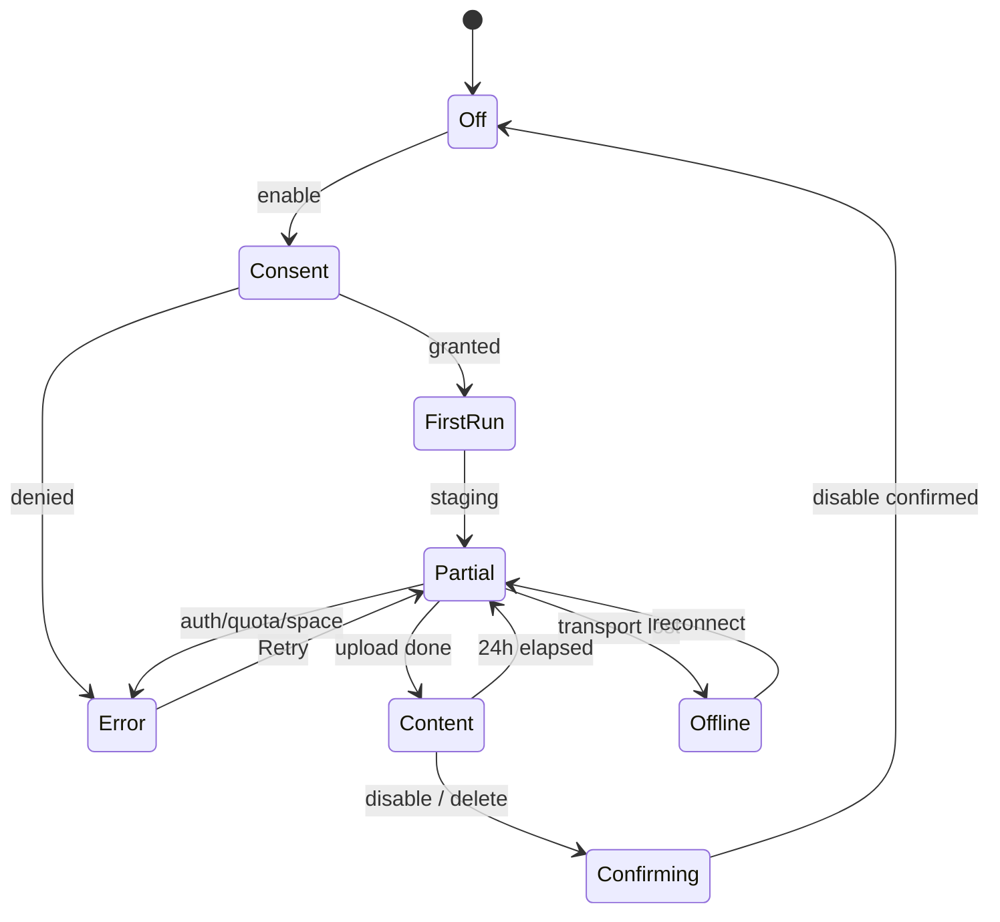
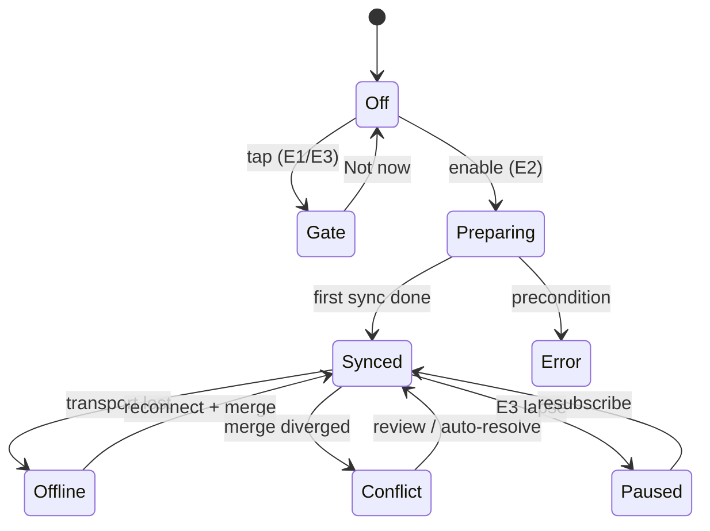
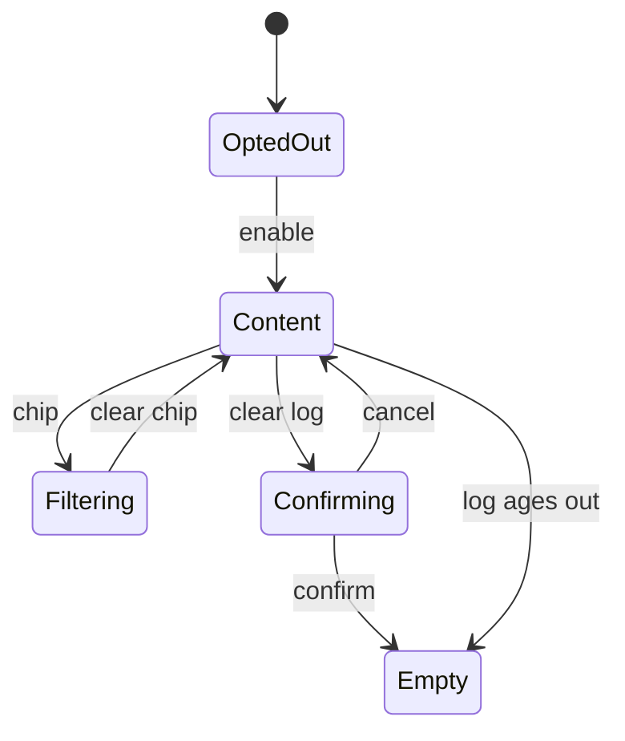
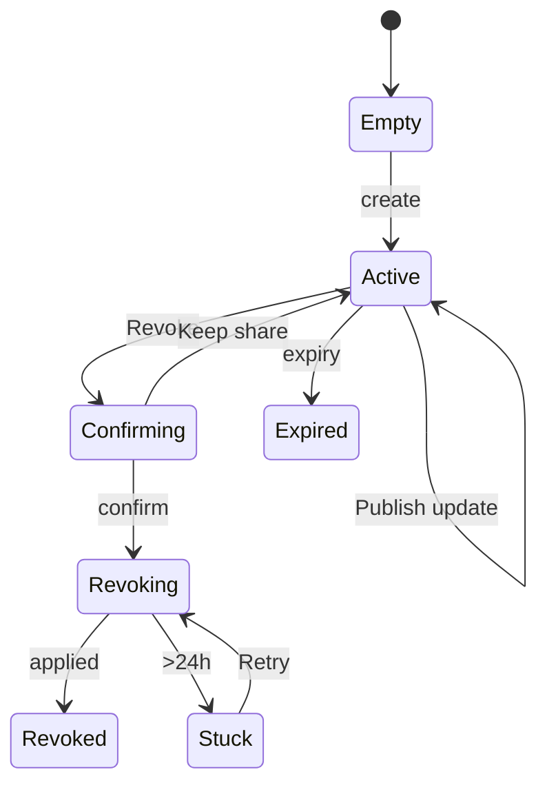
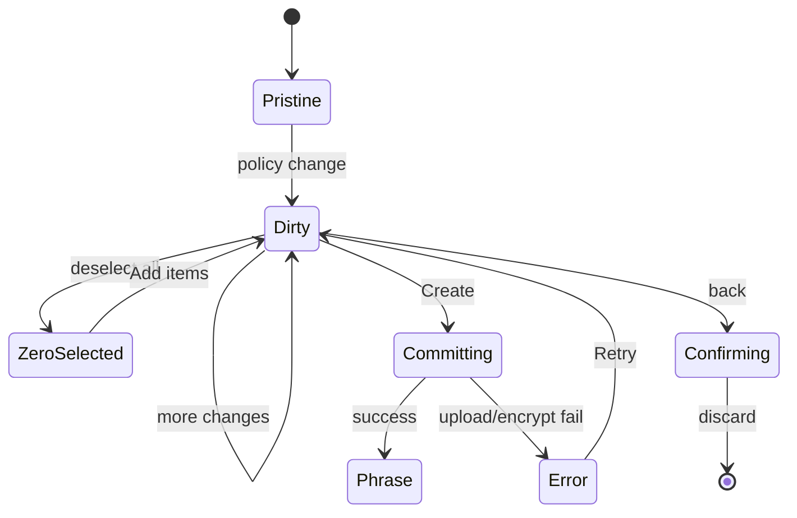
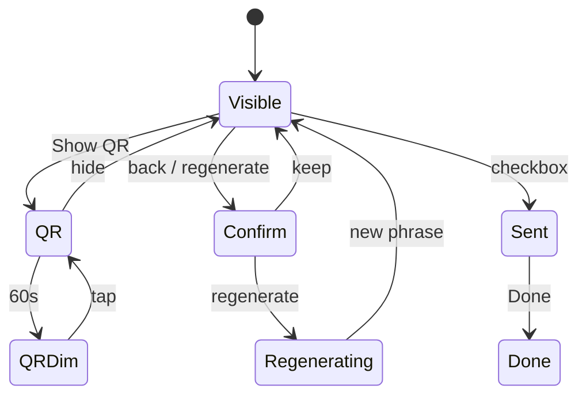
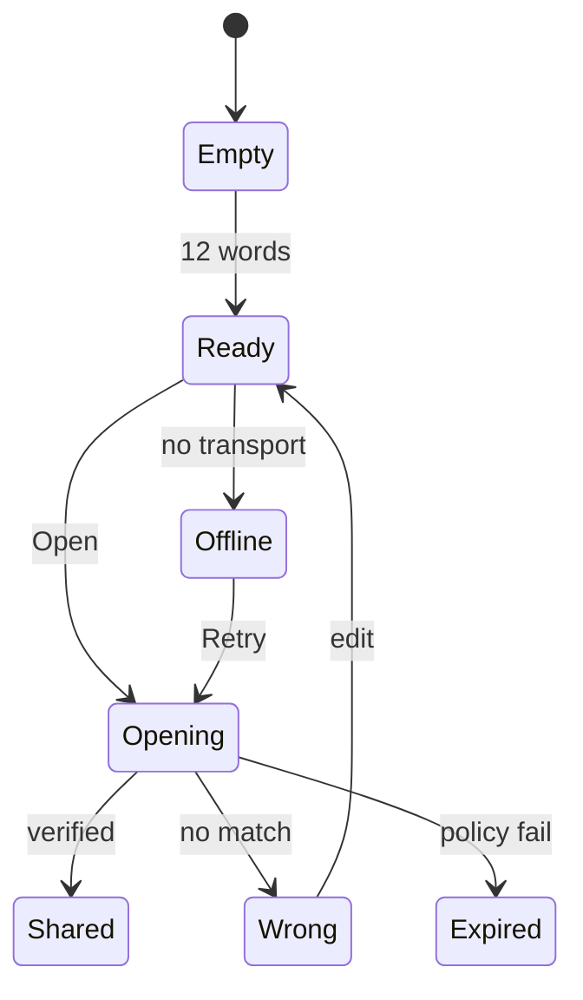
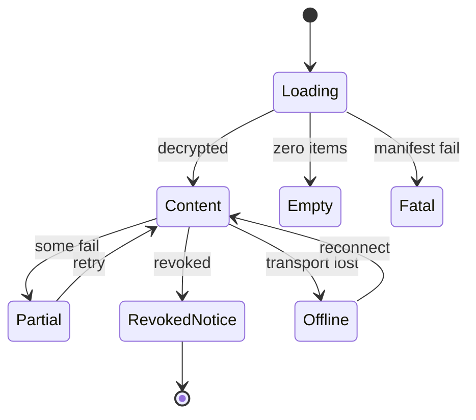

# 05 — Cloud, Sync & Sharing

> Domain file for the Cloud group: `screens.md` §14, §15, §16, §28, §31 and the transport
> features in `plan/encrypted-cloud-backup`, `plan/device-sync`, `plan/secure-sharing`.
> Reads [`_TEMPLATE.md`](./_TEMPLATE.md), [`00-state-model.md`](./00-state-model.md),
> [`07-system-states.md`](./07-system-states.md).

**Domain invariants (in addition to `_TEMPLATE.md §4`):**

1. **No recipient identity exists.** A share is a 12-word phrase. There is no email, phone,
   account, or device field anywhere in this domain. Never invent one, never imply one.
2. **Transport cannot read content.** Drive sees ciphertext, record counts, padded sizes, and
   timing only. No screen may display a record id, file name, vault label, IP address, or full
   account email in any state.
3. **Cloud never blocks the vault.** Backup and sync failures never block unlock, viewing,
   editing, importing, or capturing.
4. **`FLAG_SECURE` scope** (feature-matrix §5 decision 6): **on** for `/vault/share/phrase` and
   `/shared/{id}`; **off** for backup, sync, sync log, my shares, share create, and shared-open
   entry. "Hide previews" still applies to non-secure screens.
5. **Real counts only.** Progress is always "n of m" from a real scan. No percentage is derived
   from a guess, a timer, or file size alone.

---

### 5.1 Encrypted backup — `/settings/cloud/backup`

**Badges:** Free (E1/E2) · no Pro gate · Owner: encrypted-cloud-backup · Secure: no
**Purpose:** show whether a current encrypted copy exists in Google Drive, and let the user start, pause, or delete it.

**Entry points**
| From | Trigger | Arguments | Preconditions |
|---|---|---|---|
| `/settings` | `Encrypted backup` row | — | — |
| `/vault` | `Backed up · 2 hours ago` banner | — | ≥ 1 successful backup |
| Notification | `Backup` channel tap → unlock | `` (opaque) | Backup failed or stale > 48 h |
| `/restore/progress` | `Why?` on a restore failure | `` | Restore attempted |
| `/pro` | — | — | Backup is never gated (E1 = full) |

**Exit points**
| To | Trigger | Side effects |
|---|---|---|
| `/settings` | Back / gesture / `Esc` | — |
| Google consent (system) | `Connect Google account` | OAuth `drive.appdata`; token never shown |
| `/restore/progress` | `Restore on a new device` | Recovery-phrase re-auth, then download |
| Last-5-backups sheet | `Last 5 backups` | Read-only; list is decrypted in memory |
| Delete-cloud-data dialog | `Delete cloud data` | None until confirm |
| Background | Home / screen off | WorkManager continues; progress visible in-app only |
| `G4` process death | LMK / force stop | Relaunch → `/lock`; resumable state from WorkManager |

**Actions**
| Control | Preconditions | Effect | Resulting state | Failure |
|---|---|---|---|---|
| Enable backup (switch) | Google account connected | Schedule 24 h `UNMETERED` work; stage+encrypt first set | S15 | No account → opens consent; Drive unavailable → S6 |
| `Connect Google account` | — | System OAuth sheet | S15 → S3 | Denied → S6 "Backup needs Drive access." + `Try again` |
| `Backup now` | Enabled | Force a run past the 24 h window | S15 | Offline → S8 (queued); metered → S6 with `Resume anyway` |
| `Wi-Fi only` (switch) | Enabled | Constrain work to `UNMETERED` | S3 | — |
| `Allow mobile data` | N3 banner shown | One-shot override for this run | S15 | — |
| `Include videos` (switch) | Enabled | Include/exclude video chunks next run | S3 | — |
| Google account row | Connected | Explainer sheet: alias + `Disconnect` | S14 | — |
| `Disconnect` | Connected | Removes local token; cloud records remain | S3 | Re-consent needed → S6 |
| `Backup key` | — | Explainer + biometric reveal | S3 | Key mismatch on restore → S6 `Why?` |
| `Restore on a new device` | — | Phrase gate → `/restore/progress` | S1→S16 | Phrase wrong → generic; no Drives → S6 |
| `Last 5 backups` | ≥ 1 backup | Sheet: time, size, status | S3 | 0 backups → S4 row inside sheet |
| `Delete cloud data` | ≥ 1 record | Confirm → durable delete queue | S14→S15→S3 | Offline → queued, marked `Pending` |
| Disable backup (switch off) | Enabled | Confirm dialog (records remain) | S14→S3 | — |
| `Retry` (failure banner) | Failed state | Re-runs the failed stage only | S15 | Repeat failure → S6 stays |
| `Why?` (failure banner) | Failed state | Plain-language cause sheet | S3 | — |

**States**
| State | Trigger | Visual | Available actions | Announcement |
|---|---|---|---|---|
| S0 Initial | Composition | Static ring, no value | — | "Encrypted backup" |
| S1 Loading | Reading last-run record | Ring track + skeleton rows | none | "Checking backup" |
| S3 Content on | Enabled, healthy | Mint ring 72dp, "2 hours ago · 1.8 GB", `Google Drive` | all | "Backup complete, 2 hours ago, 1.8 gigabytes" |
| S3 Content off | Never enabled / disabled | Neutral ring, `Back up this vault` | Enable | "Backup is off" |
| S3 Stale | Last run > 48 h | Butter ring, "Last backup 3 days ago" | `Backup now` | "Backup is 3 days old" |
| S4 First run | Enabled, no backup yet | `Preparing first backup…` + `mono.m` count | Cancel | "Preparing first backup" |
| S5 Partial | Some chunks uploaded | Ring sweep + "Encrypting 42 of 128" | Cancel | "Encrypting 42 of 128" |
| S6 Error | Auth revoked / quota / staging failure | Danger ring, named cause, `Retry` + `Why?` | Retry, Why | "Backup didn't finish. Your files are safe on this device." |
| S8 Offline | N2/N4/N5 | Sky banner + "Last backed up 3 days ago" | `Retry` (queued) | "You're offline. This will retry when you're connected." |
| S8 Metered | N3 | Banner "Using mobile data" | `Resume anyway`, `Wait for Wi-Fi` | "Backup is paused on mobile data." |
| S9 Locked | Session ended | `AuroraSecureSurface` brand cover | Unlock | — |
| S14 Confirming | Disable / delete / disconnect | Solid dialog; no scrim dismiss on delete | Confirm, Keep | — |
| S15 Committing | Stage/encrypt/upload | Ring sweep + real counts; cancel available | Cancel | "Backing up" |
| S16 Success | Run completed | Mint ring, fresh timestamp | — | "Backup complete" |
| S12 Unsupported | No Play services / Drive API absent | Disabled toggle + explanation row | — | "Backup isn't available on this device." |
| X2 Battery saver | `isPowerSaveMode` | Solid surface; backup deferred; say so once | — | "Backup is paused while battery saver is on." |
| X3 Doze | `isDeviceIdleMode` | No visual change | — | — |
| D2 Low storage | ≤ 500 MB free | Butter banner "Storage is almost full." | Backup continues with warning | — |
| D3 Full | ≤ 50 MB free | Backup pauses, no data loss | `Free up space` | "This device is out of space. Free up space or connect a drive." |
| A4 200% | Font scale 200% | Rows grow; no label truncation | all | — |
| V1 / V4 | Phone / tablet | 1 col / 2 col + nav rail | all | — |

**Transitions**

**Flows**
| Flow | Path | Success | Abandonment |
|---|---|---|---|
| First enable | Off → consent → S4 → S16 | Mint ring, timestamp | Leave before S16 → S8 resumable, no partial list |
| Incremental run | S3 → S15 (counts) → S16 | Timestamp advances; real "42 of 128" | Cancel → already-uploaded chunks stay; resumes |
| Delete cloud | S3 → S14 → S15 | Records removed; local vault intact | Cancel → nothing deleted |
| Disable | S3 → S14 → Off | Switch off; records remain until deleted | Cancel → stays enabled |

**Edge cases & races**
- **Drive auth revoked** (user revoked in Google settings, or refresh fails): S6 "Backup needs Drive access." Nothing local changes; `Connect` re-consents.
- **Quota exceeded:** S6 "Google Drive is full. Free up space or turn off backup." Never auto-delete.
- **Two backups race** (manual `Backup now` during a scheduled run): second is ignored, no duplicate upload; idempotency key per run.
- **G4 during staging:** already-uploaded chunks recognized on relaunch; staging temp files are wiped; UI shows resumable state. **No duplicate backup.**
- **Clock skew:** if last-run timestamp is in the future, show "Last backup time is unavailable" rather than "-3 hours"; scheduling uses elapsed time, not wall clock.
- **Backup key mismatch on restore:** restore fails with `Backup key doesn't match` + `Retry`; the screen never deletes or overwrites the existing cloud records.
- **Delete cloud data offline:** queued; row marked `Pending` with a progress line; never silently drops.
- **Storage fills mid-staging:** pause at the real count ("Stopped at 40 of 128"), no partial item listed.

**Data contract**
Reads: last-run time/size/status (encrypted local), item count, storage free space. · Writes: enable toggles, WorkManager job, opaque delete/upload queue entries. · Must never appear: file names, vault labels, record ids, Drive file ids, account tokens, full account email, thumbnails, per-file sizes.

---

### 5.2 Device sync — `/settings/cloud/sync`

**Badges:** Pro (E2) · gate E1/E3 · Owner: device-sync · Secure: no
**Purpose:** show how many of the user's own devices carry this vault, and let them add, rename, or disconnect a device.

**Entry points**
| From | Trigger | Arguments | Preconditions |
|---|---|---|---|
| `/settings` | `Device sync [PRO]` row | — | — |
| `/pro` | Purchase return | `{return=sync}` | — |
| Notification | `Sync` channel tap → unlock | `` | Conflict or pause event |
| `/settings/cloud/backup` | `Manage devices` (when sync on) | — | Backup transport established |

**Exit points**
| To | Trigger | Side effects |
|---|---|---|
| `/settings` | Back / gesture | — |
| `/settings/cloud/sync/log` | `Activity log` row | — |
| `/pro` | Gate tap | Returns to this screen preserving state |
| Review sheet | Conflict banner | None; resolves items inline |
| Background | Home / screen off | Encrypted outbox drains via WorkManager |

**Actions**
| Control | Preconditions | Effect | Resulting state | Failure |
|---|---|---|---|---|
| Enable sync (switch) | E2 + backup on + account | `Preparing first sync…`; enroll this device | S15→S3 | E1/E3 → S10 gate; no account → consent; backup off → S6 |
| `Add a device` | E2 | Sheet: install, enter recovery phrase on the other device | S3 | — |
| Rename device alias | E2 | Inline edit; alias stored **inside** encrypted vault | S13→S3 | — |
| `Disconnect this device` | E2 | Confirm-lite; stops upload/download locally | S3 | Offline → applies immediately, queues note |
| `Manage on other device` | ≥ 2 devices | Info sheet | S3 | — |
| Conflict banner tap | Conflict present | Opens review list ("n items need review") | S13 | Merge still resolves on its own if ignored |
| Review item action | Conflict list open | Keep added / Keep deleted per item | S3 | — |
| `Activity log` | E2 | → `/settings/cloud/sync/log` | — | — |

**States**
| State | Trigger | Visual | Available actions | Announcement |
|---|---|---|---|---|
| S0 Initial | Composition | Static header, no count | — | "Device sync" |
| S1 Loading | Reading device set (local, encrypted) | Skeleton rows | none | "Loading devices" |
| S3 Content | E2, synced | Sky card "3 devices · Synced 2m ago" + `AuroraDeviceRow`s | all | "3 devices, synced 2 minutes ago" |
| S3 This device only | Only this device enrolled | Sky card "This device · Synced"; empty "Other devices" row | `Add a device` | "This device only" |
| S3 One other | 2 devices | Both rows; other's last-seen | all | "2 devices" |
| S3 Many | ≥ 5 devices | Scrollable rows; no IDs | all | "6 devices" |
| S4 No devices | Sync off | "Turn on sync to keep this vault on your own devices." | Enable (gate) | "Sync is off" |
| S5 Partial | Some peers stale | Rows with `Offline · 2 d` pills | Disconnect peers | "Some devices haven't synced recently" |
| S6 Error | Wrong account / backup off / outdated app / quota | Danger banner + cause + `Retry` | Retry, Why | Named cause (never generic) |
| S8 Offline | N2/N4 | Sky banner + queued count | Retry | "You're offline. 4 changes waiting." |
| S10 Pro-gated · paused | Pro lapsed (E3) while enrolled | Butter banner "Sync is paused." | Resume / View data | "Your Pro access has ended. Your data is still here." |
| S9 Locked | Session ended | Brand cover | Unlock | — |
| S10 Pro-gated · gate | E1/E3 direct reach | `AuroraProGate`: value sentence, `Try Pro`, `Not now` | Try Pro, Not now | "Sync is a Pro feature" |
| S13 Conflict / review | Merge produced conflicts | Butter banner "Some changes merged. 3 items need review." | Review | "Three items need review" |
| S14 Confirming | Disconnect | Sheet (not danger styling) | Disconnect, Cancel | — |
| S15 Committing | First sync / drain | "Preparing first sync…" + real count | Cancel (safe) | — |
| S16 Success | First sync done | Sky card with fresh count | — | "Sync is on" |
| G6 after foreign wipe | Peer wiped elsewhere | Peer simply shows `Disconnected`; nothing revealing | — | — |
| A4 / V1 / V4 | — | Rows grow; 1 col / 2 col + rail | all | — |

**Transitions**

**Flows**
| Flow | Path | Success | Abandonment |
|---|---|---|---|
| Add a device | S3 → `Add a device` → other device enters phrase | New `AuroraDeviceRow` appears | Other device never completes → never appears; no partial row |
| First sync | Off → enable → S15 → S16 | Count = 2+, "Preparing first sync…" resolved | Cancel during prepare → stays off; nothing uploaded |
| Disconnect | S3 → S14 → S3 | Row removed; copy says local + reversible | Cancel → stays |
| Review conflicts | S13 → review list → keep per item | Banner clears; vault converges | Ignore → auto add-wins merge; banner persists until seen |

**Edge cases & races**
- **No other devices:** "This device only" with a neutral hint; never an error.
- **A device offline 90 days:** shown as `Offline · 90 d` (short form). No nudge to delete it; on reconnect it merges; adds win over unseen deletes.
- **Clock skew:** last-sync times use device elapsed time; a peer with a future timestamp shows "Last sync time unavailable", never a negative duration.
- **Duress wipe on another device:** this device sees the peer become `Disconnected`. Nothing about coercion, content, or count is revealed; the peer never auto-rejoins.
- **G4 during first sync:** resumes via WorkManager; already-merged chunks are not re-applied (order-independent).
- **Merge semantics:** adds win over deletes that did not see the add; identical chunks collapse; merge is order-independent, so running twice equals running once.
- **Metered/offline:** no spinner; queue count only.
- **Rename race:** two devices rename the same alias concurrently → last-writer set wins; alias is content, so it merges like any record.

**Data contract**
Reads: device count, per-device alias + last-seen (all from inside encrypted vault), queue depth. · Writes: enroll/disconnect flags (local), alias (encrypted), opaque outbox entries. · Must never appear: device IDs, IP addresses, full account email, vault labels, file names, membership fields, per-chunk sizes.

---

### 5.3 Sync activity log — `/settings/cloud/sync/log`

**Badges:** Pro (E2) · Owner: device-sync · Secure: no
**Purpose:** a local, encrypted, opt-in record of sync actions, with no content in it.

**Entry points**
| From | Trigger | Arguments | Preconditions |
|---|---|---|---|
| `/settings/cloud/sync` | `Activity log` row | — | E2 |
| Conflict review | `See what merged` | `{filter=conflict}` | Conflict present |

**Exit points**
| To | Trigger | Side effects |
|---|---|---|
| `/settings/cloud/sync` | Back / gesture | — |
| Clear-log dialog | `Clear log` | None until confirm |
| Background | Home / screen off | — |

**Actions**
| Control | Preconditions | Effect | Resulting state | Failure |
|---|---|---|---|---|
| Enable logging (switch) | E2 | Start recording events locally | S3 | — |
| Row tap | Event exists | Expands a plain-language sentence | S3 | — |
| `Clear log` | ≥ 1 event | Confirm, then wipe locally | S14→S4 | — |
| Filter chips | Logging on | Filter by category (`Merge`, `Device`, `Error`) | S3 | No matches → S4 within list |

**States**
| State | Trigger | Visual | Available actions | Announcement |
|---|---|---|---|---|
| S0 Initial | Composition | Static header | — | "Sync activity log" |
| S1 Loading | Decrypting log | Skeleton rows | none | — |
| S3 Content | Events present | `AuroraListRow`s: time, action, alias | Expand, filter, clear | "12 sync events" |
| S4 Empty | Logging on, no events | "No sync activity yet." | — | "No sync activity yet" |
| S4 Opted out | Logging off | "Activity logging is off." + Enable | Enable | "Sync activity logging is off" |
| S5 Partial | Decrypt failed on some rows | Rows render, undecryptable ones neutral | Clear | — |
| S6 Error | Log store unreadable | Inline error + `Retry` | Retry, Clear | "The log couldn't be read." |
| S9 Locked | Session ended | Brand cover | Unlock | — |
| S14 Confirming | Clear | Solid dialog, no scrim dismiss | Clear, Cancel | — |
| S13 Filtering | Chips active | Filtered list + count | Clear filters | — |
| S2 10k+ events | ≥ 10,000 rows | Windowed list; grouped by day; no jank | Virtualized scroll | "10,000 sync events" |
| A4 / V1 / V4 | — | Rows grow; 1 col / rail | all | — |

**Transitions**

**Flows**
| Flow | Path | Success | Abandonment |
|---|---|---|---|
| Opt in | OptedOut → enable → S3 | Events begin recording | Leave → setting persists |
| Clear | S3 → S14 → S4 | Local wipe; peers unaffected | Cancel → nothing cleared |
| Investigate | S3 → expand row | Plain sentence, no content | — |

**Edge cases & races**
- **10k events:** list is virtualized; oldest are trimmed by an internal cap; the cap is stated once, never a count that implies content.
- **Log entries must never contain:** file names, vault labels, collection names, IP addresses, record ids, Drive file ids, device ids, account email, or per-item sizes.
- **Clear races with an incoming event:** clear wipes up to its snapshot; the event after the snapshot may reappear — acceptable and non-destructive.
- **Opt-out:** stops recording; does not delete the existing log (that is `Clear log`).
- **G4 while logging:** appends are transactional; at worst the last event is lost, never a partial/corrupt row.

**Data contract**
Reads: encrypted log rows (time, action, alias). · Writes: opt-in flag, clear marker. · Must never appear: any content identifier — this screen is the one place a content leak is most tempting and most forbidden.

---

### 5.4 My shares — `/shares`

**Badges:** Pro create (E1/E3 gate) · Owner: secure-sharing · Secure: no
**Purpose:** the owner's record of every share: status, opens used, expiry, and revoke.

**Entry points**
| From | Trigger | Arguments | Preconditions |
|---|---|---|---|
| `/settings` | `Shares` row (or nav `Shares`) | — | — |
| `/vault` selection | `Share` → after create | `{new=1}` | E2 |
| `/vault/collection/{id}` | `Share` (Pro) | `{collection=id}` | E2 |
| Notification | `Share expiry` channel tap → unlock | `` | Share expiring/expired |
| Timeline | "Shared album" event tap | `{share=id}` | Share exists |
| `/shared/{id}` | Owner opens own share? | — | Not applicable — recipients have no owner UI |

**Exit points**
| To | Trigger | Side effects |
|---|---|---|
| `/settings` | Back / gesture | — |
| `/vault/share/create` | `Share a vault` (empty) / `New share` | — |
| `/vault/share/phrase` | (create flow only) | — |
| `/vault/collection/{id}` | Card content tap | — |
| `/pro` | Gate | Returns here with state preserved |
| Revoke dialog | `Revoke` | None until confirm |

**Actions**
| Control | Preconditions | Effect | Resulting state | Failure |
|---|---|---|---|---|
| `Share a vault` | E2 | → `/vault/share/create` | — | E1/E3 → S10 gate; nothing existing is hidden |
| `New share` | E2, list non-empty | → create | — | same gate |
| `Publish update` | Share active | Queues an incremental encrypted update | S15→S3 | Offline → queued `Pending` |
| `Revoke` | Share active | Confirm dialog | S14 | — |
| `Revoke access` (confirm) | Active | Durable revoke queue | S15 `Revoking…` | Offline/stuck → `Stuck? Retry` after 24 h |
| `Keep share` | In dialog | Dismiss | S3 | — |
| Sort | ≥ 2 shares | Sort by expiry / created / status | S3 | — |
| Card tap | Any status | Detail sheet: policy, opens, dates | S3 | Deleted collection → card shows `Source deleted` |

**States**
| State | Trigger | Visual | Available actions | Announcement |
|---|---|---|---|---|
| S0 Initial | Composition | Static header | — | "My shares" |
| S1 Loading | Decrypting list | Skeleton cards | none | — |
| S3 Active | ≥ 1 active share | Card: label, mint dot, `2 of 3 opens · 6d` | Publish, Revoke | "{label}, active, 2 of 3 opens" |
| S3 Expired | Expiry passed | Card: sand dot, `Expired · Nov 12` | Delete card | "{label}, expired" |
| S3 Revoked | Revoked | Card: ink.400, `Revoked · Nov 10` | Delete card | "{label}, revoked" |
| S3 Revoking | Revoke in flight | Butter card + 2 dp progress line | — | "Revoking" |
| S3 Stuck | > 24 h pending | Card + `Stuck? Retry` | Retry | "Revoke is stuck" |
| S4 Empty | No shares | "You haven't shared anything." + `Share a vault` | Share (gate) | "You haven't shared anything" |
| S5 Partial | Some cards fail decrypt | Rows render; failed card neutral `Unavailable` | Delete card | — |
| S6 Error | List store unreadable | Inline error + `Retry` | Retry | "Your shares couldn't be loaded." |
| S8 Offline | N2/N4 | Sky banner; revoke/publish queue | Retry | "You're offline. Revoke will finish when you're connected." |
| S9 Locked | Session ended | Brand cover | Unlock | — |
| S10 Pro-gated | E1/E3 create tap | `AuroraProGate`; existing shares stay fully usable | Try Pro, Not now | "Creating shares is a Pro feature" |
| S13 Selection | Long-press a card | Multi-select for batch revoke | Revoke all | — |
| S14 Confirming | Revoke | Solid dialog (see 28.2 copy) | Revoke access, Keep share | — |
| S15 Committing | Revoke/publish | 2 dp progress line on card | — | — |
| S3 Source deleted | Shared collection deleted locally | Card marked `Source deleted`; revoke still works | Revoke | "Source deleted" |
| S3 50 shares | 50 cards | Scrollable; status grouping | Sort | "50 shares" |
| A4 / V1 / V4 | — | Cards grow; 1 col / 2 col + rail | all | — |

**Transitions**

**Flows**
| Flow | Path | Success | Abandonment |
|---|---|---|---|
| Revoke | Active → S14 → Revoking → Revoked | Card shows Revoked, never removed | Cancel → stays active |
| Publish update | Active → queue → Synced | Recipient pulls update on next check | Offline → queued `Pending` |
| Empty → create | S4 → `/vault/share/create` | New active card | Leave → stays empty |

**Edge cases & races**
- **Revoke copy (exact):** "Revoke this share? The recipient loses access the next time they're online. Files already exported stay exported." Primary `Revoke access` (danger text, not fill); secondary `Keep share`.
- **Stuck revoke:** retry is automatic; after 24 h the card exposes `Stuck? Retry`. Never silently gives up.
- **Never delete the card on revoke** — the record that it happened is the point.
- **Publish on expired/revoked:** control is absent, not disabled.
- **50 shares:** grouped by status; scroll restores by stable share id; selection is dropped after process death.
- **Deleted collection:** card survives as `Source deleted`; revoke still reaches Drive.
- **No recipient identity anywhere.** Cards show the shared *label* (encrypted content) and policy only. There is nobody to name; never render "To: …".
- **G4 during revoke:** queue is durable; on relaunch the card returns to `Revoking…` and retries.

**Data contract**
Reads: share label (encrypted), created date, opens used, max opens, expiry, status, source-collection id. · Writes: revoke/publish queue entries, card dismissal. · Must never appear: recipient email/device, phrase, Drive file id, file names inside the share.

---

### 5.5 Share create — `/vault/share/create`

**Badges:** Pro (E2) · gate E1/E3 · Owner: secure-sharing · Secure: no (phrase is shown later, on 5.6)
**Purpose:** define what is shared and the one-way policy (expiry, max opens, export) before a phrase exists.

**Entry points**
| From | Trigger | Arguments | Preconditions |
|---|---|---|---|
| `/shares` | `Share a vault` / `New share` | — | E2 |
| `/vault` selection | `Share` (Pro) | `{items=n}` | ≥ 1 item selected, E2 |
| `/vault/collection/{id}` | `Share` | `{collection=id}` | E2 |
| `/pro` | Purchase return | `{return=shareCreate}` | — |

**Exit points**
| To | Trigger | Side effects |
|---|---|---|
| `/vault` (or origin) | Back / Cancel | Nothing staged; selection preserved on origin |
| `/vault/share/phrase` | `Create share` success | Share record created; phrase held in memory only |
| `/pro` | Gate | Returns here, state preserved |
| Background | Home | **Staged draft is dropped** (no phrase exists yet) |

**Actions**
| Control | Preconditions | Effect | Resulting state | Failure |
|---|---|---|---|---|
| `Entire vault` radio | — | Scope = whole vault | S13 | Entire-vault share of empty vault → primary disabled + why |
| `Selected items (n)` radio | ≥ 1 selected | Scope = selection | S13 | — |
| `Expires` row | — | Sheet: Never / 24 h / 7 days / 30 days / Custom | S13 | — |
| `Max opens` row | — | Sheet: 1 / 3 / 5 / 10 / Unlimited | S13 | — |
| `Export` switch | — | Off by default; on adds one-line explanation | S13 | — |
| `Create share` | Selection exists | Encrypt, generate phrase, create record | S15→S16 | Offline → blocked; no Drive → S6 |
| `Add items` | Scope = selected, 0 selected | → returns to origin selection | — | — |
| Cancel | — | Discard draft | — | — |

**States**
| State | Trigger | Visual | Available actions | Announcement |
|---|---|---|---|---|
| S0 Initial | Composition | Static policy rows, defaults | — | "Share this vault" |
| S3 Pristine | Opened with a selection | Radios + policy rows; primary enabled | Create | — |
| S3 Dirty | Policy changed | Same; values update | Create, Cancel | — |
| S13 Zero selected | Scope = selected, none | Primary disabled + helper "Choose at least one item." | Add items | "Choose at least one item" |
| S13 Empty vault | Vault has no items | Entire-vault option disabled + why | Add items | "This vault is empty" |
| S10 Pro-gated | E1/E3 | `AuroraProGate`; nothing else shown | Try Pro, Not now | "Creating shares is a Pro feature" |
| S6 Publish error | No Drive access | Danger banner + cause + `Retry` | Retry, Why | Named cause (never generic) |
| S8 Offline | N2/N4 | Blocking inline "Sharing needs a connection." | Retry | "Sharing needs a connection." |
| S9 Locked | Session ended | Brand cover; draft dropped | Unlock | — |
| S14 Confirming | Leaving with a dirty draft | Confirm dialog | Discard, Keep editing | — |
| S15 Committing | Encrypting the package | Inline progress + real item count | Cancel (safe until phrase) | "Encrypting 12 of 12" |
| S16 Success | Record created | Transitions to `/vault/share/phrase` | — | — |
| D3 Full | Storage ≤ 50 MB | Blocked before encrypt | `Free up space` | "This device is out of space." |
| A4 / V1 / V4 | — | Rows grow; 1 col / 2 col + rail | all | — |

**Transitions**

**Flows**
| Flow | Path | Success | Abandonment |
|---|---|---|---|
| Create selected | Dirty → Committing → `/vault/share/phrase` | Phrase display | Back during Committing → cancel, no record |
| Create entire vault | Dirty → Committing | Phrase display | — |
| Zero selected | ZeroSelected → Add items | Selection restored | Leave → nothing created |

**Edge cases & races**
- **Estimated size:** shown as a real sum of selected item sizes ("About 340 MB"), never a guess presented as precise.
- **0 selected:** primary disabled **with** a helper line; the disabled control is never unexplained (`00 §11`).
- **Export off by default** with a one-line explanation; enabling it warns that exported copies leave the protection model.
- **Create failure reasons:** offline ("Sharing needs a connection."), no Drive, storage full, encrypt failure. Each names the cause and offers exactly one action.
- **`Export` is a policy bit bound as AAD**; changing it after creation is not possible — editing means creating a new share.
- **No recipient field.** Scope must never offer an email/account input. Phrase-based by design.
- **G4 during Committing:** no share record is committed until the phrase is derivable; relaunch returns to origin with no orphan share and no phrase on disk.

**Data contract**
Reads: selection ids/sizes, vault item count. · Writes: none until commit (share record stored encrypted). · Must never appear: file names in UI beyond the user's own selection, phrase (not yet generated), recipient identity.

---

### 5.6 Share phrase — `/vault/share/phrase`

**Badges:** Secure · Pro (already gated upstream) · Owner: secure-sharing · FLAG_SECURE: **yes** (solid)
**Purpose:** show the one-time 12-word phrase once, and get it into the recipient's hands through a different channel.

**Entry points**
| From | Trigger | Arguments | Preconditions |
|---|---|---|---|
| `/vault/share/create` | `Create share` succeeded | `{share=id}` | Phrase derived in memory |

**Exit points**
| To | Trigger | Side effects |
|---|---|---|
| `/shares` | `Done` (after "I've sent it") | Phrase buffer zeroized; share becomes active |
| Confirm dialog | Back / gesture / close | None until confirm |
| Background | Home / screen off | Phrase buffer **cleared**; on return the phrase is gone |
| `G4` process death | LMK / crash | Phrase is **unrecoverable**; share exists, phrase cannot be re-shown |

**Actions**
| Control | Preconditions | Effect | Resulting state | Failure |
|---|---|---|---|---|
| `Copy` | Phrase visible | Copy + `EXTRA_IS_SENSITIVE`; 60 s auto-clear | S16 | Clipboard denied → copy disabled + note |
| `Share` | Phrase visible | System sheet **excluding the phrase** by default | S3 | No share targets → sheet still opens |
| `Regenerate` | Phrase visible | Confirm; invalidates previous phrase | S14→S3 | Old phrase stops working immediately after |
| `Show QR` | Phrase visible | QR panel inside secure surface | S3 | — |
| `I've sent it` checkbox | — | Enables `Done` | S13 | — |
| `Done` | Checkbox ticked | Zeroize phrase, activate share | S16 | — |
| `Reveal again` | Never | — | — | **Does not exist.** |

**States**
| State | Trigger | Visual | Available actions | Announcement |
|---|---|---|---|---|
| S3 Visible | Screen open | 12 word tiles, 2×6, solid, FLAG_SECURE | Copy, Share, Regenerate, QR | "Share phrase, 12 words. Screen capture is blocked." |
| S3 QR | `Show QR` | QR panel; "Anyone who scans this can open the share." | Hide QR | "QR code shown" |
| S3 QR dimmed | 60 s elapsed | QR dims to 10%; tap to redisplay | Reveal | — |
| S13 Sent | Checkbox ticked | `Done` enabled | Done | — |
| S14 Confirming | Back / Regenerate | Solid dialog; no scrim dismiss | Discard, Keep | — |
| S15 Regenerating | After confirm | Inline spinner; old phrase dead | — | "Regenerating" |
| S16 Copied | `Copy` | Snackbar "Copied. Clears in 60 s." | — | — |
| S9/Cover | Background | Solid brand cover, phrase cleared | Unlock (returns without phrase) | — |
| TalkBack A2 | Screen reader active | Butter banner: "Screen reader active. Your phrase will be spoken aloud. Use headphones." | — | reads words 1–12 with index |
| A4 200% | Font scale | Tiles grow; 2×6 may become 2×6 with scroll | all | — |
| V1 / V4 | — | 2×6 on phone; larger tiles on tablet | all | — |

**Transitions**

**Flows**
| Flow | Path | Success | Abandonment |
|---|---|---|---|
| Send phrase | Visible → send via other channel → checkbox → Done | Share active | Leave before Done → confirm; share still exists but phrase lost |
| Copy | Visible → Copy → paste elsewhere | Clipboard clears after 60 s | — |
| Regenerate | Visible → confirm → new phrase | Old phrase invalidated | Cancel → nothing changes |

**Edge cases & races**
- **Leaving mid-flow:** back/gesture/close all open a confirm; confirming zeroizes the phrase and the share exists **without a recoverable phrase**.
- **Reveal-again never exists.** If the phrase is lost, the owner must Regenerate (which invalidates the old one) or revoke.
- **Share sheet excludes the phrase by default** — the system sheet shares only a neutral note; the owner chooses a genuinely separate channel for the words.
- **QR:** encodes the 12 words; solid + FLAG_SECURE; auto-dims after 60 s; no screenshot, no save-to-photos. Typing remains the default on the receiving side.
- **Regenerate after the recipient already claimed:** the previous phrase stops working; the new phrase must be re-sent. Warning copy states this before confirming.
- **G4 during phrase display:** phrase is gone; on relaunch the user lands on `/lock` → `/shares`, sees the share, and can only Regenerate.
- **No recipient identity.** There is no "send to" field, no contact picker, no email. Ever.

**Data contract**
Reads: derived share phrase (memory only), share id. · Writes: share activation flag after `Done`; regenerate invalidates the prior derivation. · Must never appear in storage, logs, clipboard history (after clear), or any preview: the 12 words.

---

### 5.7 Open shared vault — `/shared/open`

**Badges:** Free to open (E1–E4) · Owner: secure-sharing · FLAG_SECURE: entry screen (secure), per matrix
**Purpose:** turn a 12-word phrase into a read-only shared vault, or fail neutrally.

**Entry points**
| From | Trigger | Arguments | Preconditions |
|---|---|---|---|
| `/vault` | `Open a shared vault` (nav/settings) | — | — |
| Deep link | `vaultaire://shared/open` | — | App unlocked |
| Notification | `Share expiry` (recipient-side availability) | `` | — |
| `/welcome` | `Open a share` | — | New device |

**Exit points**
| To | Trigger | Side effects |
|---|---|---|
| `/shared/{id}` | Phrase verified + claimed | Read-only vault mounted |
| `/vault` | Back / gesture | Buffers cleared |
| Confirm on paste | Paste hold | — |
| Background | Home / screen off | Entry buffer cleared |

**Actions**
| Control | Preconditions | Effect | Resulting state | Failure |
|---|---|---|---|---|
| Type/phrase entry | — | 12 slots, 2×6, auto-advance | S13 | Autocorrect/suggestions off |
| `Paste words` (hold 1.5 s) | Clipboard has content | Fill all slots | S13 | Empty clipboard → action inert + note |
| `Scan QR` | Camera permission P1 | Opens scanner | S11 | P2/P3 → rationale; no camera → S12 |
| `Open` | 12 slots filled | Derive key, fetch, verify policy AAD | S15 | Wrong → generic; expired/revoked → neutral; offline → S8 |
| Clear all | Any input | Empty slots | S3 | — |

**States**
| State | Trigger | Visual | Available actions | Announcement |
|---|---|---|---|---|
| S0 Initial | Composition | Empty 2×6 grid, focused first slot | Type, Paste, Scan | "Enter the 12-word sharing phrase" |
| S3 Partial input | Some slots filled | Slots fill; `Open` disabled until 12 | Type, Clear | "{n} of 12 words" |
| S13 Ready | 12 slots filled | `Open` enabled | Open | "Ready to open" |
| S15 Opening | After `Open` | Full-width iris line "Opening. This can take a few seconds."; cancel disabled | — | "Opening" |
| S6 Wrong phrase | No matching share | "That phrase didn't work." | Retry, Clear | "That phrase didn't work" |
| S6 Expired | Policy expiry passed | "This share is no longer available." | Close | "This share is no longer available" |
| S6 Revoked | Owner revoked | "This share is no longer available." | Close | "This share is no longer available" |
| S6 Already used | Max opens consumed | "This share is no longer available." | Close | "This share is no longer available" |
| S6 No Drive access | No Google account or Drive access (Pro not needed) | "Sign in to Google Drive to open this share." | Connect | Named cause |
| S8 Offline | N2/N4/N5 | Blocking "Opening needs a connection." | Retry | "You're offline. This will retry when you're connected." |
| S9 Locked | Session ended | Brand cover; buffer cleared | Unlock | — |
| S11/P3 Camera denied | `Scan QR`, P2/P3 | Rationale / only `Open settings` | Open settings | — |
| S12 No camera | `Scan QR`, no hardware | Scan control absent (not disabled) | Type, Paste | — |
| A2 TalkBack | Screen reader | Each slot: "Word {i} of 12, empty/filled" | type | — |
| A4 / V1 / V4 | — | Grid grows; tablet uses wider slots | all | — |

**Transitions**

**Flows**
| Flow | Path | Success | Abandonment |
|---|---|---|---|
| Type | Empty → 12 words → Open | `/shared/{id}` | Leave → buffer cleared |
| Paste | Empty → hold Paste → Open | `/shared/{id}` | Release early → no fill |
| Scan | Empty → Scan QR → Open | `/shared/{id}` | Cancel scanner → back to entry |

**Edge cases & races**
- **Wrong phrase is fully generic.** No distinction between a typo, an expired share, a revoked share, and an already-used share **except** that expired/revoked/used converge to the same "no longer available" copy. Never hint at which word was wrong, never reveal expiry/revoke/typology.
- **Recipient without Pro:** opening and viewing are **free**; only *creating* is gated. Never show a paywall on this path.
- **No Drive access:** names the cause and offers `Connect`; never a generic failure.
- **Paste is deliberate** (1.5 s hold); no clipboard suggestion strip, autofill, or IME learning.
- **Rate-throttle** rapid wrong attempts with neutral copy; never implies a valid-but-revoked share exists.
- **G4 during Opening:** no partial mount; relaunch returns to entry with cleared buffers.

**Data contract**
Reads: phrase buffer (memory only). · Writes: claimed-share marker (opaque, encrypted), nothing plaintext. · Must never appear: the phrase at rest, the share's file names before decrypt, owner identity (there is none), a typo-vs-expiry distinction.

---

### 5.8 Shared vault (read-only) — `/shared/{id}`

**Badges:** Read-only · Free to open · Owner: secure-sharing · FLAG_SECURE: **yes** (shared vault, every policy)
**Purpose:** view a recipient's share with no write path, no export path, and no re-share path.

**Entry points**
| From | Trigger | Arguments | Preconditions |
|---|---|---|---|
| `/shared/open` | Verified phrase | `{id}` (opaque) | Claimed |
| Notification | `Share expiry` tap → unlock | `{kind=sharedView,id}` | — |

**Exit points**
| To | Trigger | Side effects |
|---|---|---|
| `/shared/open` / `/vault` | Back / gesture | Media cache cleared |
| Solid notice | Revoked mid-session | Content blurred; no cached thumbnails |
| Background | Home / screen off | Thumbnails dropped; FLAG_SECURE cover |

**Actions**
| Control | Preconditions | Effect | Resulting state | Failure |
|---|---|---|---|---|
| Open item | Item decrypts | Full-screen read-only viewer | S3 | Decrypt fail → S6 per item |
| Filter | ≥ 2 items | Filter chips (Photos/Videos/Docs) | S3 | No matches → S4 within |
| `Info` | Item open | Metadata: date, size | S3 | — |
| Export | Policy allows | Menu item **present** | — | Non-exportable → item **absent**, not disabled |
| Re-share / Edit / Delete | — | — | — | **Do not exist** |
| Refresh | — | Pull latest updates | S2 | Offline → S8 |

**States**
| State | Trigger | Visual | Available actions | Announcement |
|---|---|---|---|---|
| S0 Initial | Composition | Static header with read-only badge | — | "Read-only shared vault" |
| S1 Loading | Fetch + decrypt | Skeleton grid | none | "Loading shared vault" |
| S3 Content | Decrypted | Header badge, policy line, media grid, **no FAB** | Open, Filter, Info | "{n} items, read-only" |
| S4 Empty | Share has 0 items | "This shared vault is empty." | Refresh | "This shared vault is empty" |
| S5 Partial | Some items fail decrypt | Rendered items + neutral `Unavailable` tiles | Open, Refresh | — |
| S6 Error | Per-item decrypt failure | Inline "+ Why?" on the tile | Retry tile | "We couldn't open this item. It may be damaged." |
| S7 Fatal | Manifest undecryptable | Full-bleed "This share can't be opened." + safe exit | Back | "This share can't be opened" |
| S8 Offline | N2/N4 | Sky banner; cached items stay interactive | Refresh | "You're offline." |
| S9 Locked | Session ended | `AuroraSecureSurface` cover | Unlock | — |
| Revoked mid-session | Owner revoked; next check | Content **blurs immediately** + solid full-screen notice | Back | "This share is no longer available." |
| 200% font A4 | Font scale | Policy line wraps; grid reflows; badge not clipped | all | — |
| TalkBack A2 | Screen reader | Header announces "Read-only shared vault"; tiles announce type/size/date | open | as §4.1 |
| V1 / V4 | — | 2-up / 3-up grid + rail | all | — |

**Transitions**

**Flows**
| Flow | Path | Success | Abandonment |
|---|---|---|---|
| View | Content → open item → Info | Read-only viewing | Leave → cache cleared |
| Refresh | Content → Refresh → S2 | Updates pulled | Offline → S8, cached stays |
| Revoked | Content → notice | Clean exit | — |

**Edge cases & races**
- **Revoked mid-session:** content blurs immediately and a solid notice replaces it; **no cached thumbnails remain**. The blur is a transition, never the final state.
- **Export disabled vs absent:** when the policy forbids all export, the action is absent. When only some files are non-exportable, those menu items are absent, not disabled (`screens.md §16.4`).
- **No FAB, no edit, no delete, no re-share.** The floating action bar never appears on this route.
- **Policy line:** no owner label and no vault label exist. The header shows the shared collection's name (encrypted content) plus the `Read-only` badge. Never a recipient label — there is only one recipient and no identity for them.
- **Manifest failure** (AAD mismatch = tampered policy): fatal, one safe exit, no technical detail.
- **G4 during viewing:** thumbnails are re-decrypted on demand; nothing decrypted is written to cache.
- **200%/TalkBack:** the read-only badge and policy line remain both visible and spoken; the absent-control guarantee is identical at every font scale.

**Data contract**
Reads: encrypted share manifest + items (memory/decrypted cache only). · Writes: none — this route has **no write path**. · Must never appear: export of any item when policy forbids, owner/recipient identity, Drive ids, other shares, vault count.

---

## Flow atlas

| # | Journey | Entry | Path | Success | Degraded / failure |
|---|---|---|---|---|---|
| F1 | First backup | `/settings/cloud/backup` | Off → consent → S4 → S15 (real counts) → S16 | Mint ring, timestamp | No account / no Drive / D3 → S6 or S8 with named cause |
| F2 | Restore on a new phone | `/welcome` | Phrase entry → `/restore/progress` → S16 | "Vault restored." | Backup-key mismatch → S6 `Why?`; cancel → resumable |
| F3 | Share with a friend | `/vault/share/create` | Scope → policy → S15 → `/vault/share/phrase` → other channel → Done | Active share | Offline → blocked; phrase lost → regenerate only |
| F4 | Revoke a share | `/shares` | Active → S14 → Revoking → Revoked | Card shows Revoked | Offline → Pending; > 24 h → `Stuck? Retry` |
| F5 | Open a share that expired | `/shared/open` | Type 12 words → `Open` | — (expected fail) | "This share is no longer available." — no expiry detail |
| F6 | A second device joins sync | `/settings/cloud/sync` | Enable → S15 "Preparing first sync…" → S16 | Count = 2 devices | E1/E3 → gate; backup off / wrong account → S6 |
| F7 | Conflict after offline edits | `/settings/cloud/sync` | Offline edits → reconnect → merge → S13 review | Banner clears; vault converges | Ignore → add-wins auto-merge, banner persists |
| F8 | Duress wipe, then sync | `/settings/cloud/sync` (peer) | Peer wiped locally → this device observes | Peer shows `Disconnected` | Nothing revealing; peer never auto-rejoins |

**Journeys that must share copy:** F5 (expired, revoked, already-used) → one string, no differentiation. F2 (backup-key mismatch) → names the key, never a record id.

---

## Gaps

1. **`Allow mobile data` has no home row.** `07-system-states §1.3` puts `Resume anyway / Wait for Wi-Fi` on the N3 banner, but `screens.md §14` lists no persistence toggle. Decide whether the choice is per-run (banner only) or a stored setting, before implementation.
2. **Sync review list has no route.** `screens.md §15` says "→ review list," but `_TEMPLATE.md §5` defines no route for it. Add `/settings/cloud/sync/review` or make it a sheet on `/settings/cloud/sync`.
3. **`Publish update` semantics are unspecified.** "Update" is undefined for phrase-based shares (what changed, what the recipient pulls, when). Needs a definition before the button ships.
4. **Backup-key reveal has no stated gate.** §14 shows an explainer + reveal row but does not require biometric/pattern re-auth; recovery and duress do. Align the reveal with `04-security-settings` re-auth.
5. **Delete vs. Disable overlap.** §14 lists both `Delete cloud data` and "disabling backup… existing cloud records remain until deletion." Clarify whether delete is available while backup is on and what it does to the last-5 list.
6. **Pattern-only (V3) restore.** `encrypted-cloud-backup` claims pattern restore works only on the originating device; the UI has no copy distinguishing that from phrase restore on `/restore/progress`. Decide whether the restore entry states the difference.
7. **No re-entry surface for a claimed share.** Once the recipient leaves `/shared/{id}`, `screens.md §16` defines no way back except re-entering the 12-word phrase on `/shared/open`. Either accept that (and say so in copy) or add a "Shared with me" section to `/shares`. Do not invent a row on `/vault`.

## New components needed

1. `AuroraCloudStatusCard` — backup ring (72 dp) + status text + sub-line (account alias, size), reused on `/settings`, `/vault`, and `/settings/cloud/backup`.
2. `AuroraShareCard` — label, status pill (Active/Expired/Revoked/Revoking + progress line), policy line, `Publish update`/`Revoke` actions; never a recipient slot.
3. `AuroraSyncLogRow` — time + action + optional alias, with a strict "no content" data type that cannot hold file names, labels, IPs, or ids.
4. `AuroraBackupHistoryRow` — timestamp, size, status for the last-5 sheet; read-only, decrypts in memory.
5. `AuroraRevokeProgress` — 2 dp inline progress line + `Stuck? Retry` affordance for the pending-revoke card state.
6. `AuroraQrHandoffPanel` — solid, FLAG_SECURE QR with the "Anyone who scans this can open the share." warning and 60 s auto-dim.

> `AuroraSecretPhrase`, `AuroraSharePhraseCard`, `AuroraDeviceRow`, and `AuroraProgressRing` already exist and must be reused for 5.6, 5.2, and 5.1 rather than re-specified.
