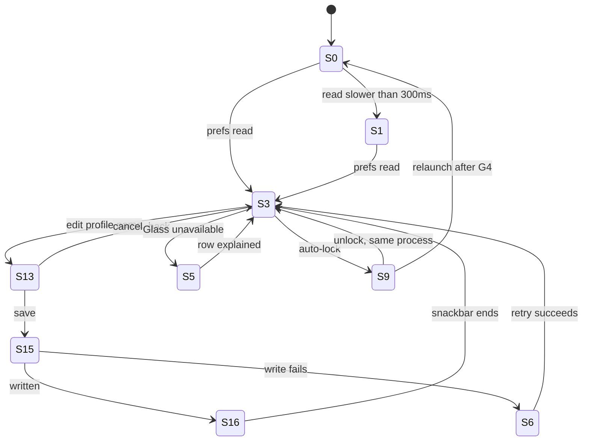
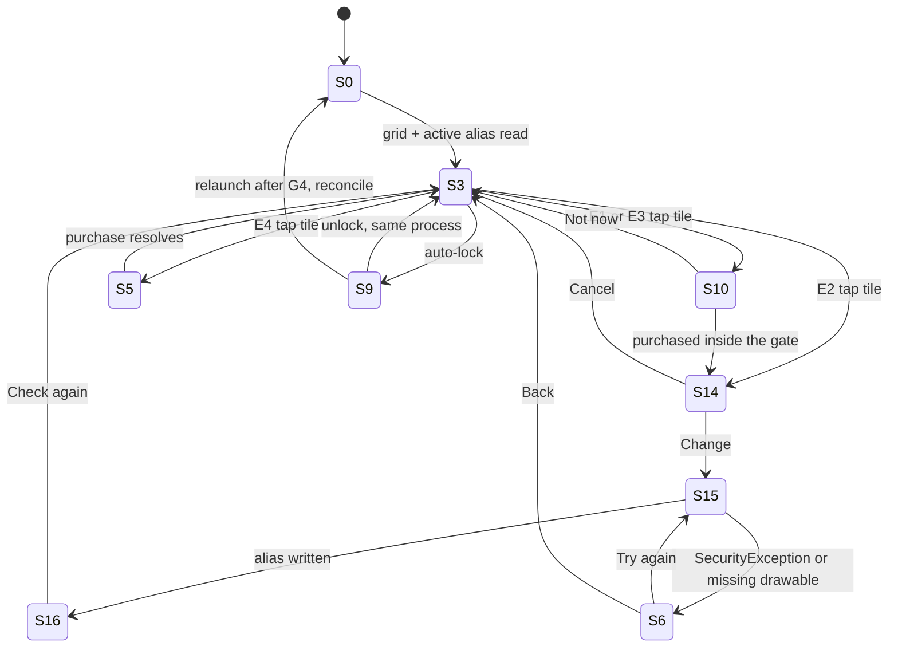
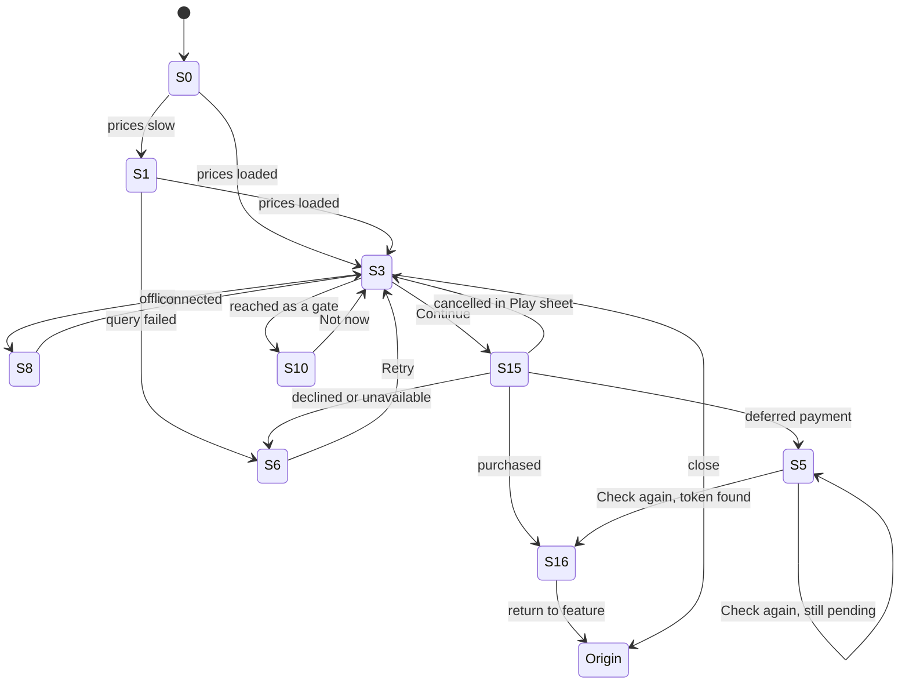

# Appearance, App Icons & Monetization — Flow & State Specification

> How the app looks, how it looks like something else, and how it gets paid for — without a
> gate ever touching user data.
> This file covers the three destinations in the `06` band plus the cross-cutting entitlement
> rules that reach every other screen.

**Read first:** [`_TEMPLATE.md`](./_TEMPLATE.md) · [`../README.md`](../README.md) · [`../screens.md`](../screens.md) · [`../components.md`](../components.md) · [`../foundations.md`](../foundations.md) · [`../app-icons/README.md`](../../app-icons/README.md) · [`00-state-model.md`](./00-state-model.md) · [`07-system-states.md`](./07-system-states.md)

**Domain invariants (in addition to `_TEMPLATE.md §4`)**

1. **Mode and theme are cosmetic.** Never change information, ordering, or security affordances between Glass, Solid and Night (`foundations.md §1`).
2. **Solid is a legitimate mode.** It is never labelled "reduced", "basic" or "accessibility mode" (`07 §7.1`).
3. **The disguise is launcher-only.** The in-app UI never changes when an alias is active; no disguise icon in the header, About, or any in-app surface (`screens.md §17`).
4. **An already-earned safety never turns off.** Duress configuration and an already-changed disguise icon keep working when Pro lapses (`07 §3.1`).
5. **No gate ever hides existing data**, never blurs content as a paywall, and never renders over `/lock` or a duress wipe.
6. **There is no analytics.** No "paywall viewed", no conversion event, no icon-change metric. Entitlement is a locally cached Play purchase token and nothing else.

---

### 1.1 Appearance — `/settings/appearance`

**Badges:** Secure: no · Pro: no · Owner: usability
**Purpose:** change how this device renders Vaultaire — theme, surface, motion, transparency, previews, language, haptics, profile name — with every change applied locally and none of it touching vault content.

**Entry points**
| From | Trigger | Arguments | Preconditions |
|---|---|---|---|
| `/settings` | Tap `Appearance` row | — | Session `G2`; app icon row may carry a `Pro` badge |
| `/settings/appearance/icons` | Back | — | — |
| `/pro` | Close after purchase | — | `E2`; returns here because the row was the origin |
| `G5` restore in progress | Restore takeover completes | — | Settings are device-local; a restored vault changes nothing on this screen |

**Exit points**
| To | Trigger | Side effects |
|---|---|---|
| `/settings` | Back / predictive back | Dirty profile-name edit abandoned after confirm |
| `/settings/appearance/icons` | Tap `App icon` | — |
| System settings | Tap `Text size`, or `App language` on API < 33 | App backgrounds; auto-lock timer running; returns with the same route |
| Background `G3` | Home / recents / screen off | Prefs already flushed; recents snapshot per "Hide previews" |
| `/lock` — `S9` | Auto-lock threshold, screen off, G4 | Open sheets dismissed; unsaved profile name dropped, nothing written |
| `/vault` | Relaunch after G4, origin unresolvable | Pending destination resolves silently or lands on `/vault` |

**Actions**
| Control | Preconditions | Effect | Resulting state | Failure |
|---|---|---|---|---|
| `Theme` row → sheet | — | Opens Light / Night / Auto segmented sheet | S3 + sheet | — |
| Pick theme | — | Applies immediately, 240 ms crossfade (`duration.base`) | S3 | Encrypted-prefs write fails → revert to persisted value + S6 |
| `Surface` row → sheet | — | Opens Glass / Solid / Auto; preview card follows the selection live | S3 | — |
| Pick surface | API ≥ 31 for Glass | Applies immediately; blur budget re-evaluated | S3 | Write fails → S6 + revert |
| Toggle `Reduce motion` | — | Immediate; ambient off, springs → 120 ms fades | S3 | Write fails → S6 |
| Toggle `Reduce transparency` | — | Immediate; every glass fill promotes to solid | S3 | Write fails → S6 |
| Toggle `Hide previews in recents` | — | Immediate; recents snapshot solid, notification previews suppressed | S3 | Write fails → S6 |
| Toggle `Haptics` | — | Immediate; haptics off app-wide except system | S3 | Write fails → S6 |
| `Text size` row | — | Hands off to system display settings | `G3` | No settings activity found → S6 "Open system settings to change text size." |
| `App language` row | API ≥ 33 per-app locale | Opens language sheet; choosing recreates the activity | S3 → recreated S0 | API < 33 → hand-off + note "Language is set for the whole device." |
| `Profile name` row | — | Opens edit sheet with one field | S13 | — |
| `Save` in name sheet | Not blank-after-trim, or intentionally cleared | Writes encrypted prefs; greeting on `/vault` gains the name | S15 → S16 | Write fails → S6, field retained, nothing persisted |
| `App icon` row | — | Pushes `/settings/appearance/icons` | — | — |

**Apply matrix** (what is immediate, what restarts)

> Note — **there is no vault label.** `screens.md §18` lists one; Aurora ships **no such row**. A user-editable vault name recreates the plaintext catalog that `hidden-vaults` removes (`screens.md §13`), and the invariant is that the title is always `Vault`. `Profile name` is the only free text here: optional, local-only, never synced, never in a notification or a recents title.
| Change | Applies | Mechanism | Session |
|---|---|---|---|
| Theme | Immediate, 240 ms crossfade | In-memory + encrypted prefs | Survives (`G2`) |
| Surface (incl. Auto) | Immediate | Same | Survives |
| Reduce motion / transparency / previews / haptics | Immediate | Same | Survives |
| Text size | Not applied by the app — hand-off | System display settings | Survives; no restart |
| App language | Effective on return; activity recreated | `LocaleManager` / `AppCompatDelegate` locales | Survives recreation; if the process dies → `/lock` |
| Profile name | Immediate on save | Encrypted prefs | Survives |
| App icon | Deferred — its own screen | `activity-alias` | Survives (`DONT_KILL_APP`) |

**States**
| State | Trigger | Visual | Available actions | Announcement |
|---|---|---|---|---|
| S0 | First composition | Static rows + preview card, no values read yet | none | "Appearance" |
| S1 | Prefs not yet read > 300 ms (cold start behind KDF) | Skeleton rows, same geometry | none | — |
| S2 | Entitlement re-queried on resume | Rows visible; 2 dp progress line under the `App icon` Pro badge | all | — |
| S3 | Content | Live preview card + rows | all | — |
| S4 | **Not reachable** — this screen has no user list. The only emptiness is an unset profile name, rendered as the row value `Not set` | — | n/a | — |
| S5 | Partial — Glass unavailable (API < 31, low RAM) | Row shows value + reason; preview renders Solid | all | — |
| S6 | Write failed, or settings hand-off failed | Inline banner + `Retry`; every other row survives | Retry | "Couldn't save that change." |
| S9 | Auto-lock | Secure cover, no content | Unlock | — |
| S12 | API < 31 | `Surface` row disabled, explained, never a dead end | read-only | "Blur needs Android 12 or newer." |
| S13 | Editing profile name | Sheet with field; `Save` disabled while blank | Save, Cancel | — |
| S15 | Saving name | Button spinner, width preserved | none | — |
| S16 | Name saved | Sheet closes, row shows name, 4 s snackbar | all | "Saved" |

**Environment states**
| Code | Condition | What appears |
|---|---|---|
| `V1` | Phone portrait | Single column; preview card at 20 dp margins |
| `V4` | Tablet 600–839 dp | Two panes, 720 dp cap: rows left, preview pinned right; nav rail |
| `A4` | 200% font | Subtitles wrap to 2 lines, never truncate; switches keep 48 dp targets; preview shrinks, keeps every row |
| `A5` | Reduced motion | Theme crossfade = 120 ms fade; no bloom drift in the preview |
| `A6` | RTL | Rows and preview mirror; icons directional-mirror; numbers stay LTR |
| `X2` | Battery saver | `Surface` shows "Solid (set by battery saver)", butter pill says so **once**; stored preference preserved |
| `N2` | Offline | **Nothing changes** — every value on this screen is local |

**Transitions**

**Flows**
| Flow | Path | Success | Abandonment |
|---|---|---|---|
| F5 Enable Solid mode | Appearance → Surface → Solid | Applies instantly; preview card solid; prefs written | Row left on Glass; nothing written |
| Switch to Night | Appearance → Theme → Night | 240 ms crossfade, no flash | Theme sheet dismissed; Light retained |
| Set a profile name | Appearance → Profile name → Save | `S16`; greeting on `/vault` reads the name | Back with dirty field → confirm; name dropped |
| Change app language | Appearance → App language → pick | Activity recreated, layout re-laid, session intact | Language sheet dismissed; previous locale retained |
| Battery saver forces Solid | Glass chosen → saver on | Row reads "Solid (set by battery saver)"; pill once | Saver clears → stored Glass returns next cold start |

**Edge cases & races**
- **Theme change while a sheet is open:** the sheet re-themes without reopening; the enter animation finishes first — no double crossfade.
- **Language switch with the name sheet open:** activity recreation closes sheets; unsaved text is dropped after a confirm, never silently.
- **Rotation during the 240 ms crossfade:** the animation cancels, the target mode wins; no mid-transition hue is committed.
- **Battery saver toggles while the `Surface` row is tapped:** the value is evaluated at sheet open, so the row and the preview cannot disagree; the pill appears once per session (`07 §7`).
- **G4 while writing prefs:** writes are atomic (temp + rename); the last committed value wins on relaunch, no torn state.
- **S9 while the name sheet is open:** the sheet is dismissed with the session; nothing is written, the old name stands.
- **RTL restart:** grid mirroring is rendering-only. An existing pattern must resolve identically in an RTL locale — pattern storage is direction-independent; this is an acceptance test, not a setting.
- **Preview card is honest:** it renders the *selected* mode — and when an override is in force (battery saver, API < 31) it renders the *effective* mode, with the row's one-line explanation next to it. It never shows a mode the device will not produce.

**Data contract**
Reads: encrypted local settings (theme, surface, reduce motion, reduce transparency, hide previews, haptics, language, profile name) · API level · power-save state · enabled launcher alias · entitlement cache.
Writes: encrypted settings only.
Must never appear: vault count, vault label, collection names, file names, pattern data, purchase token, account email. Settings never sync to cloud (`00 §5`). No analytics event on any toggle.

---

### 1.2 App icons — `/settings/appearance/icons`

**Badges:** Pro (changing an icon) · Secure: no · Owner: app-icons
**Purpose:** pick the launcher disguise from the default plus seven utility icons. Free users may preview; Pro users may switch. Nothing inside the app changes.

> Note — **label decision** (`feature-matrix.md §5` row 7): the alias `android:label` is the **utility name** ("Calculator", "Printer", …), never "Vaultaire". iOS keeps "Vaultaire" only because it offers no alternative; `app-icons/planning.md`'s older "the label will read Vaultaire" line is superseded by the canonical copy "The app will now appear as Calculator." Consequence: the alias label also drives the Recents task title, notification channel names, and the uninstall prompt — the disguise must be complete or it is a tell.

**Entry points**
| From | Trigger | Arguments | Preconditions |
|---|---|---|---|
| `/settings/appearance` | Tap `App icon` | — | `G2` |
| `/pro` | Close after purchase | origin = this screen | `E2` |
| `Application.onCreate()` | Play update reconciled | stored alias | Stored alias ≠ enabled component |

**Exit points**
| To | Trigger | Side effects |
|---|---|---|
| `/settings/appearance` | Back / predictive back | Selection discarded if not confirmed |
| `/pro` (sheet) | Tap a tile while `E1`/`E3` | Origin remembered in memory only |
| Background `G3` | Home / recents | A commit is either done or not started — there is no in-flight window |
| `/lock` — `S9` | Auto-lock | Nothing to cancel; the alias state is already committed |

**Actions**
| Control | Preconditions | Effect | Resulting state | Failure |
|---|---|---|---|---|
| Tap tile | `E2` | Marks selection: 2 dp iris ring + check | S3 | — |
| Tap tile | `E1` | `AuroraProGate` sheet: value sentence, `Try Pro`, `Not now` | S10 (sheet) | — |
| Tap tile | `E3` | Same gate, copy "Your Pro access has ended. Your data is still here." | S10 | — |
| Tap tile | `E4` | Neutral inline "Finishing purchase…" + `Check again` after 60 s | S5 | — |
| `Change icon` | `E2`, selection ≠ active alias | Opens confirm dialog | S14 | — |
| `Change` | Confirm | Enables the target alias, disables the other seven, persists, `DONT_KILL_APP` | S15 → S16 | `SecurityException` / missing drawable → S6, revert to last good alias |
| `Cancel` | Confirm | Closes dialog; selection kept | S3 | — |
| `Try again` | S6 | Re-runs the identical alias write (idempotent) | S15 | Second failure → "If it keeps happening, restart the app." |
| `Check again` | S16 / launcher lag | Re-reads the enabled component and confirms | S3 | Still old → note persists, no spinner past 8 s |

**States**
| State | Trigger | Visual | Available actions | Announcement |
|---|---|---|---|---|
| S0 | Composition | Grid skeleton + `Current` block | none | "App icon" |
| S3 | Content | 8 tiles (4×2): Vaultaire + 7 utility icons, 72 dp squircle, `label.m` under each; selected = iris ring + check | Tap tile, `Change icon` | — |
| S10 | `E1` / `E3` | Grid fully visible and previewable, tiles not operable | `Try Pro`, `Not now` | "App icons are part of Pro" |
| S14 | Confirming | `AuroraDialog`, new icon shown, "The app will now appear as Calculator." | `Change`, `Cancel` | — |
| S15 | Committing | `Change icon` spinner, footprint preserved, tiles disabled | none (cancellable until the PackageManager call returns) | "Changing icon" |
| S16 | Switch written | Tile selected; note "The launcher can take a few seconds" + `Check again` | all | "The app will now appear as Calculator." |
| S6 | Switch failed | Banner + `Try again`; active alias unchanged | Retry, Back | "The icon didn't change." |
| S5 | `E4` | Inline "Finishing purchase…" + `Check again` | Check again | — |
| S12 | Drawable / alias absent on this build | That tile is **absent**, not disabled | rest | — |
| S9 | Auto-lock | Brand cover, no content beneath | unlock | "Vault locked" |

**Environment states**
| Code | Condition | What appears |
|---|---|---|
| `V1` | Phone portrait | 4 columns × 2 rows, 12 dp gap |
| `V4` | Tablet 600–839 dp | 2 panes: `Current` pinned right, grid 6–8 columns left, 720 dp cap |
| `A4` | 200% font | 3 columns; labels wrap to 2 lines; `Change icon` 60 dp; dialog copy wraps; primary stays visible |
| `A5` | Reduced motion | Tile press = 120 ms scale; no ring draw-on |
| `A6` | RTL | Grid order mirrors; icon art never mirrors |
| `N2` | Offline | Nothing changes — no network in this screen |
| `G4` | Process death | See races — reconciliation on relaunch |

**Transitions**

**Flows**
| Flow | Path | Success | Abandonment |
|---|---|---|---|
| F2 Switch to Calculator icon | icons → Calculator tile → `Change icon` → `Change` | Alias written; selection ring on Calculator; launcher follows in 2–5 s | `Cancel`; back; lock — Vaultaire icon still active |
| Revert to the default | icons → Vaultaire tile → `Change` | Main alias enabled, seven disabled; prefs cleared | `Cancel` |
| Free preview | `E1` → tap any tile → gate sheet | No change; grid fully browsable | `Not now` — grid stays browsable |
| Stuck launcher | `Change` → S16 → launcher unchanged after 10 s | `Check again` reads the component and confirms | Back; the write already succeeded |

**Edge cases & races**
- **Copy is exact:** "The app will now appear as Calculator." — named, never "the app icon".
- **Timing:** `setComponentEnabledSetting` returns in milliseconds. The 2–5 s (Microsoft Launcher: 5–10 s) wait is the launcher's. Success is the **write**, not the launcher; no spinner may exceed 8 s (`00 §2.3`).
- **Launcher not refreshing:** stay in S16 with the note and `Check again`; never re-run the write, never claim failure.
- **Switch failing:** `SecurityException` or a missing drawable → S6, revert to the last good alias, `Try again`; second failure adds "If it keeps happening, restart the app."
- **Backgrounded mid-switch:** the write is atomic; on return the screen re-reads the enabled component and shows the truth. `DONT_KILL_APP` means the process survives, so an open task continues uninterrupted.
- **Open task after the alias changes:** the running task keeps the alias it launched from in Recents until the task is recreated. The vault session is unaffected — no re-lock, no interstitial, no restart. Killing and reopening from the launcher shows the new icon.
- **Rapid switching:** tiles are disabled during S15. A second tap is ignored, not queued.
- **Play update:** alias states reset to manifest defaults on install. `Application.onCreate()` re-applies the **stored** alias — and under `E1`/`E3` it still re-applies, because an already-changed disguise icon stays (`07 §3.1`). Only *changing* it is gated.
- **Uninstall / reinstall:** encrypted prefs are gone, so the default icon returns with a fresh vault. Nothing to reconcile.
- **Launcher shortcuts:** while a disguise is active, the long-press shortcut menu is suppressed or uses the alias label — a "Vaultaire" shortcut under a "Calculator" icon is a tell. No shortcut bypasses the pattern (`screens.md §26`).
- **Notifications while disguised:** channels inherit the app label; body copy must not say "Vaultaire" (see `## Gaps`).
- **Recents:** the alias icon and label are the disguise and are expected there; what must never leak is content, handled by "Hide previews".
- **No analytics:** `07-system-states.md`'s icon-change metrics and `app-icons/planning.md`'s success-rate tracking are not shipped — there is no analytics.

**Data contract**
Reads: enabled component state (`PackageManager`), stored alias (encrypted prefs), entitlement cache, drawable availability.
Writes: enabled component state, encrypted prefs (alias id only).
Must never appear: any vault data next to an alias, a list of aliases tied to vaults, icon-change events, device ids. In-app UI never reflects the disguise (`screens.md §17`).

---

### 1.3 Paywall — `/pro`

**Badges:** Secure: no · Pro: destination *is* the gate · Owner: monetization
**Purpose:** state Pro's value in one screen, let the user buy or leave at any point, and return them to the exact feature they came from — with no countdown, no fake discount, and no blocked back.

**Entry points**
| From | Trigger | Arguments | Preconditions |
|---|---|---|---|
| Any gated action (`Share`, `Device sync`, `Duress mode`, `App icon`) | `AuroraProGate` sheet → `Try Pro` | origin = {route, kind, opaqueId} in memory | `E1` / `E3` / `E4` |
| Gated destination opened directly (`/settings/appearance/icons`, `/settings/cloud/sync`, `/settings/security/duress`) | Route push | — | Screen renders full-screen `S10`, same copy |
| `/settings` Pro rows | Row tap | origin = the row | `E1` / `E3` |
| `/settings/appearance/icons` | Close after purchase | origin = icons | `E2` |
| Notification / deep link | **Never** | — | Notifications open settings after unlock (`screens.md §25`) |

**Exit points**
| To | Trigger | Side effects |
|---|---|---|
| Origin route | Close (44 dp), back, scrim, `Esc` | Purchase state preserved; nothing written; origin re-armed |
| `/lock` — `S9` | Auto-lock threshold, screen off | In-app paywall dismissed with the session |
| Background `G3` | Home while the Play sheet is up | Billing is system UI and continues; the app locks per threshold |
| `/vault` | Relaunch after G4 and the origin no longer resolves | Silent; never a named destination |

**Actions**
| Control | Preconditions | Effect | Resulting state | Failure |
|---|---|---|---|---|
| Pick plan | Prices loaded | Selection moves; annual preselected with monthly equivalent, no strike-through | S3 | — |
| `Continue` | `E1`/`E3`, plan chosen, price loaded | Launches the Play billing flow | S15 | `ITEM_UNAVAILABLE` → S6 "That plan isn't available. Try again." · offline → S8 |
| `Restore` | — | `queryPurchasesAsync` | S15 → S16 / S6 | Offline → "You're offline. This will retry when you're connected." |
| Close / `Not now` | — | Dismisses; the gated action stays visible and re-tappable | — | — |
| `Check again` | `E4` 60 s timeout | Re-queries purchases | S15 | Still pending → 60 s window restarts |
| `Try Pro` on a gate sheet | — | Opens `/pro` as a sheet over the origin | — | — |

**States**
| State | Trigger | Visual | Available actions | Announcement |
|---|---|---|---|---|
| S0 | Composition | Hero + two plan cards, prices not read yet | none | "Vaultaire Pro" |
| S1 | Prices loading > 300 ms | Skeleton on the price line only | none | — |
| S3 | Content | Iris eyebrow, `display.m` benefit, 3 mint check rows, price `mono.l`, `Continue`, `Restore`, legal `body.s` | all | — |
| S8 | `N2` offline | Price line "Connect to see plans."; `Continue` disabled **with the reason** | `Restore`, Close | — |
| S6 | Prices loaded but the query failed | Inline "Prices didn't load." + `Retry` | Retry, Close | — |
| S10 | Destination gate | Full-screen, same copy, `Not now` exits to the caller | `Try Pro`, `Not now` | — |
| S15 | Play sheet open | `Continue` spinner, footprint preserved; the Play sheet owns cancel | none in-app | — |
| S16 | Purchase success | Pro active; origin restored with state preserved | Return | "Pro is active." |
| S6 | Purchase failed | Inline "The purchase didn't go through." + `Try again` | Try again, Close | — |
| S5 | `E4` purchase pending | Neutral inline "Finishing purchase…" + `Check again` after 60 s | Check again, Close | — |
| S9 | Auto-lock | Paywall dismissed with the session | Unlock | — |

**Environment states**
| Code | Condition | What appears |
|---|---|---|
| `V1` | Phone portrait | Sheet at half height, scrollable |
| `V4` | Tablet 600–839 dp | Centered 480 dp sheet; plan cards side by side; nav rail behind |
| `V5` | ≥ 840 dp | Sheet becomes a side panel (`07 §5.1`); the confirm stays a dialog |
| `V6` | Multi-window < 360 dp | Sheet goes full height; one plan card visible at a time |
| `A4` | 200% font | Plan cards **stack**; price `mono.l` never truncates; `Continue` 60 dp and visible without scrolling; benefit rows wrap |
| `A2` | TalkBack | Price announced as "$19.99 per year, about $1.67 a month"; no timer, nothing to race |
| `N2` | Offline | S8 — no fake prices, ever (`07 §1.1`) |
| `X2` | Battery saver | No effect on this screen |

**Transitions**

**Flows**
| Flow | Path | Success | Abandonment |
|---|---|---|---|
| F1 Upgrade from a share gate | `/vault` → select 3 → `Share` → gate sheet → `Try Pro` → `/pro` → Annual → `Continue` | `E2`; returns to `/vault` with the same 3 items still selected and the share form pristine | Close at any point → selection intact, still gated; cancel in Play → back to S3 |
| F4 Restore on a new phone | New device → restore vault → gated row → `Restore` | `E2`; feature works; device-local prefs (icon, theme) start fresh | Nothing found → "No purchase found on this account." + `Try Pro` |
| F6 Deferred purchase | `Continue` → S5 → `Check again` | Token lands → S16, `E2` | Close during S5; the purchase is not cancelled by closing |

**Edge cases & races**
- **The paywall is never the first thing a new user sees.** No interstitial at launch, no paywall on `/vault`, no paywall after restore beyond a user-tapped gate.
- **Close at every point:** 44 dp top-right, plus back, scrim and `Esc`. During S15 the Play sheet is system UI and owns cancel; the in-app close returns with it. Closing during `E4` does not cancel the purchase.
- **Already subscribed (`ITEM_ALREADY_OWNED`):** reconcile silently, flip to `E2`, act as success. Never a second billing launch, never a double charge.
- **Purchase cancelled:** back to S3 with the previous plan selection. No second confirm, no "are you sure", no discount offer.
- **`E4` purchase pending:** neutral inline "Finishing purchase…" with a 60 s timeout → `Check again`. No alarm colour, no countdown.
- **`E3` Pro expired:** gate copy "Your Pro access has ended. Your data is still here." Re-purchasing is the same flow; nothing is deleted to force it.
- **Refund / revocation:** Play revokes; the next `queryPurchasesAsync` on resume flips to `E3`. Silent degrade — duress configuration and an active disguise keep working.
- **Family sharing:** entitlement is whatever Play reports; no account exists. One plain line: "Pro is shared through your Google family group. If the organizer cancels, it ends here too."
- **G4 during a purchase:** relaunch → `/lock` → query purchases on unlock. Token present → `E2` and the gated feature works; absent → nothing happened. The billing sheet is never relaunched automatically.
- **S9 while the paywall is open:** the in-app paywall is dismissed the instant the session locks — a paywall over `/lock` is forbidden (`00 §2.3`). The Play sheet is system UI and keeps running. On return: lock first, reconcile entitlement, then the origin if it resolves, else `/vault`.
- **N2 offline:** prices unavailable, `Continue` disabled with the reason shown. `Restore` still runs (Play caches purchases made on this device); a purchase made on another phone may need a connection.
- **Origin is memory-only:** {route, kind, opaqueId}. Never persisted with names; a stale id resolves silently to `/vault` (`00 §6`).
- **No analytics:** the only record of a purchase is Play's token, cached locally in encrypted prefs.

**Data contract**
Reads: Play SKU prices, entitlement cache, in-memory origin.
Writes: entitlement cache (encrypted prefs).
Must never appear: email, account id, payment method, purchase token, price strings in notifications, recents or logs. No conversion or paywall-view event, ever.

---

### Rule: Entitlement gates (cross-cutting)

Not a screen. This section is the rule set every other domain file cites when it writes `S10`.

**Gate vs. disabled row vs. hidden feature**
| Term | Meaning | Where it appears | Example |
|---|---|---|---|
| **Gate** | Feature is visible, value explained in one sentence, one action, always an exit | `AuroraProGate` sheet, or full-screen `S10` for a gated destination | Duress mode row, `Share`, app icon change |
| **Disabled row** | A capability the device or OS lacks. Explained, never sold. `S12` | Inline in a settings screen | Surface = Glass on API < 31 |
| **Hidden feature** | Not applicable to this user or object at all. Absent, not greyed | Nowhere | Export on a non-exportable shared file; an analytics toggle (there is no analytics) |

A Pro feature is **never** rendered as a greyed-out disabled row. Grey means "this device can't"; iris means "Pro can". Collapsing the two is a dark pattern.

**E1–E4 per gated feature** (`07 §3.1`, binding)
| Feature | `E1` Free | `E2` Pro | `E3` Expired | `E4` Pending |
|---|---|---|---|---|
| Pattern, vaults, camera, import, recovery | full | full | full | full |
| Encrypted backup | full (free, default-on) | full | full | full |
| Duress — configure | gate | full | gate | gate |
| Duress — **already configured** | **stays active** | active | **stays active** | active |
| Sync — new sync | gate | full | gate | gate |
| Sync — existing | — | full | local data intact, syncing pauses, nothing deleted | full |
| Sharing — create | gate | full | gate | gate |
| Sharing — open, view, revoke | full | full | full | full |
| App icon — change | gate | full | gate | gate |
| App icon — **already changed** | **stays** | stays | **stays** | stays |

**What stays accessible when Pro lapses**
| Retained | Why |
|---|---|
| Duress configuration, active and enforced | Coercion safety outranks revenue |
| An already-changed disguise icon | Same — the disguise only works if it does not switch off under pressure |
| All vaults, files, camera, import, recovery, backup | Never gated |
| Opening, viewing and revoking existing shares | Free by design; only *creating* is Pro |
| Local sync data | Syncing pauses; nothing is deleted, nothing is hidden |

**What a gate must never do**
- Hide, blur, or partial-render existing user content as an incentive.
- Render over `/lock`, over a duress wipe, or over the recents cover.
- Show a countdown, a fake strike-through, a "limited time", or block back.
- Be the only place an error is reported — no toast as the sole channel.
- Stack two gates, or a gate over a gate: one sheet, one decision.
- Imply an account, a cloud, or analytics exists.

**Gate lifecycle**
| Situation | Behaviour |
|---|---|
| Gate opened | Sheet over the origin; origin held in memory; back pops the sheet, not the screen |
| `S9` / `G6` | Gate and paywall are dismissed with the session |
| Purchase succeeds inside a gate | Gate closes, the original action proceeds once — never twice |
| `E4` while a gate is open | Gate shows the same "Finishing purchase…" inline state as `/pro` |
| Debug | `E1–E4` are forceable via the state injector (`00 §10`); no remote flags, no A/B |

---

## Flow atlas

| # | Journey | Path | Success | Abandonment |
|---|---|---|---|---|
| F1 | Upgrade from a share gate | `/vault` → select → `Share` → gate → `Try Pro` → `/pro` → Annual → `Continue` | `E2`; back to the selection with the form pristine | Close anywhere; Play cancel → S3, still gated, still re-tappable |
| F2 | Switch to the Calculator icon | icons → Calculator → `Change icon` → `Change` | Alias written; launcher refreshes in 2–5 s | `Cancel`; lock — default icon still active |
| F3 | Pro lapses | Renewal fails → `E3` → open a gated row | Reading everything still works; duress and the active disguise keep working | `Not now` — every re-entry shows the lapsed copy, never an alarm |
| F4 | Restore a purchase on a new phone | New device → restore vault → gated row → `Restore` | `E2`; the feature works; device-local appearance and icon start fresh | Nothing found → neutral line + `Try Pro`; offline → retry line |
| F5 | Enable Solid mode | Appearance → Surface → Solid | Instant; preview card solid; prefs written; works on API < 31 too | Left on Glass; nothing written |
| F6 | Deferred purchase completes | `Continue` → S5 → `Check again` | Token lands → S16 → origin | Close during S5; purchase survives the close |

---

## Gaps

1. **Notification copy contradicts a complete disguise.** `screens.md §25` uses "Vaultaire backup needs attention." A disguised app (label "Calculator") must not emit the real app name. Needs a neutral string set for notification bodies while an alias is active.
2. **RTL grid mirroring vs. pattern storage.** `accessibility.md §9` mirrors the pattern grid in RTL. Nothing states that switching to an RTL language cannot change what a stored pattern resolves to. Needs a written invariant plus a pixel/behaviour test before the language row ships.
3. **Play Store policy on utility labels.** `feature-matrix.md §5` leaves "Play Store policy review required before shipping" open. Calculator / Printer / Network labels plus look-alike art can read as impersonation; a renamed label set may be needed.
4. **Paywall copy is not in `screens.md §24`.** Success ("Pro is active."), already-subscribed, purchase-failed, restore-nothing-found and family-sharing lines are proposed here and need sign-off so the copy table stays the single source.
5. **Family sharing has no detection rule.** Play family purchases surface through `queryPurchasesAsync` like any other. Whether the UI should ever say "shared" — and what happens when the organizer cancels mid-session — is unstated beyond the one line proposed here.
6. **"Reduce transparency" has no documented OS source.** Android exposes no public system setting of that name before API 35-era accessibility surfaces, so it is specified as an in-app toggle that also follows the system where the OS reports one. Confirm, or drop the row and keep only `Surface = Solid`.

## New components needed

1. **`AuroraAppearancePreview`** — the live preview card: renders the selected theme × surface combination at the top of `/settings/appearance`, including the battery-saver override state.
2. **`AuroraProPlanCard`** — one plan card (title, `mono.l` price, monthly-equivalent line, selected = 2 dp iris ring + check). `AuroraProCard` is the hero; the plan pair does not exist yet.
3. **`AuroraAppIconTile`** — 72 dp squircle preview, `label.m` under it, selected ring + check badge, and a `Pro`-locked variant that stays fully browsable. Its grid is the only place disguise art is ever drawn.
4. **`AuroraSystemSettingsRow`** — a list row that hands off to a system settings page (`Text size`, `App language` below API 33) with a trailing "opens system settings" hint and a fallback when the OEM blocks the intent.
5. **`AuroraEntitlementStateRow`** — one settings-row rendering of `E1`/`E2`/`E3`/`E4` value + badge, so "App icon · Pro", "Device sync · Pro ended" and "Finishing purchase…" read identically everywhere.
6. **`AuroraLauncherRefreshNote`** — inline status note with a `Check again` action, used while the launcher catches up after an alias change; must never become a spinner that can exceed 8 s.