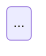

# Flow & State Specification — Authoring Contract

> Every screen in Vaultaire Aurora must enumerate **entry points, exits, actions, and every reachable state**.
> This file is the contract for that work. Read it fully before writing a domain file.

**Read first:** [`../README.md`](../README.md) · [`../screens.md`](../screens.md) · [`../components.md`](../components.md) · [`../accessibility.md`](../accessibility.md) · [`00-state-model.md`](./00-state-model.md)

---

## 1. What a domain file is

One file per screen family. Each screen gets a fixed structure so the set stays comparable and testable.

```
### N.N Screen name — `route`
**Badges:** Secure · Pro · Owner: feature
**Purpose:** one sentence, no marketing.

**Entry points**
| From | Trigger | Arguments | Preconditions |

**Exit points**
| To | Trigger | Side effects |

**Actions**
| Control | Preconditions | Effect | Resulting state | Failure |

**States**
| State | Trigger | Visual | Available actions | Announcement |

**Transitions**


**Flows**
| Flow | Path | Success | Abandonment |

**Edge cases & races**
- ...

**Data contract**
Reads: ... · Writes: ... · Must never appear: ...
```

Rules:

1. **Tables over prose.** No paragraph longer than two sentences.
2. **Every action must name its failure.** A button with no failure path is suspicious — find the failure.
3. **Every state must name its exit.** A state you cannot leave is a bug; call it out.
4. **No new product behavior.** You may enumerate failure modes, races and degraded states that follow from existing behavior. If you think a new feature is needed, put it in `## Gaps` at the end, never inline.
5. **Never contradict the security invariants** (§4). If a flow seems to require contradicting one, flag it in `## Gaps`.
6. **Name components and tokens** from `../components.md` / `../tokens.json`. If you need something that does not exist, list it under `## New components needed` — do not silently invent a visual language.
7. **Copy is exact.** Short, plain, no exclamation marks, no "oops", no blame. Reuse the copy already in `../screens.md §24`.
8. **Quote routes exactly** as listed in §5.
9. **Markdown only.** No code fences around the whole file.
10. **Length:** 60–100 lines per screen. Dense, no padding. If you exceed ~1,400 lines, compress tables — never drop states.

---

## 2. State vocabulary (use these codes)

Every screen's state table must cover the **S-family** rows that apply, plus the environment rows marked "always".

### Screen states

| Code | Name | Meaning |
|---|---|---|
| `S0` | Initial | First composition, nothing loaded, no spinner yet (< 300 ms) |
| `S1` | Loading | Skeleton or spinner; no content |
| `S2` | Refreshing | Content visible + subtle progress |
| `S3` | Content | Normal, complete |
| `S4` | Empty | Genuinely nothing to show; neutral copy, one next action |
| `S5` | Partial | Some data rendered, some failed or still unavailable |
| `S6` | Error (recoverable) | Inline error + Retry; content around it survives |
| `S7` | Error (fatal) | Screen cannot function; one safe exit |
| `S8` | Offline / stale | Cached or local data + offline notice |
| `S9` | Locked | Session ended while screen was open; secure cover |
| `S10` | Pro-gated | Feature visible, value explained, safe exit |
| `S11` | Permission-gated | Runtime permission missing |
| `S12` | Unsupported | Device/OS cannot do this (no camera, no biometrics, API < 31 glass) |
| `S13` | Selection / Editing | Multi-select or edit mode active, unsaved changes possible |
| `S14` | Confirming | Destructive or irreversible action awaiting confirm |
| `S15` | Committing | Action in flight; controls disabled; cancellable or not |
| `S16` | Success | Terminal confirmation with next action |
| `S17` | Undo window | Action applied, reversible for N seconds |

### Environment states (global — see `07-system-states.md`)

| Code | Group | Values |
|---|---|---|
| `G` | Session | `G1` cold · `G2` warm · `G3` background · `G4` process death · `G5` restore in progress · `G6` duress wipe |
| `N` | Network | `N1` online · `N2` offline · `N3` metered · `N4` captive portal · `N5` airplane |
| `D` | Storage | `D1` ok · `D2` low (< 500 MB) · `D3` full |
| `E` | Entitlement | `E1` free · `E2` pro · `E3` pro expired · `E4` purchase pending |
| `P` | Permission | `P1` granted · `P2` denied once · `P3` permanently denied · `P4` partial/limited · `P5` restricted by policy |
| `V` | Viewport | `V1` phone portrait · `V2` phone landscape · `V3` foldable · `V4` tablet · `V5` desktop/freeform · `V6` multi-window |
| `A` | Accessibility | `A1` default · `A2` TalkBack · `A3` switch access · `A4` 200% font · `A5` reduced motion · `A6` RTL |
| `X` | Device | `X1` normal · `X2` battery saver · `X3` doze · `X4` thermal throttled · `X5` screen capture active |

**Always cover:** `S0`, `S1`, `S3`, `S4`, `S6`, `S9`, `A4`, `V1`, `V4`.
**Cover when relevant:** every other code whose trigger can reach the screen.

---

## 3. Worked example (format reference — do not copy verbatim)

### 3.1 Pattern Lock — `/lock`

**Badges:** Secure (grid) · Pro: no · Owner: pattern-encryption
**Purpose:** resolve a drawn pattern into a vault session, or into an identical-looking empty vault.

**Entry points**
| From | Trigger | Arguments | Preconditions |
|---|---|---|---|
| Cold start | Launcher icon | — | Local vault state unknown |
| Auto-lock | Timeout / background > threshold | `reason=timeout` | Session existed |
| Deep link | Notification tap | `pendingDestination` | — |

**Exit points**
| To | Trigger | Side effects |
|---|---|---|
| `/vault` | Pattern resolves (known, unknown, or duress) | Session key in memory; attempt counter reset |
| `/recovery/enter` | `Forgot pattern?` | None; pattern buffer cleared |
| Background | Home gesture | Buffer cleared; no screenshot |

**Actions**
| Control | Preconditions | Effect | Resulting state | Failure |
|---|---|---|---|---|
| Draw pattern | `!throttled` | Accumulate dots, haptic per dot | S13 | Drag cancel → S3 |
| Release pattern | ≥ 1 dot | Derive key, attempt index decrypt | S1 → S3 | KDF timeout → S6 neutral |
| `Forgot pattern?` | — | Push recovery entry | — | — |

**States**
| State | Trigger | Visual | Available actions | Announcement |
|---|---|---|---|---|
| S0 | Composition | Static grid, no copy | Draw | "Pattern unlock grid" |
| S3 | Idle | 25 idle dots | Draw, Forgot | — |
| S1 | Release | Iris pulse inside grid; no spinner < 400 ms | none | "Checking" |
| S16 | Resolve | 380 ms iris glow → content | none | "Vault unlocked" |
| S6 | KDF failure | Same glow, empty vault | none | "Vault unlocked" |
| S9 | Rate limited | Neutral countdown `mono.m` | wait | "Please wait a moment" |

> Note: there is **no** wrong-pattern state. Known, unknown and duress are identical. See `../screens.md §3.1`.

**Edge cases & races**
- Release with 1 dot: ignored, no error.
- Background during KDF: cancel, clear buffers, return to S3.
- Duress: identical timing to a normal resolve (± 1 frame); no extra haptic.

**Data contract**
Reads: pattern buffer (memory only) · Writes: attempt counter (encrypted) · Never: pattern coordinates, vault count, vault label.

---

## 4. Non-negotiable invariants

Any flow you write must preserve all of these:

1. **Unknown pattern = neutral empty vault.** No error, no shake, no counter, no "not found" copy on unlock.
2. **Duress is pixel-identical** to a normal unlock: same glow, same timing class, same haptics (none extra), same destination structure.
3. **Decoy vault is indistinguishable** from a primary vault with the same content.
4. **No vault catalog, count, switcher, or picker** anywhere. Vault title is always `Vault`.
5. **No plaintext vault names or identifiers** in UI, notifications, recents, logs, or backup metadata.
6. **Secrets live on solid surfaces** with `FLAG_SECURE`, clipboard off (or explicit 60 s auto-clear), IME learning off.
7. **Camera review is mandatory** before encryption; no path writes a capture without review.
8. **Destructive actions confirm**, except duress, which is silent and instant.
9. **No analytics, no account, no cloud that can read content.** Nothing in a flow may imply otherwise.
10. **Every action is reachable and every modal is dismissible** by back, scrim tap, and `Esc`.

---

## 5. Canonical routes

Use these exact strings. Do not invent routes.

| Route | Screen | Domain file |
|---|---|---|
| `/` | Entry / splash | 01 |
| `/welcome` | New device / restore entry | 01 |
| `/onboarding/pattern` | Pattern create | 01 |
| `/onboarding/confirm` | Pattern confirm | 01 |
| `/onboarding/phrase` | Recovery phrase display (first run) | 01 |
| `/onboarding/done` | Ready | 01 |
| `/lock` | Pattern lock | 01 |
| `/recovery/enter` | Recovery phrase entry | 01 |
| `/recovery/display` | Recovery phrase (post-auth re-display) | 01 |
| `/recovery/reset-pattern` | Pattern reset | 01 |
| `/restore/progress` | Restore progress | 01 |
| `/vault` | Vault home (+ selection state) | 02 |
| `/vault/timeline` | Timeline | 02 |
| `/vault/collection/{id}` | Collection | 02 |
| `/vault/search` | Search | 02 |
| `/vault/file/{id}` | File viewer | 02 |
| `/vault/import` | Gallery import | 02 |
| `/vault/camera` | Camera | 03 |
| `/vault/camera/review` | Photo review | 03 |
| `/vault/camera/review/video` | Video review | 03 |
| `/vault/camera/permission` | Camera permission rationale | 03 |
| Notifications | Local notification channels | 03 |
| Widgets / QSS | Optional system surfaces | 03 |
| `/settings` | Settings hub | 04 |
| `/settings/security` | Security settings | 04 |
| `/settings/security/duress` | Duress setup | 04 |
| `/settings/security/duress/guidance` | Decoy guidance | 04 |
| `/settings/security/hidden-vaults` | Hidden vaults explainer | 04 |
| `/settings/security-info` | Security info / help | 04 |
| `/settings/privacy` | Privacy | 04 |
| `/settings/about` | About | 04 |
| `/settings/cloud/backup` | Encrypted backup | 05 |
| `/settings/cloud/sync` | Device sync | 05 |
| `/settings/cloud/sync/log` | Sync activity log | 05 |
| `/shares` | My shares | 05 |
| `/vault/share/create` | Share create | 05 |
| `/vault/share/phrase` | Share phrase display | 05 |
| `/shared/open` | Open shared vault | 05 |
| `/shared/{id}` | Shared vault (read-only) | 05 |
| `/settings/appearance` | Appearance | 06 |
| `/settings/appearance/icons` | App icons | 06 |
| `/pro` | Paywall | 06 |

Global overlays (snackbar, dialog host, sheet host, biometric prompt, recents cover, app lifecycle) are documented in `07-system-states.md`, not per domain.

---

## 6. Cross-file conventions

- Refer to other screens by route: `→ /lock`.
- Refer to a state by code and name on first use in a file: `S6 Error (recoverable)`.
- Timeouts and delays must be numbers from `../foundations.md §8.1` where a motion token exists; otherwise propose one in `## Gaps`.
- Anywhere you write "user can retry", specify **what exactly is retried** and **what is preserved**.
- For every screen with a list, specify: empty, one item, 1,000 items, and deleted-under-you.
- For every screen with a form, specify: pristine, dirty, invalid, submitting, submitted, submit-failed, abandoned.

---

## 7. Deliverable checklist per screen

- [ ] Entry points table has every route, notification, deep link, and lifecycle trigger that can reach it
- [ ] Exit points table includes back, gesture, timeout, process death, and any forced exit
- [ ] Every control in the wireframe from `../screens.md` appears in Actions
- [ ] Every S-state that can occur is in the States table, with an exit
- [ ] Mermaid diagram matches the States table (no orphan states)
- [ ] Edge cases include at least one race and one process-death case
- [ ] Data contract says what must never appear
- [ ] No invariant in §4 is weakened
- [ ] New components / gaps listed at the end of the file, not inline
