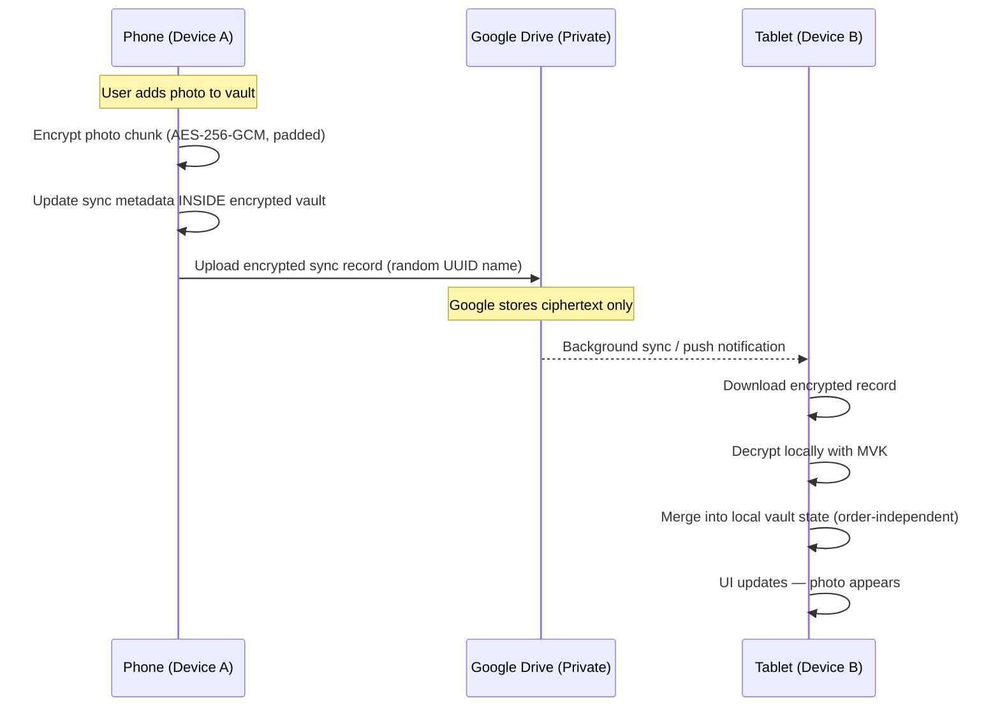
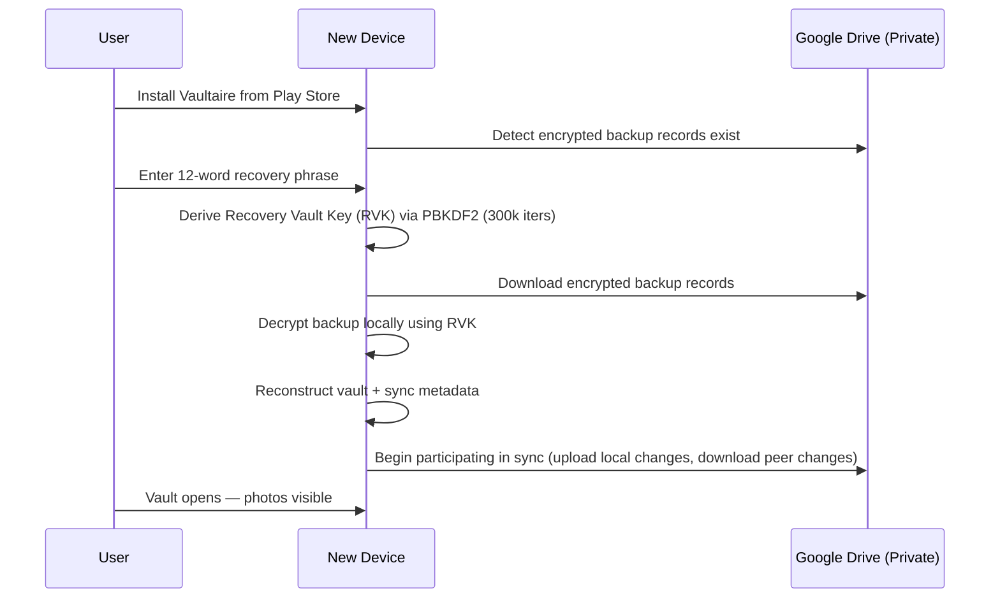
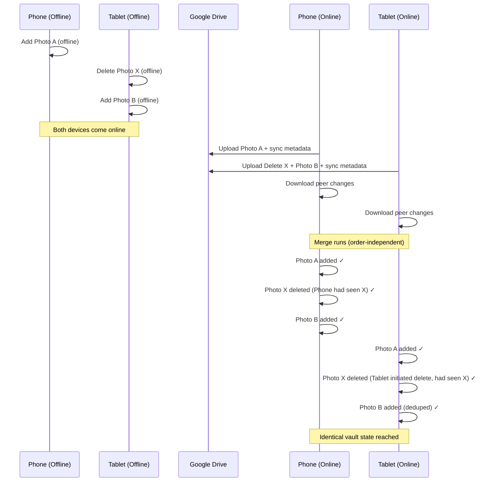

# Device Sync — Product Planning

**Perspective**: Product Owner  
**Feature**: Cross-Device Vault Synchronization  
**Entitlement**: `CROSS_DEVICE_SYNC` (Pro)

---

## User Stories

### Core Sync Stories

| ID | Story | Priority |
|----|-------|----------|
| US-01 | As a Pro user, I want my vault available on all my Android devices signed into the same Google account, so I can add a photo on my phone and view it on my tablet. | P0 |
| US-02 | As a user, I want each change encrypted on the device that made it before upload, so Google never sees my photos or pattern. | P0 |
| US-03 | As a user, I want offline changes on one device to survive and merge correctly when that device comes online. | P0 |
| US-04 | As a user, I want to choose **per vault** which vaults sync (not all vaults automatically). | P0 |
| US-05 | As a user, I want sync to use my existing encrypted Google Drive backup as transport, so I don't need separate cloud setup. | P0 |

### Setup & Recovery Stories

| ID | Story | Priority |
|----|-------|----------|
| US-06 | As a user setting up a new device, I want to install Vaultaire, enter my recovery phrase, and have my vault decrypt locally — without Google ever seeing my keys. | P0 |
| US-07 | As a user, I want to see "This device + N other devices" in vault settings when sync is active, so I know sync is working. | P1 |
| US-08 | As a user, I want to disconnect a single device from sync locally, keeping my vault on it but stopping cloud exchange. | P1 |
| US-09 | As a user who triggered duress mode, I want that device permanently cut from sync so a wipe never propagates to my other devices. | P0 |

### Conflict & Edge Case Stories

| ID | Story | Priority |
|----|-------|----------|
| US-10 | As a user adding the same photo on two devices offline, I want the merge to collapse duplicates into one entry. | P1 |
| US-11 | As a user deleting a photo on one device while another device adds a different photo offline, I want both intentions preserved (add wins over unseen delete). | P1 |
| US-12 | As a user, I want sync to be eventual consistency (not live collaboration) — cycles, not keystrokes. | P1 |
| US-13 | As a user on a metered connection, I want incremental sync transferring only changed encrypted chunks. | P1 |

---

## User Flows

### Flow 1: Add Photo on Phone → Appears on Tablet

**Key Properties**:
- Photo never exists in plaintext on Drive
- Merge happens on Device B, not in cloud
- Device A can close vault immediately after staging upload
- Delivery timing depends on connectivity, Drive availability, Android background execution limits

### Flow 2: New Device Setup → Restore Vault

**Critical**: Pattern restore ONLY works on original device with enrollment key. Recovery phrase works on ANY device with backup records.

### Flow 3: Concurrent Offline Edits → Merge

**Merge Rules (from website)**:
1. **Adds win over deletes** that did not see the added file
2. **Identical files collapse** (same content = same encrypted chunks = deduplicated)
3. **Order-independent** — same result regardless of arrival order
4. **Delete only removes** a file once that device's history shows it had seen that file

---

## Acceptance Criteria (Given / When / Then)

### AC-01: Basic Sync Enable/Disable
| Given | When | Then |
|-------|------|------|
| User has Pro entitlement (`CROSS_DEVICE_SYNC`) | User enables "Sync This Vault" in vault settings | Encrypted Google Drive backup enables for this vault; sync metadata initialized; first sync uploads current vault state |
| Sync is enabled for a vault | User disables "Sync This Vault" | Device disconnects locally; vault remains on device; cloud records preserved; peer devices unaffected |

### AC-02: Per-Vault Sync Control
| Given | When | Then |
|-------|------|------|
| User has 3 vaults (Vault A, B, C) | User enables sync for Vault A only | Only Vault A backs up to Drive and syncs; Vaults B, C remain local-only |

### AC-03: Photo Added on Device A → Appears on Device B
| Given | When | Then |
|-------|------|------|
| Sync enabled for Vault V on Device A and Device B (same Google account) | User adds photo P to Vault V on Device A | Photo P encrypts on Device A → uploads to Drive → Device B downloads → decrypts locally → merges → Photo P appears in Vault V on Device B |

### AC-04: Offline Changes Survive Merge
| Given | When | Then |
|-------|------|------|
| Device A offline: adds Photo A Device B offline: deletes Photo X, adds Photo B | Both devices come online and sync | Both devices converge to identical state: Photo A added, Photo X deleted (since B had seen X), Photo B added, no duplicates |

### AC-05: Same Photo Added Twice → Collapses
| Given | When | Then |
|-------|------|------|
| Device A offline: adds Photo P Device B offline: adds same Photo P (byte-identical) | Both devices sync | Single entry for Photo P on both devices; duplicate encrypted chunks evicted by cleanup |

### AC-06: New Device Recovery via Recovery Phrase
| Given | When | Then |
|-------|------|------|
| Encrypted backup exists in Google Drive for Vault V User has recovery phrase | User installs Vaultaire on new Device C, enters recovery phrase | Vault V decrypts locally on Device C; sync metadata reconstructed; Device C joins sync mesh |

### AC-07: Duress Wipe Isolation
| Given | When | Then |
|-------|------|------|
| Sync active across Device A, B, C User triggers Duress Mode on Device B | Duress completes on Device B | Device B: local vaults purged, recovery data wiped, cut from sync Device A, C: vaults intact, cloud backups intact, sync continues unaffected Device B never pulls vault state back down automatically |

### AC-08: Disconnect This Device
| Given | When | Then |
|-------|------|------|
| Sync active on Device A, B, C | User selects "Disconnect This Device" on Device B | Device B: stops upload/download, keeps local vault copy Device A, C: continue syncing, cloud records unchanged No peer notification, no revocation |

### AC-09: Sync Status Visibility
| Given | When | Then |
|-------|------|------|
| Vault V open, sync active on 3 devices | User views Vault V settings | Shows "This device + 2 other devices" (count only, no names/IDs) |
| Vault V closed or sync off | User views settings | Shows nothing about sync (no leak before unlock) |

### AC-10: Incremental Sync Efficiency
| Given | When | Then |
|-------|------|------|
| Vault V has 10 GB, 5000 files User adds 1 new photo (5 MB) | Sync runs | Only ~5 MB + metadata uploaded (changed chunks), not full vault re-upload |

---

## UX Requirements

### Sync Status Indicators
| State | Indicator | Location |
|-------|-----------|----------|
| Sync enabled, connected | 🟢 "Synced" + device count | Vault settings, vault list |
| Sync enabled, pending changes | 🟡 "Syncing…" + progress | Vault settings, pull-to-refresh |
| Sync enabled, offline | 🔴 "Offline — changes queued" | Vault settings |
| Sync disabled | ⚪ "Not syncing" | Vault settings |
| Duress-isolated | ⚫ "Isolated (duress)" | Vault settings (if vault still exists) |

### First-Time Setup Flow
1. **Pro gate** — Sync settings only visible with `CROSS_DEVICE_SYNC` entitlement
2. **Prerequisite check** — "Encrypted Google Drive backup must be on for this vault" (links to backup settings)
3. **Account verification** — Confirm same Google account on all devices
4. **Enable toggle** — "Sync This Vault" per vault
5. **Initial sync** — "Preparing first sync…" → "Synced (This device + 1 other)"

### Conflict Resolution UI
- **No user-facing conflict dialogs** — merge is automatic, order-independent
- **Activity log** (optional, Pro): "Photo added from Tablet", "Photo deleted from Phone" — encrypted, local-only
- **Manual resync** — Pull-to-refresh in vault triggers immediate sync cycle

### Error States
| Error | User Message | Recovery |
|-------|--------------|----------|
| Different Google accounts | "Sync requires the same Google account on all devices" | Sign in to correct account |
| Backup disabled for vault | "Enable encrypted Google Drive backup first" | Deep link to backup settings |
| Outdated app version | "Update Vaultaire on all devices to continue sync" | Play Store link |
| Drive quota exceeded | "Google Drive storage full — sync paused" | Manage Drive storage |
| Network unavailable | "Waiting for connection…" | Auto-retry when online |

---

## Trust Boundaries

### What CROSSES the Network (Google Drive)
| Data | Encryption | Visibility to Google |
|------|------------|---------------------|
| Vault file chunks | AES-256-GCM, padded to 10 MB buckets | Ciphertext only |
| Sync metadata (file membership, change counters, deletion markers) | **Inside encrypted vault payload** | Ciphertext only |
| Recovery envelope | Encrypted with Recovery Vault Key (RVK) | Ciphertext only |
| Record names | Random UUIDs | Random strings |
| Record sizes | Padded to fixed buckets | Padded sizes only |
| Timing/access patterns | N/A | Observable (metadata) |

### What NEVER Crosses the Network
| Data | Stays Where |
|------|-------------|
| User pattern (drawing) | Device only — never leaves |
| Vault Derivation Key (VDK) | Device only — derived from pattern + device salt |
| Master Vault Key (MVK) | Device only — wrapped by VDK in local vault header |
| Device enrollment key | Device only — generated on first setup, never synced |
| Recovery phrase | User's brain / paper — never transmitted |
| File names, vault names | Inside encrypted vault only |
| Device names/identifiers | Never in cloud — device count only in UI |
| Plaintext photos/videos | Device only |

### Provider Boundary (Google)
> "Google can observe that Drive records were written, how large the padded records are, when they change, and how many records the private database contains. It does not receive the pattern, backup key, or readable file payload from Vaultaire. This is the provider boundary, not a claim that all service metadata disappears."

---

## Pro Feature Enforcement

| Check | Location |
|-------|----------|
| Entitlement validation | `Entitlement.CROSS_DEVICE_SYNC` checked before showing sync UI, enabling sync, joining mesh |
| Server-side receipt validation | Play Billing `queryPurchasesAsync` on app start / resume |
| Grace period | 7 days offline allowance after subscription expiry |
| Downgrade behavior | Sync pauses, local vault remains, cloud records preserved, re-enable on resubscribe |

---

## Non-Goals (Explicit)

| Not Doing | Reason |
|-----------|--------|
| Person-to-person sharing via sync | Use Secure Sharing (separate flow, read-only, one-time phrase) |
| Cross-account sync (Google → Apple) | Transport boundary = Google account boundary |
| Live collaboration / real-time | Merge runs in cycles, not keystrokes |
| Web / Windows / Android TV sync | Android phones/tablets only (Google Drive scope) |
| Sync as backup substitute | Recovery phrase covers catastrophic loss; sync covers multi-device use |
| Device names in cloud | Leak prevention — count only |
| Conflict resolution UI | Automatic, deterministic, order-independent |