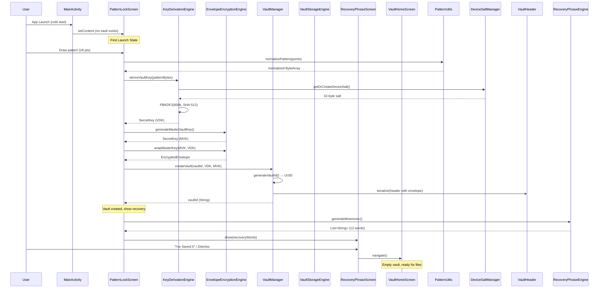

# Ease of Use — Technical Implementation

## Architecture Overview

```
┌─────────────────────────────────────────────────────────────────────────────┐
│                         VAULT AIRE ANDROID ARCHITECTURE                     │
├─────────────────────────────────────────────────────────────────────────────┤
│                                                                             │
│  ┌──────────────┐     ┌──────────────────┐     ┌──────────────────────┐   │
│  │  MainActivity │────►│  PatternLockScreen│────►│   VaultHomeScreen    │   │
│  │  (Entry Point)│     │  (Compose Screen) │     │  (Compose Screen)    │   │
│  └──────────────┘     └────────┬──────────┘     └──────────┬───────────┘   │
│         │                      │                          │               │
│         ▼                      ▼                          ▼               │
│  ┌──────────────────────────────────────────────────────────────────┐     │
│  │                     Navigation Controller (NavHost)              │     │
│  └──────────────────────────────────────────────────────────────────┘     │
│                                    │                                      │
│         ┌──────────────────────────┼──────────────────────────┐          │
│         ▼                          ▼                          ▼          │
│  ┌──────────────────┐    ┌──────────────────┐    ┌──────────────────┐   │
│  │  VaultManager    │    │ KeyDerivationEngine│  │ EnvelopeEncryption │   │
│  │  (Vault CRUD)    │    │ (PBKDF2 → VDK)    │    │ Engine (AES-GCM)   │   │
│  └────────┬─────────┘    └────────┬─────────┘    └────────┬─────────┘   │
│           │                       │                       │              │
│           ▼                       ▼                       ▼              │
│  ┌──────────────────────────────────────────────────────────────────┐   │
│  │                    VaultStorageEngine (AES-256-GCM streams)      │   │
│  └──────────────────────────────────────────────────────────────────┘   │
│                                    │                                      │
│                                    ▼                                      │
│  ┌──────────────────────────────────────────────────────────────────┐   │
│  │                    File System (Internal Storage)                │   │
│  │  /data/user/0/com.vaultaire.android/files/vaults/*.vlt          │   │
│  └──────────────────────────────────────────────────────────────────┘   │
│                                                                             │
└─────────────────────────────────────────────────────────────────────────────┘
```

---

## Mermaid: First Launch → Pattern Screen → Vault Ready



---

## MainActivity Design

### Responsibility
- Single entry point, no splash screen
- Holds `NavHost` for Compose navigation
- Manages app lifecycle locking behavior
- Provides `VaultManager` and crypto engines via dependency injection

### Key Implementation

```kotlin
// MainActivity.kt
class MainActivity : ComponentActivity() {
    private val vaultManager: VaultManager by lazy { VaultManager(this) }
    private val keyDerivation: KeyDerivationEngine by lazy { 
        KeyDerivationEngine(DeviceSaltManager(this)) 
    }
    private val envelopeEngine = EnvelopeEncryptionEngine()
    private val recoveryEngine = RecoveryPhraseEngine(DeviceSaltManager(this))
    private val storageEngine: VaultStorageEngine = VaultStorageEngineImpl()
    
    override fun onCreate(savedInstanceState: Bundle?) {
        super.onCreate(savedInstanceState)
        // No setContentView - using Compose
        enableEdgeToEdge()
        setContent {
            VaultaireTheme {
                val navController = rememberNavController()
                val vaultState = rememberVaultState() // Tracks unlocked vaultId
                
                NavHost(navController, startDestination = "pattern") {
                    composable("pattern") {
                        PatternLockScreen(
                            onUnlock = { vaultId ->
                                vaultState.unlock(vaultId)
                                navController.navigate("vault")
                            },
                            onFirstPattern = { patternBytes ->
                                FirstLaunchFlow(
                                    patternBytes = patternBytes,
                                    onComplete = { vaultId ->
                                        vaultState.unlock(vaultId)
                                        navController.navigate("vault")
                                    }
                                )
                            },
                            keyDerivation = keyDerivation,
                            envelopeEngine = envelopeEngine,
                            vaultManager = vaultManager,
                            recoveryEngine = recoveryEngine
                        )
                    }
                    composable("vault") {
                        VaultHomeScreen(
                            vaultId = vaultState.currentVaultId!!,
                            onAddFile = { /* launch picker */ },
                            onLock = { vaultState.lock(); navController.navigate("pattern") },
                            storageEngine = storageEngine,
                            vaultManager = vaultManager,
                            envelopeEngine = envelopeEngine,
                            keyDerivation = keyDerivation
                        )
                    }
                    composable("recovery") {
                        RecoveryPhraseScreen(
                            words = recoveryWords,
                            onDismiss = { navController.navigate("vault") }
                        )
                    }
                }
            }
        }
    }
    
    override fun onStop() {
        super.onStop()
        // Auto-lock on background
        vaultState.lock()
    }
}
```

### Critical Behaviors
1. **No welcome screen** — NavHost starts at `"pattern"` destination
2. **Auto-lock on `onStop()`** — Drops vault state, next launch → pattern
3. **First launch detection** — `VaultManager.listVaultFiles().isEmpty()`
4. **Single Activity** — All screens are Compose destinations

---

## Vault Creation Flow

### First Pattern → Vault Auto-Creation

```kotlin
// FirstLaunchFlow.kt
@Composable
fun FirstLaunchFlow(
    patternBytes: ByteArray,
    onComplete: (String) -> Unit,
    keyDerivation: KeyDerivationEngine,
    envelopeEngine: EnvelopeEncryptionEngine,
    vaultManager: VaultManager,
    recoveryEngine: RecoveryPhraseEngine
) {
    // 1. Derive Vault Derivation Key (VDK) from pattern
    val vdk = keyDerivation.deriveVaultKey(patternBytes)
    
    // 2. Generate fresh Master Vault Key (MVK)
    val mvk = envelopeEngine.generateMasterVaultKey()
    
    // 3. Wrap MVK with VDK (AES-GCM)
    val envelope = envelopeEngine.wrapMasterKey(mvk, vdk)
    
    // 4. Create vault file with header
    val vaultId = vaultManager.generateVaultId()
    vaultManager.createVault(vaultId, vdk, mvk)
    
    // 5. Generate recovery phrase (12-word mnemonic)
    val recoveryWords = recoveryEngine.generateMnemonic()
    
    // 6. Show RecoveryPhraseScreen ONCE
    // Navigation handled by caller after user dismisses
    
    // 7. Wipe sensitive keys from memory
    MemoryHygiene.wipeKey(vdk)
    MemoryHygiene.wipeKey(mvk)
    
    onComplete(vaultId)
}
```

### Recovery Phrase Generation

```kotlin
// RecoveryPhraseEngine.kt (extension)
fun generateMnemonic(): List<String> {
    // Use BIP39 English wordlist (2048 words)
    // Generate 128-bit entropy → 12 words with checksum
    val entropy = ByteArray(16)
    SecureRandom().nextBytes(entropy)
    return Bip39Mnemonic.generate(entropy)
}
```

---

## Zero-Config Architecture

### Defaults Derived, Not Configured

| Component | Source of Truth | User Override |
|-----------|-----------------|---------------|
| Salt | `DeviceSaltManager` (per-device, persisted) | ❌ Never |
| KDF Iterations | `KeyDerivationEngine.ITERATIONS = 600_000` | ❌ Never |
| Encryption Algo | `EnvelopeEncryptionEngine.CIPHER_ALGO = AES/GCM/NoPadding` | ❌ Never |
| Pattern Min Points | `PatternUtils.normalizePattern` requires ≥6 | ❌ Never |
| Grid Size | Hardcoded 5×5 in `PatternLockScreen` | ❌ Never |
| Backup Enabled | `SharedPreferences` default `true` | ✅ Settings |
| Analytics Enabled | `SharedPreferences` default `true` | ✅ Settings |
| App Disguise | `AppDisguiseManager` (Pro only) | ✅ Settings (Pro) |

### No Preferences Screen Required for Core Function

The only user-facing settings:
1. **Encrypted Backup** — Toggle iCloud/Google Drive backup (default ON)
2. **Anonymous Analytics** — Toggle crash/usage reporting (default ON)
3. **App Disguise** — Calculator/Printer/etc. icon (Pro, default OFF)
4. **Duress Pattern** — Set alternate pattern for decoy vault (Pro)

---

## Compose Screen Specifications

### 1. PatternLockScreen

```kotlin
@Composable
fun PatternLockScreen(
    onUnlock: (String) -> Unit,           // Existing vault: navigate to vault
    onFirstPattern: (ByteArray) -> Unit,  // First launch: create vault
    keyDerivation: KeyDerivationEngine,
    envelopeEngine: EnvelopeEncryptionEngine,
    vaultManager: VaultManager,
    recoveryEngine: RecoveryPhraseEngine
) {
    // State
    var points by remember { mutableStateOf<List<PatternPoint>>(emptyList()) }
    var isError by remember { mutableStateOf(false) }
    var attemptCount by remember { mutableStateOf(0) }
    val isFirstLaunch = vaultManager.listVaultFiles().isEmpty()
    
    // 5x5 Grid
    val gridPoints = remember { (0..24).map { index ->
        PatternPoint(index / 5, index % 5, index)
    }}
    
    // Touch handling
    val touchHandler = rememberPatternTouchHandler(
        gridPoints = gridPoints,
        onPatternComplete = { completedPoints ->
            if (completedPoints.size < 6) {
                triggerError("Connect at least 6 dots")
                return@rememberPatternTouchHandler
            }
            
            val normalized = PatternUtils.normalizePattern(completedPoints)
            val vdk = keyDerivation.deriveVaultKey(normalized)
            
            if (isFirstLaunch) {
                // Create vault, show recovery phrase
                onFirstPattern(normalized)
            } else {
                // Try unlock existing vaults
                tryUnlock(vdk, completedPoints)
            }
        }
    )
    
    // UI: 5x5 dots with connection lines
    Box(modifier = Modifier
        .fillMaxSize()
        .pointerInput(Unit) { touchHandler }
    ) {
        // Grid dots
        // Connection lines between touched points
        // Error state: red shake animation
    }
}
```

**Accessibility**:
- `semantics { role = Role.Grid; contentDescription = "Pattern lock, 5 by 5 grid" }`
- Each dot: `semantics { role = Role.Button; contentDescription = "Dot $index, row $row, column $col" }`
- TalkBack announces selected dots in sequence

### 2. VaultHomeScreen

```kotlin
@Composable
fun VaultHomeScreen(
    vaultId: String,
    onAddFile: () -> Unit,
    onLock: () -> Unit,
    storageEngine: VaultStorageEngine,
    vaultManager: VaultManager,
    envelopeEngine: EnvelopeEncryptionEngine,
    keyDerivation: KeyDerivationEngine
) {
    // Unwrap MVK from vault header using stored VDK (from pattern session)
    val masterKey = rememberVaultMasterKey(vaultId)
    
    // List files via VaultStorageEngine (Room-backed index)
    val files by vaultFileRepository.observeFiles(vaultId)
    
    Scaffold(
        topBar = { VaultTopBar(onLock = onLock) },
        floatingActionButton = {
            ExtendedFloatingActionButton(
                onClick = onAddFile,
                icon = { Icon(Icons.Default.Add, "") },
                text = { Text("Add File") }
            )
        }
    ) { padding ->
        if (files.isEmpty()) {
            EmptyVaultState(onAddFile = onAddFile)
        } else {
            VaultFileGrid(
                files = files,
                onFileClick = { file -> openFile(file, masterKey) },
                onFileLongPress = { file -> showDeleteConfirm(file) }
            )
        }
    }
}
```

### 3. File Import Flow

```kotlin
// In VaultHomeScreen or separate composable
fun launchFilePicker(activity: ComponentActivity, onResult: (Uri) -> Unit) {
    val picker = activity.registerForActivityResult(
        ActivityResultContracts.GetMultipleContents()
    ) { uris: List<Uri> ->
        uris.forEach { onResult(it) }
    }
    picker.launch("*/*") // All file types
}

// Encryption happens in VaultStorageEngine
class VaultStorageEngineImpl : VaultStorageEngine {
    override fun createEncryptedOutputStream(targetFile: File, key: SecretKey): EncryptedOutputStream {
        return EncryptedOutputStream(targetFile, key) // AES-GCM streaming
    }
    
    override fun openEncryptedInputStream(sourceFile: File, key: SecretKey): InputStream {
        return EncryptedInputStream(sourceFile, key)
    }
}
```

### 4. RecoveryPhraseScreen

```kotlin
@Composable
fun RecoveryPhraseScreen(
    words: List<String>,
    onDismiss: () -> Unit
) {
    Column(
        modifier = Modifier.padding(24.dp),
        verticalArrangement = Arrangement.spacedBy(16.dp)
    ) {
        Text("Write down your recovery phrase", style = MaterialTheme.typography.headlineSmall)
        Text("These 12 words can restore your vault if you forget your pattern.", 
             style = MaterialTheme.typography.bodyMedium, color = MaterialTheme.colorScheme.onSurfaceVariant)
        
        // 3x4 grid of words
        LazyVerticalGrid(
            columns = GridCells.Fixed(3),
            verticalArrangement = Arrangement.spacedBy(12.dp),
            horizontalArrangement = Arrangement.spacedBy(12.dp)
        ) {
            items(words.withIndex()) { (index, word) ->
                RecoveryWordCard(number = index + 1, word = word)
            }
        }
        
        Button(onClick = onDismiss, modifier = Modifier.fillMaxWidth()) {
            Text("I've Saved It")
        }
        
        TextButton(onClick = onDismiss) {
            Text("Remind Me Later")
        }
    }
}
```

---

## Navigation Structure

### NavGraph Design

```
NavHost(startDestination = "pattern") {
    // PRIMARY FLOW (no back stack to settings)
    composable("pattern") { PatternLockScreen(...) }
    composable("vault") { VaultHomeScreen(...) }
    composable("recovery") { RecoveryPhraseScreen(...) }
    
    // SETTINGS (explicit entry only, not in main flow)
    navigation(startDestination = "settings", route = "settings") {
        composable("settings") { SettingsScreen(...) }
        composable("backup") { BackupSettingsScreen(...) }
        composable("disguise") { DisguiseSettingsScreen(...) }
        composable("duress") { DuressPatternScreen(...) }
    }
    
    // FILE VIEWERS (modal, not in back stack)
    dialog("viewer/{fileId}") { FileViewerScreen(...) }
    dialog("camera") { CameraScreen(...) }
}
```

### Key Navigation Rules

1. **Pattern → Vault** — Forward only, no back to pattern
2. **Vault → Settings** — Explicit navigation, back returns to Vault
3. **Vault → File Viewer** — Modal dialog, dismiss returns to Vault
4. **Pattern → Recovery** — Only via "Forgot Pattern?" link
5. **Back press on Pattern** — Exits app (no vault to return to)
6. **Back press on Vault** — Locks app, goes to Pattern

---

## Error Handling

### Pattern Errors

| Error | Trigger | UI Response | Recovery |
|-------|---------|-------------|----------|
| Too few points | `< 6` points drawn | Red shake + "Connect at least 6 dots" | Auto-clear, retry |
| Wrong pattern | GCM tag validation fails | Red shake + "Incorrect pattern" | Auto-clear, retry |
| 5 failures | 5 consecutive wrong | 30s lockout + countdown | Wait, then retry |
| Vault not found | No `.vlt` files exist | N/A (first launch path) | Create new vault |
| Corrupt vault | Header parse fails | "Vault damaged" + delete option | Delete, start over |

### Storage Errors

| Error | Trigger | UI Response | Recovery |
|-------|---------|-------------|----------|
| Storage full | `IOException` on write | "Not enough space" + free space hint | Delete files, retry |
| File too large | `> 4GB` (FAT32 limit) | "File too large" | N/A (device limit) |
| Permission denied | Storage permission revoked | Request permission rationale | Grant in settings |

### Recovery Errors

| Error | Trigger | UI Response |
|-------|---------|-------------|
| Invalid mnemonic | Wrong word / checksum fail | "Invalid recovery phrase" |
| Wrong vault | Phrase valid but different vault | "This phrase unlocks a different vault" |

---

## Performance Optimization

### Cold Start Targets

| Phase | Target | Strategy |
|-------|--------|----------|
| Process start → `onCreate` | < 200ms | Minimal `Application` class |
| `onCreate` → PatternLockScreen | < 400ms | Lazy initialization, no I/O on main thread |
| PatternLockScreen interactive | < 200ms | Pre-inflate Compose, no crypto on first frame |
| **Total cold start** | **< 800ms** | |

### Implementation Strategies

```kotlin
// VaultaireApplication.kt - Minimal
class VaultaireApplication : Application() {
    override fun onCreate() {
        super.onCreate()
        // NO network, NO crypto, NO disk I/O here
        // Only: Timber.plant(), crash reporting init
    }
}

// MainActivity - Lazy init
private val keyDerivation: KeyDerivationEngine by lazy(LazyThreadSafetyMode.NONE) {
    KeyDerivationEngine(DeviceSaltManager(this))
}
private val vaultManager: VaultManager by lazy(LazyThreadSafetyMode.NONE) { 
    VaultManager(this) 
}

// PatternLockScreen - No crypto until pattern drawn
@Composable
fun PatternLockScreen(...) {
    // First frame: only UI, no KeyDerivationEngine usage
    // Crypto only in onPatternComplete callback
}
```

### Memory Efficiency

- **No image caching in memory** — Coil handles disk cache only
- **Streaming encryption** — `EncryptedOutputStream` / `EncryptedInputStream` never load full file
- **Key wiping** — `MemoryHygiene.wipeKey()` called immediately after use
- **No background services** — App only runs in foreground
- **Room index only** — File metadata in DB, blobs encrypted on disk

---

## Security Considerations

### Key Lifecycle

```
Pattern Drawn
     │
     ▼
┌─────────────────────────────────────┐
│ VDK derived (PBKDF2, 600k iters)    │
│ Stored in: Composable state (RAM)   │
│ Wiped: on unlock success/failure    │
└─────────────────────────────────────┘
     │
     ▼ (First Launch)
┌─────────────────────────────────────┐
│ MVK generated (SecureRandom, 256b)  │
│ Wrapped with VDK (AES-GCM)          │
│ Stored in: VaultHeader (.vlt file)  │
│ Wiped: after wrap                   │
└─────────────────────────────────────┘
     │
     ▼ (Unlock Existing)
┌─────────────────────────────────────┐
│ MVK unwrapped from header           │
│ Stored in: Composable state (RAM)   │
│ Wiped: on app background/lock       │
└─────────────────────────────────────┘
```

### App Lock Behavior

```kotlin
// In MainActivity
override fun onStop() {
    super.onStop()
    // Drop all key material immediately
    vaultState.lock() // Sets currentVaultId = null, wipes MVK
    MemoryHygiene.wipeKey(sessionMasterKey)
}

// In PatternLockScreen - re-derive on every unlock
// No cached VDK across app launches
```

---

## Dependencies Map

```
app/build.gradle.kts
├── androidx.activity:activity-compose:1.9.3
├── androidx.compose:compose-bom:2024.11.00
│   ├── ui, ui-graphics, material3, material-icons-extended
├── androidx.navigation:navigation-compose:2.8.4
├── androidx.camera:camera-*:1.4.0
├── androidx.media3:media3-*:1.5.0
├── io.coil-kt:coil-compose:3.0.4
├── androidx.room:room-*:2.6.1 (file metadata index)
├── com.android.billingclient:billing-ktx:7.1.1
├── androidx.security:security-crypto:1.1.0-alpha06 (encrypted prefs)
└── kotlinx.coroutines:coroutines-android:1.9.0
```

---

## Implementation Checklist

### Phase 1: Core Unlock Flow
- [ ] `MainActivity` with NavHost, lazy DI
- [ ] `PatternLockScreen` with 5×5 grid, touch handling
- [ ] `PatternUtils.normalizePattern` integration
- [ ] `KeyDerivationEngine` + `DeviceSaltManager` wiring
- [ ] `VaultManager.createVault` / `unlockVault` integration
- [ ] First launch detection → auto-create vault
- [ ] Recovery phrase generation + screen
- [ ] Auto-lock on `onStop()`

### Phase 2: Vault Home & Files
- [ ] `VaultHomeScreen` with grid/list
- [ ] File picker integration (`ActivityResultContracts`)
- [ ] `VaultStorageEngine` implementation (AES-GCM streaming)
- [ ] Room database for file metadata index
- [ ] File viewers (image, video, document, audio)
- [ ] Delete / rename / share actions

### Phase 3: Polish & Accessibility
- [ ] TalkBack support all screens
- [ ] Dynamic Type support
- [ ] Reduced motion support
- [ ] High contrast theme
- [ ] Haptic feedback on pattern
- [ ] 30s lockout after 5 failures

### Phase 4: Settings & Pro Features
- [ ] Settings screen (backup, analytics, disguise)
- [ ] AppDisguiseManager integration
- [ ] Duress pattern support
- [ ] Encrypted backup engine

---

## Testing Hooks

```kotlin
// For UI tests - expose test tags
@Composable
fun PatternLockScreen(...) {
    Box(
        modifier = Modifier
            .fillMaxSize()
            .testTag("pattern_lock_screen")
    ) { ... }
}

// For vault state testing
interface TestVaultState {
    val isLocked: Boolean
    val currentVaultId: String?
    fun reset()
}
```