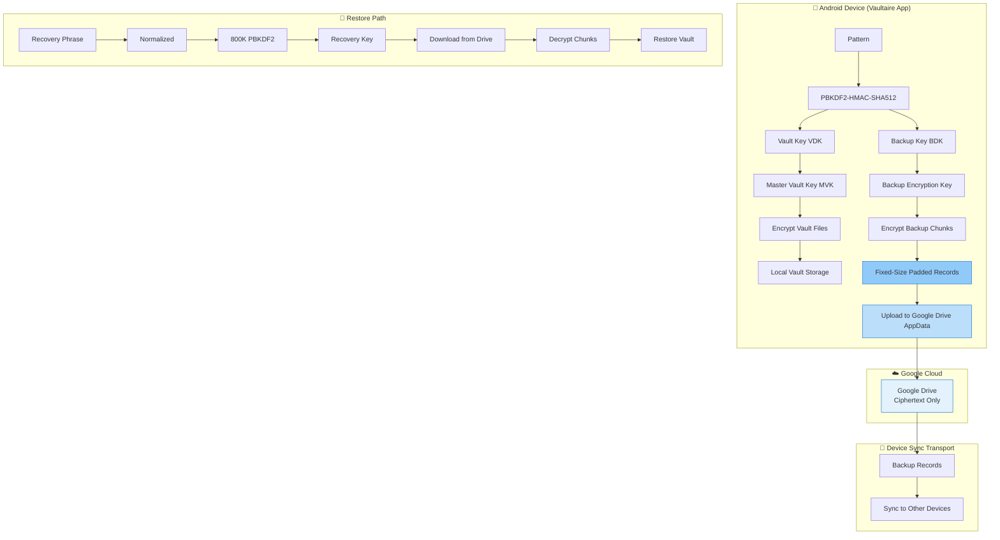
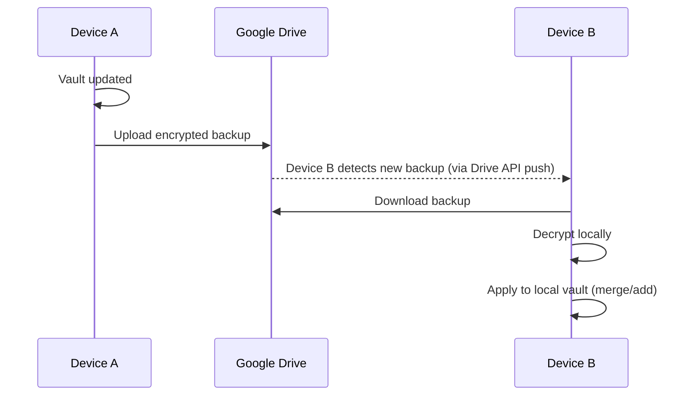

# Implementation — Encrypted Cloud Backup

## Tech Lead / Architect Perspective

---

## Architecture Diagram



---

## Backup Key Derivation

### Design: Separate Key for Backup

The iOS implementation claims a **separate pattern-derived backup key**. This is critical because:

1. **Compromise isolation**: If the backup key is exposed, the vault key remains secret.
2. **Recovery phrase independence**: Recovery phrase can derive backup key without needing the device's enrollment key.
3. **Different salt context**: Uses device salt + "BACKUP" context string vs "VAULT" for vault key.

### Proposed Implementation

```kotlin
class BackupKeyDerivationEngine(
    private val saltManager: DeviceSaltManager
) {
    companion object {
        private const val KDF_ALGORITHM = "PBKDF2WithHmacSHA512"
        private const val BACKUP_ITERATIONS = 600_000
        private const val RECOVERY_ITERATIONS = 800_000
        private const val KEY_LENGTH_BITS = 256
        private const val BACKUP_SALTContext = "VLTBKP"
    }

    /**
     * Derives a 256-bit Backup Key from pattern bytes.
     * Uses a different salt context than vault key derivation.
     */
    fun deriveBackupKey(patternBytes: ByteArray): SecretKey {
        val deviceSalt = saltManager.getOrCreateDeviceSalt()
        val backupSalt = (BACKUP_SALTContext + bytesToHex(deviceSalt)).toByteArray(Charsets.UTF_8)
        val chars = CharArray(patternBytes.size) { i -> patternBytes[i].toInt().toChar() }

        try {
            val spec = PBEKeySpec(chars, backupSalt, BACKUP_ITERATIONS, KEY_LENGTH_BITS)
            val skf = SecretKeyFactory.getInstance(KDF_ALGORITHM)
            val keyBytes = skf.generateSecret(spec).encoded
            return SecretKeySpec(keyBytes, "AES")
        } finally {
            Arrays.fill(chars, '\u0000')
        }
    }

    /**
     * Derives a recovery key from normalized recovery phrase.
     * Uses 800,000 iterations (higher cost for offline attack protection).
     */
    fun deriveRecoveryKey(recoveryPhraseNormalized: String): SecretKey {
        val deviceSalt = saltManager.getOrCreateDeviceSalt()
        val recoverySalt = ("VLTRCP" + bytesToHex(deviceSalt)).toByteArray(Charsets.UTF_8)

        val spec = PBEKeySpec(
            recoveryPhraseNormalized.toCharArray(),
            recoverySalt,
            RECOVERY_ITERATIONS,
            KEY_LENGTH_BITS
        )
        val skf = SecretKeyFactory.getInstance(KDF_ALGORITHM)
        val keyBytes = skf.generateSecret(spec).encoded
        return SecretKeySpec(keyBytes, "AES")
    }
}
```

### Gap in Current Code

Current `KeyDerivationEngine.kt` only has `deriveVaultKey()`. We need:
- `deriveBackupKey()` with different salt context
- Integration with recovery phrase normalization (BIP-39 style)

---

## Padding Scheme: Fixed-Size Padded Records

### iOS Claim
> "The app splits the backup into fixed-size chunks, pads each encrypted chunk to 10 MB"

### Current Android Implementation (Gap Analysis)

`ZeroKnowledgeBackupEngine.kt`:
- Uses `MIN_BUCKET_SIZE_BYTES = 64 KB`
- Calculates next power-of-2 × 10 MB bucket
- **Not true fixed-size**: 64KB → 10MB → 20MB → 40MB → etc. (variable)

### Required Change

Implement **true fixed-size padding** to 10 MB chunks:

```kotlin
companion object {
    private const val CHUNK_SIZE_BYTES = 10 * 1024 * 1024L // 10 MB exactly
}

fun calculatePaddedSize(originalSize: Long): Long {
    if (originalSize <= 0) return CHUNK_SIZE_BYTES
    return ((originalSize + CHUNK_SIZE_BYTES - 1) / CHUNK_SIZE_BYTES) * CHUNK_SIZE_BYTES
}
```

### Why 10 MB?

1. **Obfuscates file sizes**: All records appear as 10 MB chunks.
2. **Efficient for Google Drive**: API supports resumable uploads up to 5 TB, 256 file limit per request.
3. **Metadata hiding**: Record count reveals number of chunks, not actual data distribution.

---

## Authenticated Encryption: AES-256-GCM with Header as AAD

### Current Implementation (Good)

`ZeroKnowledgeBackupEngine.kt` lines 121-131:
```kotlin
cipher.updateAAD(headerBytes)  // Header as AAD
```

### Header Structure

| Field | Size | Description |
|---|---|---|
| Magic | 7 bytes | "VLTBK01" - file format marker |
| Salt | 16 bytes | Random salt for decryption |
| IV | 12 bytes | GCM nonce |
| Original Size | 8 bytes | Long - actual data size |
| Padded Size | 8 bytes | Long - padded size (metadata for decryption) |

### Security Properties

- **Confidentiality**: AES-256-GCM hides plaintext
- **Integrity**: GCM tag detects any tampering
- **Authentication**: AAD binds header to ciphertext (header cannot be modified without detection)

### Android Implementation Details

```kotlin
private const val CIPHER_ALGO = "AES/GCM/NoPadding"
private const val GCM_TAG_LENGTH_BITS = 128

val cipher = Cipher.getInstance(CIPHER_ALGO)
val gcmSpec = GCMParameterSpec(GCM_TAG_LENGTH_BITS, iv)
cipher.init(Cipher.ENCRYPT_MODE, masterVaultKey, gcmSpec)
cipher.updateAAD(headerBytes)  // Critical: header bound to ciphertext
```

---

## Android Adaptations

### Google Drive API vs CloudKit

| Feature | iOS CloudKit | Android Google Drive |
|---|---|---|
| **Storage location** | Private iCloud database | **AppData folder** (`drive.appdata` scope) |
| **Visibility** | Not visible to user | **Hidden from user** (perfect for zero-knowledge) |
| **Auth** | Apple Account | **Google Account Picker** (`AccountManager`) |
| **Transport** | CloudKit SDK | **Google Drive REST API v3** (App Data folder) |
| **Background Sync** | Background App Refresh | **WorkManager + Foreground Service** |
| **Battery Optimization** | System managed | **Request exemption** for backup tasks |
| **Media Handling** | Photos app entitlements | **Scoped Storage** (avoid writing to Google Photos) |

### Transport: Google Drive App Data Folder

The **App Data folder** is a hidden folder provided by Google Drive specifically for storing application configuration and data that should not be directly accessible by the user.

1. **Scope**: `https://www.googleapis.com/auth/drive.appdata`
2. **Security**: Only the app that created the data can access it.
3. **Zero-Knowledge**: The app uploads ciphertext; Google sees only file blobs in a hidden container.

### Recommended Implementation (Google Drive)

```kotlin
// Google Drive service setup with AppData scope
class GoogleDriveBackupService(
    private val context: Context,
    private val account: GoogleAccount
) {
    private val driveService: Drive by lazy {
        val transport = NetHttpTransport()
        val jsonFactory = GsonFactory.getDefaultInstance()
        val credential = GoogleAccountCredential.usingOAuth2(
            context, listOf(DriveScopes.DRIVE_APPDATA)
        ).setSelectedAccount(account)
        
        Drive.Builder(transport, jsonFactory, credential)
            .setApplicationName("Vaultaire Android")
            .build()
    }

    /**
     * Upload encrypted backup to AppData folder
     */
    suspend fun uploadBackup(encryptedChunks: List<ByteArray>): Result<String> {
        val fileMetadata = File()
        fileMetadata.name = "vault_backup_${System.currentTimeMillis()}.vltbk"
        fileMetadata.parents = listOf("appDataFolder") // Special target

        // Using resumable upload for reliability
        val mediaContent = InputStreamContent("application/octet-stream", 
            ByteArrayInputStream(combineChunks(encryptedChunks)))
        
        return try {
            val request = driveService.files().create(fileMetadata, mediaContent)
            request.mediaHttpUploader.isDirectUploadEnabled = false
            request.mediaHttpUploader.chunkSize = 1 * 1024 * 1024 // 1MB chunks for progress tracking
            val response = request.execute()
            Result.success(response.id)
        } catch (e: Exception) {
            Result.failure(e)
        }
    }
}
```

### Background Processing: WorkManager & Foreground Services

Android 12+ (API 31) imposes strict limits on background starts. For backups (which can be large), we must use:

1. **WorkManager**: For scheduling (24h cadence, idle, Wi-Fi).
2. **Expedited Jobs / Foreground Service**: To ensure the OS doesn't kill the upload mid-way.

```kotlin
class BackupWorker(context: Context, params: WorkerParameters) : CoroutineWorker(context, params) {
    override suspend fun doWork(): Result {
        // 1. Show notification (Foreground Service requirement)
        setForeground(createForegroundInfo())
        
        // 2. Request battery exemption if needed (via PowerManager)
        
        // 3. Perform encrypted backup
        return try {
            val backupResult = performEncryptedBackup()
            if (backupResult) Result.success() else Result.retry()
        } catch (e: Exception) {
            Result.failure()
        }
    }

    private fun createForegroundInfo(): ForegroundInfo {
        val notification = NotificationCompat.Builder(applicationContext, CHANNEL_ID)
            .setContentTitle("Backing up vault...")
            .setSmallIcon(R.drawable.ic_cloud_upload)
            .setOngoing(true)
            .build()
        return ForegroundInfo(NOTIFICATION_ID, notification)
    }
}
```

### Permissions & Account Selection

- **GET_ACCOUNTS**: To show the account picker.
- **INTERNET**: For Google Drive communication.
- **WAKE_LOCK**: To prevent sleep during encryption/upload.

**Account Selection**:
Use `GoogleSignInClient` to let the user choose which Google account to use for the backup. The selected account's `Account` object is then used to initialize the Drive service.

---

## Integration with Google Photos (Negative Constraint)

**Constraint**: "Never adds to Google Photos" (equivalent to "Never adds to iPhone camera roll").

- **Implementation**: Vaultaire uses **Scoped Storage** and its own internal directory (`/data/user/0/com.vaultaire.android/files/vault/`).
- **MediaStore**: We explicitly avoid `MediaStore.Images` or `MediaStore.Video` APIs.
- **No-Media**: A `.nomedia` file is placed in the vault directory to prevent system scanners from indexing thumbnails or cached files.
- **Export Only**: Plaintext only exists during explicit "Export" operations to user-visible folders.

---

## Integration with Device Sync

### Backup as Sync Transport

**Claim**: "Encrypted iCloud backup is the transport for Device Sync"

This means:
1. Backup records contain the **latest vault state**.
2. When device A creates a backup, device B can pull it during sync.
3. Backup is the **authoritative source** for vault state.

### Proposed Flow



### Implementation Notes

- Use Drive API push notifications (watch channel) to detect backup updates
- Backup version/timestamp stored in metadata
- Sync compares backup timestamp with local last-sync time

---

## Integration with Duress Mode

### Claim
> "Backup survives duress wipe"

### Design Decision

**Duress Mode** is a factory reset triggered by a special pattern that:
1. Deletes local vault
2. Keeps backup key derivation intact

### Implementation

```kotlin
class DuressModeHandler(
    private val keystore: KeystoreManager,
    private val preferences: EncryptedSharedPreferences
) {
    fun enterDuress() {
        // 1. Wipes local vault data
        vaultStorage.clearAll()
        
        // 2. KEEPS the device salt in Keystore
        // saltManager never wipes device salt
        
        // 3. Marks duress mode active (for analytics)
        preferences.edit().putBoolean("duress_mode", true).apply()
        
        // 4. Backup key still derivable from pattern
        // because device salt persists
    }
    
    fun exitDuressAndRestore(): Boolean {
        // Requires recovery phrase
        val recoveryKey = deriveRecoveryKey(userPhrase)
        val backup = downloadBackup()
        val decrypted = decryptBackup(backup, recoveryKey)
        restoreVault(decrypted)
        return true
    }
}
```

### Trust Implication

- Device salt persists → backup key still derivable
- Local vault wiped → no plaintext on device
- User must use recovery phrase to restore

---

## Integration with Secret Phrase

### Claim
> "Recovery phrase restores on any device with matching encrypted backup records"

### Required Flow

1. **Onboarding**: Generate and display recovery phrase (12-24 words)
2. **Normalization**: Convert phrase to standard form (BIP-39 style)
3. **Encryption**: Encrypt vault with backup key, store encrypted blob
4. **Upload**: Push to Drive AppData
5. **Restore**: Enter phrase → derive recovery key → download → decrypt

### Implementation Skeleton

```kotlin
class RecoveryPhraseManager {
    fun generatePhrase(): String {
        val entropy = ByteArray(16) // 128 bits
        SecureRandom().nextBytes(entropy)
        return mnemonic.fromEntropy(entropy) // BIP-39
    }

    fun normalizePhrase(phrase: String): String {
        return phrase.lowercase()
            .replace(/\s+/, " ")
            .trim()
    }

    fun createEncryptedRecoveryEnvelope(
        recoveryKey: SecretKey,
        vaultData: ByteArray
    ): EncryptedEnvelope {
        // Use recovery key to encrypt entire vault backup
        return envelopeEncryptionEngine.encrypt(vaultData, recoveryKey)
    }
}
```

---

## Offline Behavior

### Backup Queue

When offline, queue backup operations:

```kotlin
class BackupQueue {
    private val pendingBackups = mutableListOf<BackupRequest>()
    private val workManager: WorkManager
    
    fun enqueue(vaultChecksum: String) {
        val request = BackupRequest(checksum = vaultChecksum, timestamp = System.currentTimeMillis())
        pendingBackups.add(request)
        scheduleUpload()
    }
    
    private fun scheduleUpload() {
        val constraints = Constraints.Builder()
            .setRequiredNetworkType(NetworkType.CONNECTED)
            .build()
        
        val work = OneTimeWorkRequestBuilder<UploadBackupWorker>()
            .setConstraints(constraints)
            .build()
        
        workManager.enqueue(work)
    }
}
```

### Retry Logic

```kotlin
class UploadBackupWorker : Worker() {
    override suspend fun doWork(): Result {
        return try {
            val result = googleDriveService.uploadBackup(pendingChunks)
            if (result.isSuccess) {
                clearPendingBackup()
                Result.success()
            } else {
                // Exponential backoff
                Result.retry()
            }
        } catch (e: IOException) {
            Result.retry()
        }
    }
}
```

### Conditions for Retry Limit

- **Storage quota exceeded**: Fail fast, notify user
- **Network timeout**: Retry up to 3 times
- **Authentication error**: Prompt for re-auth
- **Corrupt backup**: Mark as invalid, trigger fresh backup

---

## Security Requirements

### Trust Model Summary

| Entity | Can |
|---|---|
| **Google** | Store ciphertext, see metadata |
| **Google employee** | Cannot decrypt (no key) |
| **Court order** | Must produce ciphertext (unreadable) |
| **Compromised device (unlocked)** | Can access keys in memory |
| **Locked device** | Keys protected by Android Keystore |

### Security Invariants

1. **Plaintext never reaches cloud**: ✅ `encryptBackup()` called before upload
2. **Backup key never in plaintext storage**: ✅ Derived on-demand, stored only in Keystore
3. **Recovery phrase never leaves device**: ✅ Normalized locally, used only for key derivation
4. **Header contains no sensitive metadata**: ✅ Only magic, salt, iv, sizes

### Android-Specific Security Measures

```kotlin
// Android Keystore for device salt
val keyGenParameterSpec = KeyGenParameterSpec.Builder(
    "device_salt",
    PURPOSE_SIGN or PURPOSE_VERIFY
).setUserAuthenticationRequired(false)
 .setUserAuthenticationValidityDurationSeconds(-1)
 .build()

// EncryptedSharedPreferences for non-critical settings
val masterPrefs = EncryptedSharedPreferences.create(
    "vault_preferences",
    MasterKeys.getOrCreate(MasterKeys.AES256_GCM_SPEC),
    context,
    prefMode = MODE_PRIVATE
)
```

---

## Open Questions

1. **Chunk size**: Is 10 MB optimal for mobile uploads? Consider 4 MB for better resumable behavior.
2. **Decoy records**: How many? When added? iOS says "to reduce what record sizes reveal" — needs research.
3. **Drive API quotas**: Daily upload/download limits? Need to check.
4. **Restore UX**: Should we verify vault integrity after restore? How long without device?
5. **Background limitations**: Android 12+ may restrict background uploads — need foreground service.