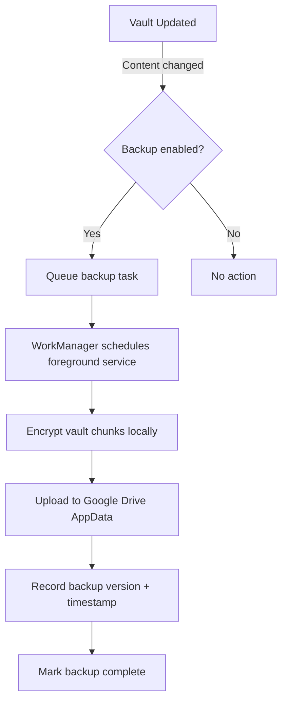
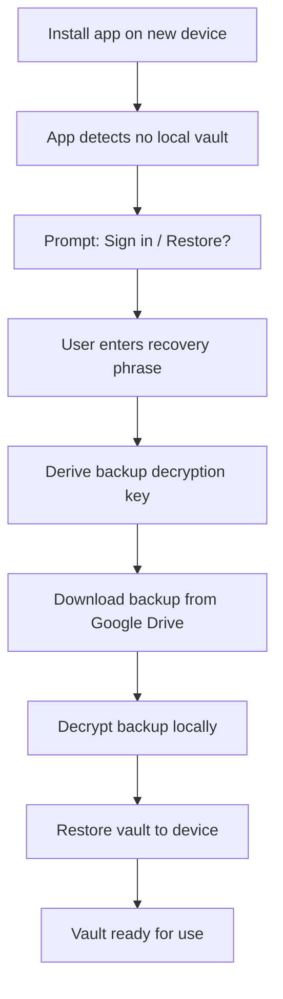
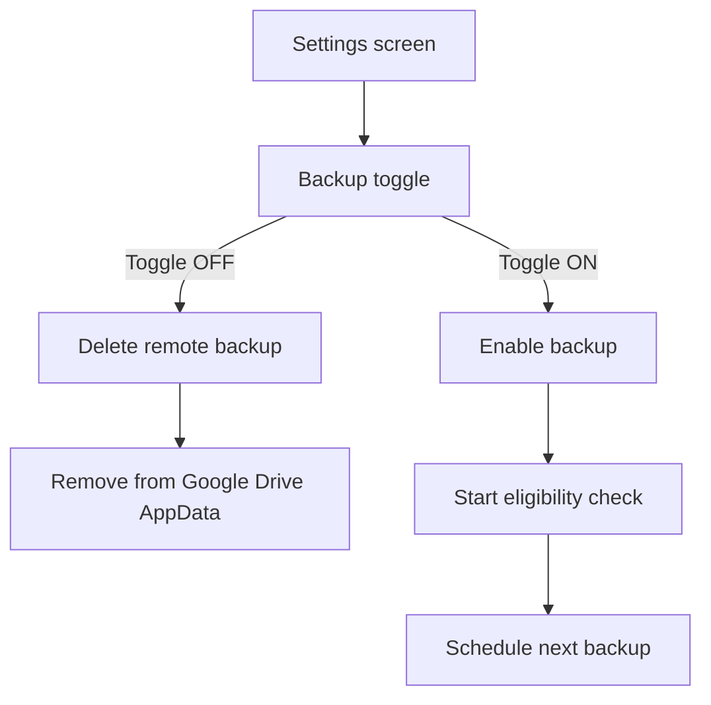

# Planning — Encrypted Cloud Backup

## Product Owner Perspective

---

## User Stories

### Epic: Encrypted Cloud Backup

**As a user, I want my vault backed up to the cloud so that I never lose my data if my device is lost, stolen, or broken.**

#### Story 1: Backup is enabled by default

> **As a** new Vaultaire user  
> **I want** encrypted backups to be on automatically  
> **So that** I am protected without having to configure anything

*Acceptance*: A fresh install has `backupEnabled = true` in SharedPreferences. User can toggle to `false` in Settings.

#### Story 2: Backup key derivation is separate from vault key

> **As a** security-conscious user  
> **I want** the backup key to be derived differently from my unlock pattern  
> **So that** a compromised backup does not reveal my vault unlock pattern

*Acceptance*: `KeyDerivationEngine` provides `deriveBackupKey(pattern, deviceSalt): ByteArray` with a different salt/context than `deriveVaultKey()`.

#### Story 3: I can restore my vault on a new device using my recovery phrase

> **As a** user who lost my phone  
> **I want** to restore my vault on a new device using my recovery phrase  
> **So that** I can access my vault without the original device

*Acceptance*: New device install prompts for recovery phrase. Valid phrase downloads encrypted backup, decrypts locally, and vault is restored.

#### Story 4: I can disable backup if I don't want cloud storage

> **As a** privacy-focused user  
> **I want** to turn off encrypted backup completely  
> **So that** no cloud data leaves my device

*Acceptance*: Settings toggle `backupEnabled = false` deletes any remote backup copies. Local vault remains intact.

#### Story 5: Backup runs automatically while the device is idle

> **As a** user with a large vault  
> **I want** backups to happen automatically and resume if interrupted  
> **So that** my vault is always backed up without manual intervention

*Acceptance*: WorkManager periodic work runs every 24h when device is idle and on Wi-Fi. Progress is tracked and can resume from last byte.

---

## User Flows

### Flow 1: Automatic Backup on Vault Changes



### Flow 2: Restore on New Device



### Flow 3: Backup Toggle in Settings



---

## Acceptance Criteria

### Backup Toggle (Feature: Settings)

```gherkin
Given I am on the Settings screen
When I toggle "Encrypted Cloud Backup" to ON
Then the setting is persisted to SharedPreferences with key "backup_enabled"
And a 24-hour backup is triggered if network is available
```

```gherkin
Given I have Encrypted Cloud Backup enabled
And there is a backup stored in Google Drive AppData
When I toggle "Encrypted Cloud Backup" to OFF
Then the remote backup is deleted from Google Drive AppData
And the local vault continues to work normally
```

### Backup Key Derivation

```gherkin
Given I provide a pattern "1-2-3-4-5"
And I have a device salt "ABC123..."
When I request a backup key
Then the output is derived via PBKDF2-HMAC-SHA512 with 600_000 iterations
And the salt is combined with a non-vault context string
But the result is NOT the same as vault key
```

### Fixed-Size Padded Records

```gherkin
Given I encrypt a 5 MB file for backup
When the backup engine calculates padded size
Then the result is exactly 10 MB
```

```gherkin
Given I encrypt a 15 MB file for backup
When the backup engine calculates padded size
Then the result is exactly 20 MB
```

### Backup Encryption

```gherkin
Given I have a backup record to encrypt
When I call encryptBackup() with the master vault key
Then the output starts with the magic bytes "VLTBK01"
And includes a 16-byte salt, 12-byte IV, original size, padded size
And the encrypted content uses AES-256-GCM with 128-bit tag
And the header bytes are set as Additional Authenticated Data (AAD)
```

### Restore from Recovery Phrase

```gherkin
Given I have a valid recovery phrase
When I enter it on a new device
Then I can restore my vault within 60 seconds
And all photos, videos, and files are restored correctly
```

### Google Drive Integration

```gherkin
Given backup is enabled
And the device is on Wi-Fi and idle
When the 24-hour backup window triggers
Then a backup is uploaded to Google Drive AppData folder
And the upload can resume if it fails mid-way
```

---

## UX: Backup Status Indicator

### Components

| Component | State | Visual |
|---|---|---|
| Backup indicator (in vault list) | Not backed up | Gray cloud with slash |
| Backup indicator | Backed up today | Cloud with checkmark |
| Backup indicator | Backup in progress | Animated spinning cloud |
| Backup indicator | Error | Cloud with exclamation |

### Settings Screen

```
┌─────────────────────────────┐
│ Settings                    │
├─────────────────────────────┤
│ Encrypted Cloud Backup      │
│ [ON]  Backup to Google Drive│
│ Last backup: Yesterday      │
│ 24h schedule • Wi-Fi only   │
│                             │
│ Recovery Phrase             │
│ ★★★★★★★★★★                 │
│ Show Phrase                 │
└─────────────────────────────┘
```

### Restore Flow Screening

1. **Screen 1**: "Restore from backup?"
   - Subtitle: "Enter your recovery phrase"
   - 12-word input field with spaced tokens
   - "Hint: Find it on the card you saved during setup"

2. **Screen 2**: "Restoring vault..."
   - Progress indicator (determinate, estimated time)
   - "This may take a few minutes"

3. **Screen 3**: "Vault restored!"
   - Success icon
   - "Your vault is ready. Your pattern unlocks your device."

---

## Trust Boundaries

### What Google Sees (Google Drive metadata)

| Data Visible to Google |
|---|
| File exists in AppData folder |
| File size (padded, ~10 MB increments) |
| Timestamp of last modification |
| Account ID (Google Account) |
| Record counts (number of backup chunks) |

### What Google Does NOT See

| Data Hidden from Google |
|---|
| Vault plaintext (photos, videos, files) |
| Backup key (plaintext) |
| Pattern-derived keys |
| Recovery phrase |
| File names (encrypted in backup header) |
| File types (encrypted metadata) |
| Content hashes |

### Trust Analysis

| Entity | Can |
|---|---|
| **Google** | Store ciphertext, see metadata, detect backups |
| **Google employee** | Cannot decrypt without user's pattern/phrase |
| **Court order to Google** | Can produce ciphertext + metadata, not plaintext |
| **Rogue Google employee** | Cannot access vault content without local credentials |
| **Compromised device (unlocked)** | Can access keys and plaintext in memory |
| **Device locked** | Keys are in Keystore, not accessible without unlock |

### Threat Model Mitigations

| Threat | Mitigation |
|---|---|
| Google subpoena | Client-side encryption means no readable key |
| Rogue employee | No plaintext key stored server-side |
| Metadata analysis | Fixed-size padding, decoy records, chunk counts obscured |
| Device theft (locked) | Android Keystore protects keys |
| Device malware (unlocked) | Mitigated by non-rooted device recommendation |
| Pattern reuse | Different derivation context for backup key |