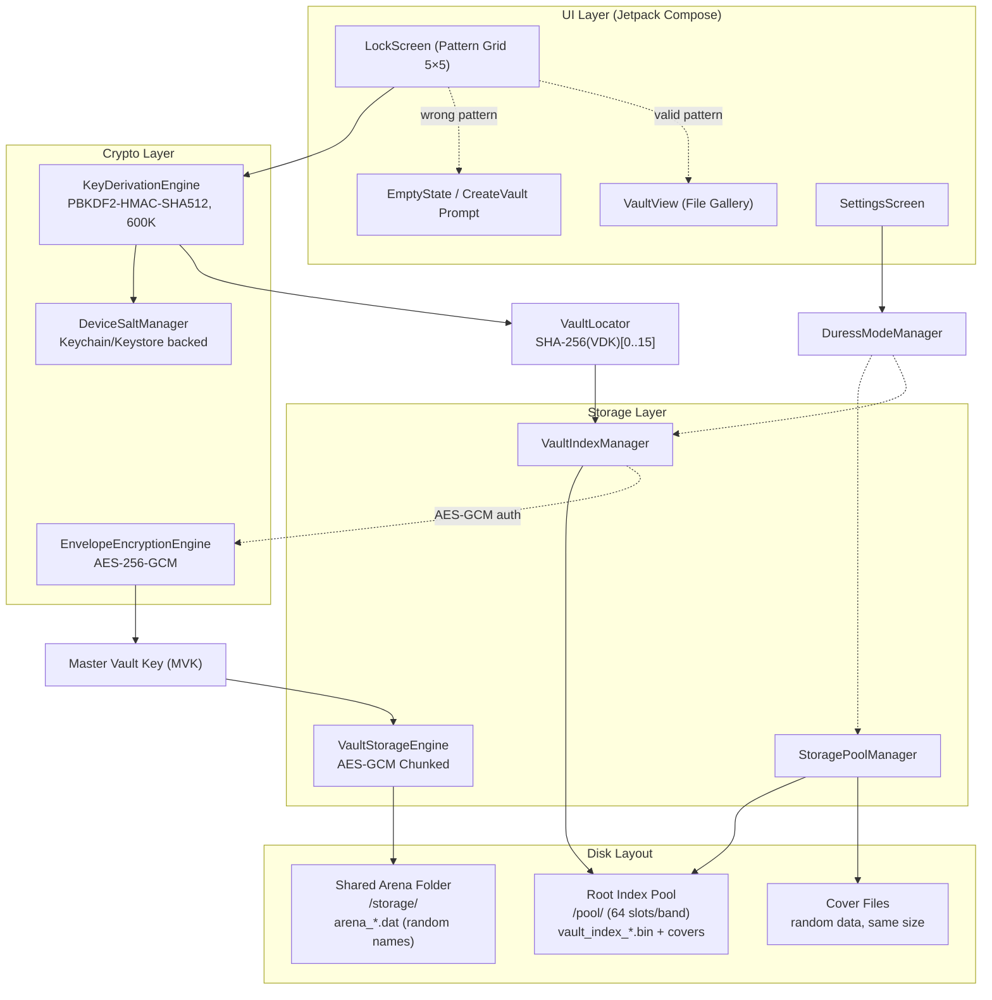

# Implementation — Hidden Vaults

**Role**: Tech Lead / Software Architect  
**Scope**: Complete technical architecture, storage layout, crypto integration, file naming, and integration with Plausible Deniability / Duress Mode.

---

## 1. Architecture Diagram



### Key Data Flows

1. **Unlock Flow**: Pattern → `KeyDerivationEngine` (PBKDF2) → VDK → `VaultLocator` → locator string → `VaultIndexManager` reads `vault_index_<locator>.bin` from pool → `EnvelopeEncryptionEngine.unwrapMasterKey()` → MVK → `VaultStorageEngine` opens files in shared arena
2. **Create Vault Flow**: Pattern → VDK → locator → generate MVK → wrap MVK with VDK → write encrypted `VaultIndex` to pool at locator slot
3. **Duress Flow**: User triggers duress → `DuressModeManager.purgeNonDecoyVaults()` → `StoragePoolManager` deletes non-duress index files + `VaultStorageEngine` deletes associated arena files

---

## 2. No Vault List UI — Direct to Pattern Grid

### App Entry Point

```
VaultaireApp (Compose)
    └── MainActivity
          └── UnlockScreen (Pattern Grid)  ← First screen, ALWAYS
```

**Critical Design Decision**: There is no `VaultListScreen`, no `VaultPickerDialog`, no "Select Vault" button anywhere in the UI hierarchy.

### Pattern Grid Spec

```kotlin
@Composable
fun PatternGrid(
    onPatternComplete: (List<PatternPoint>) -> Unit,
    onForgotPattern: () -> Unit,
    // NO onCreateVault — first pattern auto-creates vault (Zero-Config)
) {
    // 5x5 grid, minimum 48dp touch targets (Material 3)
    // Visual feedback: connecting line, dot fill animation
    // 3 failures → 30s cooldown overlay
}
```

### State Machine

```kotlin
sealed interface UnlockState {
    data class AwaitingPattern(val failedAttempts: Int = 0) : UnlockState
    data class VerifyingPattern(val pattern: List<PatternPoint>) : UnlockState
    data class VaultOpened(val vault: OpenVault) : UnlockState
    // Zero-Config: No separate "CreateVault" state — empty vault IS the opened vault
    // EmptyVault means: vault exists (index created), but fileMap is empty
    data class EmptyVault(val vault: OpenVault) : UnlockState  
    data class Cooldown(val remainingSeconds: Int) : UnlockState
    data class ForgotPattern : UnlockState
}

data class OpenVault(
    val locator: String,
    val masterVaultKey: SecretKey,
    val fileMap: Map<String, FileRecord>  // empty on first use
)
```

---

## 3. Pattern → Vault Resolution (No Vault ID Lookup)

### 3.1 VaultLocator Utility (NEW)

```kotlin
package com.vaultaire.android.vault

import androidx.annotation.VisibleForTesting
import javax.crypto.SecretKey

/**
 * Derives a deterministic, non-reversible locator string from a Vault Derivation Key.
 * The locator is used as the filename suffix for the encrypted vault index.
 * 
 * Design: First 16 bytes of SHA-256(VDK) encoded as lowercase hex.
 * This is NOT reversible to the pattern or VDK.
 * Collision probability: negligible (128-bit space, but we only use 64 chars).
 */
object VaultLocator {

    private const val LOCATOR_BYTES = 16  // 128 bits = 32 hex chars

    fun deriveLocator(vaultDerivationKey: SecretKey): String {
        val hash = java.security.MessageDigest.getInstance("SHA-256")
            .digest(vaultDerivationKey.encoded)
        return ByteArray(LOCATOR_BYTES).apply {
            System.arraycopy(hash, 0, this, 0, LOCATOR_BYTES)
        }.joinToString("") { "%02x".format(it) }
    }

    @VisibleForTesting
    fun validateLocator(locator: String): Boolean {
        return locator.matches(Regex("^[a-f0-9]{32}$"))
    }
}
```

### 3.2 VaultIndexManager (NEW)

```kotlin
package com.vaultaire.android.vault

import com.vaultaire.android.crypto.EncryptedEnvelope
import com.vaultaire.android.crypto.EnvelopeEncryptionEngine
import com.vaultaire.android.storage.RandomAccessEncryptedSource
import com.vaultaire.android.storage.VaultStorageEngine
import kotlinx.serialization.Serializable

/**
 * Manages the encrypted vault index — the root file map and wrapped master key.
 * Each vault has exactly one index file in the pool, named by its key-derived locator.
 */
class VaultIndexManager(
    private val context: Context,
    private val storageEngine: VaultStorageEngine,
    private val envelopeEngine: EnvelopeEncryptionEngine = EnvelopeEncryptionEngine(),
    private val poolManager: StoragePoolManager
) {

    private val indexFileExtension = ".bin"
    private val poolDir = poolManager.poolDirectory

    /**
     * Zero-Config Onboarding: Try to open vault; if not found, create it automatically.
     * This is the primary entry point for pattern resolution.
     * Returns the OpenVault (which contains MVK and fileMap).
     */
    fun openOrCreateVault(vdk: SecretKey): OpenVault {
        val locator = VaultLocator.deriveLocator(vdk)
        val indexFile = poolManager.getIndexFile(locator)
        
        val index = if (indexFile.exists()) {
            // Try to open existing vault
            try {
                readEncryptedIndex(indexFile, vdk)
            } catch (e: SecurityException) {
                // Wrong pattern — authentication failed
                throw SecurityException("Pattern authentication failed")
            }
        } else {
            // Zero-Config: Create new vault for this pattern
            createVaultIndex(vdk)
        }
        
        val mvk = envelopeEngine.unwrapMasterKey(index.masterKeyEnvelope, vdk)
        return OpenVault(locator = locator, masterVaultKey = mvk, fileMap = index.fileMap)
    }

    /**
     * Creates a new vault index for the given pattern.
     * Generates a fresh MVK, wraps it with the VDK, and writes to the pool.
     */
    fun createVaultIndex(vdk: SecretKey): VaultIndex {
        val mvk = envelopeEngine.generateMasterVaultKey()
        val envelope = envelopeEngine.wrapMasterKey(mvk, vdk)
        val locator = VaultLocator.deriveLocator(vdk)

        val index = VaultIndex(
            locator = locator,
            masterKeyEnvelope = envelope,
            fileMap = emptyMap(),  // empty file map initially
            createdAt = System.currentTimeMillis(),
            version = CURRENT_VERSION
        )

        writeIndexToPool(index, vdk)
        return index
    }

    /**
     * Attempts to read and authenticate a vault index for the given pattern.
     * Returns null if no index exists or authentication fails (wrong pattern).
     */
    fun tryOpenVaultIndex(vdk: SecretKey): VaultIndex? {
        val locator = VaultLocator.deriveLocator(vdk)
        val indexFile = poolManager.getIndexFile(locator)
        
        if (!indexFile.exists()) return null

        return try {
            val encryptedIndex = readEncryptedIndex(indexFile, vdk)
            // If we get here, AES-GCM auth succeeded
            encryptedIndex
        } catch (e: SecurityException) {
            // Authentication failed — wrong pattern or corrupted
            null
        }
    }

    private fun writeIndexToPool(index: VaultIndex, vdk: SecretKey) {
        val poolSlot = poolManager.reserveSlotForLocator(index.locator)
        val encryptedBytes = encryptIndex(index, vdk)
        poolSlot.writeBytes(encryptedBytes)
    }

    private fun encryptIndex(index: VaultIndex, vdk: SecretKey): ByteArray {
        // Serialize index to JSON, then encrypt with VDK using AES-GCM
        val json = VaultIndex.serializer().serializeToJsonElement(index).toString()
        val plaintext = json.toByteArray(Charsets.UTF_8)
        
        val cipher = Cipher.getInstance("AES/GCM/NoPadding")
        val iv = ByteArray(12).also { SecureRandom().nextBytes(it) }
        cipher.init(Cipher.ENCRYPT_MODE, vdk, GCMParameterSpec(128, iv))
        val ciphertext = cipher.doFinal(plaintext)
        
        // Format: [magic:8][version:1][iv:12][ciphertext...]
        return ByteArrayOutputStream().apply {
            write("VLTIDX1".toByteArray(Charsets.UTF_8)) // 8 bytes including null?
            write(CURRENT_VERSION.toByte())
            write(iv)
            write(ciphertext)
        }.toByteArray()
    }

    private fun readEncryptedIndex(file: File, vdk: SecretKey): VaultIndex {
        val data = file.readBytes()
        require(data.size >= 21) { "Index file too small" }
        
        val magic = data.copyOfRange(0, 8)
        require(magic.contentEquals("VLTIDX1".toByteArray(Charsets.UTF_8))) { "Invalid index magic" }
        
        val version = data[8].toInt()
        require(version == CURRENT_VERSION) { "Unsupported index version" }
        
        val iv = data.copyOfRange(9, 21)
        val ciphertext = data.copyOfRange(21, data.size)
        
        val cipher = Cipher.getInstance("AES/GCM/NoPadding")
        cipher.init(Cipher.DECRYPT_MODE, vdk, GCMParameterSpec(128, iv))
        val plaintext = cipher.doFinal(ciphertext)
        
        val json = String(plaintext, Charsets.UTF_8)
        return VaultIndex.serializer().deserializeFromJson(json)
    }

    companion object {
        const val CURRENT_VERSION = 1
    }
}

@Serializable
data class VaultIndex(
    val locator: String,                      // 32-char hex, from VaultLocator
    val masterKeyEnvelope: EncryptedEnvelope, // MVK wrapped with VDK
    val fileMap: Map<String, FileRecord>,     // logical path → file record
    val createdAt: Long,
    val version: Int
)

@Serializable
data class FileRecord(
    val storageFileName: String,  // random name in shared arena
    val originalName: String,     // encrypted in header, not here
    val mimeType: String,
    val size: Long,
    val createdAt: Long,
    val modifiedAt: Long
)
```

### 3.3 Resolution Flow Summary (Zero-Config Onboarding)

```
Pattern drawn (e.g., dots [0,0] → [1,1] → [2,2])
       │
       ▼
KeyDerivationEngine.deriveVaultKey(patternBytes) → VDK (256-bit SecretKey)
       │
       ▼
VaultLocator.deriveLocator(VDK) → "a1b2c3d4e5f6..." (32-char hex)
       │
       ▼
VaultIndexManager.openOrCreateVault(VDK)
       │
       ├── Index file NOT found → CREATE new index at pool/locator.bin
       │     ├── Generate fresh MVK
       │     ├── Wrap MVK with VDK (AES-GCM)
       │     ├── Write encrypted VaultIndex (empty fileMap) to pool
       │     └── Return OpenVault(mvk, emptyFileMap) → Empty Vault UI
       │
       ├── Index file FOUND → readEncryptedIndex(file, VDK)
       │     ├── AES-GCM auth FAILS → SecurityException("Pattern authentication failed")
       │     │
       │     └── AES-GCM auth SUCCEEDS → VaultIndex with MVK envelope
       │           │
       │           ▼
       │     EnvelopeEncryptionEngine.unwrapMasterKey(envelope, VDK) → MVK
       │           │
       │           ▼
       │     Return OpenVault(mvk, fileMap) → VaultView UI
       │
       └── (No "EmptyState" that exposes other vaults)
```

**Key Point**: There is no code path that returns "vault not found" to the UI. Every pattern either opens an existing vault or creates a new one. The UI never shows "no vault exists for this pattern" — it shows an empty vault ready for files.

---

## 4. Encrypted Index Format

### 4.1 On-Disk Structure (Encrypted Index File)

```
vault_index_<32-char-locator>.bin
┌─────────────────────────────────────────────────────────────┐
│ Magic: "VLTIDX1" (8 bytes)                                  │
├─────────────────────────────────────────────────────────────┤
│ Version: 1 byte (0x01)                                      │
├─────────────────────────────────────────────────────────────┤
│ IV: 12 bytes (random per index)                             │
├─────────────────────────────────────────────────────────────┤
│ Ciphertext: AES-256-GCM(plaintext_json, VDK, IV)            │
│   └── Contains 16-byte GCM auth tag at end                  │
└─────────────────────────────────────────────────────────────┘
```

### 4.2 Decrypted Index JSON Structure

```json
{
  "locator": "a1b2c3d4e5f67890a1b2c3d4e5f67890",
  "masterKeyEnvelope": {
    "iv": "base64...",
    "ciphertext": "base64..."
  },
  "fileMap": {
    "photos/IMG_001.jpg": {
      "storageFileName": "arena_7x9k2m.dat",
      "originalName": "IMG_001.jpg",
      "mimeType": "image/jpeg",
      "size": 2048576,
      "createdAt": 1700000000000,
      "modifiedAt": 1700000000000
    },
    "documents/contract.pdf": {
      "storageFileName": "arena_3p8q1z.dat",
      "originalName": "contract.pdf",
      "mimeType": "application/pdf",
      "size": 512000,
      "createdAt": 1700001000000,
      "modifiedAt": 1700001000000
    }
  },
  "createdAt": 1700000000000,
  "version": 1
}
```

### 4.3 What the Index Protects

| Field | Protected By | Visible to Examiner |
|-------|--------------|---------------------|
| `locator` | N/A (filename) | Yes (32-char hex) |
| `masterKeyEnvelope` | AES-GCM (VDK) | Ciphertext only |
| `fileMap` keys (logical paths) | AES-GCM (VDK) | No |
| `fileMap` values (storage file names) | AES-GCM (VDK) | No |
| `originalName`, `mimeType` | AES-GCM (VDK) | No |
| `createdAt`, `modifiedAt` | AES-GCM (VDK) | No |

### 4.4 Current Code Gap (VaultHeader Leaks)

**Current `VaultHeader` stores plaintext:**
- `vaultId` (UUID) — **REMOVE**
- `isDuressDecoy` flag — **REMOVE** (move to encrypted index)

**Required Change**: Replace `VaultHeader` with fully encrypted `VaultIndex`. No plaintext metadata at rest.

---

## 5. File Naming on Disk (Android Internal Storage)

All files are stored in **app-private internal storage** (`context.filesDir`) — not accessible to other apps or users without root. This is the Android-native equivalent of iOS app container.

### 5.1 Root Index Files (Pool)

```
<filesDir>/vaults/pool/
├── vault_index_a1b2c3d4e5f67890a1b2c3d4e5f67890.bin   ← real index
├── vault_index_cover_001.bin                           ← cover file
├── vault_index_cover_002.bin                           ← cover file
...
├── vault_index_cover_063.bin                           ← cover file (64 slots/band)
```

- **Real index**: `vault_index_<32-char-locator>.bin`
- **Cover files**: `vault_index_cover_<3-digit>.bin` filled with cryptographically random bytes
- **Band size**: 64 slots (1 real + up to 63 covers initially, more added as vaults created)
- **Locator**: First 16 bytes of SHA-256(VDK) as hex — **cannot** be reversed to pattern
- **No UUIDs, no timestamps, no vault names** in filenames

### 5.2 Storage Files (Shared Arena Folder)

```
<filesDir>/vaults/storage/
├── arena_a7x9k2m.dat
├── arena_3p8q1z.dat
├── arena_m9n4v5b.dat
```

- **Naming**: `arena_<random-base32>.dat` — no vault association
- **Content**: Chunked AES-256-GCM encrypted file data (64KB chunks + 16B tags)
- **Ownership**: Tracked **only** inside encrypted `VaultIndex.fileMap` → `storageFileName`
- **Deletion**: When vault is deleted, its arena files are deleted; covers remain
- **No user-visible names, no MIME types, no vault IDs** in arena filenames

### 5.3 Cover File Strategy

```kotlin
class CoverFileGenerator {
    companion object {
        const val BAND_SIZE = 64
        const val COVER_PREFIX = "vault_index_cover_"
        const val INDEX_PREFIX = "vault_index_"
    }

    fun ensureBandCapacity(poolDir: File, neededSlots: Int) {
        val current = poolDir.listFiles { _, name -> name.startsWith(INDEX_PREFIX) }?.size ?: 0
        val bandsNeeded = ((current + neededSlots) + BAND_SIZE - 1) / BAND_SIZE
        val totalSlotsNeeded = bandsNeeded * BAND_SIZE
        
        val coversNeeded = totalSlotsNeeded - current
        repeat(coversNeeded) { i ->
            val coverFile = File(poolDir, "${COVER_PREFIX}${String.format("%03d", current + i + 1)}.bin")
            coverFile.writeBytes(randomBytes(coverFileSize()))
        }
    }

    private fun coverFileSize(): Int = 4096 // 4KB, matches typical index size
}
```

---

## 6. Root File Pooling (Padded Pool of 64 Slots)

### 6.1 StoragePoolManager (NEW)

```kotlin
package com.vaultaire.android.vault

import java.io.File
import java.security.SecureRandom

class StoragePoolManager(private val context: Context) {

    private val baseDir: File = File(context.filesDir, "vaults").apply { mkdirs() }
    val poolDirectory: File = File(baseDir, "pool").apply { mkdirs() }
    val arenaDirectory: File = File(baseDir, "storage").apply { mkdirs() }

    init {
        ensureInitialBand()
    }

    private fun ensureInitialBand() {
        val existing = poolDirectory.listFiles()?.size ?: 0
        if (existing == 0) {
            // Create first band of 64 cover files
            repeat(BAND_SIZE) { i ->
                val coverFile = File(poolDirectory, "${COVER_PREFIX}${String.format("%03d", i + 1)}.bin")
                coverFile.writeBytes(generateRandomBytes(COVER_FILE_SIZE))
            }
        }
    }

    /**
     * Reserves a slot for the given locator.
     * If locator already exists, returns existing file.
     * Otherwise, replaces a cover file with the real index.
     */
    fun reserveSlotForLocator(locator: String): File {
        val indexFile = File(poolDirectory, "${INDEX_PREFIX}$locator.bin")
        if (indexFile.exists()) return indexFile

        // Find a cover file to replace
        val coverFiles = poolDirectory.listFiles { _, name -> name.startsWith(COVER_PREFIX) }
            ?.sortedBy { it.name } ?: emptyArray()
        
        if (coverFiles.isEmpty()) {
            // Need new band
            addNewBand()
            return reserveSlotForLocator(locator)
        }

        // Replace first cover file
        val coverToReplace = coverFiles.first()
        val success = coverToReplace.renameTo(indexFile)
        require(success) { "Failed to replace cover file with index" }
        return indexFile
    }

    fun getIndexFile(locator: String): File = File(poolDirectory, "${INDEX_PREFIX}$locator.bin")

    fun listRealIndexFiles(): List<File> {
        return poolDirectory.listFiles { _, name -> 
            name.startsWith(INDEX_PREFIX) && !name.startsWith(COVER_PREFIX)
        }?.toList() ?: emptyList()
    }

    fun listCoverFiles(): List<File> {
        return poolDirectory.listFiles { _, name -> name.startsWith(COVER_PREFIX) }?.toList() ?: emptyList()
    }

    fun deleteIndexFile(locator: String): Boolean {
        val indexFile = getIndexFile(locator)
        if (!indexFile.exists()) return false
        
        // Replace with a new cover file to maintain band padding
        val deleted = indexFile.delete()
        if (deleted) {
            val coverNumber = (listCoverFiles().size + 1)
            val newCover = File(poolDirectory, "${COVER_PREFIX}${String.format("%03d", coverNumber)}.bin")
            newCover.writeBytes(generateRandomBytes(COVER_FILE_SIZE))
        }
        return deleted
    }

    private fun addNewBand() {
        repeat(BAND_SIZE) { i ->
            val coverFile = File(poolDirectory, "${COVER_PREFIX}${String.format("%03d", listCoverFiles().size + i + 1)}.bin")
            coverFile.writeBytes(generateRandomBytes(COVER_FILE_SIZE))
        }
    }

    companion object {
        const val BAND_SIZE = 64
        const val COVER_PREFIX = "vault_index_cover_"
        const val INDEX_PREFIX = "vault_index_"
        const val COVER_FILE_SIZE = 4096
    }
}
```

### 6.2 Pool Behavior Summary

| Event | Pool Action |
|-------|-------------|
| First vault created | 64 cover files exist → 1 replaced with real index |
| Vault deleted | Index file replaced with new cover file |
| 64 vaults created | Band full → new band of 64 covers added |
| Examiner counts | Sees N bands × 64 files, cannot distinguish real vs. cover |

---

## 7. Integration with Plausible Deniability & Duress Mode

### 7.1 Duress Mode Design

Duress mode is a **user-triggered** action that deletes all non-duress vaults. The designation of a vault as "duress" is stored **inside the encrypted index**, not in plaintext.

```kotlin
@Serializable
data class VaultIndex(
    val locator: String,
    val masterKeyEnvelope: EncryptedEnvelope,
    val fileMap: Map<String, FileRecord>,
    val createdAt: Long,
    val version: Int,
    val isDuressDecoy: Boolean = false  // ENCRYPTED inside index
)
```

### 7.2 DuressModeManager (NEW)

```kotlin
package com.vaultaire.android.vault

class DuressModeManager(
    private val indexManager: VaultIndexManager,
    private val poolManager: StoragePoolManager,
    private val storageEngine: VaultStorageEngine
) {

    /**
     * Triggered by user (e.g., special pattern, shake gesture, quick settings tile).
     * Deletes all vaults EXCEPT the one marked as duress decoy.
     * The currently open vault is preserved if it's the decoy.
     */
    fun triggerDuressPurge(currentVaultLocator: String?) {
        val realIndexes = poolManager.listRealIndexFiles()
        
        for (indexFile in realIndexes) {
            val locator = extractLocator(indexFile.name)
            
            // Skip the currently open vault if it's the decoy
            if (locator == currentVaultLocator) continue
            
            // Check if this vault is marked as duress decoy
            // We need to try opening it with the current VDK — but we don't have it!
            // Design: The decoy vault is identified by the pattern used to OPEN it.
            // So we can only purge vaults we CAN'T open with the current pattern.
        }
    }

    /**
     * Better design: Purge all vaults that DON'T match the duress pattern.
     * The duress pattern is configured in settings and stored in Keychain/Keystore.
     */
    fun triggerDuressPurgeWithKnownDuressPattern(duressVdk: SecretKey) {
        val duressLocator = VaultLocator.deriveLocator(duressVdk)
        val realIndexes = poolManager.listRealIndexFiles()
        
        for (indexFile in realIndexes) {
            val locator = extractLocator(indexFile.name)
            if (locator != duressLocator) {
                // Delete this vault's index and storage files
                deleteVaultCompletely(locator)
            }
        }
    }

    private fun deleteVaultCompletely(locator: String) {
        // 1. Delete index file (replaced with cover)
        poolManager.deleteIndexFile(locator)
        
        // 2. Delete associated arena files
        // Need to read index first to know which arena files belong to it
        // But we can't read it without the VDK!
        // Design: Track arena file ownership externally or use per-vault arena folders?
        // Per-website: "All vaults share one storage folder with random names"
        // So we CAN'T know which arena files belong to which vault without the index.
        
        // Solution: When index is deleted, the arena files become orphaned.
        // Periodic cleanup can remove unreferenced arena files.
        // Or: Store arena file mapping in a separate encrypted manifest per vault?
    }

    private fun extractLocator(fileName: String): String {
        return fileName.removePrefix("vault_index_").removeSuffix(".bin")
    }
}
```

### 7.3 Arena File Cleanup Strategy

Since arena files are shared and randomly named, we need a reference-counting or manifest approach:

```kotlin
// Option A: Per-vault encrypted manifest (stored alongside index)
// Option B: Global encrypted manifest (one per vault, but that's the index)
// Option C: Arena file naming includes locator prefix (breaks "random names" claim)
// Option D: Periodic scan — read all indexes we can open, collect referenced arena files, delete rest

class ArenaCleanupManager(
    private val poolManager: StoragePoolManager,
    private val storageEngine: VaultStorageEngine
) {
    fun cleanupOrphanedArenas(knownVdks: List<SecretKey>) {
        val referencedArenas = mutableSetOf<String>()
        
        for (vdk in knownVdks) {
            val index = indexManager.tryOpenVaultIndex(vdk)
            if (index != null) {
                index.fileMap.values.forEach { referencedArenas.add(it.storageFileName) }
            }
        }
        
        val allArenaFiles = poolManager.arenaDirectory.listFiles { _, name -> name.startsWith("arena_") } ?: emptyArray()
        for (arenaFile in allArenaFiles) {
            if (arenaFile.name !in referencedArenas) {
                arenaFile.delete()
            }
        }
    }
}
```

### 7.4 Plausible Deniability UX Flow

```
Settings → Plausible Deniability
    ├── Enable Duress Mode
    │   └── Draw Duress Pattern (stored in Keychain/Keystore)
    │
    ├── Decoy Vault Setup
    │   └── "Open Decoy Vault" → draws duress pattern → opens/creates decoy
    │
    └── Trigger Duress Purge
        ├── Special Pattern (e.g., 4 corners)
        ├── Shake Gesture
        ├── Quick Settings Tile
        └── "Panic Button" in notification
```

### 7.5 Security Properties

| Property | Implementation |
|----------|----------------|
| Decoy vault indistinguishable | Same encryption, same index format, `isDuressDecoy` encrypted |
| Duress pattern stored securely | Android Keystore / StrongBox, requires auth |
| Purge is irrecoverable | Files deleted, not moved to trash |
| Examiner can detect purge | Missing index files, fewer arena files — **admitted limitation** |

---

## 8. Honest Forensic Limits — Design For Truth

### 8.1 What Our Design Cannot Hide

| Artifact | Exposed To | Mitigation |
|----------|------------|------------|
| Number of pool bands (64 files each) | Filesystem examiner | Documented limitation |
| Total arena file count | Filesystem examiner | Documented limitation |
| Arena file sizes (all same chunked size) | Filesystem examiner | Fixed chunk size is necessary |
| File modification timestamps | Filesystem examiner | Android scoped storage limits |
| App installation & storage usage | System / examiner | Cannot hide |

### 8.2 What Our Design DOES Protect

| Property | Mechanism |
|----------|-----------|
| Vault patterns | Never stored; derived on-demand |
| Vault labels/names | Not stored anywhere |
| File original names | Encrypted in file header + index |
| File MIME types | Encrypted in file header + index |
| File contents | AES-256-GCM with per-vault MVK |
| Cross-vault file association | Random arena names, shared folder |
| Index-to-pattern mapping | Key-derived locator (SHA-256) |

### 8.3 User-Facing Transparency

**Settings → Security → Forensic Transparency** screen must state:

> **What a forensic examiner with device access can learn:**
> - That Vaultaire is installed
> - Approximately how much storage it uses
> - A lower bound on how many vaults contain files (from arena file count)
> - When vaults were last modified (file timestamps)
>
> **What they CANNOT learn without your pattern:**
> - Your patterns or passwords
> - How many vaults you have (exact count)
> - Vault names or labels
> - File names, types, or contents
> - Which files belong to which vault

---

## 9. Migration from Current Code

### 9.1 Required Changes

| Current | Target | Effort |
|---------|--------|--------|
| `VaultManager` uses UUID `vaultId` | `VaultIndexManager` uses key-derived locator | Rewrite |
| `VaultHeader` stores plaintext `vaultId`, `isDuressDecoy` | `VaultIndex` fully encrypted | Replace |
| `vaults/` flat directory | `vaults/pool/` + `vaults/storage/` with pooling | New structure |
| No cover files | 64-slot bands with cover files | New logic |
| `purgeNonDecoyVaultFiles` reads plaintext header | Duress purge uses encrypted index flag | Refactor |

### 9.2 Migration Strategy

```kotlin
// On first app launch after update:
fun migrateLegacyVaults() {
    val legacyDir = File(context.filesDir, "vaults")
    val legacyFiles = legacyDir.listFiles { _, name -> name.endsWith(".vlt") } ?: emptyArray()
    
    for (legacyFile in legacyFiles) {
        // Read legacy header (has plaintext vaultId)
        val header = VaultHeader.deserialize(legacyFile.inputStream())
        
        // We CANNOT migrate because we don't have the VDK!
        // User must re-enter pattern for each vault.
        // Show migration UI: "Enter pattern for vault: <vaultId>"
    }
}
```

**Decision**: Don't auto-migrate. Require user to unlock each vault with its pattern to re-encrypt under new format. This is more secure and honest.

---

## 10. Crypto Parameters Summary

| Parameter | Value | Source |
|-----------|-------|--------|
| KDF Algorithm | PBKDF2-HMAC-SHA512 | NIST SP 800-132 |
| KDF Iterations | 600,000 | Website claim, current code |
| KDF Output | 256 bits | AES-256 key |
| Device Salt | 32 bytes, random | Keychain/Keystore backed |
| Index Encryption | AES-256-GCM | NIST SP 800-38D |
| Index IV | 12 bytes, random per index | Crypto best practice |
| File Encryption | AES-256-GCM, 64KB chunks | Current `EncryptedOutputStream` |
| File Chunk IV | Derived from master IV + chunk index | Current implementation |
| Locator Derivation | SHA-256(VDK)[0..15] as hex | New, 128-bit space |
| Pool Band Size | 64 slots | Website claim |
| Cover File Size | 4 KB | Matches index size |

---

## 11. Open Questions for Team

1. **Biometric Unlock**: Should we support biometric as alternative to pattern? (Requires storing VDK in Keystore)
2. **Cloud Backup**: How does hidden vaults work with zero-knowledge backup? (Per-vault backup keys?)
3. **Multi-device Sync**: If user has multiple devices, how do vaults sync without revealing vault list?
4. **Recovery Phrase**: Does recovery phrase unlock all vaults or just one? (Website: "encrypted local recovery database contains pattern and phrase material")
5. **Performance**: 600K PBKDF2 rounds on older Android — need async + progress indicator?
6. **Cover File Size**: Should cover files match actual index size exactly, or vary?

---

## 12. Implementation Priority Order

| Phase | Components | Dependencies |
|-------|------------|--------------|
| 1 | `VaultLocator`, `VaultIndex` (serializable), `VaultIndexManager` | `KeyDerivationEngine`, `EnvelopeEncryptionEngine` |
| 2 | `StoragePoolManager` (pool + cover files) | `VaultIndexManager` |
| 3 | `ArenaCleanupManager` | `StoragePoolManager`, `VaultIndexManager` |
| 4 | `DuressModeManager` | All above + Keystore for duress pattern |
| 5 | Pattern unlock UI (Compose) | All above |
| 6 | Migration tool for legacy `.vlt` files | Legacy `VaultHeader` reading |
| 7 | Forensic transparency help screen | Content writing |
| 8 | Integration tests, security audit | All above |