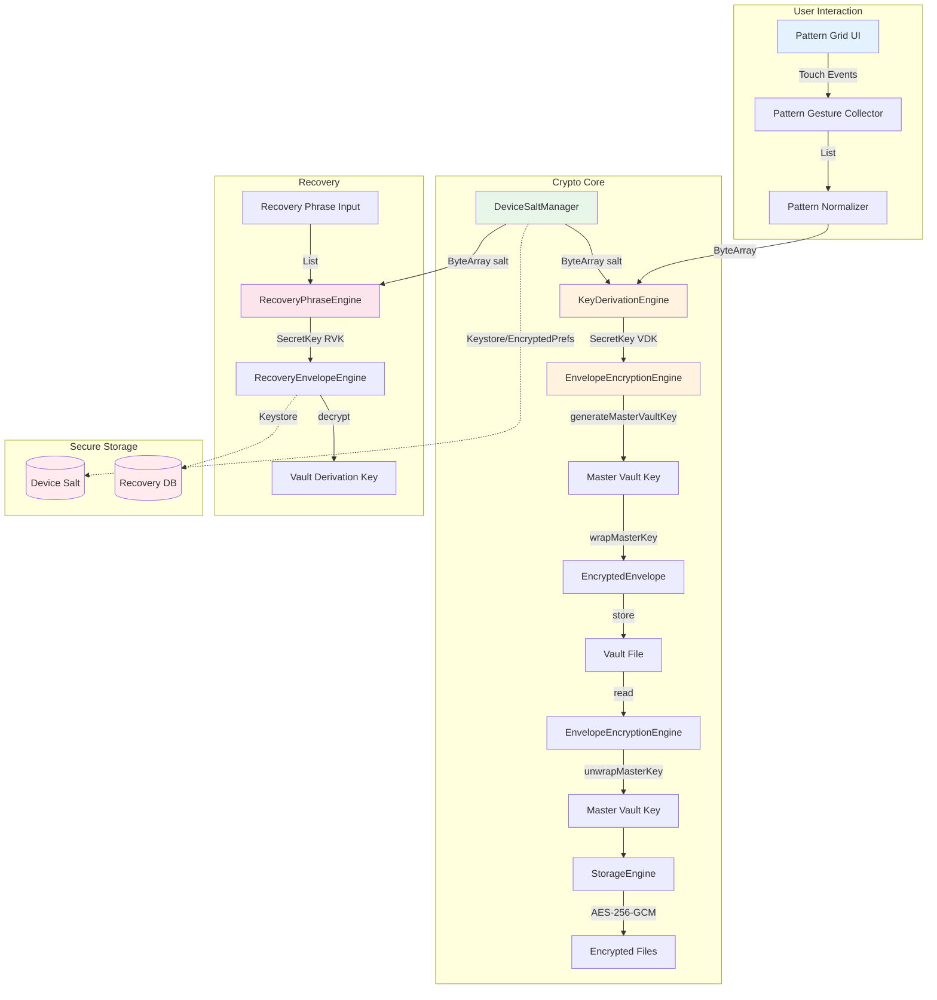
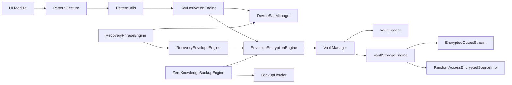

# Implementation Document: Pattern Encryption
## Technical Architecture — Tech Lead / Architect Perspective

---

## Technical Architecture Diagram



---

## Data Structures and Serialization Formats

### 1. PatternPoint (Already Implemented)
```kotlin
data class PatternPoint(val row: Int, val col: Int) {
    val index: Int get() = row * 5 + col  // 0-24
}
```

### 2. Normalized Pattern Byte Array (PatternUtils)
```
Format: [Domain Separator][Point Indices...]
- Domain Separator: "VAULTAIRE_PATTERN_V1" (19 bytes UTF-8)
- Points: uint16 per point (max 24 fits in 5 bits, using 2 bytes for alignment)
- Example: 25 dots → 19 + (25 × 2) = 69 bytes max
```

### 3. Device Salt
```kotlin
// Stored: 32 bytes (256 bits) - hex encoded in current impl
// REQUIRED: Migrate to Android Keystore
ByteArray(32)  // Cryptographically random, device-bound
```

### 4. Vault Header (VaultHeader.kt)
```
Binary Format:
┌─────────────────────────────────────────────────────────────────┐
│ Magic (7 bytes)    │ "VLTHDR1" UTF-8                            │
├─────────────────────────────────────────────────────────────────┤
│ VaultId Length (4) │ Big-endian uint32                          │
├─────────────────────────────────────────────────────────────────┤
│ VaultId (36)       │ UUID string UTF-8                          │
├─────────────────────────────────────────────────────────────────┤
│ Duress Flag (1)    │ 0x01 = duress decoy, 0x00 = normal         │
├─────────────────────────────────────────────────────────────────┤
│ IV Length (4)      │ Big-endian uint32 (should be 12)           │
├─────────────────────────────────────────────────────────────────┤
│ IV (12)            │ AES-GCM nonce                              │
├─────────────────────────────────────────────────────────────────┤
│ Ciphertext Len (4) │ Big-endian uint32                          │
├─────────────────────────────────────────────────────────────────┤
│ Ciphertext (var)   │ Wrapped Master Vault Key + auth tag        │
└─────────────────────────────────────────────────────────────────┘
```

### 5. EncryptedEnvelope
```kotlin
data class EncryptedEnvelope(
    val iv: ByteArray,      // 12 bytes
    val ciphertext: ByteArray  // 32 bytes key + 16 bytes tag = 48 bytes
)
```

### 6. File Encryption Header (EncryptedOutputStream)
```
Binary Format (80 bytes header):
┌─────────────────────────────────────────────────────────────────┐
│ Magic (6)         │ "VAULT1" ASCII                             │
├─────────────────────────────────────────────────────────────────┤
│ Version (1)       │ 0x01                                       │
├─────────────────────────────────────────────────────────────────┤
│ Reserved (1)      │ 0x00                                       │
├─────────────────────────────────────────────────────────────────┤
│ Salt (32)         │ Currently all zeros (PLACEHOLDER)          │
├─────────────────────────────────────────────────────────────────┤
│ Master IV (12)    │ Base nonce for chunking                    │
├─────────────────────────────────────────────────────────────────┤
│ Chunk Size (4)    │ Big-endian uint32 (default 65536)          │
├─────────────────────────────────────────────────────────────────┤
│ File Size (8)     │ Big-endian uint64 (0 = streaming)          │
├─────────────────────────────────────────────────────────────────┤
│ Header Auth Tag (16)│ Placeholder (not yet implemented)        │
└─────────────────────────────────────────────────────────────────┘
```

### 7. File Chunk Format
```
Per Chunk (chunkSize + 16 bytes tag):
┌─────────────────────────────────────────────────────────────────┐
│ Ciphertext (chunkSize bytes)                                    │
├─────────────────────────────────────────────────────────────────┤
│ Auth Tag (16 bytes)                                             │
└─────────────────────────────────────────────────────────────────┘

Chunk IV derivation:
chunkIv = masterIv XOR (chunkIndex as 8-byte big-endian, placed in last 8 bytes of IV)
```

### 8. Recovery Phrase Derivation
```kotlin
// Input: 12-word mnemonic, normalized
val canonicalPhrase = words.joinToString(" ").lowercase().trim()
// KDF: PBKDF2-HMAC-SHA512, 800,000 iterations, 256-bit output
// Output: Recovery Vault Key (RVK) - 256-bit SecretKey
```

### 9. Backup Header (ZeroKnowledgeBackupEngine)
```
Binary Format (51 bytes):
┌─────────────────────────────────────────────────────────────────┐
│ Magic (7)         │ "VLTBK01" UTF-8                            │
├─────────────────────────────────────────────────────────────────┤
│ Salt (16)         │ PBKDF2 salt for backup key derivation      │
├─────────────────────────────────────────────────────────────────┤
│ IV (12)           │ AES-GCM nonce                              │
├─────────────────────────────────────────────────────────────────┤
│ Original Size (8) │ Big-endian uint64                          │
├─────────────────────────────────────────────────────────────────┤
│ Padded Size (8)   │ Big-endian uint64 (bucket-aligned)         │
└─────────────────────────────────────────────────────────────────┘
```

---

## Class Interfaces and Responsibilities

### PatternPoint
**Responsibility**: Immutable representation of a grid coordinate
**Interface**: 
- `row: Int` (0-4)
- `col: Int` (0-4)  
- `index: Int` (0-24, computed)

### PatternUtils
**Responsibility**: Pattern normalization and serialization
**Interface**:
```kotlin
object PatternUtils {
    const val DOMAIN_SEPARATOR = "VAULTAIRE_PATTERN_V1"
    
    /**
     * Normalizes raw touch points into canonical byte array.
     * Interpolates intermediate points on straight lines.
     */
    fun normalizePattern(points: List<PatternPoint>): ByteArray
    
    /**
     * Validates pattern meets minimum requirements.
     * Returns (isValid, errorMessage)
     */
    fun validatePattern(points: List<PatternPoint>): Pair<Boolean, String?>
    
    /**
     * Calculates pattern strength score (0-100).
     */
    fun calculatePatternStrength(points: List<PatternPoint>): Int
}
```

### DeviceSaltManager (NEEDS REFACTOR)
**Current**: Uses SharedPreferences - INSECURE
**Required**: Use Android Keystore + EncryptedSharedPreferences

```kotlin
class DeviceSaltManager(private val context: Context) {
    companion object {
        const val SALT_KEY = "device_kdf_salt"
        const val SALT_SIZE = 32
    }
    
    /**
     * Retrieves or creates device-bound salt.
     * Salt is stored in Android Keystore protected by hardware.
     */
    fun getOrCreateDeviceSalt(): ByteArray
    
    /**
     * Checks if salt exists.
     */
    fun hasDeviceSalt(): Boolean
    
    /**
     * Rotates device salt (for migration scenarios).
     * WARNING: Breaks all existing vaults on this device!
     */
    fun rotateDeviceSalt(): ByteArray
}
```

### KeyDerivationEngine
**Responsibility**: PBKDF2 key derivation from pattern/recovery
**Interface**:
```kotlin
class KeyDerivationEngine(private val saltManager: DeviceSaltManager) {
    companion object {
        const val KDF_ALGORITHM = "PBKDF2WithHmacSHA512"
        const val PATTERN_ITERATIONS = 600_000
        const val RECOVERY_ITERATIONS = 800_000  // UPDATED: was 300k
        const val KEY_LENGTH_BITS = 256
    }
    
    /**
     * Derives Vault Derivation Key (VDK) from pattern bytes.
     * Constant-time operation.
     */
    fun deriveVaultKey(patternBytes: ByteArray): SecretKey
    
    /**
     * Derives Recovery Vault Key (RVK) from recovery phrase.
     * Constant-time operation.
     */
    fun deriveRecoveryKey(phraseWords: List<String>): SecretKey
}
```

### EnvelopeEncryptionEngine
**Responsibility**: Key wrapping/unwrapping with AES-256-GCM
**Interface**:
```kotlin
class EnvelopeEncryptionEngine {
    companion object {
        const val CIPHER_ALGO = "AES/GCM/NoPadding"
        const val GCM_TAG_LENGTH = 128  // bits
        const val IV_LENGTH_BYTES = 12  // 96 bits
    }
    
    /**
     * Generates fresh random 256-bit Master Vault Key.
     */
    fun generateMasterVaultKey(): SecretKey
    
    /**
     * Wraps (encrypts) MVK using VDK.
     * Returns EncryptedEnvelope with IV + ciphertext (with auth tag).
     */
    fun wrapMasterKey(masterKey: SecretKey, derivationKey: SecretKey): EncryptedEnvelope
    
    /**
     * Unwraps (decrypts) MVK using VDK.
     * Throws AEADBadTagException if key is wrong.
     */
    fun unwrapMasterKey(envelope: EncryptedEnvelope, derivationKey: SecretKey): SecretKey
}
```

### RecoveryPhraseEngine (NEEDS UPDATE)
**Current**: Uses 300k iterations, should be 800k per website
**Required**: Align with website specification

```kotlin
class RecoveryPhraseEngine(private val saltManager: DeviceSaltManager) {
    companion object {
        const val MNEMONIC_WORD_COUNT = 12
        const val RECOVERY_ITERATIONS = 800_000  // FIXED: was 300k
    }
    
    /**
     * Generates new 12-word mnemonic from wordlist.
     */
    fun generateMnemonic(): List<String>
    
    /**
     * Validates mnemonic word count and format.
     */
    fun validateMnemonic(words: List<String>): Boolean
    
    /**
     * Derives Recovery Vault Key (RVK) from phrase.
     */
    fun deriveRecoveryKeyFromPhrase(mnemonicWords: List<String>): SecretKey
}
```

### MemoryHygiene (NEEDS ENHANCEMENT)
**Current**: Only wipes char arrays
**Required**: Also wipe byte arrays, SecretKey encoded forms

```kotlin
object MemoryHygiene {
    /**
     * Overwrites byte array with zeroes.
     */
    fun wipe(bytes: ByteArray?)
    
    /**
     * Wipes secret key material.
     */
    fun wipeKey(key: SecretKey?)
    
    /**
     * Wipes multiple arrays atomically.
     */
    fun wipeAll(vararg arrays: ByteArray?)
    
    /**
     * Securely clears CharArray used for passwords.
     */
    fun wipeChars(chars: CharArray?)
}
```

---

## Integration Points with Other Modules

### Module Dependency Graph



### Integration Contracts

| Producer | Consumer | Data | Format |
|----------|----------|------|--------|
| PatternGesture | PatternUtils | `List<PatternPoint>` | In-memory |
| PatternUtils | KeyDerivationEngine | `ByteArray` | `VAULTAIRE_PATTERN_V1` + points |
| DeviceSaltManager | KeyDerivationEngine | `ByteArray` (32) | Raw bytes |
| KeyDerivationEngine | EnvelopeEncryptionEngine | `SecretKey` (VDK) | AES key |
| EnvelopeEncryptionEngine | VaultManager | `EncryptedEnvelope` | Serialized |
| VaultManager | VaultStorageEngine | `SecretKey` (MVK) | AES key |
| Master Vault Key | EncryptedOutputStream | `SecretKey` | AES key |
| Master Vault Key | RandomAccessEncryptedSourceImpl | `SecretKey` | AES key |
| RecoveryPhraseEngine | RecoveryEnvelopeEngine | `SecretKey` (RVK) | AES key |

---

## Cryptographic Specifications

### Algorithm Suite

| Purpose | Algorithm | Parameters |
|---------|-----------|------------|
| Key Derivation (Pattern) | PBKDF2-HMAC-SHA512 | 600,000 iterations, 256-bit output |
| Key Derivation (Recovery) | PBKDF2-HMAC-SHA512 | 800,000 iterations, 256-bit output |
| Key Wrapping | AES-256-GCM | 96-bit IV, 128-bit tag |
| File Encryption | AES-256-GCM | 96-bit base IV, chunked |
| Backup Encryption | AES-256-GCM | 96-bit IV, 128-bit tag, AAD |
| Random Generation | SecureRandom (Android) | SHA1PRNG → DRBG |

### Key Hierarchy

```
Device Salt (32 bytes, Keystore)
        │
        ▼
┌──────────────────────────────────┐
│ Pattern (User gesture)           │
└──────────────────────────────────┘
        │
        ▼
PBKDF2-HMAC-SHA512 (600k)
        │
        ▼
Vault Derivation Key (VDK) ──► AES-256-GCM ──► Wraps Master Vault Key
      256-bit                     96-bit IV
                                  128-bit tag
        │
        ▼
Master Vault Key (MVK) ──► AES-256-GCM ──► File Encryption
      256-bit (random)         96-bit base IV
                               Per-chunk IVs
        │
        ▼
┌──────────────────────────────────┐
│ Recovery Phrase (12 words)       │
└──────────────────────────────────┘
        │
        ▼
PBKDF2-HMAC-SHA512 (800k)
        │
        ▼
Recovery Vault Key (RVK) ──► AES-256-GCM ──► Decrypts Recovery Envelope
      256-bit                     96-bit IV
                                  128-bit tag
```

### Domain Separation

All PBKDF2 derivations MUST include a domain separator:
- Pattern: `"VAULTAIRE_PATTERN_V1" + serialized_pattern`
- Recovery: `"VAULTAIRE_RECOVERY_V1" + canonical_phrase`
- Backup: Unique salt per backup file (16 bytes)

### Nonce Discipline

| Operation | Nonce Source | Uniqueness Guarantee |
|-----------|--------------|---------------------|
| Key Wrap | `SecureRandom` (12 bytes) | Probabilistic (2^96 space) |
| File Header | `SecureRandom` (12 bytes) | Per-file |
| File Chunks | `baseIv XOR chunkIndex` | Deterministic, unique per chunk |
| Backup | `SecureRandom` (12 bytes) | Per-backup |

---

## Platform Adaptations for Android (vs iOS)

### 1. Device Salt Storage

| iOS (Website) | Android (Current) | Android (Required) |
|---------------|-------------------|---------------------|
| Keychain `WhenUnlockedThisDeviceOnly` | SharedPreferences (plaintext hex) | Android Keystore + EncryptedSharedPreferences |

**Implementation Strategy:**
```kotlin
// Use androidx.security.crypto.EncryptedSharedPreferences
val masterKey = MasterKey.Builder(context)
    .setKeyScheme(MasterKey.KeyScheme.AES256_GCM)
    .build()

val encryptedPrefs = EncryptedSharedPreferences.create(
    context,
    "vlt_sec_prefs",
    masterKey,
    EncryptedSharedPreferences.PrefKeyEncryptionScheme.AES256_SIV,
    EncryptedSharedPreferences.PrefValueEncryptionScheme.AES256_GCM
)

// Salt encrypted at rest with hardware-backed keys
```

### 2. Screenshot/Screen Recording Protection

| iOS | Android |
|-----|---------|
| `windowLevel` + `UIScreen.capturedDidChangeNotification` | `FLAG_SECURE` on window + `MediaProjection` callback |

**Implementation:**
```kotlin
// In Activity.onCreate()
window.setFlags(
    WindowManager.LayoutParams.FLAG_SECURE,
    WindowManager.LayoutParams.FLAG_SECURE
)

// Optional: Detect screen recording via MediaProjectionManager
val projectionManager = getSystemService(MediaProjectionManager::class.java)
projectionManager?.addCallback(callback, null)
```

### 3. Hardware-Backed Key Storage

| iOS | Android |
|-----|---------|
| Secure Enclave (via Keychain) | Android Keystore (TEE/StrongBox) |

**Strategy**: 
- Use `MasterKey` from `androidx.security.crypto` which abstracts Keystore
- For asymmetric operations (future), use `KeyGenParameterSpec` with `setIsStrongBoxBacked(true)`

### 4. Memory Management Differences

| iOS | Android |
|-----|---------|
| ARC + CryptoKit manages key lifetime | Explicit `Arrays.fill()` required for byte[] |
| Process memory zeroed on crash | Need explicit cleanup in `onDestroy()` |

**Strategy**: Implement `AutoCloseable` pattern for sensitive objects, use `try-finally` for cleanup.

### 5. Biometric Integration (Future)

| iOS | Android |
|-----|---------|
| Face ID / Touch ID via LocalAuthentication | BiometricPrompt API |

**Note**: Pattern is primary, biometric can be convenience unlock (not key derivation).

---

## Security Considerations and Threat Model

### Threat Model (STRIDE)

| Threat | Impact | Mitigation |
|--------|--------|------------|
| **Spoofing** | Attacker uses stolen device | Pattern entropy + PBKDF2 + device salt |
| **Tampering** | Modify encrypted files | AES-GCM authentication tags |
| **Repudiation** | Deny actions taken | N/A (local only) |
| **Information Disclosure** | Extract keys from memory | Memory hygiene, Keystore, FLAG_SECURE |
| **DoS** | Brute-force lockout | Progressive delays, attempt counting |
| **Elevation** | Root access extracts keys | Hardware-backed Keystore, StrongBox |

### Attack Vectors Specific to Pattern Encryption

| Attack | Description | Mitigation |
|--------|-------------|------------|
| **Smudge Attack** | Oil traces reveal pattern | 5×5 grid increases complexity; wipe screen reminder |
| **Shoulder Surfing** | Visual observation | FLAG_SECURE, optional scatter mode |
| **Video Recording** | Camera captures entry | FLAG_SECURE prevents screen recording |
| **Brute Force** | Try all patterns | 600k PBKDF2 iterations + attempt limiting |
| **Rainbow Table** | Precompute pattern→key | Device salt unique per device |
| **Offline Verification** | Test pattern against vault | GCM auth tag provides oracle (by design) |
| **Side Channel** | Timing on pattern comparison | Constant-time operations |
| **Memory Dump** | Extract keys from RAM | Memory hygiene, Keystore for salt |

### Key Security Requirements

1. **No Key in Plaintext Storage**: Salt, wrapped keys, master keys never in plaintext
2. **Constant-Time Operations**: All crypto operations must not leak timing
3. **Forward Secrecy**: Pattern change rewraps MVK, doesn't re-encrypt files
4. **Recovery Independence**: Recovery phrase uses separate KDF parameters
5. **Algorithm Agility**: Domain separators enable future migration

---

## Performance Characteristics

### PBKDF2 Timing (Estimated on Modern Android)

| Device Tier | 600k Iterations | 800k Iterations |
|-------------|-----------------|-----------------|
| High-end (Snapdragon 8 Gen 3) | ~400ms | ~530ms |
| Mid-range (Snapdragon 7 Gen 1) | ~800ms | ~1.1s |
| Budget (Snapdragon 4 Gen 1) | ~1.8s | ~2.4s |

**Note**: Must run on background thread with progress indication.

### Memory Profile

| Operation | Peak Memory | Duration |
|-----------|-------------|----------|
| Pattern normalization | < 10 KB | < 5ms |
| PBKDF2 derivation | ~ 2 MB | 400ms - 2.4s |
| Key wrapping | < 50 KB | < 10ms |
| File encryption (64KB chunks) | ~ 200 KB | Streaming |
| Total unlock flow | < 5 MB | < 3s (including UI) |

### Battery Impact

- PBKDF2 is CPU-intensive but runs infrequently (unlock only)
- Typical user: ~5 unlocks/day = ~2-10 seconds CPU/day
- Negligible impact on battery life

---

## Migration Path (If Refactoring Existing Code)

### Phase 1: Device Salt Migration (CRITICAL)
```kotlin
// 1. Add new Keystore-based implementation
class KeystoreDeviceSaltManager @Inject constructor(
    @ApplicationContext context: Context
) : DeviceSaltManagerInterface

// 2. Migrate existing salt from SharedPreferences
fun migrateLegacySalt(context: Context): ByteArray {
    val legacyPrefs = context.getSharedPreferences("vlt_sec_prefs", MODE_PRIVATE)
    val legacyHex = legacyPrefs.getString("device_kdf_salt", null)
    val salt = if (legacyHex != null) hexToBytes(legacyHex) else generateNewSalt()
    newManager.store(salt)
    return salt
}

// 3. Remove old SharedPreferences usage
// 4. Test: existing vaults still unlock with migrated salt
```

### Phase 2: Recovery Iteration Update
```kotlin
// Update RecoveryPhraseEngine to 800k iterations
// Re-derive recovery envelopes for existing users on next recovery
```

### Phase 3: Recovery Envelope Implementation
```kotlin
// New: RecoveryEnvelopeEngine
// Encrypts VDK + metadata with RVK
// Stores in Keystore-protected storage
```

### Phase 4: Memory Hygiene Enhancement
```kotlin
// Extend MemoryHygiene for byte[] arrays
// Integrate with Vault lifecycle (lock/unlock)
```

### Phase 5: Brute-Force Protection
```kotlin
// Add AttemptCounter with progressive delays
// Store in EncryptedSharedPreferences
// Reset on successful unlock
```

### Phase 6: UX Enhancements
```kotlin
// Pattern strength indicator
// Scatter mode for shoulder surfing
// Accessibility improvements
```

---

## Code Organization Recommendations

```
crypto/
├── pattern/
│   ├── PatternPoint.kt
│   ├── PatternUtils.kt
│   ├── PatternValidator.kt           # NEW: strength, requirements
│   └── PatternSerializer.kt          # NEW: explicit serialization
├── kdf/
│   ├── KeyDerivationEngine.kt
│   ├── DeviceSaltManager.kt          # REFACTOR: Keystore-backed
│   └── RecoveryPhraseEngine.kt       # UPDATE: 800k iterations
├── envelope/
│   ├── EnvelopeEncryptionEngine.kt
│   ├── EncryptedEnvelope.kt
│   └── RecoveryEnvelopeEngine.kt     # NEW: recovery envelope
├── memory/
│   ├── MemoryHygiene.kt              # ENHANCE: byte[] support
│   └── SecureBuffer.kt               # NEW: AutoCloseable wrapper
└── auth/
    └── AttemptCounter.kt             # NEW: brute-force protection
```

---

## Build Configuration

### Required Dependencies (Already Present)
```kotlin
// app/build.gradle.kts
implementation("androidx.security:security-crypto:1.1.0-alpha06")
// Provides: EncryptedSharedPreferences, MasterKey
```

### ProGuard/R8 Rules (Release Build)
```proguard
# Keep crypto classes
-keep class com.vaultaire.android.crypto.** { *; }
# Prevent optimization of security-critical code
-keepclassmembers class com.vaultaire.android.crypto.MemoryHygiene {
    *;
}
```

---

## Monitoring and Observability

### Key Metrics to Instrument

| Metric | Purpose |
|--------|---------|
| `pattern_unlock_success` | Success rate |
| `pattern_unlock_failure` | Failure types |
| `kdf_duration_ms` | Performance monitoring |
| `memory_cleanup_duration_ms` | Hygiene verification |
| `attempt_counter_value` | Brute-force detection |
| `salt_migration_status` | Migration completion |

### Logging Guidelines

```kotlin
// DO log:
logger.info("Vault unlock attempt for vaultId=$vaultId")
logger.warn("Pattern validation failed: $reason")
logger.info("KDF completed in ${duration}ms")

// NEVER log:
logger.debug("Pattern bytes: ${bytesToHex(patternBytes)}")
logger.debug("VDK: ${bytesToHex(vdk.encoded)}")
logger.debug("MVK: ${bytesToHex(mvk.encoded)}")
logger.debug("Salt: ${bytesToHex(salt)}")
```

---

## Compliance Checklist

| Requirement | Status | Notes |
|-------------|--------|-------|
| PBKDF2 ≥ 600k iterations | ✅ | Implemented |
| PBKDF2 ≥ 800k for recovery | ❌ | Currently 300k - MUST FIX |
| AES-256-GCM | ✅ | Implemented |
| 96-bit IVs | ✅ | Implemented |
| 128-bit auth tags | ✅ | Implemented |
| Device-bound salt in HSM | ❌ | SharedPreferences - MUST FIX |
| Memory zeroing | ⚠️ | Partial - char[] only |
| Constant-time compare | ❓ | Needs verification |
| Domain separation | ✅ | Pattern V1 implemented |
| Algorithm agility | ✅ | Versioned domains |
| Forward secrecy (rekey) | ✅ | VDK wraps MVK |
| Recovery independent | ⚠️ | Recovery engine separate but iterations wrong |

---

## Open Questions for Team

1. **Biometric convenience unlock**: Should we add biometric as alternative to pattern for unlocking (not key derivation)?
2. **Scatter mode**: Randomize dot positions per session to defeat smudge attacks?
3. **Duress pattern**: Different pattern that opens decoy vault (plausible deniability)?
4. **Cloud backup key**: How to derive pattern-specific backup key for zero-knowledge backup?
5. **Migration strategy**: Force all users to re-create vaults after salt migration, or support both?

---

## Appendix: Test Vectors

### Pattern Normalization
```kotlin
// Input: [(0,0), (0,4)]  // Horizontal top row
// Output: DomainSeparator + [0, 1, 2, 3, 4] indices
// Byte length: 19 + 10 = 29 bytes

// Input: [(0,0), (4,4)]  // Diagonal
// Output: DomainSeparator + [0, 12, 24]  // (2,2) interpolated
// Byte length: 19 + 6 = 25 bytes
```

### PBKDF2 Test Vector (NIST SP 800-132)
```
Password: "VAULTAIRE_PATTERN_V1" + serialized_pattern
Salt: 32-byte device salt
Iterations: 600000
DKLen: 32
Algorithm: PBKDF2-HMAC-SHA512
```

### AES-GCM Test Vector
```
Key: 32 bytes (from KDF)
IV: 12 bytes (SecureRandom)
Plaintext: 32 bytes (master key)
AAD: none
Ciphertext: 32 bytes + 16 byte tag
```