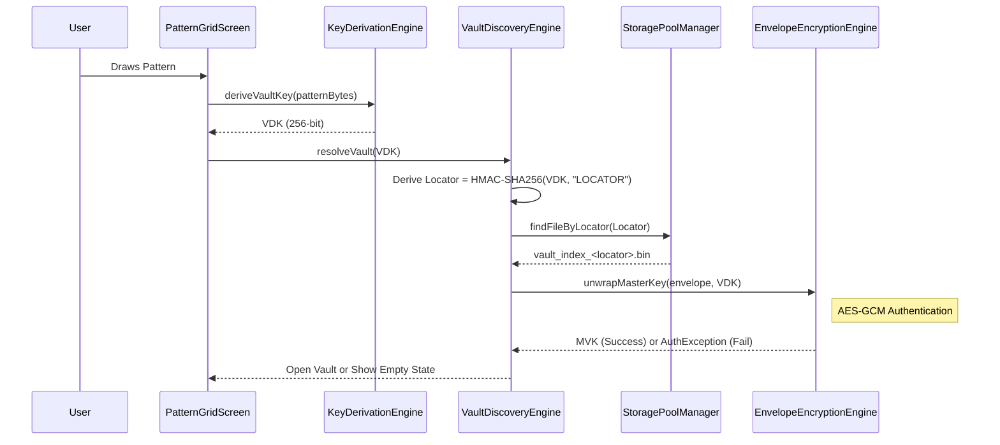

# Implementation — Plausible Deniability & Hidden Vaults

**Role**: Tech Lead / Software Architect  
**Platform**: Android (Kotlin 2.x, javax.crypto)

---

## 1. Architecture Overview

The plausible deniability architecture replaces the "ID-based" vault lookup with "Pattern-addressed" discovery. No central registry exists. Every pattern is a potential key to a vault that may or may not exist on disk.

### Pattern-Addressed Discovery Flow


---

## 2. Fixed-Size Envelope Header (Redesign)

The current `VaultHeader.kt` is a security risk because it leaks `vaultId` and `isDuressDecoy` in plaintext. We replace it with a **Fixed-Size Vault Envelope (96 Bytes)**.

### Header Specification (96 Bytes)
| Offset | Size | Name | Description |
|--------|------|------|-------------|
| 0 | 4 | Magic | `0x56 0x4C 0x54 0x49` ("VLTI") |
| 4 | 1 | Version | `0x01` |
| 5 | 3 | Reserved | Zero-filled |
| 8 | 12 | IV | AES-GCM Nonce |
| 20 | 16 | Tag | AES-GCM Auth Tag |
| 36 | 60 | Ciphertext | Encrypted Payload (see below) |

### Encrypted Payload (60 Bytes)
Encrypted using **VDK** via AES-256-GCM.
- **Master Vault Key (MVK)**: 32 bytes (Random AES-256 key for vault content).
- **Duress Flag**: 1 byte (`0x01` = Duress/Decoy, `0x00` = Normal).
- **Integrity Canary**: 8 bytes (Random constant `0x56 0x41 0x55 0x4C 0x54 0x41 0x49 0x52` to verify successful decryption).
- **Padding**: 19 bytes (Random noise to reach fixed size).

**Security Property**: Since the `isDuressDecoy` flag is inside the encrypted ciphertext, an examiner cannot distinguish a real vault from a decoy vault without the pattern.

---

## 3. Storage Pool Management

To obscure the exact count of vaults, we implement a **64-Slot Padded Pool**.

### `StoragePoolManager`
- **Location**: `D:\CodeWork\VaultApp\android\app\src\main\java\com\vaultaire\android\vault\StoragePoolManager.kt`
- **Function**:
    - Ensures the `vaults/` directory always contains a multiple of 64 files.
    - Real vaults are named `vlt_<locator>.bin`.
    - Cover files are named `vlt_<random_64_chars>.bin`.
    - **Cover File Content**: 96 bytes of cryptographically secure random noise. To a disk observer, a cover file and an encrypted index envelope are indistinguishable (both look like random bytes).

---

## 4. Vault Discovery Algorithm

The `VaultManager` will no longer take a `vaultId`.

```kotlin
/**
 * Discovery Algorithm
 */
fun discoverVault(vdk: SecretKey): VaultSession? {
    // 1. Derive Locator
    val locator = deriveLocator(vdk) // HMAC-SHA256(vdk, "VAULTAIRE_LOCATOR_V1")
    
    // 2. Locate File
    val file = poolManager.getFile(locator)
    if (file == null || !file.exists()) return null
    
    // 3. Attempt Decryption of Envelope
    try {
        val header = readFixedHeader(file)
        val payload = envelopeEngine.decrypt(header.envelope, vdk)
        
        // 4. Verify Integrity Canary
        if (!verifyCanary(payload)) return null
        
        // 5. Extract MVK and Duress Status
        val mvk = extractMvk(payload)
        val isDuress = extractDuressFlag(payload)
        
        // 6. Handle Duress Trigger
        if (isDuress) {
            duressWipeProtocol.triggerSilentWipe(excludeLocator = locator)
        }
        
        return VaultSession(mvk, isDuress)
    } catch (e: SecurityException) {
        // Auth failure (wrong pattern or corrupted file)
        return null
    }
}
```

---

## 5. File Naming & Padding

### Storage Files
- **Naming**: Every file inside a vault is stored in a shared `data/` folder.
- **Filename**: `UUID.randomUUID().toString() + ".dat"`
- **Metadata**: Filenames, sizes, and MIME types are stored **inside the encrypted Index**, not on the filesystem.
- **Plausible Deniability**: Since all vaults share the same folder and use random names, an observer cannot tell which files belong to which vault without opening one.

### Padding Files
- When a vault is deleted, the `StoragePoolManager` must replace the index file with a random cover file immediately.
- The `VaultStorageEngine` should support "Decoy Padding": generating large, random-content files in the shared `data/` folder to obscure the total volume of sensitive data.

---

## 6. Migration Path (Old → New)

Since the current `VaultHeader` leaks metadata, we must force a migration on the first launch of the new version:

1. **Detection**: Identify files using the old `VLTHDR1` magic.
2. **Re-wrap**: On the next successful unlock, the app must:
    - Decrypt the old header.
    - Read the `vaultId` and `isDuressDecoy` flag.
    - Re-encrypt into the new **96-byte Fixed Envelope**.
    - Rename the file to `vlt_<locator>.bin`.
3. **Cleanup**: Delete the old `.vlt` file and ensure the 64-slot pool is populated.

---

## 7. Security Analysis

| Threat | Mitigation |
|--------|------------|
| **Examiner counts vaults** | Padded pool (64 slots) makes the exact count harder to determine (1 vs 5 is hidden; 1 vs 70 is not). |
| **Examiner identifies Duress vault** | `isDuressDecoy` flag is moved inside the AES-GCM encrypted envelope. |
| **Brute-force pattern guessing** | 600,000 PBKDF2 rounds + UI-level attempt throttling (lockout). |
| **Correlation of storage files** | Shared storage folder + random names + decoy padding files. |
| **Offline Verification** | **Known Limit**: Examiner can verify guesses offline by checking if AES-GCM tag matches. This is a property of authenticated encryption. |
