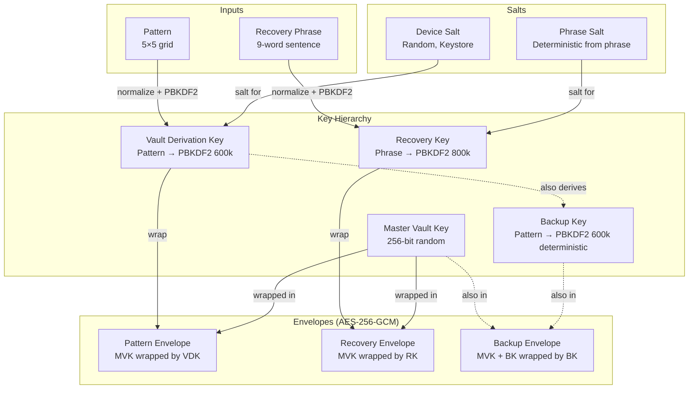

# Secret Phrase — Technical Implementation

## Technical Architecture Diagram



---

## Word List Specification

### Generated Phrases: Grammatical Template System

**NOT BIP-39**. Vaultaire uses a custom grammatical sentence generator with role-specific word lists.

#### Template Structure (9 words)

```
[Article] [Adjective] [Noun] [Verb] [Preposition] [Article] [Adjective] [Noun] [Adverb]
```

Example: "the quiet river flows beneath ancient stone bridges at midnight"

#### Word Lists (English)

| Role | Count | Example Words |
|------|-------|---------------|
| Articles | 3 | the, a, an |
| Adjectives | 500 | quiet, ancient, swift, silent, golden, ... |
| Nouns | 1000 | river, mountain, bridge, shadow, key, ... |
| Verbs | 500 | flows, rests, guards, watches, sleeps, ... |
| Prepositions | 30 | beneath, above, within, beyond, across, ... |
| Adverbs | 200 | silently, swiftly, eternally, quietly, ... |

**Total entropy**: log₂(3 × 500 × 1000 × 500 × 30 × 3 × 500 × 1000 × 200) ≈ **77 bits**

> **Note**: Word lists must be identical between iOS and Android for cross-platform recovery. Ship as embedded resources.

#### Generation Algorithm

```kotlin
fun generatePhrase(): List<String> {
    val random = SecureRandom()
    return listOf(
        pickRandom(articles),
        pickRandom(adjectives),
        pickRandom(nouns),
        pickRandom(verbs),
        pickRandom(prepositions),
        pickRandom(articles),
        pickRandom(adjectives),
        pickRandom(nouns),
        pickRandom(adverbs)
    )
}
```

### Custom Phrases

- **Minimum**: 6 words
- **Maximum**: 24 words
- **Character set**: Unicode letters, spaces, hyphens, apostrophes
- **Validation**: Entropy estimator (see below)

---

## Key Derivation Formula

### Pattern-Derived Keys (Vault Key / Backup Key)

```
VDK = PBKDF2-HMAC-SHA512(
    password = normalizePattern(patternBytes),
    salt = deviceSalt,                    // 32 bytes, random, stored in Keystore
    iterations = 600,000,
    keyLength = 256 bits
)

BK  = PBKDF2-HMAC-SHA512(
    password = normalizePattern(patternBytes),
    salt = "VAULTAIRE_BACKUP_SALT_V1",   // Fixed constant
    iterations = 600,000,
    keyLength = 256 bits
)
```

### Recovery Key (Phrase-Derived)

```
RK = PBKDF2-HMAC-SHA512(
    password = normalizePhrase(phrase),   // lowercase, trim, single spaces
    salt = phraseSalt(phrase),            // Deterministic: HKDF(phrase, "VAULTAIRE_PHRASE_SALT_V1")
    iterations = 800,000,
    keyLength = 256 bits
)
```

### Phrase Salt Derivation (Deterministic, Cross-Platform)

```kotlin
fun derivePhraseSalt(normalizedPhrase: String): ByteArray {
    val ikm = normalizedPhrase.toByteArray(Charsets.UTF_8)
    val salt = "VAULTAIRE_PHRASE_SALT_V1".toByteArray(Charsets.UTF_8)
    val hkdf = Hkdf(ikm, salt, "VAULTAIRE_PHRASE_SALT_V1".toByteArray(Charsets.UTF_8))
    return hkdf.generateKey(32)  // 256-bit salt
}
```

> **Critical**: This salt derivation MUST be identical on iOS and Android. Use standard HKDF-SHA256.

---

## Envelope Structure

### EncryptedEnvelope (Existing — Keep)

```kotlin
data class EncryptedEnvelope(
    val iv: ByteArray,      // 12 bytes (96-bit nonce for GCM)
    val ciphertext: ByteArray  // Encrypted payload + 16-byte GCM tag appended
)
```

### Recovery Envelope Payload

```kotlin
data class RecoveryEnvelopePayload(
    val masterVaultKey: ByteArray,      // 32 bytes (MVK)
    val version: Int = 1,
    val createdAt: Long = System.currentTimeMillis()
)
```

### Pattern Envelope Payload

```kotlin
data class PatternEnvelopePayload(
    val masterVaultKey: ByteArray,      // 32 bytes (MVK) — SAME as recovery
    val version: Int = 1,
    val createdAt: Long = System.currentTimeMillis()
)
```

### Cloud Recovery Manifest (Future)

```kotlin
data class CloudRecoveryManifest(
    val locator: ByteArray,              // 32 bytes (deterministic from phrase)
    val recoveryEnvelope: EncryptedEnvelope,  // MVK wrapped by RK
    val backupEnvelope: EncryptedEnvelope,    // MVK + BK wrapped by BK
    val vaultMetadata: VaultMetadata,
    val version: Int = 1
)
```

---

## Dual-Access Envelope Design

Both envelopes wrap the **same MVK**:

```
┌─────────────────────────────────────────────────────────┐
│                    VAULT CREATION                        │
├─────────────────────────────────────────────────────────┤
│  MVK = SecureRandom(32 bytes)                           │
│                                                         │
│  VDK = PBKDF2(pattern, deviceSalt, 600k)               │
│  PE  = AES-GCM-Encrypt(MVK, VDK)  → Pattern Envelope    │
│                                                         │
│  RK  = PBKDF2(phrase, phraseSalt, 800k)                │
│  RE  = AES-GCM-Encrypt(MVK, RK)    → Recovery Envelope  │
│                                                         │
│  Store: PE, RE, encryptedPhrase                         │
└─────────────────────────────────────────────────────────┘
```

**Recovery**: `RK` decrypts `RE` → `MVK` → new `VDK` from new pattern → new `PE` → new `RK` from new phrase → new `RE`

---

## Class Interfaces & Responsibilities

### 1. RecoveryPhraseEngine (Redesign Required)

```kotlin
package com.vaultaire.android.crypto

import javax.crypto.SecretKey
import javax.crypto.SecretKeyFactory
import javax.crypto.spec.PBEKeySpec
import javax.crypto.spec.SecretKeySpec

/**
 * Handles all recovery phrase operations:
 * - Generation (grammatical 9-word sentences)
 * - Validation (custom phrases ≥6 words, strength estimation)
 * - Normalization
 * - Key derivation (PBKDF2-HMAC-SHA512, 800k, phrase-derived salt)
 */
class RecoveryPhraseEngine(
    private val wordLists: WordLists,
    private val strengthEstimator: PhraseStrengthEstimator
) {

    companion object {
        const val GENERATED_WORD_COUNT = 9
        const val CUSTOM_MIN_WORDS = 6
        const val CUSTOM_MAX_WORDS = 24
        const val PBKDF2_ITERATIONS = 800_000
        const val KEY_LENGTH_BITS = 256
        const val PHRASE_SALT_LABEL = "VAULTAIRE_PHRASE_SALT_V1"
        const val KDF_ALGORITHM = "PBKDF2WithHmacSHA512"
    }

    /**
     * Generates a cryptographically secure 9-word grammatical phrase.
     * @return List of 9 words in grammatical order
     */
    fun generatePhrase(): List<String>

    /**
     * Validates a custom phrase.
     * @param words List of words (6-24)
     * @return ValidationResult (valid, or error reason)
     */
    fun validateCustomPhrase(words: List<String>): ValidationResult

    /**
     * Normalizes a phrase for deterministic key derivation.
     * Lowercase, trim, single spaces, NFKC normalization.
     */
    fun normalizePhrase(words: List<String>): String

    /**
     * Derives the 256-bit Recovery Key from a normalized phrase.
     * Uses deterministic phrase-derived salt (NOT device salt).
     * @param normalizedPhrase Output of normalizePhrase()
     * @return 256-bit AES SecretKey
     */
    fun deriveRecoveryKey(normalizedPhrase: String): SecretKey

    /**
     * Derives the deterministic phrase salt for cross-platform compatibility.
     */
    fun derivePhraseSalt(normalizedPhrase: String): ByteArray

    /**
     * Estimates entropy of a phrase (for custom phrase validation).
     */
    fun estimateEntropy(words: List<String>): Double
}
```

### 2. WordLists (New)

```kotlin
package com.vaultaire.android.crypto

/**
 * Immutable word lists for grammatical phrase generation.
 * Must match iOS word lists exactly for cross-platform compatibility.
 * Loaded from embedded JSON resource.
 */
data class WordLists(
    val articles: List<String>,       // 3 words
    val adjectives: List<String>,     // ~500 words
    val nouns: List<String>,          // ~1000 words
    val verbs: List<String>,          // ~500 words
    val prepositions: List<String>,   // ~30 words
    val adverbs: List<String>         // ~200 words
) {
    companion object {
        fun loadFromResources(context: Context): WordLists
    }
}
```

**Resource**: `res/raw/word_lists_en.json` (include in APK)

```json
{
  "articles": ["the", "a", "an"],
  "adjectives": ["quiet", "ancient", "swift", "..."],
  "nouns": ["river", "mountain", "bridge", "..."],
  "verbs": ["flows", "rests", "guards", "..."],
  "prepositions": ["beneath", "above", "within", "..."],
  "adverbs": ["silently", "swiftly", "eternally", "..."]
}
```

### 3. PhraseStrengthEstimator (New)

```kotlin
package com.vaultaire.android.crypto

/**
 * Estimates phrase entropy and rejects weak phrases.
 * Used for custom phrase validation.
 */
class PhraseStrengthEstimator(
    private val commonPhraseList: Set<String>,  // Top 10k common phrases
    private val dictionaryWords: Set<String>    // Common dictionary words
) {

    data class Result(
        val entropyBits: Double,
        val isAcceptable: Boolean,
        val rejectionReason: String?
    )

    /**
     * Estimates entropy and validates against policy.
     * @param words Normalized word list
     * @return Result with entropy and accept/reject decision
     */
    fun estimate(words: List<String>): Result

    private fun hasRepetitivePattern(words: List<String>): Boolean
    private fun isCommonPhrase(words: List<String>): Boolean
    private fun calculateEntropy(words: List<String>): Double
}
```

**Policy**:
- Minimum entropy: **50 bits** (for custom phrases)
- Reject: Common phrases (quotes, lyrics, proverbs)
- Reject: Repetitive patterns ("word word word word word word")
- Reject: Sequential dictionary words

### 4. RecoveryEnvelopeManager (New)

```kotlin
package com.vaultaire.android.crypto

import com.vaultaire.android.crypto.EnvelopeEncryptionEngine.EncryptedEnvelope

/**
 * Manages the dual-envelope system: Pattern Envelope + Recovery Envelope.
 * Both envelopes wrap the SAME Master Vault Key.
 */
class RecoveryEnvelopeManager(
    private val envelopeEngine: EnvelopeEncryptionEngine,
    private val phraseEngine: RecoveryPhraseEngine,
    private val keyDerivation: KeyDerivationEngine,
    private val secureStorage: SecureStorage
) {

    data class VaultEnvelopes(
        val patternEnvelope: EncryptedEnvelope,
        val recoveryEnvelope: EncryptedEnvelope,
        val encryptedPhrase: ByteArray,  // Phrase encrypted for settings display
        val phraseVersion: Int = 1
    )

    /**
     * Creates both envelopes during vault creation.
     * @param masterKey The MVK (32 bytes)
     * @param patternBytes Normalized pattern bytes
     * @param phraseWords 9-word generated phrase
     * @return VaultEnvelopes containing both envelopes + encrypted phrase
     */
    fun createEnvelopes(
        masterKey: SecretKey,
        patternBytes: ByteArray,
        phraseWords: List<String>
    ): VaultEnvelopes

    /**
     * Recovers MVK using recovery phrase (local recovery).
     * @param phraseWords User-entered phrase words
     * @return Master Vault Key if phrase is correct
     * @throws InvalidPhraseException if phrase wrong
     */
    fun recoverWithPhrase(phraseWords: List<String>): SecretKey

    /**
     * Recovers MVK using pattern (normal unlock).
     * @param patternBytes Normalized pattern bytes
     * @return Master Vault Key if pattern is correct
     * @throws InvalidPatternException if pattern wrong
     */
    fun unlockWithPattern(patternBytes: ByteArray): SecretKey

    /**
     * Rotates envelopes after pattern change.
     * Generates new phrase, new recovery envelope, new pattern envelope.
     * MVK remains the same.
     * @param masterKey Current MVK
     * @param newPatternBytes New pattern
     * @return New VaultEnvelopes
     */
    fun rotateEnvelopes(masterKey: SecretKey, newPatternBytes: ByteArray): VaultEnvelopes

    /**
     * Gets the current recovery phrase for settings display.
     * Decrypts from secure storage.
     */
    fun getRecoveryPhrase(): List<String>
}
```

### 5. SecureStorage (New — Android Keystore Integration)

```kotlin
package com.vaultaire.android.crypto

import android.content.Context
import androidx.security.crypto.EncryptedSharedPreferences
import androidx.security.crypto.MasterKeys

/**
 * Android Keystore-backed encrypted storage for:
 * - Device salt (for pattern derivation)
 * - Recovery phrase (encrypted, retrievable for settings)
 * - Recovery envelope
 * - Pattern envelope
 */
class SecureStorage(private val context: Context) {

    private val prefs: SharedPreferences by lazy {
        val masterKeyAlias = MasterKeys.getOrCreate(MasterKeys.AES256_GCM_SPEC)
        EncryptedSharedPreferences.create(
            "vaultaire_secrets",
            masterKeyAlias,
            context,
            EncryptedSharedPreferences.PrefKeyEncryptionScheme.AES256_SIV,
            EncryptedSharedPreferences.PrefValueEncryptionScheme.AES256_GCM
        )
    }

    // Device salt (for pattern KDF)
    fun saveDeviceSalt(salt: ByteArray)
    fun getDeviceSalt(): ByteArray?
    fun hasDeviceSalt(): Boolean

    // Recovery phrase (encrypted, for settings display)
    fun saveEncryptedPhrase(phraseWords: List<String>)
    fun getEncryptedPhrase(): List<String>?

    // Envelopes
    fun savePatternEnvelope(envelope: EncryptedEnvelope)
    fun getPatternEnvelope(): EncryptedEnvelope?
    fun saveRecoveryEnvelope(envelope: EncryptedEnvelope)
    fun getRecoveryEnvelope(): EncryptedEnvelope?

    // Cloud recovery manifest (future)
    fun saveCloudManifest(manifest: CloudRecoveryManifest)
    fun getCloudManifest(): CloudRecoveryManifest?

    // Clear all (vault deletion)
    fun clearAll()
}
```

### 6. PhraseEntryViewModel (New — UI Logic)

```kotlin
package com.vaultaire.android.ui.recovery

import androidx.lifecycle.ViewModel
import androidx.lifecycle.viewModelScope
import com.vaultaire.android.crypto.RecoveryEnvelopeManager
import com.vaultaire.android.crypto.RecoveryPhraseEngine
import kotlinx.coroutines.flow.MutableStateFlow
import kotlinx.coroutines.flow.asStateFlow
import kotlinx.coroutines.launch

/**
 * ViewModel for phrase entry screens (recovery, settings display).
 */
class PhraseEntryViewModel(
    private val phraseEngine: RecoveryPhraseEngine,
    private val envelopeManager: RecoveryEnvelopeManager,
    private val secureStorage: SecureStorage
) : ViewModel() {

    // State
    private val _state = MutableStateFlow<PhraseEntryState>(PhraseEntryState.Idle)
    val state: StateFlow<PhraseEntryState> = _state.asStateFlow()

    // Recovery flow
    fun onPhraseEntered(words: List<String>) {
        viewModelScope.launch {
            _state.value = PhraseEntryState.Validating
            try {
                val mvk = envelopeManager.recoverWithPhrase(words)
                _state.value = PhraseEntryState.Success(mvk)
            } catch (e: InvalidPhraseException) {
                _state.value = PhraseEntryState.Error("Phrase not recognized")
            }
        }
    }

    // Settings display flow
    fun loadPhraseForDisplay() {
        viewModelScope.launch {
            _state.value = PhraseEntryState.Loading
            try {
                val phrase = secureStorage.getEncryptedPhrase() ?: throw IllegalStateException("No phrase stored")
                _state.value = PhraseEntryState.PhraseLoaded(phrase)
            } catch (e: Exception) {
                _state.value = PhraseEntryState.Error("Failed to load phrase")
            }
        }
    }

    // Clipboard handling
    fun onCopyPhrase(phrase: List<String>) {
        val normalized = phraseEngine.normalizePhrase(phrase)
        ClipboardManager.setText(normalized)
        // Auto-clear after 60s
        Handler(Looper.getMainLooper()).postDelayed({ ClipboardManager.clear() }, 60_000)
    }
}

sealed interface PhraseEntryState {
    data class Idle : PhraseEntryState
    data class Validating : PhraseEntryState
    data class Success(val masterKey: SecretKey) : PhraseEntryState
    data class PhraseLoaded(val words: List<String>) : PhraseEntryState
    data class Loading : PhraseEntryState
    data class Error(val message: String) : PhraseEntryState
}
```

---

## Integration with Vault Creation & Pattern Reset

### Vault Creation Flow (Updated)

```kotlin
// In VaultCreationViewModel
fun createVault(patternPoints: List<PatternPoint>) {
    // 1. Normalize pattern
    val patternBytes = PatternUtils.normalizePattern(patternPoints)

    // 2. Generate MVK
    val masterKey = envelopeEngine.generateMasterVaultKey()

    // 3. Derive VDK & create Pattern Envelope
    val vaultKey = keyDerivation.deriveVaultKey(patternBytes)
    val patternEnvelope = envelopeEngine.wrapMasterKey(masterKey, vaultKey)

    // 4. Generate recovery phrase
    val phraseWords = phraseEngine.generatePhrase()

    // 5. Derive RK & create Recovery Envelope
    val normalizedPhrase = phraseEngine.normalizePhrase(phraseWords)
    val recoveryKey = phraseEngine.deriveRecoveryKey(normalizedPhrase)
    val recoveryEnvelope = envelopeEngine.wrapMasterKey(masterKey, recoveryKey)

    // 6. Store everything
    secureStorage.saveDeviceSalt(saltManager.getOrCreateDeviceSalt())
    secureStorage.savePatternEnvelope(patternEnvelope)
    secureStorage.saveRecoveryEnvelope(recoveryEnvelope)
    secureStorage.saveEncryptedPhrase(phraseWords)

    // 7. Show phrase to user (FLAG_SECURE screen)
    // 8. On confirmation → vault ready
}
```

### Pattern Reset Flow (Updated)

```kotlin
// In PatternResetViewModel
fun resetPatternWithPhrase(phraseWords: List<String>, newPatternPoints: List<PatternPoint>) {
    // 1. Recover MVK via phrase
    val masterKey = envelopeManager.recoverWithPhrase(phraseWords)

    // 2. Derive new VDK from new pattern
    val newPatternBytes = PatternUtils.normalizePattern(newPatternPoints)
    val newVaultKey = keyDerivation.deriveVaultKey(newPatternBytes)

    // 3. Create new Pattern Envelope
    val newPatternEnvelope = envelopeEngine.wrapMasterKey(masterKey, newVaultKey)

    // 4. Generate NEW recovery phrase
    val newPhraseWords = phraseEngine.generatePhrase()
    val newNormalizedPhrase = phraseEngine.normalizePhrase(newPhraseWords)
    val newRecoveryKey = phraseEngine.deriveRecoveryKey(newNormalizedPhrase)

    // 5. Create new Recovery Envelope
    val newRecoveryEnvelope = envelopeEngine.wrapMasterKey(masterKey, newRecoveryKey)

    // 6. Store new envelopes + new phrase
    secureStorage.savePatternEnvelope(newPatternEnvelope)
    secureStorage.saveRecoveryEnvelope(newRecoveryEnvelope)
    secureStorage.saveEncryptedPhrase(newPhraseWords)

    // 7. Show NEW phrase to user (must confirm)
}
```

---

## Platform Adaptations for Android

| iOS Feature | Android Equivalent |
|-------------|-------------------|
| iOS Keychain `WhenUnlockedThisDeviceOnly` | `EncryptedSharedPreferences` with Keystore-backed MasterKey (StrongBox preferred) |
| `FLAG_SECURE` on phrase screen | `WindowManager.LayoutParams.FLAG_SECURE` on Activity/Dialog |
| Keychain biometric protection | `BiometricPrompt` + `CryptoObject` for Keystore key auth |
| CloudKit private database | Google Drive App Folder (or user-selected folder) |
| Deterministic phrase locator | HKDF(phrase, "VAULTAIRE_LOCATOR_V1") → 32-byte ID |
| App background memory clearing | `onTrimMemory(TRIM_MEMORY_COMPLETE)` + `MemoryHygiene.wipe()` |
| Secure random | `SecureRandom` (Linux `/dev/urandom` backed) |
| PBKDF2 | `SecretKeyFactory.getInstance("PBKDF2WithHmacSHA512")` |
| AES-256-GCM | `Cipher.getInstance("AES/GCM/NoPadding")` with 12-byte IV, 128-bit tag |

### Android-Specific Security Hardening

```kotlin
// Phrase Display Activity - FLAG_SECURE
class PhraseDisplayActivity : AppCompatActivity() {
    override fun onCreate(savedInstanceState: Bundle?) {
        // MUST be set before setContentView
        window.setFlags(
            WindowManager.LayoutParams.FLAG_SECURE,
            WindowManager.LayoutParams.FLAG_SECURE
        )
        super.onCreate(savedInstanceState)
        setContentView(R.layout.activity_phrase_display)
        // ... disable accessibility for phrase TextView
        phraseTextView.importantForAccessibility = View.IMPORTANT_FOR_ACCESSIBILITY_NO
        phraseTextView.importantForAutofill = View.IMPORTANT_FOR_AUTOFILL_NO
    }
}

// Clipboard auto-clear
fun copyPhraseToClipboard(context: Context, phrase: String) {
    val clipboard = context.getSystemService(Context.CLIPBOARD_SERVICE) as ClipboardManager
    val clip = ClipData.newPlainText("Recovery Phrase", phrase)
    clipboard.setPrimaryClip(clip)

    // Auto-clear after 60 seconds
    Handler(Looper.getMainLooper()).postDelayed({
        if (clipboard.primaryClip == clip) {
            clipboard.primaryClip = null
        }
    }, 60_000)
}

// Memory hygiene for phrase strings
fun wipePhraseWords(words: List<String>) {
    // Strings are immutable in Java/Kotlin - can't truly wipe
    // Best practice: use CharArray during processing, wipe after
    // For stored phrase: only keep encrypted in Keystore
}
```

---

## Security Considerations

### Phrase Never Stored in Plaintext

| Location | Protection |
|----------|------------|
| During generation | In-memory only, `CharArray` wiped after use |
| Secure storage | Encrypted via `EncryptedSharedPreferences` (Keystore-backed) |
| Settings display | Decrypted on-demand, displayed in FLAG_SECURE Activity |
| Cloud backup | Never uploaded; only deterministic locator + encrypted manifest |

### Screenshot / Screen Recording Prevention

```kotlin
// Applied to ANY Activity/Fragment showing the phrase
window.setFlags(
    WindowManager.LayoutParams.FLAG_SECURE,
    WindowManager.LayoutParams.FLAG_SECURE
)

// Also disable:
- View.IMPORTANT_FOR_ACCESSIBILITY_NO (prevent TalkBack reading)
- View.IMPORTANT_FOR_AUTOFILL_NO (prevent autofill suggestions)
- textNoSuggestions on any input fields
```

### Clipboard Handling

- Copy button copies **normalized phrase** (single spaces, lowercase)
- Auto-clear after **60 seconds** via `Handler`
- Show toast: "Copied — clears from clipboard in 60 seconds"
- On app background (`onPause`): clear clipboard if our clip

### Timing Attack Mitigation

```kotlin
fun recoverWithPhrase(phraseWords: List<String>): SecretKey {
    val normalized = phraseEngine.normalizePhrase(phraseWords)
    val recoveryKey = phraseEngine.deriveRecoveryKey(normalized)
    val envelope = secureStorage.getRecoveryEnvelope() 
        ?: throw InvalidPhraseException()

    // ALWAYS attempt decryption (even if envelope missing)
    // Use constant-time comparison for GCM tag validation
    return try {
        envelopeEngine.unwrapMasterKey(envelope, recoveryKey)
    } catch (e: AEADBadTagException) {
        // Same error message regardless of failure reason
        throw InvalidPhraseException()
    }
}
```

---

## Performance Characteristics

| Operation | Target (Modern Device) | Notes |
|-----------|------------------------|-------|
| Phrase generation | < 50ms | SecureRandom + list picks |
| Phrase validation | < 200ms | Entropy estimation + dictionary check |
| PBKDF2 (800k, SHA-512) | 800-1500ms | Varies by device; run on IO thread |
| Envelope encrypt/decrypt | < 10ms | AES-GCM hardware accelerated |
| Total recovery unlock | < 2s | PBKDF2 dominant |
| Total vault creation | < 3s | 2× PBKDF2 (600k + 800k) |

### Threading

```kotlin
// All crypto operations on IO dispatcher
withContext(Dispatchers.IO) {
    val recoveryKey = phraseEngine.deriveRecoveryKey(normalizedPhrase)
    val mvk = envelopeEngine.unwrapMasterKey(envelope, recoveryKey)
}
```

### Optimization Notes

- **PBKDF2 800k** is expensive; consider:
  - Show progress indicator during recovery
  - Cache derived RK briefly if user retries (max 30s)
  - Use `SecretKeyFactory` (JCA) — hardware accelerated on some devices
- **Word lists**: Load once at startup, keep in memory (~2MB)

---

## Migration from Current Code

### Breaking Changes Required

| Current | Required | Migration |
|---------|----------|-----------|
| `RecoveryPhraseEngine.deriveRecoveryKeyFromPhrase(mnemonicWords: List<String>)`: requires 12 words | `deriveRecoveryKey(normalizedPhrase: String)`: 9 words, phrase-derived salt | **Replace entirely** |
| `KeyDerivationEngine.ITERATIONS = 600_000` (for recovery) | `RecoveryPhraseEngine.PBKDF2_ITERATIONS = 800_000` | Separate constants |
| Device salt used for recovery | Phrase-derived deterministic salt | New `derivePhraseSalt()` |
| No phrase generation | Grammatical 9-word generator | New `WordLists` + `generatePhrase()` |
| No custom phrase support | Custom phrase validation (≥6 words) | New `PhraseStrengthEstimator` |
| No phrase storage | Encrypted phrase in Keystore | New `SecureStorage` |
| No FLAG_SECURE | Phrase display with FLAG_SECURE | New Activity |

### Backward Compatibility

- **Existing vaults**: Cannot migrate (different phrase format, different KDF params)
- **Migration path**: User must create new vault; old vault unrecoverable without old phrase
- **Document clearly**: "Vaultaire Android v2.0 uses new 9-word phrase format. Existing vaults require pattern unlock."

---

## Dependencies

```kotlin
// build.gradle.kts
dependencies {
    // AndroidX Security (EncryptedSharedPreferences, MasterKeys)
    implementation("androidx.security:security-crypto:1.1.0-alpha06")

    // Biometric (for Keystore auth)
    implementation("androidx.biometric:biometric:1.2.0-alpha04")

    // Google Drive API (future cloud backup)
    // implementation("com.google.android.gms:play-services-drive:17.0.0")

    // Kotlinx Coroutines
    implementation("org.jetbrains.kotlinx:kotlinx-coroutines-android:1.8.0")

    // Lifecycle ViewModel
    implementation("androidx.lifecycle:lifecycle-viewmodel-compose:2.7.0")
}
```

---

## File Structure

```
app/src/main/java/com/vaultaire/android/
├── crypto/
│   ├── RecoveryPhraseEngine.kt           # REPLACE
│   ├── WordLists.kt                      # NEW
│   ├── PhraseStrengthEstimator.kt        # NEW
│   ├── RecoveryEnvelopeManager.kt        # NEW
│   ├── SecureStorage.kt                  # NEW
│   ├── EnvelopeEncryptionEngine.kt       # KEEP (minor updates)
│   ├── KeyDerivationEngine.kt            # KEEP (pattern only)
│   ├── MemoryHygiene.kt                  # KEEP
│   ├── PatternUtils.kt                   # KEEP
│   └── exceptions/
│       ├── InvalidPhraseException.kt     # NEW
│       └── InvalidPatternException.kt    # NEW
├── ui/
│   ├── recovery/
│   │   ├── PhraseEntryViewModel.kt       # NEW
│   │   ├── PhraseDisplayActivity.kt      # NEW (FLAG_SECURE)
│   │   ├── PhraseEntryScreen.kt          # NEW (Compose)
│   │   └── RecoveryFlowScreen.kt         # NEW (Compose)
│   └── vault/
│       └── VaultCreationViewModel.kt     # UPDATE
└── res/
    ├── raw/
    │   └── word_lists_en.json            # NEW
    └── layout/
        └── activity_phrase_display.xml   # NEW
```

---

## Cross-Platform Compatibility Checklist

- [ ] Word lists identical (JSON resource shared or generated from same source)
- [ ] Phrase normalization identical (NFKC, lowercase, trim, single space)
- [ ] Phrase salt derivation identical (HKDF-SHA256, same label)
- [ ] PBKDF2 parameters identical (HMAC-SHA512, 800k, 256-bit)
- [ ] Envelope format identical (AES-256-GCM, 12-byte IV, 128-bit tag)
- [ ] Cloud locator derivation identical (HKDF-SHA256, same label)
- [ ] Cloud manifest format identical (protobuf/JSON schema shared)