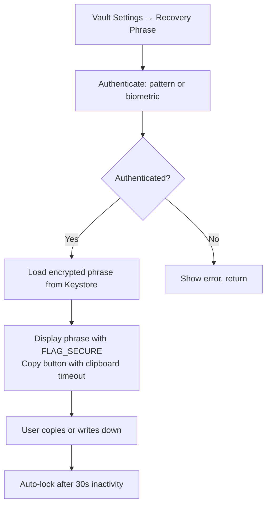
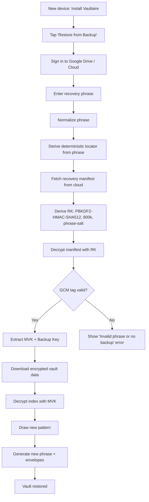

# Secret Phrase — Product Planning

## User Stories

### Core Recovery Stories

1. **As a new user creating my first vault**, I want Vaultaire to generate a memorable nine-word recovery sentence so that I can recover my vault if I forget my pattern.

2. **As a user who prefers my own recovery phrase**, I want to supply a custom phrase of at least six words so that I can use something personally meaningful (while still passing strength validation).

3. **As a user who has forgotten my pattern**, I want to enter my recovery phrase and regain access to my vault so that I don't lose my data permanently.

4. **As a user setting up Vaultaire on a new device**, I want to restore my vault from encrypted cloud backup using my recovery phrase so that I don't need my old device.

### Phrase Management Stories

5. **As a user who wants to verify my backup**, I want to view my recovery phrase in vault settings (after authenticating) so that I can confirm I saved it correctly.

6. **As a user changing my pattern**, I want Vaultaire to generate a new recovery phrase and envelope so that the old phrase becomes invalid and I must save the new one.

7. **As a security-conscious user**, I want the recovery phrase display to prevent screenshots and screen recording so that my phrase isn't accidentally captured in my gallery or cloud sync.

8. **As a user copying my phrase**, I want the clipboard to auto-clear after a short timeout so that the phrase doesn't linger in clipboard history.

### Edge Case Stories

9. **As a user who lost both pattern AND phrase**, I want to understand that my data is unrecoverable (no provider reset) so that I take backup seriously.

10. **As a user entering an invalid phrase**, I want clear feedback (wrong word count, unknown words, wrong order) so that I can correct my entry.

---

## User Flows

### Flow 1: Vault Creation with Phrase Generation

```mermaid
flowchart TD
    A[User taps Create Vault] --> B[Draw pattern 2x confirmation]
    B --> C[Generate MVK + device salt]
    C --> D[Derive VDK from pattern + device salt<br/>(PBKDF2-HMAC-SHA512, 600k iter)]
    D --> E[Wrap MVK with VDK → Pattern Envelope]
    E --> F[Generate 9-word grammatical phrase<br/>(cryptographically secure random)]
    F --> G[Validate phrase strength]
    G --> H[Derive RK from phrase<br/>(PBKDF2-HMAC-SHA512, 800k iter, phrase-derived salt)]
    H --> I[Wrap MVK with RK → Recovery Envelope]
    I --> J[Store both envelopes + encrypted phrase in Keystore]
    J --> K[Display phrase with 'Write it down' UI<br/>FLAG_SECURE enabled]
    K --> L[User confirms saved]
    L --> M[Vault ready]
```

**Key Screens:**
1. Pattern drawing (2x)
2. Phrase generation animation
3. **Phrase Display Screen** (full-screen, FLAG_SECURE, no screenshots)
   - Large, readable 9 words in grammatical sentence format
   - "Write this down on paper" instruction
   - "I've saved it" button (enabled after 10s delay)
4. Confirmation screen

---

### Flow 2: Phrase Display & Backup (Settings)



**Key Screens:**
- Settings entry point
- Re-authentication prompt
- Phrase display (same security as creation)

---

### Flow 3: Pattern Reset via Phrase (Local Recovery)

```mermaid
flowchart TD
    A[Lock screen → Forgot Pattern?] --> B[Recovery phrase entry screen]
    B --> C[Enter 9 words (order matters)]
    C --> D[Normalize: lowercase, trim, single spaces]
    D --> E[Derive RK: PBKDF2-HMAC-SHA512, 800k, phrase-salt]
    E --> F[Decrypt Recovery Envelope with RK]
    F --> G{GCM tag valid?}
    G -->|Yes| H[Extract MVK]
    G -->|No| I[Show 'Invalid phrase' error]
    H --> J[Derive new VDK from new pattern]
    J --> K[Wrap MVK with new VDK → new Pattern Envelope]
    K --> L[Generate NEW recovery phrase + envelope]
    L --> M[Store new envelopes + phrase]
    M --> N[Display new phrase → User confirms]
    N --> O[Vault unlocked with new pattern]
```

**Key Screens:**
1. "Forgot Pattern?" link on lock screen
2. Word entry (9 fields, auto-advance, paste support)
3. Processing indicator
4. New pattern drawing (2x)
5. New phrase display (same as Flow 1)

---

### Flow 4: Vault Restore via Phrase (Cloud Backup)



**Key Screens:**
1. Welcome → Restore from Backup
2. Cloud sign-in
3. Phrase entry
4. Progress (downloading/decrypting)
5. New pattern + new phrase

---

## Acceptance Criteria

### Vault Creation with Phrase Generation

| ID | Given | When | Then |
|----|-------|------|------|
| AC-01 | User creates new vault | Vault creation completes | 9-word grammatical phrase generated using cryptographically secure randomness |
| AC-02 | Phrase generated | User views phrase | Phrase follows grammatical template (e.g., "The quick brown fox jumps over lazy dogs") |
| AC-03 | Phrase displayed | Screen is active | FLAG_SECURE prevents screenshots/screen recording |
| AC-04 | User taps "I've saved it" | After minimum 10s delay | Button enables; vault becomes accessible |
| AC-05 | Phrase generated | Internally | Recovery envelope created with MVK wrapped by phrase-derived RK (800k PBKDF2) |
| AC-06 | Phrase generated | Internally | Pattern envelope created with MVK wrapped by pattern-derived VDK (600k PBKDF2) |
| AC-07 | Both envelopes exist | Internally | Both envelopes decrypt to the SAME MVK |

### Custom Phrase Support

| ID | Given | When | Then |
|----|-------|------|------|
| AC-08 | User chooses custom phrase | Enters ≥6 words | Phrase accepted if passes strength estimator |
| AC-09 | User enters <6 words | Submits | Rejected with clear error |
| AC-10 | User enters weak phrase (common words) | Submits | Rejected with strength guidance |
| AC-11 | Custom phrase accepted | Vault created | Same envelope structure as generated phrase |

### Phrase Display in Settings

| ID | Given | When | Then |
|----|-------|------|------|
| AC-12 | Vault unlocked | User navigates to Settings → Recovery Phrase | Re-authentication required (pattern/biometric) |
| AC-13 | Re-authenticated | Phrase displayed | FLAG_SECURE active; phrase shown in grammatical format |
| AC-14 | User taps Copy | Phrase copied | Clipboard auto-clears after 60 seconds |
| AC-15 | 30s inactivity | Phrase screen | Auto-locks, returns to settings |

### Pattern Reset via Phrase (Local)

| ID | Given | When | Then |
|----|-------|------|------|
| AC-16 | User forgot pattern | Taps "Forgot Pattern?" | Recovery phrase entry screen shown |
| AC-17 | Valid phrase entered | Submitted | MVK recovered; new pattern flow starts |
| AC-18 | Invalid phrase entered | Submitted | Clear error: "Phrase not recognized" (no timing leak) |
| AC-19 | Recovery successful | New pattern set | **New recovery phrase generated**; old phrase invalidated |
| AC-20 | Recovery successful | New phrase displayed | User must confirm new phrase before vault access |

### Vault Restore via Phrase (Cloud)

| ID | Given | When | Then |
|----|-------|------|------|
| AC-21 | New device, cloud backup exists | User enters valid phrase | Vault restored with all files |
| AC-22 | New device, no cloud backup | User enters valid phrase | Error: "No encrypted backup found for this phrase" |
| AC-23 | Wrong phrase entered | Submitted | Error: "Phrase not recognized" |
| AC-24 | Restore successful | Vault opens | New pattern + new phrase generated |

### Phrase Validation Rules

| Rule | Specification |
|------|---------------|
| Word Count (Generated) | Exactly 9 words |
| Word Count (Custom) | 6–24 words |
| Word Source (Generated) | Pre-defined grammatical word lists (articles, adjectives, nouns, verbs, prepositions) |
| Word Source (Custom) | Any words; validated against entropy estimator |
| Normalization | Lowercase, single spaces, trim, Unicode NFKC |
| Strength Estimator | Rejects common phrases, dictionary quotes, repetitive patterns; min entropy threshold |

---

## Edge Cases

### Total Loss Scenario (Forgotten Pattern + Forgotten Phrase)

| Scenario | Behavior |
|----------|----------|
| Local vault only, no phrase, no pattern | **Data unrecoverable** — no provider reset, no backdoor |
| Cloud backup exists, no phrase, no pattern | **Data unrecoverable** — cloud backup encrypted with phrase-derived key |
| Cloud backup exists, pattern remembered | Can restore via pattern-derived backup key (separate from recovery phrase) |
| Device lost, cloud backup exists, phrase remembered | Full restore possible on new device |

**UI Requirement**: Clear, unambiguous messaging at every recovery entry point:
> "If you lose both your pattern and your recovery phrase, your data cannot be recovered. Vaultaire has no account reset or backdoor."

### Phrase Validation Edge Cases

| Input | Expected Result |
|-------|-----------------|
| Empty string | "Please enter your recovery phrase" |
| 5 words (custom) | "Phrase must contain at least 6 words" |
| 8 words (generated) | "Phrase must contain exactly 9 words" |
| 10 words (generated) | "Phrase must contain exactly 9 words" |
| Valid words, wrong order | "Phrase not recognized" (generic, no timing leak) |
| Valid phrase, extra whitespace | Normalized → accepted |
| Valid phrase, mixed case | Normalized → accepted |
| Unicode lookalikes (homoglyphs) | NFKC normalized → rejected if not in word list |
| Phrase with numbers/symbols | Rejected (generated phrases never contain these) |

### Concurrency & State

| Scenario | Handling |
|----------|----------|
| App backgrounded during phrase display | Auto-lock, clear phrase from UI, require re-auth |
| Screen rotation during phrase entry | Preserve entered words |
| Multiple "Forgot Pattern?" taps | Single recovery flow; prevent duplicate |
| Pattern change during recovery flow | Cancel recovery, restart |

---

## UX: Secure Phrase Display

### Screen Security Requirements

| Requirement | Android Implementation |
|-------------|------------------------|
| Prevent screenshots | `WindowManager.LayoutParams.FLAG_SECURE` on phrase display Activity/Dialog |
| Prevent screen recording | FLAG_SECURE also blocks MediaProjection |
| Prevent remote desktop view | FLAG_SECURE |
| Prevent clipboard persistence | ClipboardManager with `setPrimaryClip` + delayed clear (60s) via handler |
| Prevent autocomplete/suggestions | `android:importantForAutofill="no"` on word fields; `textNoSuggestions` |
| Prevent accessibility reading | `importantForAccessibility="no"` on phrase TextView (or custom AccessibilityDelegate) |
| Auto-lock on inactivity | 30s countdown timer; clear phrase, return to settings |

### Phrase Display Layout

```
┌─────────────────────────────────────┐
│  ⚠️  Your Recovery Phrase           │
│                                     │
│  Write this down on paper.          │
│  Do not store digitally.            │
│                                     │
│  ┌─────────────────────────────┐   │
│  │ the  quiet  river  flows    │   │
│  │ beneath  ancient  stone     │   │
│  │ bridges  at  midnight       │   │
│  └─────────────────────────────┘   │
│                                     │
│  [Copy]                    [Done]   │
│                                     │
│  Auto-locks in 30s                  │
└─────────────────────────────────────┘
```

- **Font**: Monospace, large (24sp), high contrast
- **Word grouping**: 3 words per line for readability
- **Copy button**: Copies normalized phrase (single spaces); shows toast "Copied — clears in 60s"
- **Done button**: Only enabled after 10s (creation flow) or immediately (settings view)

### Backup/Restore Workflow Design

#### Local Backup (Implicit)
- Recovery phrase + envelopes stored in **Android Keystore**-backed EncryptedSharedPreferences
- Phrase encrypted with Keystore-bound key (biometric/strongbox backed)
- Envelopes stored alongside phrase

#### Cloud Backup (Future — Google Drive)
- Deterministic locator: `HKDF(phrase, "VAULTAIRE_LOCATOR_V1")` → 32-byte ID
- Recovery manifest: `{ mvkEnvelope, backupKeyEnvelope, vaultMetadata }` encrypted with RK
- Upload to user's Google Drive (App Folder or specific folder)
- Restore: phrase → locator → fetch manifest → decrypt with RK → extract MVK

---

## Success Metrics

| Metric | Target |
|--------|--------|
| Phrase generation time | < 500ms (800k PBKDF2 on modern Android) |
| Phrase validation time | < 200ms |
| Recovery unlock time | < 2s (includes PBKDF2 + envelope decrypt) |
| Phrase display auto-lock | 30s inactivity |
| Clipboard clear delay | 60s |
| User completion rate (phrase backup) | > 95% |
| Recovery success rate (valid phrase) | 100% |
| False rejection rate (valid phrase) | 0% |