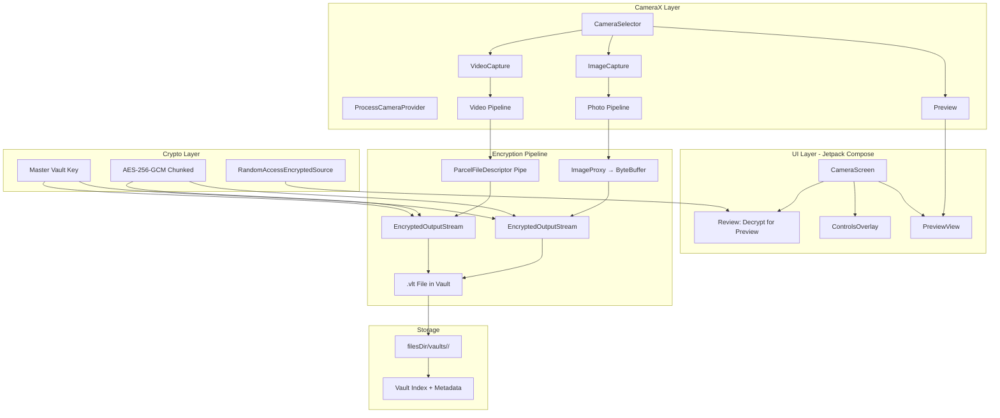

# Secure Camera — Technical Implementation Plan

## Architecture Overview



---

## Zero-Temp-File Architecture

### Photo Pipeline: `ImageProxy` → Memory → `.vlt`

```
CameraX ImageCapture
        │
        ▼
ImageCapture.OnImageCapturedCallback.onCaptureSuccess(ImageProxy)
        │
        ▼
ImageProxy.planes[0].buffer (YUV_420_888 or JPEG)
        │
        ├─ For JPEG: buffer → ByteArray directly
        ├─ For YUV: Convert to JPEG via ImageProxy.toBitmap() → compress
        │
        ▼
ByteArray held in memory (CoroutineScope(Dispatchers.IO))
        │
        ▼
EncryptedOutputStream(FileOutputStream(targetFile), masterKey)
        │
        ├─ writeHeader() → "VAULT1" | version | reserved | salt(32) | masterIV(12) | chunkSize(4) | fileSize(8) | headerTag(16)
        ├─ Chunked write: 64KB buffers → AES-256-GCM per chunk (unique IV per chunk)
        └─ close() → final chunk + flush + update header fileSize
        │
        ▼
.vlt file in vault directory
        │
        ▼
Thumbnail generation (async, post-commit)
```

**Key Implementation Details:**
- `ImageCapture` configured with `CAPTURE_MODE_MAXIMIZE_QUALITY` + `setTargetResolution(max sensor size)`
- `ImageProxy` **must** be closed in `finally` block to return buffer to CameraX pool
- ByteArray **wiped** after encryption: `Arrays.fill(bytes, 0)` (use `MemoryHygiene.wipe()`)
- Orientation: Store EXIF orientation in encrypted payload or file header

### Video Pipeline: CameraX → Pipe → `.vlt`

```
CameraX VideoCapture<Recorder>
        │
        ▼
ParcelFileDescriptor.createPipe() → [readSide, writeSide]
        │                              │
        │                              ▼
        │                    FileOutputOptions.Builder(writeSide).build()
        │                              │
        ▼                              ▼
CoroutineScope(Dispatchers.IO)    Recorder → prepareRecording → start()
        │                              │
        │                    VideoRecordEvent.Finalize
        │                              │
        ▼                              ▼
EncryptedOutputStream(            writeSide.close()
    FileOutputStream(target),       │
    masterKey)                       ▼
        │                    encryptionJob.join()
        ├─ writeHeader() (same as photo)
        ├─ readSide.use { inputStream →
        │     buffer[64KB] → read loop → eos.write()
        │ }
        └─ close() → final chunk
        │
        ▼
.vlt file in vault directory
```

**Key Implementation Details:**
- **No temporary MP4 file** — `ParcelFileDescriptor` pipe streams directly from MediaCodec to encryption
- `EncryptedOutputStream` runs in parallel coroutine, reading from pipe readSide
- On cancel/retake: `writeSide.close()` → encoder stops → `encryptionJob.cancel()` → delete partial `.vlt`
- On app kill: Partial `.vlt` remains; sweep on next vault unlock deletes files with size=0 or invalid header

---

## CameraX Configuration

### Dependencies (Already in build.gradle.kts)
```kotlin
implementation(libs.androidx.camera.core)
implementation(libs.androidx.camera.camera2)
implementation(libs.androidx.camera.lifecycle)
implementation(libs.androidx.camera.video)
implementation(libs.androidx.camera.view)
```

### Preview
```kotlin
val preview = Preview.Builder()
    .setTargetRotation(viewfinder.display.rotation)
    .setTargetAspectRatio(AspectRatio.RATIO_4_3) // or match sensor
    .setSurfaceProvider(previewView.surfaceProvider)
    .build()
```

### ImageCapture (Photo)
```kotlin
val imageCapture = ImageCapture.Builder()
    .setCaptureMode(ImageCapture.CAPTURE_MODE_MAXIMIZE_QUALITY)
    .setTargetRotation(viewfinder.display.rotation)
    .setTargetAspectRatio(AspectRatio.RATIO_4_3)
    .setMaxResolution() // Use max sensor resolution
    .setJpegQuality(100) // Quality over speed
    .build()
```

### VideoCapture (Video)
```kotlin
val recorder = Recorder.Builder()
    .setQualitySelector(QualitySelector.fromOrderedList(
        Quality.HIGHEST, Quality.HD, Quality.SD
    ))
    .setTargetAspectRatio(AspectRatio.RATIO_16_9) // Video typically 16:9
    .build()

val videoCapture = VideoCapture.withOutput(recorder)
```

### CameraSelector & Lens Facing
```kotlin
// Front camera
val frontSelector = CameraSelector.Builder()
    .requireLensFacing(CameraSelector.LENS_FACING_FRONT)
    .build()

// Rear camera
val backSelector = CameraSelector.Builder()
    .requireLensFacing(CameraSelector.LENS_FACING_BACK)
    .build()

// Switch: unbind current, bind new selector with same use cases
cameraProvider.unbindAll()
cameraProvider.bindToLifecycle(lifecycleOwner, selector, preview, imageCapture, videoCapture)
```

### Focus & Exposure (Tap to Focus)
```kotlin
previewView.setOnTouchListener { _, event ->
    if (event.action == MotionEvent.ACTION_DOWN) {
        val meterPoint = previewView.viewportRect.mapToPreview(
            event.x, event.y
        )
        val action = FocusMeteringAction.Builder(
            MeteringPointFactory.createPoint(meterPoint.x, meterPoint.y)
        ).apply {
            setAutoFocus(true)
            setAutoExposure(true)
            setAutoCancelDuration(5, TimeUnit.SECONDS)
        }.build()
        cameraControl.startFocusAndMetering(action)
    }
    true
}
```

### Flash / Torch
```kotlin
// Photo flash
val flashMode = when {
    flashState == FlashMode.AUTO -> ImageCapture.FLASH_MODE_AUTO
    flashState == FlashMode.ON -> ImageCapture.FLASH_MODE_ON
    else -> ImageCapture.FLASH_MODE_OFF
}
imageCapture.flashMode = flashMode

// Video torch (rear only)
if (cameraInfo.hasFlashUnit()) {
    cameraControl.enableTorch(torchEnabled)
}
```

### Lifecycle Binding
```kotlin
// In Activity/Fragment onStart()
val cameraProvider = ProcessCameraProvider.getInstance(context).await()

val preview = Preview.Builder().build().also { it.setSurfaceProvider(previewView.surfaceProvider) }
val imageCapture = ImageCapture.Builder().build()
val videoCapture = VideoCapture.withOutput(recorder)

cameraProvider.bindToLifecycle(this, cameraSelector, preview, imageCapture, videoCapture)
```

---

## Review Step Implementation

### The Challenge
Website mandates: *"After the shutter fires, Vaultaire shows you the frame with two choices. Retake discards it. Save to Vault encrypts it. Nothing is written to the vault until you pick."*

### Solution: In-Memory Review

**Photo Review:**
```
1. ImageCapture.takePicture(OnImageCapturedCallback)
2. onCaptureSuccess(ImageProxy):
   a. Convert ImageProxy → Bitmap (via toBitmap() or YUV→RGB)
   b. Hold Bitmap in ViewModel/state (NOT written to disk)
   c. imageProxy.close() // Return buffer to pool
   d. Navigate to ReviewScreen with Bitmap
3. ReviewScreen: Display Bitmap in ImageView
4. User taps "Retake": Bitmap.recycle(), return to CameraScreen
5. User taps "Keep": 
   a. Compress Bitmap → ByteArray (JPEG, quality 100)
   b. Encrypt via EncryptedOutputStream → .vlt
   c. Generate thumbnail from Bitmap
   d. Bitmap.recycle(), wipe ByteArray
```

**Video Review:**
```
1. VideoCapture starts recording to ParcelFileDescriptor pipe → EncryptedOutputStream → .vlt
2. User stops recording:
   a. writeSide.close() → encoder finishes
   b. encryptionJob.join() → .vlt complete
   c. ReviewScreen: Play .vlt via Media3 + custom DataSource (decrypt-stream)
3. User taps "Retake": 
   a. Delete .vlt file
   b. Return to CameraScreen
4. User taps "Keep": 
   a. .vlt already complete (just confirm)
   b. Generate thumbnail (extract first keyframe via MediaMetadataRetriever)
   c. Return to Vault Grid
```

**Why this works:**
- Photo: Bitmap in memory (~10-50MB for 12-48MP) — acceptable for review duration
- Video: Already encrypted to `.vlt`; review decrypt-streams (no extra disk write)
- **Zero unencrypted files on disk at any point**

### Alternative Considered (Rejected)
> Capture → Encrypt → Decrypt for Review → Retake deletes `.vlt`
> **Rejected**: Violates zero-temp-file; leaves encrypted garbage on "Retake"; adds latency

---

## RAM Security (Memory Hygiene)

### Current Gaps in `SecureCameraManager.kt`
```kotlin
// Line 34-36: ByteArray created but NOT wiped
val buffer = image.planes[0].buffer
val bytes = ByteArray(buffer.remaining())
buffer.get(bytes)
// ... encrypt ...
image.close() // Good: returns ImageProxy to pool
// BAD: 'bytes' ByteArray remains in memory until GC
```

### Required Fixes
```kotlin
override fun onCaptureSuccess(image: ImageProxy) {
    CoroutineScope(Dispatchers.IO).launch {
        val bytes = try {
            val buffer = image.planes[0].buffer
            val bytes = ByteArray(buffer.remaining())
            buffer.get(bytes)
            bytes
        } finally {
            image.close() // Always close ImageProxy
        }
        
        try {
            EncryptedOutputStream(FileOutputStream(targetFile), keyProvider()).use { eos ->
                eos.write(bytes)
            }
            withContext(Dispatchers.Main) { onSuccess() }
        } catch (t: Throwable) {
            withContext(Dispatchers.Main) { onError(t) }
        } finally {
            MemoryHygiene.wipe(bytes) // <-- ADD: Wipe buffer after encrypt
        }
    }
}
```

### Video Pipeline
- `ParcelFileDescriptor` pipe buffers managed by OS
- `EncryptedOutputStream` internal 64KB buffer wiped on `close()` via `buffer.clear()` (but not zeroed)
- **Add**: `MemoryHygiene.wipe(buffer.array())` in `EncryptedOutputStream.close()`

### Thumbnail Generation
- Decrypt first chunk/frame → generate thumbnail → wipe decrypted buffer
- Store thumbnail encrypted in vault metadata (separate from main file)

---

## Screen Security (FLAG_SECURE)

### Implementation
```kotlin
// In CameraActivity or CameraFragment
override fun onCreate(savedInstanceState: Bundle?) {
    super.onCreate(savedInstanceState)
    // MUST be set before setContentView
    window.setFlags(
        WindowManager.LayoutParams.FLAG_SECURE,
        WindowManager.LayoutParams.FLAG_SECURE
    )
    setContentView { CameraScreen() }
}
```

### Effects
- **Screenshots**: `mediaProjection` APIs return black/blank
- **Recent Apps**: Thumbnail shows secure placeholder (blank)
- **Screen Recording**: Black frames
- **Caveat**: Does not prevent physical camera photographing screen

### Compose Integration
```kotlin
// In MainActivity or CameraActivity
override fun onCreate(savedInstanceState: Bundle?) {
    super.onCreate(savedInstanceState)
    window.setFlags(
        WindowManager.LayoutParams.FLAG_SECURE,
        WindowManager.LayoutParams.FLAG_SECURE
    )
    enableEdgeToEdge() // If using edge-to-edge
    setContent { VaultaireTheme { CameraScreen() } }
}
```

---

## Permission Handling (Android 13+ Patterns)

### Manifest (Already Present)
```xml
<uses-permission android:name="android.permission.CAMERA" />
<uses-permission android:name="android.permission.RECORD_AUDIO" />
```

### Runtime Requests (Activity Result APIs)
```kotlin
// Camera permission (required for preview)
val requestCameraPermission = registerForActivityResult(ActivityResultContracts.RequestPermission()) { granted ->
    if (granted) startCamera() else showPermissionRationale()
}

// Microphone permission (optional, requested at video record start)
val requestMicPermission = registerForActivityResult(ActivityResultContracts.RequestPermission()) { granted ->
    if (!granted) showAudioOffBadge()
}
```

### Android 13+ Granular Media Permissions
- `CAMERA` is dangerous permission (runtime required)
- `RECORD_AUDIO` is dangerous permission (runtime required)
- No `READ_MEDIA_IMAGES`/`VIDEO` needed since we don't access MediaStore

### Permission Flow
```kotlin
fun openCamera() {
    if (ContextCompat.checkSelfPermission(this, Manifest.permission.CAMERA) == GRANTED) {
        navigateToCameraScreen()
    } else if (shouldShowRequestPermissionRationale(Manifest.permission.CAMERA)) {
        showRationaleDialog { requestCameraPermission.launch(Manifest.permission.CAMERA) }
    } else {
        requestCameraPermission.launch(Manifest.permission.CAMERA)
    }
}

// In Video mode, on record press:
fun startRecording() {
    if (ContextCompat.checkSelfPermission(this, Manifest.permission.RECORD_AUDIO) == GRANTED) {
        startVideoRecording(withAudio = true)
    } else if (shouldShowRequestPermissionRationale(Manifest.permission.RECORD_AUDIO)) {
        showMicRationaleDialog { requestMicPermission.launch(Manifest.permission.RECORD_AUDIO) }
    } else {
        requestMicPermission.launch(Manifest.permission.RECORD_AUDIO)
    }
}
```

---

## Thumbnail Generation

### Requirements
- Generated **after** "Keep" (post-encryption)
- Stored encrypted in vault metadata (not as separate file)
- Used for vault grid display

### Implementation
```kotlin
suspend fun generateThumbnail(vltFile: File, masterKey: SecretKey): ByteArray = withContext(Dispatchers.IO) {
    // Photo: decrypt first chunk, decode JPEG, scale to 256x256, re-encode JPEG
    // Video: use MediaMetadataRetriever with custom DataSource to extract first keyframe
    
    val source = RandomAccessEncryptedSourceImpl(vltFile, masterKey)
    try {
        // Read first chunk (contains JPEG SOI or MP4 ftyp)
        val firstChunk = ByteArray(source.chunkSize)
        source.readAt(0, firstChunk, 0, source.chunkSize)
        
        if (isJpeg(firstChunk)) {
            val bitmap = BitmapFactory.decodeByteArray(firstChunk, 0, firstChunk.size)
            return createThumbnail(bitmap)
        } else if (isMp4(firstChunk)) {
            // Use Media3 with decrypting DataSource
            return extractVideoThumbnail(source, masterKey)
        }
        throw IllegalStateException("Unknown file type")
    } finally {
        source.close()
    }
}
```

---

## Orientation Handling

### Problem
- Device rotation during capture
- Sensor orientation vs display rotation
- EXIF orientation tag in JPEG

### CameraX Solution
```kotlin
// Both Preview and ImageCapture/VideoCapture
.setTargetRotation(viewfinder.display.rotation)

// For ImageCapture, also:
imageCapture.setTargetRotation(viewfinder.display.rotation)

// The captured JPEG will have correct EXIF orientation
// For video, MediaCodec handles rotation via composition matrix
```

### Review Screen
- Lock orientation to portrait during review (prevents rotation mid-review)
- Or: Rotate Bitmap/Video to match capture orientation

---

## Performance Targets

| Metric | Target | Measurement |
|--------|--------|-------------|
| Photo capture latency (shutter → review) | < 500ms | High-end device |
| Photo capture latency (mid-tier) | < 1000ms | |
| Video start latency (record → recording) | < 300ms | |
| Encryption throughput (AES-256-GCM) | > 100 MB/s | Pixel 7 class |
| Memory peak (photo review) | < 100 MB | 48MP JPEG ~50MB |
| Memory peak (video recording) | < 50 MB | Streaming, no full buffer |
| Battery impact (10 min recording) | < 5% | Screen on, encoding + encrypt |

### Optimization Strategies
- Use `ImageCapture.CAPTURE_MODE_MAXIMIZE_QUALITY` + `setMaxResolution()` — CameraX handles efficient pipeline
- `EncryptedOutputStream` 64KB chunks balance CPU/IO
- Coroutine `Dispatchers.IO` for encryption (off main thread)
- Thumbnail generation async, low priority
- Release `ImageProxy` immediately after buffer copy

---

## Integration Points

### Vault Manager
```kotlin
// SecureCameraManager needs:
class SecureCameraManager(
    context: Context,
    private val vaultManager: VaultManager, // To get current vault directory
    private val keyProvider: () -> SecretKey // Master Vault Key for current vault
) {
    fun capturePhoto(targetVaultId: String, ...) {
        val targetFile = File(vaultManager.getVaultDir(targetVaultId), "${UUID.randomUUID()}.vlt")
        // ...
    }
}
```

### Vault Storage Engine
- `EncryptedOutputStream` implements `VaultStorageEngine.createEncryptedOutputStream()`
- `RandomAccessEncryptedSourceImpl` implements `VaultStorageEngine.openRandomAccessSource()`

### Crypto Engine
- `KeyDerivationEngine` → `Vault Derivation Key` (PBKDF2, 600k iterations)
- `EnvelopeEncryptionEngine` → wraps/unwraps `Master Vault Key`
- `DeviceSaltManager` → device-wide salt in SharedPreferences (not KeyStore — Android Keystore doesn't support raw symmetric keys easily)

---

## Error Handling & Recovery

| Error Scenario | Handling |
|----------------|----------|
| `ImageCaptureException` | Surface to UI, show "Capture failed, try again" |
| `IOException` (storage full) | Show "Storage full", offer to free space |
| `SecurityException` (key unwrap fail) | Vault locked — require re-auth |
| `OutOfMemoryError` (large photo) | Catch, release ImageProxy, show "Image too large" |
| App killed mid-video | On next unlock: sweep `vaultDir` for `.vlt` with invalid header/size=0 → delete |
| Pipe broken (video) | Cancel encryption job, delete partial `.vlt` |

---

## Testing Hooks

```kotlin
// For instrumented tests
interface SecureCameraTestHooks {
    fun setMockImageCapture(mock: ImageCapture)
    fun setMockVideoCapture(mock: VideoCapture<Recorder>)
    fun setMockKeyProvider(provider: () -> SecretKey)
    fun captureLastPhotoBytes(): ByteArray? // For verification
    fun captureLastVideoPath(): String?
}
```

---

## Future Enhancements (Post-MVP)

1. **HEIC/HEVC support** — `ImageCapture.setOutputFormat(ImageCapture.OUTPUT_FORMAT_HEIC)`
2. **HDR capture** — `ImageCapture.setDynamicRange(DynamicRange.HDR)`
3. **ProRAW / RAW capture** — `ImageCapture.setOutputFormat(OUTPUT_FORMAT_RAW)`
4. **Multi-camera (ultra-wide, telephoto)** — `CameraSelector.filter()` by camera ID
5. **Secure document scan mode** — Edge detection, perspective correction, then encrypt
6. **Timelapse / slow-motion** — CameraX `VideoCapture` quality selector
7. **Face/body detection overlay** — ML Kit on preview frames (on-device only)