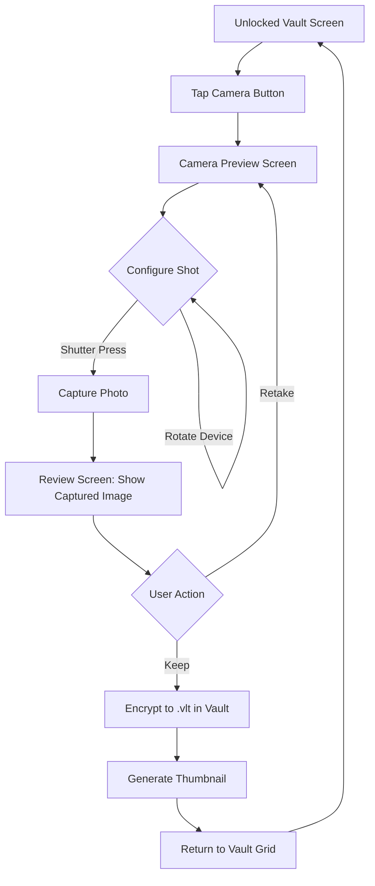
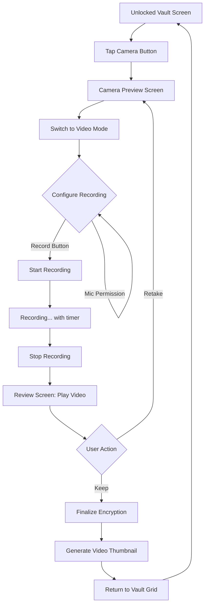
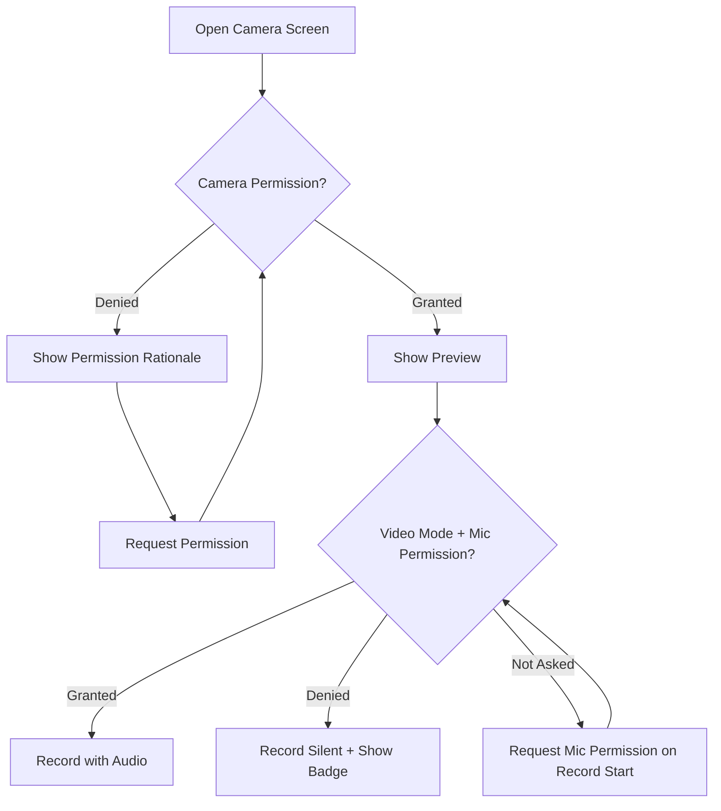

# Secure Camera — Product Planning Document

## User Stories

### Core Capture Flow
| ID | Story | Priority |
|----|-------|----------|
| US-CAM-01 | As a vault user, I want to open the camera from inside an unlocked vault so that I can take private photos/videos that are encrypted immediately | P0 |
| US-CAM-02 | As a user, I want to switch between front and rear cameras so I can capture selfies or scene photos | P0 |
| US-CAM-03 | As a user, I want to tap the preview to set focus and exposure so my shots are sharp and well-exposed | P0 |
| US-CAM-04 | As a user, I want to cycle flash (auto/on/off) for photos and toggle torch for video so I can shoot in low light | P0 |
| US-CAM-05 | As a user, I want to record video with optional audio so I can capture moments with or without sound | P0 |
| US-CAM-06 | **As a user, I want to review every capture before it's encrypted** so I can retake bad shots without leaving encrypted garbage | P0 |
| US-CAM-07 | As a user, I want captures to go directly into my open vault (not gallery/MediaStore) so there's no delete step and no forensic trail | P0 |
| US-CAM-08 | As a user, I want the camera to respect device rotation so landscape shots are stored upright | P1 |
| US-CAM-09 | As a privacy-conscious user, I want the camera preview blocked from screenshots and recent-apps so my private content isn't leaked | P0 |
| US-CAM-10 | As a user, I want video recording to show an "audio off" badge if I denied microphone permission so I'm never surprised | P1 |

### Import & Migration
| ID | Story | Priority |
|----|-------|----------|
| US-CAM-11 | As a user with existing photos in my gallery, I want to import them into the vault so I can secure my past captures | P1 |
| US-CAM-12 | As a user importing from gallery, I want the app to offer to delete originals and remind me to empty "Trash/Recently Deleted" | P2 |

### Vault Context
| ID | Story | Priority |
|----|-------|----------|
| US-CAM-13 | As a user with multiple vaults, I want captures to go into the currently unlocked vault so I control where each photo lives | P0 |
| US-CAM-14 | As a user with a hidden vault, I want captures taken there to inherit its deniability (no backup, no sync) | P1 |
| US-CAM-15 | As a user in duress mode, I want captures to go to the decoy vault so my real vault stays hidden | P1 |

---

## User Flows

### Flow 1: Open Camera → Capture Photo → Review → Keep/Retake



**Key UX Requirements:**
- Review screen **must** show the actual captured image (not a live preview)
- "Retake" discards the capture entirely — no encryption, no file written
- "Keep" triggers encryption; user sees progress indicator
- After "Keep", return to vault grid showing new thumbnail
- Camera preview **must have FLAG_SECURE** (no screenshots, no recent-apps thumbnail)

### Flow 2: Open Camera → Record Video → Review → Keep/Retake



**Key UX Requirements:**
- Video review plays the recorded video (decrypt-stream from `.vlt` or buffer)
- Show recording timer during capture
- Show "audio off" badge if microphone permission denied
- Torch toggle only available for rear camera
- Same "Retake = discard, Keep = encrypt" semantics

### Flow 3: Permission Handling



---

## Acceptance Criteria (Given/When/Then)

### Photo Capture
| Scenario | Given | When | Then |
|----------|-------|------|------|
| AC-CAM-01 | Vault is unlocked, user on vault grid | User taps camera button | Camera preview opens with FLAG_SECURE, front/rear selector, flash control, shutter button |
| AC-CAM-02 | Camera preview showing | User taps preview | Focus/exposure metering point set at tap location; visual indicator shown |
| AC-CAM-03 | Camera preview showing | User taps lens switch | Camera switches to other lens (front↔rear); preview updates |
| AC-CAM-04 | Camera preview showing, rear camera | User taps flash icon | Flash cycles: Auto → On → Off → Auto; icon updates |
| AC-CAM-05 | Camera preview showing | User presses shutter | Photo captured at max sensor resolution; review screen shows captured image |
| AC-CAM-06 | Review screen showing captured photo | User taps "Retake" | Photo discarded (buffer wiped); returns to camera preview |
| AC-CAM-07 | Review screen showing captured photo | User taps "Keep" | Photo encrypted via AES-256-GCM to `.vlt` in current vault; thumbnail generated; returns to vault grid with new item |
| AC-CAM-08 | Photo captured, user rotates device | Capture completes | Image stored with correct orientation (EXIF or header flag) |
| AC-CAM-09 | Camera preview showing | User takes screenshot / opens recent apps | Screenshot is black/blank; recent apps shows blank/secure placeholder |
| AC-CAM-10 | Photo kept | User checks system gallery / MediaStore | Photo does NOT appear in gallery, Google Photos, or any MediaStore query |

### Video Capture
| Scenario | Given | When | Then |
|----------|-------|------|------|
| AC-CAM-11 | Camera preview showing | User switches to video mode | UI shows record button, torch toggle (rear only), timer placeholder |
| AC-CAM-12 | Video mode, rear camera | User taps torch icon | Torch toggles on/off; icon updates |
| AC-CAM-13 | Video mode | User presses record | Recording starts; timer displays; record button becomes stop |
| AC-CAM-14 | Recording in progress | User presses stop | Recording stops; review screen shows recorded video playback |
| AC-CAM-15 | Review screen showing video | User taps "Retake" | Video discarded; encryption job cancelled; returns to camera preview |
| AC-CAM-16 | Review screen showing video | User taps "Keep" | Video encryption finalized; thumbnail generated; returns to vault grid |
| AC-CAM-17 | Video mode, microphone permission denied | User starts recording | Recording proceeds silently; "audio off" badge visible during recording and review |
| AC-CAM-18 | Video recording, app killed mid-recording | App restarts | No orphaned temp files; no partial `.vlt` in vault |

### Security & Privacy
| Scenario | Given | When | Then |
|----------|-------|------|------|
| AC-SEC-01 | Any capture completed (keep or retake) | User inspects app internal storage | No unencrypted image/video files exist; only `.vlt` files |
| AC-SEC-02 | Photo kept | User checks file system | `.vlt` file exists in `filesDir/vaults/<vaultId>/` or similar; not in `Pictures/`, `DCIM/`, `Movies/` |
| AC-SEC-03 | Video kept | User checks file system | `.vlt` file exists; no temporary MP4 in cache, temp, or app files |
| AC-SEC-04 | Capture in progress | User locks device / app backgrounded | Capture cancelled; buffers wiped; no partial data persists |
| AC-SEC-05 | Multiple captures of identical scene | User inspects encrypted files | Each `.vlt` has different ciphertext (unique IV per file) |

### Permissions
| Scenario | Given | When | Then |
|----------|-------|------|------|
| AC-PERM-01 | App first launch, camera not granted | User opens camera | Runtime permission requested; rationale shown if denied before |
| AC-PERM-02 | Camera permission permanently denied | User opens camera | Settings deep-link offered; preview not shown |
| AC-PERM-03 | Video mode, mic not granted | User starts recording | Mic permission requested; if denied, silent recording proceeds with badge |

---

## UX Design Details

### Camera Preview Screen
```
┌─────────────────────────────────────────┐
│  ← Back          Secure Camera        ⚙️ │  ← Toolbar (FLAG_SECURE)
├─────────────────────────────────────────┤
│                                         │
│                                         │
│        ████████████████████████        │  ← PreviewView (CameraX)
│        █  LIVE PREVIEW    █            │
│        █  [tap to focus]  █            │
│        ████████████████████████        │
│                                         │
│                                         │
├─────────────────────────────────────────┤
│  🔄   📷/📹   ⚡/🔦    ● SHUTTER ●       │  ← Controls
│  Lens  Mode    Flash   Capture          │
└─────────────────────────────────────────┘
```

**Controls:**
- **Lens Switch (🔄)**: Front ↔ Rear. Only show if device has both.
- **Mode Toggle (📷/📹)**: Photo ↔ Video. Changes shutter to record button.
- **Flash/Torch (⚡/🔦)**: Photo: Auto/On/Off cycle. Video: Torch On/Off (rear only).
- **Shutter/Record**: Large, tactile. Haptic feedback on press.

### Review Screen (Photo)
```
┌─────────────────────────────────────────┐
│  ← Retake           Review          ✓ Keep │
├─────────────────────────────────────────┤
│                                         │
│        ████████████████████████        │
│        █  CAPTURED IMAGE   █           │  ← Full-screen ImageView
│        ████████████████████████        │
│                                         │
├─────────────────────────────────────────┤
│  Photo will be encrypted into vault     │  ← Context hint
└─────────────────────────────────────────┘
```

### Review Screen (Video)
```
┌─────────────────────────────────────────┐
│  ← Retake           Review          ✓ Keep │
├─────────────────────────────────────────┤
│                                         │
│        ████████████████████████        │
│        █  VIDEO PLAYBACK   █           │  ← Media3 PlayerView
│        █  [0:12 / 0:45]  █             │
│        ████████████████████████        │
│         ▶️ ⏸️ 🔊/🔇  🔁  📹/🎵         │
│                                         │
├─────────────────────────────────────────┤
│  Video will be encrypted into vault     │
│  🔇 Audio off                          │  ← Only if mic denied
└─────────────────────────────────────────┘
```

### Visual States
| State | Shutter Button | Notes |
|-------|----------------|-------|
| Ready | White circle, 72dp | Pulse animation on focus lock |
| Capturing | Spinner | "Capturing..." toast |
| Recording | Red circle, pulsing | Timer: 00:00 |
| Processing | Spinner + "Encrypting..." | Disable back gesture |

### Accessibility
- All controls: `contentDescription` for TalkBack
- Focus order: Toolbar → Preview → Controls
- Flash/torch state announced on change
- Review screen: "Captured image, double tap to keep, swipe left to retake"

---

## Critical UX Requirement: The Review Step

**From the website:** *"After the shutter fires, Vaultaire shows you the frame with two choices. Retake discards it. Save to Vault encrypts it. Nothing is written to the vault until you pick, and nothing is written to Photos either way."*

This is **non-negotiable**. The review step serves three purposes:
1. **Quality control** — user confirms the shot before committing
2. **Privacy** — user can discard sensitive content before it hits encrypted storage
3. **Trust** — user sees exactly what will be encrypted

**Implementation implication:** The capture must be held in memory (ImageProxy for photo, encrypted stream buffer for video) during review. No file written until "Keep".

---

## Platform Adaptations (iOS → Android)

| iOS Concept | Android Equivalent | Notes |
|-------------|-------------------|-------|
| Camera inside vault | Camera screen accessible only from unlocked vault Activity | Enforce via navigation guard |
| Never added to Photos | Never inserted into MediaStore | Use `context.filesDir` for `.vlt` files |
| Recently Deleted (30 days) | MediaStore Trash (30 days) | Avoided by not using MediaStore |
| iCloud Photos upload | Google Photos backup | Avoided by not using MediaStore + `allowBackup=false` |
| Data Protection Complete | `context.filesDir` + encrypted FS | Android 10+ encrypts app data at rest |
| Excluded from backup | `android:allowBackup="false"` + `dataExtractionRules` | Already configured |
| AVAssetWriter temp file | CameraX VideoCapture → ParcelFileDescriptor pipe | **Android advantage: no temp file needed** |
| 3-pass overwrite | Not needed if pipe used | If temp file ever used: `FileChannel.force(true)` + overwrite |

---

## Edge Cases to Handle

| Edge Case | Handling |
|-----------|----------|
| Camera unavailable (in use by other app) | Show error, offer retry |
| Storage full during capture | Catch `IOException`, show "Storage full", offer to free space |
| Capture cancelled (back gesture) | Discard buffers, return to vault |
| Low memory during capture | `ImageProxy` auto-released; catch `OutOfMemoryError`, show error |
| Device rotation mid-capture | CameraX handles; ensure review screen locks orientation |
| App killed during video recording | On restart: sweep for orphaned `.vlt` files (partial writes) |
| Microphone permission revoked mid-recording | Stop recording, save silent portion, show badge |
| Vault locked during capture (timeout) | Cancel capture, wipe buffers, require re-auth |