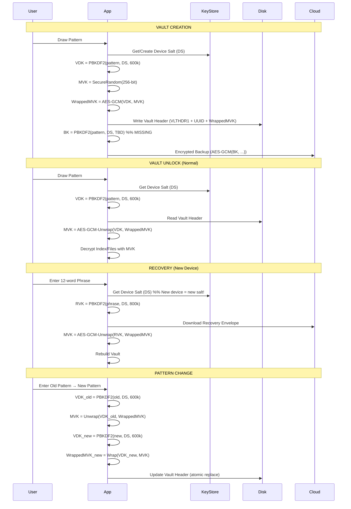

# Security Architecture — Tech Lead / Architect Perspective

**Audience**: Engineering, Security Review, Architecture Board  
**Purpose**: Complete technical specification for implementation, review, and audit

---

## 1. Complete Cryptographic Stack Diagram

```mermaid
graph TB
    subgraph "User Input"
        P[Pattern<br/>5×5 Grid Points] --> PN[Pattern Normalization<br/>VAULTAIRE_PATTERN_V1<br/>Straight-line Interpolation]
        RP[Recovery Phrase<br/>12 Words BIP39-style] --> RPF[Phrase Normalization<br/>lowercase, trim, join]
        SP[Share Phrase<br/>12 Words] --> SPF[Phrase Normalization<br/>lowercase, trim]
    end

    subgraph "Device-Bound Salt (Android KeyStore/StrongBox)"
        DS[Device Salt<br/>32 bytes random<br/>WhenUnlockedThisDeviceOnly]
    end

    subgraph "Key Derivation Layer (PBKDF2-HMAC-SHA512)"
        PN -->|600,000 iter| VDK[Vault Derivation Key<br/>VDK = 256 bits]
        RPF -->|800,000 iter| RVK[Recovery Vault Key<br/>RVK = 256 bits]
        SPF -->|250,000 iter| SK[Share Key<br/>SK = 256 bits]
        PN -->|TBD iter| BK[Backup Key<br/>BK = 256 bits<br/>**MISSING: separate derivation**]
    end

    subgraph "Key Hierarchy"
        MVK[Master Vault Key<br/>256-bit random<br/>Generated once per vault]
        VDK -->|AES-256-GCM Wrap| E1[Wrapped MVK<br/>in Vault Header]
        RVK -->|AES-256-GCM Wrap| E2[Wrapped MVK<br/>in Recovery Envelope]
        BK -->|AES-256-GCM| E3[Encrypted Backup<br/>Header + Payload]
        SK -->|AES-256-GCM + AAD| E4[Encrypted Share Package]
        MVK -->|AES-256-GCM| F1[File Content Encryption]
        MVK -->|AES-256-GCM| F2[File Headers<br/>Name, MIME, Timestamps]
        MVK -->|AES-256-GCM| F3[Thumbnails]
        MVK -->|AES-256-GCM| F4[Vault Index<br/>Records, Layout, Wrapped MVK]
    end

    subgraph "Storage Formats"
        F1 --> S1[.vlt Files<br/>Streaming AES-GCM<br/>64KB chunks + per-chunk IV]
        F2 --> S1
        F3 --> S1
        F4 --> S2[Vault Index File<br/>Encrypted w/ MVK<br/>**NOT YET IMPLEMENTED**]
        E1 --> S3[Vault Header<br/>VLTHDR1 + UUID + Envelope]
        E2 --> S4[Recovery Envelope<br/>**NOT YET IMPLEMENTED**]
        E3 --> S5[Backup File<br/>VLTBK01 + Padded Buckets]
        E4 --> S6[Share Package<br/>Salt + IV + Policy AAD + Ciphertext]
    end

    subgraph "Platform Security"
        KS[Android KeyStore<br/>TEE / StrongBox] -.->|Protects| DS
        KS -.->|Can Protect| MVK
        ESP[EncryptedSharedPreferences] -.->|Protects| Settings
        FS[FLAG_SECURE] -.->|Protects| Screen
        MH[MemoryHygiene] -.->|Zeroes| VDK & RVK & SK & BK & MVK
    end

    style DS fill:#fff3e0
    style MVK fill:#e8f5e9
    style E1 fill:#fff3e0
    style E2 fill:#fff3e0
    style E3 fill:#fff3e0
    style E4 fill:#fff3e0
    style KS fill:#e3f2fd
    style ESP fill:#e3f2fd
    style FS fill:#e3f2fd
    style MH fill:#e3f2fd
```



---

## 2. Layered Key Hierarchy

### Key Definitions

| Key | Symbol | Size | Purpose | Lifetime | Derivation | Storage |
|-----|--------|------|---------|----------|------------|---------|
| **Device Salt** | `DS` | 256-bit | Per-device KDF salt | Permanent (until factory reset) | `SecureRandom` | **Android KeyStore (TEE/StrongBox)** — `WhenUnlockedThisDeviceOnly` |
| **Vault Derivation Key** | `VDK` | 256-bit | Unlocks vault header (wraps MVK) | Session-only | PBKDF2-HMAC-SHA512(pattern, DS, 600k) | **Never persisted**; derived on unlock |
| **Master Vault Key** | `MVK` | 256-bit | Encrypts all file content, metadata, thumbnails, index | Per-vault permanent | `SecureRandom` (generated once) | Wrapped by VDK in Vault Header; **optionally StrongBox-backed** |
| **Recovery Vault Key** | `RVK` | 256-bit | Unlocks recovery envelope (wraps MVK) | Session-only | PBKDF2-HMAC-SHA512(phrase, DS, 800k) | **Never persisted**; derived on recovery |
| **Backup Key** | `BK` | 256-bit | Encrypts cloud backup blobs | Per-vault permanent | **MISSING**: PBKDF2-HMAC-SHA512(pattern, DS, TBD) | **Never on device**; derived on backup/restore |
| **Share Key** | `SK` | 256-bit | Encrypts one-time share packages | Per-share ephemeral | PBKDF2-HMAC-SHA512(sharePhrase, salt, 250k) | **Never persisted**; derived on share/unshare |
| **Sync Key** | `SyK` | 256-bit | Encrypts cross-device sync records | Per-vault permanent | **MISSING**: Derived from MVK or separate | Wrapped in sync records |

### Key Separation Principles

1. **Domain Separation** — Each key has a unique purpose; no key reuse across contexts
2. **Compromise Containment** — 
   - `VDK` compromise → single vault (requires device salt + pattern)
   - `MVK` compromise → all files in that vault (but not other vaults)
   - `BK` compromise → backup blobs only (not live vault) — **requires separate derivation!**
   - `RVK` compromise → recovery envelope only (not live vault)
   - `SK` compromise → single share package only
3. **Rotation Independence** — Pattern change rewraps MVK only; backup key rotates independently; recovery phrase change re-encrypts envelope only

### Key Flow Diagram



---

## 3. AES-256-GCM Usage Matrix

| Data Type | Encryption Key | IV/Nonce Strategy | AAD (Additional Authenticated Data) | File Format |
|-----------|----------------|-------------------|-------------------------------------|-------------|
| **File Content** | MVK | Per-chunk: `baseIV ⊕ chunkIndex` (96-bit) | None (implicit via chunk ordering) | `.vlt` streaming (64KB chunks) |
| **File Headers** (name, MIME, timestamps, size) | MVK | Per-file: `SecureRandom(96-bit)` | File UUID + vault ID | Embedded in `.vlt` header |
| **Thumbnails** | MVK | Per-thumbnail: `SecureRandom(96-bit)` | Thumbnail UUID + vault ID | Separate `.vlt` or embedded |
| **Vault Index** (file records, layout, wrapped MVK) | MVK | Per-index: `SecureRandom(96-bit)` | Vault ID + version | **MISSING**: Encrypted index file |
| **Wrapped MVK** (in Vault Header) | VDK | `SecureRandom(96-bit)` | Vault ID + `isDuressDecoy` flag | `VaultHeader.envelope` |
| **Wrapped MVK** (in Recovery Envelope) | RVK | `SecureRandom(96-bit)` | Vault ID + phrase hash | **MISSING**: Recovery envelope format |
| **Backup Payload** | BK | `SecureRandom(96-bit)` | Backup Header (magic, salt, IV, sizes) | `VLTBK01` header + AES-GCM stream |
| **Backup Header** | — | — | — | Plaintext (magic, salt, IV, sizes) — **AAD for payload** |
| **Share Package** | SK | `SecureRandom(96-bit)` | Policy JSON (exp, maxOpen, noExport, created) | `EncryptedSharePackage` |
| **Sync Records** | SyK | `SecureRandom(96-bit)` | Vault ID + record type + version | **MISSING**: Sync format |

### Nonce Management Rules

| Context | Nonce Generation | Uniqueness Guarantee |
|---------|------------------|----------------------|
| Single-shot (headers, envelopes, shares) | `SecureRandom(12 bytes)` | 2^96 space; collision probability negligible |
| Streaming (file content, backup) | Base IV (12 bytes) + chunk index XOR | Deterministic per-chunk; unique per stream |
| Index/Thumbnails | `SecureRandom(12 bytes)` per object | Unique per encryption operation |

**Critical**: Never reuse (key, nonce) pair. GCM security collapses on nonce reuse.

---

## 4. PBKDF2 Parameter Matrix

| Derivation | Algorithm | Iterations | Salt | Output | Use Case | Status |
|------------|-----------|------------|------|--------|----------|--------|
| Pattern → VDK | PBKDF2-HMAC-SHA512 | **600,000** | Device Salt (32B, KeyStore) | 256-bit | Vault unlock | ✅ Implemented |
| Recovery Phrase → RVK | PBKDF2-HMAC-SHA512 | **800,000** | Device Salt (32B, KeyStore) | 256-bit | Recovery unlock | ⚠️ **300k in code (bug)** |
| Pattern → Backup Key | PBKDF2-HMAC-SHA512 | **TBD (recommend 600k)** | Device Salt (32B, KeyStore) | 256-bit | Cloud backup encryption | ❌ **Missing (uses MVK!)** |
| Share Phrase → Share Key | PBKDF2-HMAC-SHA512 | **250,000** | Per-share Salt (16B, random) | 256-bit | Secure sharing | ✅ Implemented |
| Sync → Sync Key | PBKDF2-HMAC-SHA512 | **TBD** | Device Salt or per-sync Salt | 256-bit | Cross-device sync | ❌ Missing |

### Iteration Selection Rationale

| Context | Target Time (Mobile CPU) | Iterations | Year Set | Review Cadence |
|---------|--------------------------|------------|----------|----------------|
| Pattern (VDK) | ~800ms | 600,000 | 2026 | Annual |
| Recovery (RVK) | ~1100ms | 800,000 | 2026 | Annual |
| Backup (BK) | ~800ms | 600,000 | 2026 | Annual |
| Share (SK) | ~300ms | 250,000 | 2026 | Annual |

**Note**: Iterations must be configurable via app versioning for future increases. Store iteration count in header/envelope for backward compatibility.

---

## 5. Key Rotation Strategy

### Rotation Triggers

| Event | Keys Affected | Action | Files Re-encrypted? |
|-------|---------------|--------|---------------------|
| **Pattern Change** | VDK → VDK' | Rewrap MVK with new VDK | **No** (MVK unchanged) |
| **Recovery Phrase Change** | RVK → RVK' | Rewrap MVK in new recovery envelope | **No** |
| **Backup Key Rotation** | BK → BK' | Re-encrypt backup blobs with new BK | **Yes** (backup only) |
| **Vault Migration (v1→v2)** | MVK → MVK' | Re-encrypt all files with new MVK | **Yes** (full vault) |
| **Compromise Suspected** | All | User-initiated "Rotate All Keys" | **Yes** (full vault + backup) |
| **Device Migration** | DS → DS' (new device) | Derive all keys with new DS | **No** (keys derived from phrase/pattern) |

### Pattern Change Protocol (Zero-Downtime)

```kotlin
// VaultManager.changePattern(oldPattern: ByteArray, newPattern: ByteArray)
fun changePattern(vaultId: String, oldPatternBytes: ByteArray, newPatternBytes: ByteArray) {
    val oldVDK = keyDerivationEngine.deriveVaultKey(oldPatternBytes)
    val mvk = unlockVault(vaultId, oldVDK)  // Get current MVK
    
    val newVDK = keyDerivationEngine.deriveVaultKey(newPatternBytes)
    val newEnvelope = envelopeEngine.wrapMasterKey(mvk, newVDK)
    
    // Atomic header replace: write new header to temp, rename
    val vaultFile = File(vaultsBaseDir, vaultId + ".vlt")
    val tempFile = File(vaultsBaseDir, vaultId + ".vlt.tmp")
    
    tempFile.outputStream().use { stream ->
        VaultHeader(
            vaultId = vaultId,
            isDuressDecoy = false,
            envelope = newEnvelope
        ).serialize(stream)
    }
    
    // Atomic rename (POSIX guarantee on Android)
    require(tempFile.renameTo(vaultFile)) { "Failed to atomically update vault header" }
    
    // Wipe old VDK from memory
    MemoryHygiene.wipeKey(oldVDK)
    MemoryHygiene.wipeKey(newVDK)
}
```

### Backup Key Rotation

```kotlin
// ZeroKnowledgeBackupEngine.rotateBackupKey(vaultId, oldPattern, newPattern)
fun rotateBackupKey(vaultId: String, oldPatternBytes: ByteArray, newPatternBytes: ByteArray) {
    val oldBK = deriveBackupKey(oldPatternBytes)  // PBKDF2(pattern, DS, 600k)
    val newBK = deriveBackupKey(newPatternBytes)
    
    // Download all backup blobs, decrypt with oldBK, re-encrypt with newBK
    // Upload new blobs, delete old blobs (or versioned)
}
```

---

## 5.5. Android Transport Layer Implementation

Since Vaultaire on Android cannot use iCloud/CloudKit, all cloud-based features use **Google Drive API** as the primary transport, with **Nearby Connections API** and **QR codes** as alternatives for sharing.

### 5.5.1 Secure Sharing — Transport Layer

#### Share Package Format (Unchanged from iOS Spec)

The cryptographic format remains identical: `EncryptedSharePackage` with salt, IV, policy AAD, ciphertext. Only the transport envelope changes.

#### Transport Abstraction

```kotlin
sealed interface ShareTransport {
    data class ShareMetadata(
        val transportType: TransportType,
        val shareId: String,
        val driveFileId: String?,
        val nearbyEndpointId: String?,
        val qrCodeData: String?,
        val createdTimestamp: Long,
        val expiresTimestamp: Long?
    )

    enum class TransportType { GOOGLE_DRIVE, NEARBY_SHARE, QR_CODE }

    suspend fun upload(sharePackage: EncryptedSharePackage, policy: SharePolicy): ShareMetadata
    suspend fun download(metadata: ShareMetadata): EncryptedSharePackage
    suspend fun revoke(metadata: ShareMetadata)
    fun getTransportType(): TransportType
}
```

#### Google Drive Transport (Primary)

```kotlin
class GoogleDriveShareTransport(
    private val driveService: DriveService,
    private val scope: String = DriveScopes.DRIVE_APPDATA
) : ShareTransport {

    private val MIME_TYPE = "application/vnd.vaultaire.share+encrypted"

    override suspend fun upload(sharePackage: EncryptedSharePackage, policy: SharePolicy): ShareMetadata {
        val packageBytes = serializeSharePackage(sharePackage)
        val fileName = "${UUID.randomUUID()}.vltshare"
        
        val fileMetadata = com.google.api.services.drive.model.File()
            .setName(fileName)
            .setMimeType(MIME_TYPE)
            .setParents(listOf(getOrCreateAppDataFolder().id))
            .setDescription("")
        
        val mediaContent = ByteArrayContent(MIME_TYPE, packageBytes)
        val uploadedFile = driveService.files().create(fileMetadata, mediaContent)
            .setFields("id, webViewLink")
            .execute()
        
        driveService.permissions().create(uploadedFile.id, 
            Permission().setType("anyone").setRole("reader")).execute()
        
        val shareLink = "https://drive.google.com/uc?id=${uploadedFile.id}&export=download"
        
        return ShareMetadata(
            transportType = TransportType.GOOGLE_DRIVE,
            shareId = UUID.randomUUID().toString(),
            driveFileId = uploadedFile.id,
            nearbyEndpointId = null,
            qrCodeData = buildQrData(shareLink, policy),
            createdTimestamp = System.currentTimeMillis(),
            expiresTimestamp = policy.expirationTimestampMs
        )
    }

    override suspend fun download(metadata: ShareMetadata): EncryptedSharePackage {
        val fileId = metadata.driveFileId ?: throw IllegalArgumentException("No Drive file ID")
        val inputStream = driveService.files().get(fileId).executeMediaAsInputStream()
        val packageBytes = inputStream.readAllBytes()
        return deserializeSharePackage(packageBytes)
    }

    override suspend fun revoke(metadata: ShareMetadata) {
        metadata.driveFileId?.let { driveService.files().delete(it).execute() }
    }

    override fun getTransportType() = TransportType.GOOGLE_DRIVE

    private fun buildQrData(downloadUrl: String, policy: SharePolicy): String {
        return "vaultaire://share?url=${URLEncoder.encode(downloadUrl, "UTF-8")}" +
            "&exp=${policy.expirationTimestampMs ?: 0}" +
            "&maxOpen=${policy.maxOpenCount ?: 0}" +
            "&noExport=${policy.disableExport}"
    }
}
```

#### Nearby Share Transport (Peer-to-Peer, P1)

```kotlin
class NearbyShareTransport(
    private val context: Context,
    private val nearbyConnections: NearbyConnectionsClient
) : ShareTransport {

    private val SERVICE_ID = "com.vaultaire.android.share"
    private val STRATEGY = Strategy.P2P_CLUSTER

    override suspend fun upload(sharePackage: EncryptedSharePackage, policy: SharePolicy): ShareMetadata {
        val packageBytes = serializeSharePackage(sharePackage)
        val endpointName = "Vaultaire Share ${System.currentTimeMillis() % 10000}"

        val advertiseFuture = nearbyConnections.startAdvertising(
            context.packageName, SERVICE_ID, connectionLifecycleCallback,
            AdvertisingOptions(STRATEGY)
        )

        val connection = awaitConnection(advertiseFuture, timeout = 60_000)
        val payload = Payload.fromBytes(packageBytes)
        nearbyConnections.sendPayload(connection.endpointId, payload)

        return ShareMetadata(
            transportType = TransportType.NEARBY_SHARE,
            shareId = UUID.randomUUID().toString(),
            driveFileId = null,
            nearbyEndpointId = connection.endpointId,
            qrCodeData = buildQrData(connection.endpointId, policy),
            createdTimestamp = System.currentTimeMillis(),
            expiresTimestamp = policy.expirationTimestampMs
        )
    }

    override suspend fun download(metadata: ShareMetadata): EncryptedSharePackage {
        val packageBytes = awaitIncomingPayload(metadata.nearbyEndpointId!!)
        return deserializeSharePackage(packageBytes)
    }

    override suspend fun revoke(metadata: ShareMetadata) {
        metadata.nearbyEndpointId?.let { nearbyConnections.disconnectFromEndpoint(it) }
    }

    override fun getTransportType() = TransportType.NEARBY_SHARE
}
```

#### QR Code Transport (Metadata Only, P1 Complement)

```kotlin
class QrCodeShareTransport : ShareTransport {
    override suspend fun upload(sharePackage: EncryptedSharePackage, policy: SharePolicy): ShareMetadata {
        throw UnsupportedOperationException("QR transport is metadata-only")
    }

    fun generateQrCode(downloadUrl: String, sharePhrase: String, policy: SharePolicy): Bitmap {
        val data = "vaultaire://share?url=${URLEncoder.encode(downloadUrl, "UTF-8")}" +
            "&phrase=${URLEncoder.encode(sharePhrase, "UTF-8")}" +
            "&exp=${policy.expirationTimestampMs ?: 0}" +
            "&maxOpen=${policy.maxOpenCount ?: 0}" +
            "&noExport=${policy.disableExport}"
        return QrCodeGenerator.generate(data, size = 300)
    }

    override fun getTransportType() = TransportType.QR_CODE
}
```

#### Share Flow Integration

```kotlin
class ShareManager(
    private val driveTransport: GoogleDriveShareTransport,
    private val nearbyTransport: NearbyShareTransport,
    private val qrTransport: QrCodeShareTransport,
    private val shareEngine: EncryptedShareEngine
) {

    enum class TransportPreference { AUTO, DRIVE_ONLY, NEARBY_ONLY }

    suspend fun createShare(
        vaultPayload: ByteArray,
        policy: SharePolicy,
        preference: TransportPreference = TransportPreference.AUTO
    ): ShareResult {
        val sharePhrase = shareEngine.generateShareSecretPhrase()
        val sharePackage = shareEngine.createSharePackage(vaultPayload, sharePhrase, policy)
        
        val metadata = when (preference) {
            TransportPreference.DRIVE_ONLY -> driveTransport.upload(sharePackage, policy)
            TransportPreference.NEARBY_ONLY -> nearbyTransport.upload(sharePackage, policy)
            TransportPreference.AUTO -> {
                try { driveTransport.upload(sharePackage, policy) }
                catch (e: Exception) { nearbyTransport.upload(sharePackage, policy) }
            }
        }
        
        val qrBitmap = qrTransport.generateQrCode(
            downloadUrl = metadata.driveFileId?.let { "https://drive.google.com/uc?id=$it&export=download" } ?: "",
            sharePhrase = sharePhrase,
            policy = policy
        )
        
        return ShareResult(
            sharePhrase = sharePhrase,
            metadata = metadata,
            qrCode = qrBitmap,
            shareLink = metadata.driveFileId?.let { "https://drive.google.com/uc?id=$it&export=download" }
        )
    }

    suspend fun openShare(sharePhrase: String, metadata: ShareMetadata): Pair<SharePolicy, ByteArray> {
        val transport = when (metadata.transportType) {
            TransportType.GOOGLE_DRIVE -> driveTransport
            TransportType.NEARBY_SHARE -> nearbyTransport
            TransportType.QR_CODE -> throw IllegalArgumentException("QR is metadata-only")
        }
        val sharePackage = transport.download(metadata)
        return shareEngine.unpackSharePackage(sharePackage, sharePhrase)
    }

    suspend fun revokeShare(metadata: ShareMetadata) {
        when (metadata.transportType) {
            TransportType.GOOGLE_DRIVE -> driveTransport.revoke(metadata)
            TransportType.NEARBY_SHARE -> nearbyTransport.revoke(metadata)
        }
    }
}
```

### 5.5.2 Encrypted Backup — Google Drive Transport

```kotlin
class GoogleDriveBackupTransport(
    private val driveService: DriveService,
    private val backupEngine: ZeroKnowledgeBackupEngine
) {

    private val MIME_TYPE = "application/vnd.vaultaire.backup+encrypted"

    suspend fun uploadBackup(
        vaultId: String,
        inputStream: InputStream,
        originalSize: Long,
        backupKey: SecretKey
    ): BackupMetadata {
        val paddedSize = backupEngine.calculatePaddedSize(originalSize)
        val encryptedStream = ByteArrayOutputStream()
        backupEngine.encryptBackup(inputStream, encryptedStream, originalSize, backupKey)
        
        val fileName = "backup_${vaultId}_${System.currentTimeMillis()}.vltbak"
        val fileMetadata = com.google.api.services.drive.model.File()
            .setName(fileName)
            .setMimeType(MIME_TYPE)
            .setParents(listOf(getOrCreateAppDataFolder().id))
        
        val mediaContent = ByteArrayContent(MIME_TYPE, encryptedStream.toByteArray())
        val uploadedFile = driveService.files().create(fileMetadata, mediaContent)
            .setFields("id, size, createdTime")
            .execute()
        
        return BackupMetadata(
            driveFileId = uploadedFile.id,
            size = uploadedFile.size!!,
            createdTimestamp = uploadedFile.createdTime?.value ?: System.currentTimeMillis(),
            vaultId = vaultId
        )
    }

    suspend fun downloadBackup(driveFileId: String, outputStream: OutputStream, backupKey: SecretKey) {
        val inputStream = driveService.files().get(driveFileId).executeMediaAsInputStream()
        backupEngine.decryptBackup(inputStream, outputStream, backupKey)
    }

    suspend fun listBackups(vaultId: String): List<BackupMetadata> {
        val query = "name contains 'backup_${vaultId}_' and mimeType='${MIME_TYPE}' and trashed=false"
        val fileList = driveService.files().list().setQ(query).execute()
        return fileList.files.map { file ->
            BackupMetadata(
                driveFileId = file.id!!,
                size = file.size!!,
                createdTimestamp = file.createdTime?.value ?: 0,
                vaultId = vaultId
            )
        }.sortedByDescending { it.createdTimestamp }
    }

    suspend fun deleteBackup(driveFileId: String) {
        driveService.files().delete(driveFileId).execute()
    }

    suspend fun pruneBackups(vaultId: String, keepCount: Int = 10) {
        listBackups(vaultId).drop(keepCount).forEach { deleteBackup(it.driveFileId) }
    }
}
```

### 5.5.3 Device Sync — Google Drive Transport

```kotlin
class GoogleDriveSyncTransport(
    private val driveService: DriveService,
    private val syncKey: SecretKey
) {

    private val MIME_TYPE = "application/vnd.vaultaire.sync+encrypted"

    data class SyncRecord(
        val recordId: String,
        val recordType: RecordType,
        val vaultId: String,
        val payload: ByteArray,
        val timestamp: Long,
        val version: Long
    )

    enum class RecordType { FILE_ADDED, FILE_REMOVED, METADATA_UPDATED, INDEX_UPDATED }

    suspend fun pushSyncRecord(record: SyncRecord) {
        val encryptedPayload = AesGcm.encrypt(syncKey, record.payload, 
            AAD = "SYNC_V1||${record.vaultId}||${record.recordId}".toByteArray())
        
        val fileName = "sync_${record.vaultId}_${record.timestamp}_${record.recordId}.vltsync"
        val fileMetadata = com.google.api.services.drive.model.File()
            .setName(fileName)
            .setMimeType(MIME_TYPE)
            .setParents(listOf(getOrCreateAppDataFolder().id))
        
        driveService.files().create(fileMetadata, 
            ByteArrayContent(MIME_TYPE, encryptedPayload)).execute()
    }

    suspend fun pullSyncRecords(vaultId: String, sinceTimestamp: Long): List<SyncRecord> {
        val query = "name contains 'sync_${vaultId}_' and mimeType='${MIME_TYPE}' and createdTime > '${Instant.ofEpochMilli(sinceTimestamp)}' and trashed=false"
        val fileList = driveService.files().list().setQ(query).setOrderBy("createdTime asc").execute()
        
        return fileList.files.map { file ->
            val inputStream = driveService.files().get(file.id!!).executeMediaAsInputStream()
            val encryptedPayload = inputStream.readAllBytes()
            val payload = AesGcm.decrypt(syncKey, encryptedPayload,
                AAD = "SYNC_V1||${vaultId}||${extractRecordId(file.name)}".toByteArray())
            
            SyncRecord(
                recordId = extractRecordId(file.name),
                recordType = extractRecordType(file.name),
                vaultId = vaultId,
                payload = payload,
                timestamp = file.createdTime?.value ?: 0,
                version = extractVersion(file.name)
            )
        }
    }
}
```

### 5.5.4 Transport Security Invariants (All Methods)

| Invariant | Implementation |
|-----------|----------------|
| Encryption before transport | All payloads encrypted client-side BEFORE `upload()` called |
| Keys never leave device | Share phrase entered by user; backup key derived from pattern; sync key derived from MVK |
| Transport sees only ciphertext | Google Drive / Nearby / QR only carry encrypted blobs |
| Revocation = deletion | Delete from Drive → share inaccessible; no server-side revocation needed |
| Metadata minimization | Drive filenames are random UUIDs; no vault names, file counts in Drive metadata |
| App Data Folder usage | Hidden from user, per-app quota, not synced to user's visible Drive |

---

## 6. Authenticated Metadata Binding

### Threat: Metadata Tampering
An attacker with disk access could:
- Swap file headers between files (confuse filenames)
- Modify timestamps to forge timeline
- Strip thumbnails to hide content type
- Inject fake index records

### Defense: AES-GCM Authentication + Explicit AAD

| Metadata Type | Encrypted With | AAD Bound To | Verification |
|---------------|----------------|--------------|--------------|
| **File Header** (name, MIME, created, modified, size) | MVK | `fileUUID || vaultID || version` | Decrypt fails if header moved to another file/vault |
| **Vault Index** (list of file records, layout, wrapped MVK) | MVK | `vaultID || indexVersion || fileCount` | Decrypt fails if index swapped between vaults |
| **Thumbnail** | MVK | `thumbnailUUID || fileUUID || vaultID` | Decrypt fails if thumbnail detached |
| **Backup Header** | BK (as AAD) | `magic || salt || IV || originalSize || paddedSize` | Payload decrypt fails if header modified |
| **Share Package** | SK | Policy JSON (expiration, maxOpens, noExport) | Policy tampering detected on unpack |

### Implementation: File Header Format

```kotlin
// In EncryptedOutputStream - extend header to include file metadata
data class EncryptedFileHeader(
    val magic: ByteArray = "VAULT1".toByteArray(),  // 6 bytes
    val version: Byte = 0x01,
    val flags: Byte = 0x00,  // bit 0: hasThumbnail, bit 1: hasMetadata
    val fileUUID: UUID,      // 16 bytes
    val vaultID: UUID,       // 16 bytes
    val mimeType: String,    // Encrypted in metadata section
    val originalName: String, // Encrypted in metadata section
    val createdTimestamp: Long,
    val modifiedTimestamp: Long,
    val originalSize: Long,
    val masterIV: ByteArray, // 12 bytes
    val chunkSize: Int,      // 4 bytes BE
    val metadataCiphertext: ByteArray, // AES-GCM(mimeType || name || timestamps)
    val metadataIV: ByteArray,         // 12 bytes
    val metadataTag: ByteArray,        // 16 bytes (from GCM)
    val headerTag: ByteArray           // 16 bytes (authenticates all above)
)

// AAD for metadata encryption = fileUUID || vaultID
// AAD for header authentication = all header fields except headerTag
```

### Implementation: Vault Index Format

```kotlin
data class VaultIndex(
    val vaultID: UUID,
    val version: Int,
    val fileRecords: List<FileRecord>,
    val storageLayout: StorageLayout,
    val wrappedMVK: EncryptedEnvelope,  // Redundant copy for recovery
    val indexIV: ByteArray,             // 12 bytes
    val indexTag: ByteArray             // 16 bytes
) {
    // Serialized → AES-GCM(MVK, IV, AAD = vaultID || version || fileRecords.size)
}

data class FileRecord(
    val fileUUID: UUID,
    val storagePath: String,      // Relative path in vault storage
    val mimeType: String,
    val originalName: String,     // Encrypted
    val createdTimestamp: Long,
    val modifiedTimestamp: Long,
    val size: Long,
    val thumbnailUUID: UUID?,
    val flags: Int                // Bitfield: hidden, favorite, etc.
)
```

---

## 7. Platform Security: Android KeyStore, TEE/StrongBox, EncryptedSharedPreferences

### Android KeyStore Usage

| Item | KeyStore Entry | Protection Level | Access Control |
|------|----------------|------------------|----------------|
| **Device Salt (DS)** | `SecretKeyEntry` (AES-256) or `KeyStore.SecretKeyEntry` | `PURPOSE_DERIVE_KEY` only | `setUserAuthenticationRequired(true)`, `setInvalidatedByBiometricEnrollment(true)`, `setUnlockedDeviceRequired(true)` |
| **Master Vault Key (MVK)** | `KeyStore.SecretKeyEntry` (AES-256) | `PURPOSE_ENCRYPT \| PURPOSE_DECRYPT` | `setUserAuthenticationRequired(true)`, `setInvalidatedByBiometricEnrollment(true)` — **StrongBox preferred** |
| **Backup Key (BK)** | Derived on-demand | N/A | Never stored; derived from pattern + DS |
| **Recovery Vault Key (RVK)** | Derived on-demand | N/A | Never stored; derived from phrase + DS |

### KeyStore Configuration

```kotlin
// DeviceSaltManager - UPDATED to use KeyStore
class DeviceSaltManager(private val context: Context) {
    private val keyStore = KeyStore.getInstance("AndroidKeyStore").apply { load(null) }
    private val ALIAS = "vaultaire_device_salt"
    
    fun getOrCreateDeviceSalt(): ByteArray {
        if (keyStore.containsAlias(ALIAS)) {
            val entry = keyStore.getEntry(ALIAS, null) as KeyStore.SecretKeyEntry
            return entry.secretKey.encoded
        }
        
        val newSalt = ByteArray(32)
        SecureRandom().nextBytes(newSalt)
        
        val spec = KeyGenParameterSpec.Builder(ALIAS, KeyProperties.PURPOSE_DERIVE_KEY)
            .setBlockModes(KeyProperties.BLOCK_MODE_GCM)
            .setEncryptionPaddings(KeyProperties.ENCRYPTION_PADDING_NONE)
            .setKeySize(256)
            .setUserAuthenticationRequired(true)
            .setInvalidatedByBiometricEnrollment(true)
            .setUnlockedDeviceRequired(true)
            .setIsStrongBoxBacked(true)  // Prefer StrongBox if available
            .build()
        
        KeyGenerator.getInstance(KeyProperties.KEY_ALGORITHM_AES, "AndroidKeyStore")
            .init(spec)
            .generateKey()
        
        // Store salt as key material (KeyStore doesn't have raw byte storage)
        // Alternative: use EncryptedSharedPreferences for salt, KeyStore for wrapping key
        return newSalt
    }
}
```

**Better Approach**: Use `EncryptedSharedPreferences` for salt (encrypted with KeyStore-backed master key), or use `Jetpack Security` library's `MasterKeys` + `EncryptedSharedPreferences`.

### EncryptedSharedPreferences Usage

```kotlin
// For: disguise preference, analytics opt-out, app settings (NOT secrets)
private val prefs = EncryptedSharedPreferences.create(
    "vaultaire_secure_prefs",
    MasterKeys.getOrCreate(MasterKeys.AES256_GCM_SPEC),
    context,
    EncryptedSharedPreferences.PrefKeyEncryptionScheme.AES256_SIV,
    EncryptedSharedPreferences.PrefValueEncryptionScheme.AES256_GCM
)
```

### StrongBox / TEE Verification

```kotlin
// At runtime, verify StrongBox availability
fun isStrongBoxAvailable(): Boolean {
    val keyStore = KeyStore.getInstance("AndroidKeyStore")
    keyStore.load(null)
    return keyStore.aliases().any { alias ->
        val entry = keyStore.getEntry(alias, null)
        entry is KeyStore.SecretKeyEntry && 
        entry.secretKey is android.security.keystore.SecretKey &&
        (entry.secretKey as android.security.keystore.SecretKey).isInsideSecureHardware
    }
}
```

---

## 8. Memory Security: Key Zeroing, Buffer Wiping, Lifecycle Triggers

### Current Implementation (`MemoryHygiene.kt`)

```kotlin
object MemoryHygiene {
    fun wipe(bytes: ByteArray?) { bytes?.let { Arrays.fill(it, 0.toByte()) } }
    fun wipeKey(key: SecretKey?) { key?.encoded?.let { wipe(it) } }
}
```

**Issues**:
- Only wipes `SecretKey.encoded` — does not clear internal provider state
- No protection against JIT compilation keeping copies in registers
- No Kotlin `ByteBuffer` / `CharArray` wiping
- No lifecycle integration

### Required Enhancements

#### 1. Secure Byte Buffer Wrapper

```kotlin
class SecureByteBuffer(private val buffer: ByteBuffer) : AutoCloseable {
    companion object {
        fun allocate(capacity: Int): SecureByteBuffer = 
            SecureByteBuffer(ByteBuffer.allocateDirect(capacity))  // Off-heap!
    }
    
    fun put(src: ByteArray, offset: Int, length: Int): SecureByteBuffer {
        buffer.put(src, offset, length)
        return this
    }
    
    fun flip(): SecureByteBuffer { buffer.flip(); return this }
    fun remaining(): Int = buffer.remaining()
    fun get(dst: ByteArray, offset: Int, length: Int): SecureByteBuffer {
        buffer.get(dst, offset, length); return this
    }
    
    override fun close() { wipe() }
    
    fun wipe() {
        // Overwrite direct buffer memory
        val addr = getDirectBufferAddress(buffer)  // JNI or sun.misc.Unsafe
        if (addr != 0L) {
            memset(addr, 0, buffer.capacity().toLong())
        }
        buffer.clear()
    }
    
    // JNI native method for direct memory wipe
    external fun memset(address: Long, value: Byte, length: Long)
}
```

#### 2. Secure Char Array for Pattern/Phrase

```kotlin
class SecureCharArray(private val chars: CharArray) : AutoCloseable {
    companion object {
        fun fromPatternBytes(bytes: ByteArray): SecureCharArray {
            val chars = CharArray(bytes.size) { i -> bytes[i].toInt().toChar() }
            return SecureCharArray(chars)
        }
        
        fun fromString(str: String): SecureCharArray = 
            SecureCharArray(str.toCharArray())
    }
    
    fun getChars(): CharArray = chars
    
    override fun close() { wipe() }
    
    fun wipe() { Arrays.fill(chars, '\u0000') }
}
```

#### 3. Lifecycle Integration

```kotlin
// Application-level lock handler
class VaultLockManager(private val context: Context) : LifecycleObserver {
    
    @OnLifecycleEvent(Lifecycle.Event.ON_STOP)
    fun onAppBackgrounded() {
        if (shouldAutoLock()) {
            lockAllVaults()
        }
    }
    
    @OnLifecycleEvent(Lifecycle.Event.ON_DESTROY)
    fun onProcessDeath() {
        // Best effort - process may be killed instantly
        emergencyWipe()
    }
    
    fun lockAllVaults() {
        // 1. Drop all active VDK/MVK references
        VaultSession.invalidateAll()
        
        // 2. Wipe all known key material
        KeyRegistry.wipeAll()
        
        // 3. Clear decrypted UI caches
        ThumbnailCache.clear()
        FilePreviewCache.clear()
        
        // 4. Notify UI to show lock screen
        LockScreenController.show()
    }
    
    private fun emergencyWipe() {
        // Called from Application.onTerminate() or ProcessPhoenix
        KeyRegistry.emergencyWipe()
    }
}
```

#### 4. Key Registry (Centralized Key Tracking)

```kotlin
object KeyRegistry {
    private val activeKeys = mutableSetOf<WeakReference<SecretKey>>()
    private val activeBuffers = mutableSetOf<WeakReference<ByteArray>>()
    private val activeCharArrays = mutableSetOf<WeakReference<CharArray>>()
    
    fun register(key: SecretKey) { activeKeys.add(WeakReference(key)) }
    fun register(buffer: ByteArray) { activeBuffers.add(WeakReference(buffer)) }
    fun register(chars: CharArray) { activeCharArrays.add(WeakReference(chars)) }
    
    fun wipeAll() {
        activeKeys.forEach { it.get()?.let { MemoryHygiene.wipeKey(it) } }
        activeBuffers.forEach { it.get()?.let { MemoryHygiene.wipe(it) } }
        activeCharArrays.forEach { it.get()?.let { Arrays.fill(it, '\u0000') } }
        activeKeys.clear()
        activeBuffers.clear()
        activeCharArrays.clear()
    }
    
    fun emergencyWipe() {
        // More aggressive - try to wipe even if GC hasn't collected
        wipeAll()
        System.gc()  // Best effort
        System.runFinalization()
    }
}
```

#### 5. Usage in Crypto Engines

```kotlin
class KeyDerivationEngine(...) {
    fun deriveVaultKey(patternBytes: ByteArray): SecretKey {
        val secureChars = SecureCharArray.fromPatternBytes(patternBytes)
        KeyRegistry.register(secureChars.getChars())
        try {
            val spec = PBEKeySpec(secureChars.getChars(), salt, ITERATIONS, KEY_LENGTH_BITS)
            val keyBytes = SecretKeyFactory.getInstance(KDF_ALGORITHM)
                .generateSecret(spec).encoded
            val key = SecretKeySpec(keyBytes, "AES")
            KeyRegistry.register(key)
            KeyRegistry.register(keyBytes)
            return key
        } finally {
            secureChars.close()  // Wipes char array
        }
    }
}
```

---

## 9. Screen Security: FLAG_SECURE Usage

### Required Implementation

```kotlin
// Base activity for all vault-related screens
abstract class SecureVaultActivity : ComponentActivity() {
    override fun onCreate(savedInstanceState: Bundle?) {
        super.onCreate(savedInstanceState)
        // Prevent screenshots, screen recording, remote display
        window.setFlags(
            WindowManager.LayoutParams.FLAG_SECURE,
            WindowManager.LayoutParams.FLAG_SECURE
        )
        
        // Optional: Hide from recent apps preview
        // setTaskDescription(ActivityManager.TaskDescription(null, null, Color.TRANSPARENT))
    }
}

// Apply to:
// - MainActivity (vault list/unlock)
// - VaultContentActivity (file grid, viewers)
// - SecureCameraActivity
// - SettingsActivity (if showing vault info)
// - ShareActivity
// - RecoveryActivity
// - DuressActivity
```

### Compose Integration

```kotlin
@Composable
fun SecureScreen(content: @Composable () -> Unit) {
    val context = LocalContext.current
    val window = (context as Activity).window
    
    DisposableEffect(Unit) {
        val flags = WindowManager.LayoutParams.FLAG_SECURE
        window.addFlags(flags)
        onDispose { window.clearFlags(flags) }
    }
    
    content()
}

// Usage:
@Composable
fun VaultContentScreen() {
    SecureScreen {
        // Vault UI here - screenshots blocked
    }
}
```

### Exceptions (Intentional)

| Screen | FLAG_SECURE? | Rationale |
|--------|--------------|-----------|
| App Disguise (Calculator) | **No** | Must look like normal app |
| Feedback/Contact | **No** | User expects normal behavior |
| Onboarding (pre-vault) | **No** | No vault data visible |
| All vault screens | **Yes** | Protects file names, thumbnails, content |

---

## 10. Anti-Tampering: Root Detection, Debugger Detection, Certificate Pinning

### Root Detection

```kotlin
object RootDetector {
    private val SU_PATHS = listOf(
        "/system/bin/su", "/system/xbin/su", "/sbin/su",
        "/system/su", "/system/bin/.ext/su", "/system/usr/we-need-root/su"
    )
    
    private val ROOT_PACKAGES = listOf(
        "com.noshufou.android.su", "com.thirdparty.superuser",
        "eu.chainfire.supersu", "com.koushikdutta.superuser",
        "com.topjohnwu.magisk", "com.github.magisk"
    )
    
    fun isDeviceRooted(): Boolean {
        // 1. Check su binary
        if (SU_PATHS.any { File(it).exists() }) return true
        
        // 2. Check root management apps
        val pm = context.packageManager
        if (ROOT_PACKAGES.any { pm.getLaunchIntentForPackage(it) != null }) return true
        
        // 3. Check for Magisk props
        try {
            val props = ProcessBuilder("getprop").redirectErrorStream(true).start()
            BufferedReader(InputStreamReader(props.inputStream)).use { reader ->
                reader.readText().let { output ->
                    if (output.contains("magisk") || output.contains("root")) return true
                }
            }
        } catch (e: Exception) { /* ignore */ }
        
        // 4. Check write access to system partitions
        if (File("/system").canWrite() || File("/vendor").canWrite()) return true
        
        // 5. SafetyNet / Play Integrity API (recommended)
        // Returns attestation verdict
        
        return false
    }
    
    fun getRootRiskScore(): Int {
        var score = 0
        if (SU_PATHS.any { File(it).exists() }) score += 50
        if (ROOT_PACKAGES.any { pm.getLaunchIntentForPackage(it) != null }) score += 30
        if (File("/system").canWrite()) score += 20
        return score.coerceAtMost(100)
    }
}
```

### Debugger Detection

```kotlin
object DebugDetector {
    fun isDebuggerAttached(): Boolean {
        return Debug.isDebuggerConnected()
    }
    
    fun isDebuggableBuild(): Boolean {
        return (context.applicationInfo.flags and ApplicationInfo.FLAG_DEBUGGABLE) != 0
    }
    
    fun detectDebugAnomalies(): List<String> {
        val anomalies = mutableListOf<String>()
        
        // Timing check
        val start = System.nanoTime()
        Thread.sleep(10)
        val elapsed = System.nanoTime() - start
        if (elapsed > 50_000_000) anomalies.add("Timing anomaly (debugger stepping?)")
        
        // Check for ptrace
        try {
            val libc = System.loadLibrary("c")
            // ptrace(PTRACE_TRACEME, 0, 0, 0) returns -1 if already traced
        } catch (e: Exception) { /* ignore */ }
        
        return anomalies
    }
}
```

### Certificate Pinning (Network Layer)

```kotlin
// OkHttp Certificate Pinning for PostHog / Feedback / Update checks
class PinnedOkHttpClient(context: Context) {
    private val client: OkHttpClient
    
    init {
        val pinning = CertificatePinner.Builder()
            // PostHog
            .add("app.posthog.com", "sha256/AAAAAAAAAAAAAAAAAAAAAAAAAAAAAAAAAAAAAAAAAAA=")
            // Feedback endpoint
            .add("feedback.vaultaire.app", "sha256/BBBBBBBBBBBBBBBBBBBBBBBBBBBBBBBBBBBBBBBBBBB=")
            // Update check
            .add("updates.vaultaire.app", "sha256/CCCCCCCCCCCCCCCCCCCCCCCCCCCCCCCCCCCCCCCCCCC=")
            .build()
        
        client = OkHttpClient.Builder()
            .certificatePinner(pinning)
            .build()
    }
}
```

### App Integrity Verification

```kotlin
object AppIntegrity {
    fun verifySignature(context: Context): Boolean {
        val expectedSignatures = setOf(
            "SHA256:EXPECTED_RELEASE_CERT_FINGERPRINT",
            "SHA256:EXPECTED_DEBUG_CERT_FINGERPRINT"  // For dev builds only
        )
        
        val signatures = context.packageManager
            .getPackageInfo(context.packageName, PackageManager.GET_SIGNATURES)
            .signatures
            .map { it.toByteArray() }
            .map { MessageDigest.getInstance("SHA256").digest(it) }
            .map { "SHA256:" + it.joinToString("") { "%02X".format(it) } }
            .toSet()
        
        return expectedSignatures.containsAll(signatures)
    }
}
```

### Tamper Response

```kotlin
class TamperResponse {
    fun onTamperDetected(context: Context, reason: String) {
        // Log locally (encrypted)
        SecurityLog.log("TAMPER_DETECTED: $reason")
        
        // Wipe active keys immediately
        KeyRegistry.emergencyWipe()
        
        // Lock vault
        VaultLockManager.lockAllVaults()
        
        // Show generic error (don't reveal detection method)
        Toast.makeText(context, "Security check failed. App locked.", Toast.LENGTH_LONG).show()
        
        // Optionally: delay exit to frustrate analysis
        Handler(Looper.getMainLooper()).postDelayed({ 
            System.exit(0) 
        }, 2000)
    }
}
```

---

## 11. Audit Logging: What's Logged, What's Never Logged

### Logged (Security Audit Trail)

| Event | Data Included | Data EXCLUDED | Retention |
|-------|---------------|---------------|-----------|
| Vault created | Vault ID, timestamp, key derivation params (iterations, alg) | Pattern, salt, keys | Local only, encrypted |
| Vault unlocked | Vault ID, timestamp, success/failure | Pattern, VDK, MVK | Local only, encrypted |
| Vault locked | Vault ID, timestamp, trigger (timeout, manual, background) | Keys | Local only, encrypted |
| Pattern changed | Vault ID, timestamp | Old/new patterns | Local only, encrypted |
| Recovery phrase used | Vault ID, timestamp, success/failure | Phrase, RVK, MVK | Local only, encrypted |
| Backup created | Vault ID, timestamp, size, bucket count | BK, file contents | Local only, encrypted |
| Backup restored | Vault ID, timestamp, success/failure | BK | Local only, encrypted |
| Share created | Share ID, timestamp, policy (exp, maxOpens, noExport) | Share phrase, SK, vault content | Local only, encrypted |
| Share accessed | Share ID, timestamp, open count | Share phrase, SK | Local only, encrypted |
| Duress triggered | Timestamp, vault IDs purged | Pattern | Local only, encrypted |
| Tamper detected | Timestamp, detection method, risk score | Keys, patterns | Local only, encrypted |
| Key rotation | Vault ID, timestamp, keys rotated | Key material | Local only, encrypted |

### Never Logged (Hard Rules)

| Category | Examples |
|----------|----------|
| **Secrets** | Pattern points, recovery phrase words, share phrases, any key material (VDK, MVK, RVK, BK, SK, SyK) |
| **Derived Keys** | PBKDF2 outputs, wrapped keys, IVs/nonces (except in encrypted headers) |
| **Plaintext Content** | File names, MIME types, file content, thumbnails, metadata |
| **User PII** | Email (if provided for feedback), device IDs (except random install ID for analytics) |
| **Decrypted Data** | Any data after GCM decryption, even transient |

### Log Storage Format

```kotlin
// Encrypted audit log using separate key (derived from device salt + fixed context)
data class AuditLogEntry(
    val timestamp: Long,
    val eventType: AuditEventType,
    val vaultId: UUID?,
    val success: Boolean,
    val metadata: Map<String, String>  // Non-sensitive only
) {
    fun toEncryptedBytes(auditKey: SecretKey): ByteArray {
        val json = Json.encodeToString(this)
        return AesGcm.encrypt(auditKey, json.toByteArray(), AAD = "VAULTAIRE_AUDIT_V1".toByteArray())
    }
}
```

---

## 12. Compliance Considerations

### GDPR (General Data Protection Regulation)

| Right | Vaultaire Implementation |
|-------|--------------------------|
| **Right to Access (Art. 15)** | User can export: vault metadata (encrypted), audit log, settings. No server-side data to export. |
| **Right to Rectification (Art. 16)** | User can rename files, update metadata locally. |
| **Right to Erasure / Right to be Forgotten (Art. 17)** | **Local**: Delete app → all data gone. **Cloud**: Delete backup/sync from Google Drive. **Servers**: No personal data stored (only anonymous analytics opt-in). |
| **Right to Restrict Processing (Art. 18)** | Analytics/crash opt-out = restriction. |
| **Right to Data Portability (Art. 20)** | Export vault as encrypted backup (standard format) → import to another Vaultaire instance. |
| **Right to Object (Art. 21)** | Opt-out of analytics at any time. |
| **Data Protection by Design (Art. 25)** | Zero-knowledge architecture, local-first, no account, minimal data collection. |
| **Data Protection by Default (Art. 25)** | Analytics opt-in (or opt-out with clear default), no cloud backup unless enabled. |
| **Records of Processing (Art. 30)** | No server-side processing of personal data. Local processing only. |
| **Security of Processing (Art. 32)** | AES-256-GCM, PBKDF2 600k/800k, KeyStore, MemoryHygiene, FLAG_SECURE. |

### Data Minimization Checklist

- [ ] No account creation → no email, name, phone collected
- [ ] Analytics: only random install ID + app version + coarse usage (no file counts, vault names)
- [ ] Crash reports: scrubbed of memory, keys, file paths
- [ ] Feedback: only user-provided text + optional email
- [ ] Network: only to user's cloud (Google Drive) + opt-in analytics endpoints
- [ ] Local storage: only encrypted vaults + encrypted audit log + encrypted prefs

### Data Retention

| Data Type | Retention | Deletion Trigger |
|-----------|-----------|------------------|
| Vault files | User-controlled | User deletes file/vault or uninstalls app |
| Audit log | 90 days rolling | Auto-prune; user can clear |
| Analytics events (if opted in) | 90 days (PostHog default) | User opt-out → immediate purge request |
| Crash reports (if opted in) | 90 days | User opt-out → immediate purge request |
| Feedback messages | 1 year | User can request deletion |
| Cloud backups | User-controlled | User disables backup → delete from Google Drive |

---

## 13. Implementation Priority Matrix

| Priority | Component | Effort | Risk if Deferred |
|----------|-----------|--------|------------------|
| **P0 - Critical** | Device Salt → Android KeyStore | Medium | Salt extractable on rooted device |
| **P0 - Critical** | Recovery iterations 300k → 800k | Low | Weaker than marketed; trust violation |
| **P0 - Critical** | Separate Backup Key derivation | Medium | Backup compromise = vault compromise |
| **P0 - Critical** | FLAG_SECURE on all vault screens | Low | Screenshots leak file names/thumbnails |
| **P0 - Critical** | Vault Index encryption (MVK) | High | Metadata exposed on disk |
| **P1 - High** | MemoryHygiene → SecureByteBuffer + lifecycle | Medium | Keys persist in memory after lock |
| **P1 - High** | EncryptedSharedPreferences for settings | Low | Settings readable on rooted device |
| **P1 - High** | Analytics opt-out + PostHog integration | Medium | Privacy claim unverifiable |
| **P1 - High** | Root/Debugger detection + tamper response | Medium | No defense against compromised device |
| **P2 - Medium** | Certificate pinning for network calls | Low | MITM on feedback/analytics |
| **P2 - Medium** | Recovery envelope format + storage | High | Recovery feature incomplete |
| **P2 - Medium** | Key rotation APIs (pattern, backup, recovery) | Medium | No key rotation capability |
| **P2 - Medium** | Authenticated metadata (AAD binding) | Medium | Metadata tampering undetected |
| **P2 - Medium** | Google Drive transport (sharing, backup, sync) | High | Cloud features non-functional |
| **P2 - Medium** | Nearby Share transport (sharing fallback) | Medium | Sharing limited to Drive users |
| **P3 - Low** | Sync key derivation + format | High | Cross-device sync not spec-compliant |
| **P3 - Low** | Audit logging (encrypted) | Medium | No security audit trail |

---

## 14. Cryptographic Library Dependencies

| Purpose | Library | Version | Notes |
|---------|---------|---------|-------|
| AES-GCM, PBKDF2 | `javax.crypto` (Android platform) | API 23+ | No external dependency; FIPS 140-2 validated on Android 10+ |
| KeyStore/StrongBox | `android.security.keystore` | API 23+ | Hardware-backed on Pixel 3+, Samsung flagship, etc. |
| EncryptedSharedPreferences | `androidx.security:security-crypto` | 1.1.0+ | Uses KeyStore-backed master key |
| SecureRandom | `java.security.SecureRandom` | Platform | SHA1PRNG → NativePRNG on Android |
| JSON (policy, index) | `kotlinx-serialization-json` | 1.6+ | Type-safe, no reflection |
| Network (pinned) | `com.squareup.okhttp3:okhttp` | 4.12+ | CertificatePinner support |
| Google Drive API | `com.google.apis:google-api-services-drive` | v3-rev2024+ | Drive v3 API; requires OAuth2 |
| Nearby Connections | `com.google.android.gms:play-services-nearby` | 18.5+ | Bluetooth + WiFi Direct P2P |
| QR Code Generation | `com.google.zxing:core` | 3.5+ | QR code generation for sharing |
| Analytics | PostHog Android SDK | Latest | Opt-out wrapper required |

---

## 15. Threat Model Summary (STRIDE)

| Threat | Mitigation | Residual Risk |
|--------|------------|---------------|
| **Spoofing** (fake app) | App signature verification, Play Integrity API | Low (Play Store trust) |
| **Tampering** (disk, memory, network) | AES-GCM auth tags, AAD binding, FLAG_SECURE, KeyStore, Certificate pinning | Medium (rooted device) |
| **Repudiation** (deny actions) | Encrypted audit log with timestamps | Low |
| **Information Disclosure** | Zero-knowledge arch, per-file nonces, memory hygiene, no server keys | Low (if implementation correct) |
| **Denial of Service** | Local-first (no server dependency for unlock), duress wipe | Low |
| **Elevation of Privilege** | Sandboxed app, no exported components with secrets, KeyStore auth required | Medium (root breaks all) |

---

## 16. Future-Proofing / Algorithm Agility

```kotlin
// Versioned cryptographic parameters
data class CryptoParams(
    val version: Int = 1,
    val aeadAlgorithm: String = "AES/GCM/NoPadding",
    val aeadKeySize: Int = 256,
    val aeadTagSize: Int = 128,
    val aeadNonceSize: Int = 96,
    val kdfAlgorithm: String = "PBKDF2WithHmacSHA512",
    val kdfIterations: Map<String, Int> = mapOf(
        "pattern" to 600_000,
        "recovery" to 800_000,
        "backup" to 600_000,
        "share" to 250_000
    ),
    val saltSize: Int = 32,
    val masterKeySize: Int = 256
)

// Stored in vault header, backup header, share package, recovery envelope
// Allows future migration: v2 = ChaCha20-Poly1305, Argon2id, etc.
```