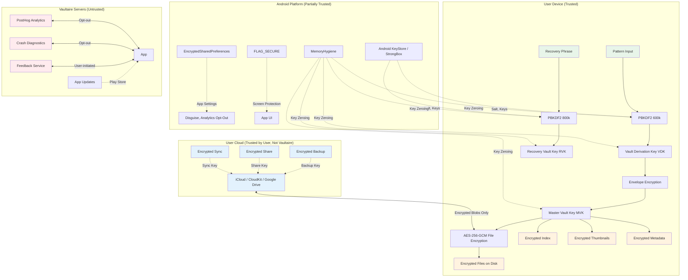

# Security Architecture — Product Owner Perspective

**Audience**: Product, Design, Leadership  
**Purpose**: Define the security positioning, trust model, and user-facing promises

---

## 1. Security Positioning & Trust Model

### The Vaultaire Promise

> **"Your files. Your keys. Our servers never see either."**

Vaultaire is a **zero-knowledge, local-first encrypted vault**. The security architecture is the product — not a feature. Every design decision flows from a single principle: **the provider (Vaultaire/Wraxle LLC) cannot decrypt user data under any normal circumstance**.

### Trust Boundaries

| Boundary | What Crosses | What NEVER Crosses | Enforcement |
|----------|--------------|-------------------|-------------|
| **Device ↔ Vaultaire Servers** | • Anonymous usage analytics (PostHog, opt-out)<br>• Crash diagnostics (opt-out)<br>• Google Play Install Referrer attribution token (opt-out)<br>• Feedback messages (user-initiated)<br>• App updates | • Pattern / secret phrase<br>• Vault keys (VDK, MVK, RVK, backup key)<br>• File content, metadata, thumbnails<br>• Recovery phrases<br>• Decrypted plaintext | Code audit, network monitoring, no server-side key storage |
| **Device ↔ Cloud (Google Drive / User's Cloud)** | • Encrypted backup blobs (AES-256-GCM)<br>• Encrypted share packages<br>• Encrypted sync records | • Any decryption key<br>• Pattern / phrase<br>• Readable file content | Client-side encryption before upload; Google Drive only sees ciphertext |
| **App Process ↔ OS (Android)** | • Encrypted file I/O<br>• KeyStore operations (salt, keys)<br>• Camera frames (encrypted in-process) | • Plaintext keys in SharedPreferences<br>• Plaintext files on disk<br>• Screen content in screenshots/recording | FLAG_SECURE, KeyStore/StrongBox, MemoryHygiene, EncryptedSharedPreferences |
| **User ↔ App** | • Pattern input (5×5 grid)<br>• Secret phrase entry<br>• Biometric unlock (future) | • Pattern/phrase in logs<br>• Keys in crash dumps | No logging of secrets; MemoryHygiene on lock; FLAG_SECURE |

### What "Zero-Knowledge" Means in Practice

| Scenario | Vaultaire Can Decrypt? | Why |
|----------|------------------------|-----|
| Law enforcement subpoena for user's vault | **No** | No keys, no pattern, no plaintext on servers |
| Vaultaire server breach | **No** | Servers only hold analytics, not vault data |
| Rogue Vaultaire employee | **No** | No architectural access to decryption keys |
| User loses device, has recovery phrase | **Yes (user only)** | Recovery phrase → RVK → recovery envelope → MVK |
| User forgets pattern, no recovery phrase | **Never** | No backdoor, no reset, no "forgot password" |

---

## 2. What Vaultaire Promises vs What Competitors Don't Do

| Capability | Vaultaire | Typical Competitor (1Password, Bitwarden, etc.) | Typical "Photo Vault" App |
|------------|-----------|--------------------------------------------------|---------------------------|
| **No account / email required** | ✅ | ❌ (account mandatory) | ⚠️ (often requires account) |
| **Local-only encryption (no cloud)** | ✅ (optional) | ❌ (cloud-first) | ⚠️ (often cloud backup forced) |
| **Provider cannot decrypt** | ✅ (architectural) | ⚠️ (some hold keys for sync) | ❌ (often hold keys) |
| **Pattern-based unlock (no typing)** | ✅ | ❌ | ✅ (common) |
| **Plausible deniability (hidden vaults)** | ✅ | ❌ | ❌ |
| **Duress mode (silent destruction)** | ✅ | ❌ | ❌ |
| **Secure camera (no Photos library)** | ✅ | ❌ | ⚠️ (some) |
| **App disguise (calculator icon)** | ✅ | ❌ | ✅ (some) |
| **Encrypted sharing (one-time phrase)** | ✅ | ⚠️ (account-based sharing) | ❌ |
| **Cross-device sync (user's cloud)** | ✅ (CloudKit/Drive) | ✅ (proprietary cloud) | ❌ |
| **Recovery phrase ≠ master key** | ✅ (separate key hierarchy) | ⚠️ (often same) | ❌ |
| **Per-file nonces (no deterministic ciphertext)** | ✅ | ✅ | ❌ (often ECB/CBC) |
| **Memory hygiene (key zeroing)** | ✅ | ⚠️ (rarely documented) | ❌ |
| **Analytics opt-out (granular)** | ✅ | ⚠️ (often all-or-nothing) | ❌ |
| **Open cryptographic specification** | ✅ (this doc) | ❌ | ❌ |

### Competitive Differentiators (Moat)

1. **No Account Required** — Zero friction, zero identity linkage, zero credential stuffing surface
2. **Plausible Deniability + Duress** — Unique in consumer market; addresses coercion threat model
3. **Architectural Zero-Knowledge** — Not a policy; enforced by cryptography (no server-held keys)
4. **Pattern + Phrase Dual Unlock** — Usability (pattern) + Recovery (phrase) with separate key derivations
5. **Open Spec** — Security researchers can verify claims without reverse engineering

---

## 3. User-Facing Security Features Summary

| Feature | User Value | Technical Basis |
|---------|------------|-----------------|
| **Pattern Encryption** | Draw a shape; no keyboard, no shoulder-surfing typing | PBKDF2-HMAC-SHA512 (600k) + device salt → VDK → wraps MVK |
| **Secret Phrase (Recovery)** | 12-word backup; works on new device without pattern | PBKDF2-HMAC-SHA512 (800k) + device salt → RVK → recovery envelope |
| **Plausible Deniability** | Multiple vaults; no UI shows "vault picker" | Separate `.vlt` files per pattern; no cross-vault index |
| **Hidden Vaults** | Files don't reveal vault membership | Encrypted indexes; filenames on disk are opaque |
| **Duress Mode** | Coercion → unlock decoy, real vaults silently wiped | Special pattern triggers `purgeNonDecoyVaultFiles()` |
| **Encrypted Google Drive Backup** | Restore on new device; Google can't read | Pattern-derived backup key (separate!) + padded buckets |
| **Secure Sharing** | Read-only vault via one-time phrase; expires, count-limited | 12-word phrase → share key (250k PBKDF2); policy in AAD; transport via Google Drive / Nearby Share / QR |
| **Device Sync** | Same vault on phone + tablet via user's cloud | Encrypted sync records in Google Drive |
| **Secure Camera** | Photos/videos never hit Photos library | CameraX → `EncryptedOutputStream` directly |
| **App Disguise** | Icon looks like Calculator/Printer/Notes/etc. | Alias activities; Pro feature |

---

## 4. No Account / Email Requirement — Deep Dive

### Why This Matters

| Threat | With Account | Without Account (Vaultaire) |
|--------|--------------|----------------------------|
| Credential stuffing | ✅ Vulnerable | ✅ Impossible |
| Password database breach | ✅ Exposes vault access | ✅ No passwords exist |
| Email enumeration | ✅ Confirms user exists | ✅ No email collected |
| Account takeover (SIM swap, phishing) | ✅ Possible | ✅ No account to take over |
| Legal subpoena for user list | ✅ Gets all users | ✅ No user list exists |
| Marketing / tracking linkage | ✅ Easy | ✅ No identity to link |

### Implementation Requirements

- **No signup flow** — App opens directly to pattern setup
- **No "forgot pattern" via email** — Only recovery phrase works
- **No cloud identity** — Sync/backup uses user's own Google account (Google Drive), not Vaultaire's
- **Analytics are anonymous** — Random install ID, no PII

---

## 5. Analytics / Crash Diagnostics Opt-Out

### Current Website Claim (Adapted for Android)
> "Anonymous usage and crash data go to PostHog by default, and you can turn them off in Settings. If you send feedback, our feedback service receives your message, the optional reply email, your language and the app version. While analytics are on, a Google Play Install Referrer attribution token and a random install ID pass through our service to Google Play."

### Required Implementation (Android)

| Component | Requirement |
|-----------|-------------|
| **PostHog SDK** | Integrated with opt-out flag in `EncryptedSharedPreferences` / `DataStore` |
| **Crash Reporting** | Separate opt-out (can keep crashes on, analytics off) |
| **Google Play Install Referrer API** | Attribution token handling (Android equivalent of Apple Ads) |
| **Settings UI** | Two toggles: "Usage Analytics" + "Crash Diagnostics" |
| **Network Layer** | Zero telemetry if both off; no background uploads |
| **Feedback** | Explicit user action; email optional; no auto-include logs |

### Privacy-by-Design Checklist

- [ ] No PII in analytics events (no file names, counts, vault IDs)
- [ ] No pattern/phrase/keystrokes ever logged
- [ ] Crash dumps scrubbed of memory containing keys
- [ ] Opt-out respected immediately (no "phone home on next launch")
- [ ] Data retention policy documented (e.g., 90 days)

---

## 6. Trust Boundary Summary Diagram



**Legend**: 🟢 User-controlled secrets | 🟡 Encrypted data at rest | 🔴 Vaultaire servers (no keys) | 🔵 User's cloud (ciphertext only)

---

## 6.5. Android Transport Layer Design (Sharing, Backup, Sync)

Since Vaultaire on Android cannot use iCloud/CloudKit, all cloud-based features use **Google Drive** as the primary transport, with **Nearby Share** and **QR codes** as alternatives for sharing.

### Secure Sharing — Android Transport Options

| Transport Method | How It Works | Pros | Cons | Implementation Priority |
|------------------|--------------|------|------|------------------------|
| **Google Drive (Primary)** | Sender uploads encrypted share package to their Drive, creates shareable link. Recipient opens link → imports into Vaultaire. | Works async, cross-platform, large files, revocable (delete file) | Requires Google account + Drive permission | **P0** |
| **Nearby Share (Peer-to-Peer)** | Sender creates hotspot/Bluetooth connection, transfers encrypted package directly. | No cloud, offline-capable, fast for large files | Both devices nearby, Android 6+ only | **P1** |
| **QR Code + File Share Intent** | Sender generates QR with share phrase + metadata. Recipient scans → Vaultaire opens → downloads from Drive or receives via Nearby. | Works for small metadata, human-verifiable | QR limited capacity; still needs transport for payload | **P1** (complement) |

#### Sharing Flow (Google Drive Primary)

```
Sender (Pro)                          Recipient (Free)
    │                                      │
    ├─ 1. Create share package             │
    │    (AES-GCM + policy AAD)            │
    ├─ 2. Upload to Google Drive           │
    │    (app-specific folder,              │
    │     encrypted filename)              │
    ├─ 3. Generate share link +            │
    │    12-word phrase                    │
    │                                      │
    │         ┌────────────────────────┐   │
    │         │ Share via:             │   │
    │         │ • System share sheet   │   │
    │         │ • QR code (phrase+URL) │   │
    │         │ • Nearby Share         │   │
    │         └────────────────────────┘   │
    │                    │                 │
    ▼                    ▼                 ▼
    │              Receives link + phrase  │
    │              Opens in Vaultaire      │
    │              Downloads from Drive    │
    │              Unpacks with phrase     │
    │              Enforces policy         │
    │              (exp, count, no-export) │
```

#### "Pro to Create, Free to Open" on Android

| Role | Requirement | Capability |
|------|-------------|------------|
| **Sender (Creator)** | Vaultaire Pro + Google Drive connected | Create shares, set policies, revoke (delete from Drive) |
| **Recipient** | Vaultaire Free + Google Drive access (for Drive transport) | Open shares, view read-only, export if allowed by policy |

> **Note**: Unlike iOS where "iCloud sign-in" is implied, on Android the recipient needs **Google Drive access** (signed into Google Play Services with Drive scope) to download the share package. Nearby Share works without Drive.

### Encrypted Backup — Google Drive Transport

| Aspect | Design |
|--------|--------|
| **Storage Location** | Google Drive "App Data Folder" (hidden from user, per-app quota) or user-visible "Vaultaire Backups" folder |
| **Authentication** | Google Sign-In + Drive scope (`https://www.googleapis.com/auth/drive.appdata` or `drive.file`) |
| **Backup Key** | Derived from pattern + device salt (PBKDF2 600k) — **separate from MVK** |
| **Format** | Padded buckets (64KB → 10MB → +10MB increments) — same as iOS spec |
| **Schedule** | Immediate on change / Wi-Fi only / Daily / Manual (user configurable) |
| **Restore** | New device → Google Sign-In → download latest backup → enter pattern → derive BK → decrypt |

### Device Sync — Google Drive Transport

| Aspect | Design |
|--------|--------|
| **Sync Engine** | Google Drive "App Data Folder" for encrypted sync records |
| **Conflict Resolution** | Last-writer-wins per record (timestamp-based); MVK never changes so no key conflicts |
| **Sync Records** | Encrypted with Sync Key (derived from MVK or separate) |
| **Offline Support** | Local queue → sync when online |
| **Multi-device** | Phone + Tablet + Chromebook (if Android apps supported) |

### Transport Security Invariants (All Methods)

1. **Encryption before transport** — Payload encrypted client-side with share/backup/sync key BEFORE leaving app
2. **Keys never leave device** — Share phrase entered by user; backup key derived from pattern; sync key derived from MVK
3. **Transport sees only ciphertext** — Google Drive / Nearby / QR only carry encrypted blobs
4. **Revocation = deletion** — Delete from Drive → share inaccessible; no server-side revocation needed
5. **Metadata minimization** — Drive filenames are random UUIDs; no vault names, file counts in Drive metadata

---

## 7. Security Positioning Statement (Marketing-Ready)

> **Vaultaire is the only encrypted vault that:**
> - Requires **no account, no email, no identity** — ever
> - Gives **you** the only keys — our architecture **mathematically prevents** us from decrypting your data
> - Offers **plausible deniability** (hidden vaults) and **duress mode** (silent wipe) for coercion scenarios
> - Lets you **backup to your own cloud** (iCloud/Google Drive) with a **separate backup key** — not your vault key
> - Lets you **share securely** with a one-time phrase that expires and enforces read-only/no-export policies
> - **Shows its work** — full cryptographic specification published for audit
> - **Respects your privacy** — analytics and crash reporting are **opt-out, granular, and anonymous**

---

## 8. Risks & Mitigations (Product View)

| Risk | Likelihood | Impact | Mitigation |
|------|------------|--------|------------|
| User forgets pattern + no recovery phrase | Medium | Data loss (by design) | Prominent recovery phrase setup flow; QR code export |
| Weak pattern (low entropy) | High | Brute-force feasible | Pattern strength meter; minimum 6 points enforced |
| Device compromise (root/malware) | Low | Full vault access while unlocked | FLAG_SECURE, MemoryHygiene, KeyStore; document threat model |
| Backup key == vault key (current bug) | — | Backup breach = vault breach | **Fix: derive separate backup key from pattern** |
| Recovery iterations too low (300k vs 800k) | — | Weaker than marketed | **Fix: match 800k iterations** |
| Salt in SharedPreferences (not KeyStore) | — | Salt extractable on rooted device | **Fix: move to Android KeyStore/StrongBox** |
| No FLAG_SECURE implemented | — | Screenshots/recordings leak content | **Fix: add to all vault activities** |
| Analytics opt-out not implemented | — | Privacy claim unverifiable | **Fix: implement PostHog + opt-out UI** |
| No Google Drive transport for sharing/backup/sync | — | Cloud features non-functional | **Fix: implement Drive transport layer** |
| No Nearby Share / QR fallback for sharing | — | Sharing limited to Drive users | **Fix: add peer-to-peer + QR transport** |

---

## 9. Success Metrics (Security KPIs)

| Metric | Target | Measurement |
|--------|--------|-------------|
| % users setting recovery phrase | > 80% | Analytics event (opt-in) |
| % users enabling analytics opt-out | > 30% | Settings toggle state |
| Zero server-side key exposure incidents | 0 | Incident tracking |
| Cryptographic audit findings (critical) | 0 | Annual third-party audit |
| Time to rotate keys on pattern change | < 2s | Performance test |
| Memory key retention after lock | 0 bytes | Memory dump test |
| FLAG_SECURE coverage | 100% of vault screens | Automated UI test |
| Share creation → recipient open (Drive) | < 30s | E2E test |
| Share creation → recipient open (Nearby) | < 10s | E2E test |
| Backup upload (100MB) on Wi-Fi | < 60s | Performance test |
| Sync convergence (2 devices) | < 10s | E2E test |

---

## 10. Open Questions for Product

1. **Biometric unlock** — Face ID / Fingerprint as pattern alternative? Requires Android BiometricPrompt + key wrapping
2. **Auto-lock timeout** — Configurable? Default 1 min / 5 min / never?
3. **Shake to lock / emergency lock** — Panic gesture?
4. **Decoy vault pre-population** — Auto-fill with plausible files on duress?
5. **Backup schedule** — Immediate / Wi-Fi only / daily / manual?
6. **Share expiration defaults** — 24h / 7d / 30d / never?
7. **Analytics default** — On or off by default? (Website says "on by default, can turn off")
8. **Share transport default** — Google Drive / Nearby Share / QR? (Drive primary, others fallback?)
9. **Drive folder visibility** — App Data Folder (hidden) vs user-visible "Vaultaire" folder?
10. **Sync conflict UI** — Show conflicts or auto-resolve (LWW)?
11. **Nearby Share discovery** — Show nearby Vaultaire users or manual "share to nearby"?